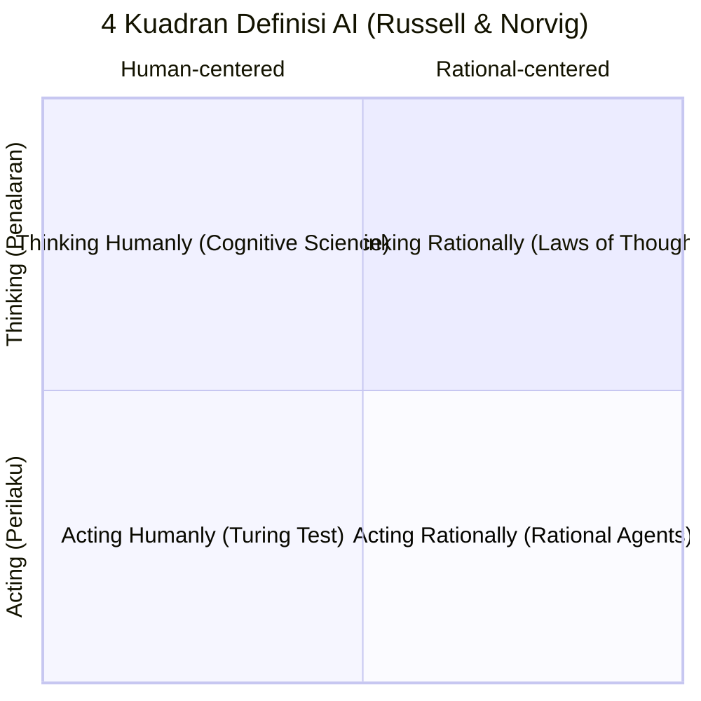
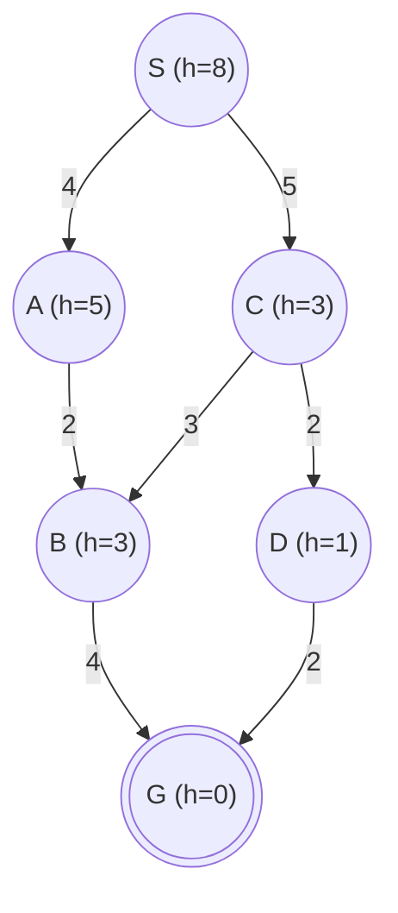
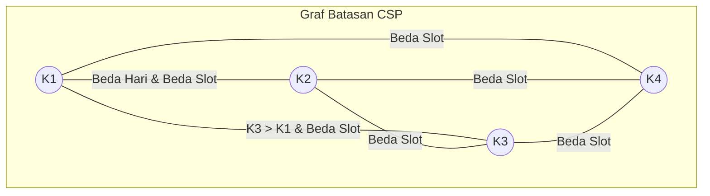

---
tags:
  - ai
  - uts
  - soal-pembahasan
  - intelligent-agents
  - search-algorithms
  - csp
  - propositional-logic
  - first-order-logic
created: 2026-10-12
title: "Soal dan Pembahasan Lengkap UTS Kecerdasan Buatan Genap 2025/2026"
source: "Ujian Tengah Semester Genap 2025/2026 KEB1222 (Kode Dosen: MKD & KPR)"
---

# Soal & Pembahasan UTS Kecerdasan Buatan (Genap 2025/2026)

> [!summary] Informasi Ujian
> - **Mata Kuliah**: KEB1222 Kecerdasan Buatan (Program Studi S1 Kecerdasan Buatan)
> - **Semester**: Genap 2025/2026
> - **Waktu**: 120 Menit | Sifat: Catatan Tertutup (*Closed Book*)
> - **Kode Dosen**: MKD (Bagian 1-3) & KPR (Bagian CSP, Logic, FOL)
> - **Master Navigasi**: [[00 - MOC AI UTS|00 - MOC AI UTS (Map of Content)]]

---

# BAGIAN 1: KODE DOSEN MKD

---

## Soal 1. Pendahuluan Artificial Intelligence (Bobot: 15)

> [!question] Pertanyaan
> Di dalam Buku *"Artificial Intelligence A Modern Approach"* karangan Russell dan Norvig, definisi Kecerdasan Buatan (*Artificial Intelligence*) secara umum dapat dikelompokkan ke dalam 4 kategori. Jelaskan definisi *Artificial Intelligence* berdasarkan keempat kategori tersebut!

### Pembahasan & Jawaban:
Russell & Norvig mengelompokkan definisi AI ke dalam matriks 2 dimensi berdasarkan dua kriteria:
1. **Fokus dimensi**: Proses berpikir dan penalaran (*Reasoning/Thinking*) vs. Perilaku lahiriah (*Behavior/Acting*).
2. **Tolok ukur**: Kesesuaian dengan manusia (*Human-like performance*) vs. Rasionalitas ideal (*Ideal/Rational performance*).

| Dimensi | Berpikir (*Thinking*) | Bertindak (*Acting*) |
| :--- | :--- | :--- |
| **Seperti Manusia (*Human-like*)** | **Thinking Humanly**: Pendekatan Pemodelan Kognitif (*Cognitive Science*) | **Acting Humanly**: Uji Turing (*The Turing Test Approach*) |
| **Secara Rasional (*Rational*)** | **Thinking Rationally**: Hukum Pemikiran Logis (*The Laws of Thought / Logic*) | **Acting Rationally**: Pendekatan Agen Rasional (*The Rational Agent Approach*) |

#### Penjelasan 4 Kategori:

1. **Acting Humanly (Bertindak Seperti Manusia) — Pendekatan Uji Turing (*The Turing Test*)**
   - **Konsep**: Diusulkan oleh Alan Turing (1950). Mesin dikatakan cerdas jika perilakunya tidak dapat dibedakan dari manusia oleh seorang penguji manusia melalui percakapan teks jarak jauh.
   - **Kapabilitas Kunci**: Membutuhkan *Natural Language Processing* (NLP), *Knowledge Representation*, *Automated Reasoning*, dan *Machine Learning*. Jika melibatkan fisik (*Total Turing Test*), membutuhkan *Computer Vision* dan *Robotics*.

2. **Thinking Humanly (Berpikir Seperti Manusia) — Pendekatan Pemodelan Kognitif (*Cognitive Modeling*)**
   - **Konsep**: Menentukan bagaimana pikiran dan otak manusia bekerja sebenarnya, kemudian mengekspresikan teori tersebut ke dalam program komputer.
   - **Metode**: Menggunakan pendekatan multidisiplin *Cognitive Science* melalui introspeksi alur berpikir, eksperimen psikologis, serta pemindaian aktivitas otak (*brain imaging* seperti fMRI/EEG).

3. **Thinking Rationally (Berpikir Rasional) — Pendekatan Hukum Pemikiran (*The Laws of Thought*)**
   - **Konsep**: Berakar dari logika silogisme Aristoteles. Menekankan pola penalaran deduktif formal yang tidak terbantahkan: jika premis benar, maka kesimpulan logis yang dihasilkan pasti benar.
   - **Karakteristik**: Memodelkan dunia ke dalam sistem logika formal (proposisional / first-order logic) dan menjalankan inferensi matematis untuk mencapai solusi yang sahih secara logis.

4. **Acting Rationally (Bertindak Rasional) — Pendekatan Agen Rasional (*The Rational Agent Approach*)**
   - **Konsep**: Pendekatan standar AI modern. Agen rasional adalah entitas yang bertindak untuk mencapai hasil terbaik, atau jika ada ketidakpastian, memaksimalkan ekspektasi hasil (*maximize expected utility / performance measure*) berdasarkan bukti dari riwayat persepsinya.
   - **Keunggulan**: Lebih umum daripada *thinking rationally* (karena mencakup refleks cepat tanpa inferensi panjang) dan memiliki landasan matematika yang lebih kokoh dibanding sekadar meniru keterbatasan manusia.

*Referensi materi*: [[Week 01 - Pengantar Kecerdasan Buatan (Intro to AI)]]

---

## Soal 2. Intelligent Agents (Bobot: 20)

### A. Benar (B) / Salah (S) Karakteristik Lingkungan & Agen

> [!question] Instruksi
> Untuk beberapa pernyataan di bawah ini, tentukan apakah pernyataan tersebut Benar (B) atau Salah (S) dan berikan alasan singkat terkait jawaban Anda!

| No. | Pernyataan | Benar (B) / Salah (S) | Penjelasan Singkat |
| :---: | :--- | :---: | :--- |
| **(a)** | Terdapat sebuah *task environment* di mana *agent* harus mempertimbangkan riwayat aksi sebelumnya. Lingkungan tersebut termasuk *episodic environment*. | **S** | Pada *episodic environment*, setiap episode terbagi mandiri dan aksi saat ini tidak mempengaruhi masa depan. Lingkungan yang mengharuskan mempertimbangkan riwayat aksi masa lalu / berdampak ke depan adalah **sequential environment**. |
| **(b)** | Terdapat sebuah *task environment* di mana *agent* memilih aksi hanya untuk mencapai tujuan tanpa mempertimbangkan tingkat kepuasan. *Agent* tersebut termasuk *utility-based agent*. | **S** | Agen yang hanya memilih aksi demi mencapai tujuan tanpa mengukur derajat kepuasan/kebahagiaan adalah **goal-based agent**. *Utility-based agent* secara eksplisit memetakan status ke nilai numerik kepuasan (*utility function*) untuk memilih jalur terbaik. |
| **(c)** | Terdapat sebuah *task environment* di mana *agent* menyimpan informasi masa lalu untuk mengatasi keterbatasan observasi. *Agent* tersebut termasuk *model-based agent*. | **B** | *Model-based agent* memelihara *internal state* (memori masa lalu dan pengetahuan bagaimana dunia berevolusi) untuk merekonstruksi aspek lingkungan yang tidak dapat diamati secara langsung pada lingkungan *partially observable*. |
| **(d)** | Terdapat *task environment* di mana *simple reflex agent* dapat selalu bertindak *rational*. | **B** | *Simple reflex agent* dapat bertindak rasional sempurna jika lingkungannya bersifat **fully observable**, di mana persepsi instan saat ini sudah memuat informasi lengkap untuk pengambilan keputusan optimal. |
| **(e)** | *Task environments* untuk permainan catur dengan jam (*clock*) adalah *fully observable*, *multi-agent*, *episodic*, *semi static* dan *discrete*. | **S** | Catur bersifat **sequential** (bukan *episodic*), karena langkah bidak saat ini secara kritis mempengaruhi kondisi permainan di langkah berikutnya. (Meskipun sifat *fully observable*, *multi-agent*, *semi-static*, dan *discrete* bernilai benar, keberadaan kata *episodic* membuat pernyataan keseluruhan menjadi Salah). |

---

### B. Analisis PEAS Drone Cerdas Greenhouse

> [!question] Skenario Kasus
> Sebuah drone cerdas (*intelligent drone*) berbasis AI digunakan di dalam *greenhouse* untuk mengenali bunga yang siap diserbuki. Jika bunga yang terdeteksi sesuai kriteria, drone akan melakukan penyerbukan secara otomatis.
> Lengkapilah komponen PEAS berikut dengan **2 indikator utama** pada setiap komponen!

| Komponen PEAS | No. | Indikator Utama | Penjelasan |
| :--- | :---: | :--- | :--- |
| **Performance (P)** *(Ukuran Kinerja)* | 1. | **Tingkat Keberhasilan Penyerbukan** | Persentase bunga siap serbuk yang berhasil diserbuki secara akurat dan tepat pada putik tanpa merusak mahkota. |
| | 2. | **Efisiensi Operasional & Energi** | Waktu yang dibutuhkan per luasan area greenhouse serta minimalisasi konsumsi baterai drone per siklus terbang. |
| **Environment (E)** *(Lingkungan Tugas)* | 1. | **Struktur Fisik Greenhouse** | Lorong bedengan tanaman, tiang penyangga, jaring paranet, kabel instalasi, serta variasi suhu/kelembaban/angin internal. |
| | 2. | **Populasi Tanaman & Bunga** | Bunga-bunga target dalam berbagai fase mekar/kematangan, daun penutup, dan serangga alami di sekitar tanaman. |
| **Actuators (A)** *(Aktuator / Penggerak)* | 1. | **Motor Rotor / Baling-Baling Drone** | Penggerak multi-rotor untuk manuver penerbangan 3 dimensi (*hovering*, maju, mundur, naik-turun dengan presisi mikro). |
| | 2. | **Aplikator Penyerbuk Mekanis / Nozzle Semprot** | Lengan mekanik mini berkuas lembut atau dispenser mikro untuk melepaskan serbuk sari tepat sasaran. |
| **Sensors (S)** *(Sensor Masukan)* | 1. | **Kamera Visual RGB Resolusi Tinggi / Multispektral** | Sensor optik untuk deteksi visual warna, tekstur, bentuk nektar, dan klasifikasi kematangan bunga siap serbuk. |
| | 2. | **Sensor Jarak / Kedalaman (LiDAR, ToF, atau Ultrasonik)** | Sensor pengukur jarak presisi tinggi terhadap rintangan dedaunan/batang dan untuk stabilisasi jarak penyerbukan. |

*Referensi materi*: [[Week 02 - Agen Cerdas dan Lingkungan (Intelligent Agents)]]

---

## Soal 3. Uninformed and Informed Search Strategies (Bobot: 20)

> [!question] Deskripsi Masalah
> Perhatikan *state search graph* berikut. Cost per langkah (*step costs*) dituliskan bersebelahan dengan setiap arc. Nilai heuristik diberikan bersebelahan dengan setiap node sebagai $h=x$. Successors dikembalikan dalam urutan *left-to-right*:
> - Anak dari $S$ adalah $(A, C)$
> - Anak dari $A$ adalah $(B)$
> - Anak dari $C$ adalah $(B, D)$
> - Anak dari $B$ adalah $(G)$
> - Anak dari $D$ adalah $(G)$
> 
> Mulai dari start node $S$ dan berakhir di goal node $G$.
> Tentukan **Order of Expansion**, **Path Found**, dan **Cost Path Found** untuk masing-masing strategi pencarian!

### Diagram State Space Graph:

#### Ringkasan Parameter Graf:
- **Biaya Busur ($c$)**:
  - $S \to A = 4$
  - $S \to C = 5$
  - $A \to B = 2$
  - $C \to B = 3$
  - $C \to D = 2$
  - $B \to G = 4$
  - $D \to G = 2$
- **Heuristik ($h$)**:
  - $h(S) = 8, h(A) = 5, h(B) = 3, h(C) = 3, h(D) = 1, h(G) = 0$

---

### Penelusuran Langkah Tiap Algoritma:

#### 1. Depth First Search (DFS) *(Contoh pada soal)*
- Mulai $S$. Anak: $A, C$. Pilih paling kiri: $A$.
- Dari $A$, anak: $B$.
- Dari $B$, anak: $G$. Goal ditemukan!
- **Order of Expansion**: `S-A-B-G`
- **Path Found**: `S-A-B-G`
- **Cost**: $4 + 2 + 4 = 10$.

#### 2. Breadth First Search (BFS)
- Antrean FIFO (*First-In First-Out*):
  1. Expand $S \to$ Masukkan anak ke antrean: $[A, C]$.
  2. Pop $A \to$ Expand $A$, masukkan anak: $B$ (via jalur $S\text{-}A\text{-}B$). Antrean: $[C, B]$.
  3. Pop $C \to$ Expand $C$, anak: $B, D$. Masukkan $D$ (karena $B$ sudah ada di antrean). Antrean: $[B, D]$.
  4. Pop $B$ (jalur $S\text{-}A\text{-}B$) $\to$ Expand $B$, menghasilkan suksesor $G$. Goal $G$ ditemukan!
- **Order of Expansion**: `S-A-C-B-G` *(atau `S-A-C-B` saat goal test pada generasi)*
- **Path Found**: `S-A-B-G`
- **Cost**: $4 + 2 + 4 = 10$.

#### 3. Uniform Cost Search (UCS)
- Antrean Prioritas diurutkan berdasarkan biaya riil terkecil $g(n)$:
  1. Pop $S$ ($g=0$) $\to$ Masukkan $A (g=4)$ dan $C (g=5)$.
  2. Pop $A$ ($g=4$) $\to$ Masukkan $B (g=4+2=6$, via $S\text{-}A\text{-}B$). Antrean: $C(g=5), B(g=6)$.
  3. Pop $C$ ($g=5$) $\to$ Suksesor $B(g=5+3=8$, diabaikan karena $g=6$ lebih murah) dan $D(g=5+2=7$, via $S\text{-}C\text{-}D$). Antrean: $B(g=6), D(g=7)$.
  4. Pop $B$ ($g=6$) $\to$ Suksesor $G(g=6+4=10$, via $S\text{-}A\text{-}B\text{-}G$). Antrean: $D(g=7), G(g=10)$.
  5. Pop $D$ ($g=7$) $\to$ Suksesor $G(g=7+2=9$, via $S\text{-}C\text{-}D\text{-}G$). Perbarui nilai $G$ menjadi lebih murah ($g=9$). Antrean: $G(g=9)$.
  6. Pop $G$ ($g=9$) $\to$ Goal test sukses saat di-pop!
- **Order of Expansion**: `S-A-C-B-D-G`
- **Path Found**: `S-C-D-G`
- **Cost**: $5 + 2 + 2 = 9$.

#### 4. Greedy (Best-First) Search
- Antrean Prioritas diurutkan murni berdasarkan heuristik terkecil $h(n)$:
  1. Pop $S$ ($h=8$) $\to$ Suksesor $A(h=5)$ dan $C(h=3)$.
  2. Pop $C$ ($h=3$) $\to$ Suksesor $B(h=3)$ dan $D(h=1)$. Antrean: $D(h=1), B(h=3), A(h=5)$.
  3. Pop $D$ ($h=1$) $\to$ Suksesor $G(h=0)$. Antrean: $G(h=0), B(h=3), A(h=5)$.
  4. Pop $G$ ($h=0$) $\to$ Goal test sukses!
- **Order of Expansion**: `S-C-D-G`
- **Path Found**: `S-C-D-G`
- **Cost**: $5 + 2 + 2 = 9$.

#### 5. A\* Search
- Antrean Prioritas diurutkan berdasarkan $f(n) = g(n) + h(n)$:
  1. Pop $S$ ($g=0, h=8 \implies f=8$) $\to$
     - $C: g=5, h=3 \implies f=8$ (jalur $S\text{-}C$)
     - $A: g=4, h=5 \implies f=9$ (jalur $S\text{-}A$)
     - Antrean: $[C(f=8), A(f=9)]$.
  2. Pop $C$ ($f=8$) $\to$
     - $D: g=7, h=1 \implies f=8$ (jalur $S\text{-}C\text{-}D$)
     - $B: g=8, h=3 \implies f=11$ (jalur $S\text{-}C\text{-}B$)
     - Antrean: $[D(f=8), A(f=9), B(f=11)]$.
  3. Pop $D$ ($f=8$) $\to$
     - $G: g=9, h=0 \implies f=9$ (jalur $S\text{-}C\text{-}D\text{-}G$)
     - Antrean: $[A(f=9), G(f=9), B(f=11)]$.
  4. Node $A$ dan $G$ memiliki $f=9$. Dengan tie-breaking nilai $h$ terendah ($h(G)=0 < h(A)=5$), $G$ langsung di-pop:
     - Pop $G$ ($f=9$) $\to$ Goal test sukses!
     *(Catatan: Jika tie-breaking memprioritaskan node lebih awal / urutan kiri, node $A$ di-pop terlebih dahulu $\to B(f=9)$, lalu $G$ di-pop, menghasilkan order `S-C-D-A-G`)*.
- **Order of Expansion**: `S-C-D-G` *(atau `S-C-D-A-G`)*
- **Path Found**: `S-C-D-G`
- **Cost**: $5 + 2 + 2 = 9$.

---

### Jawaban Tabel 1 Lengkap:

| Search Strategy | Order of Expansion | Path Found | Cost Path Found |
| :--- | :---: | :---: | :---: |
| **Depth First Search** | S-A-B-G | S-A-B-G | 10 |
| **Breath First Search** | S-A-C-B-G | S-A-B-G | 10 |
| **Uniform Cost Search** | S-A-C-B-D-G | S-C-D-G | 9 |
| **Greedy (Best-First) Search** | S-C-D-G | S-C-D-G | 9 |
| **A\* Search** | S-C-D-G | S-C-D-G | 9 |

> [!check] Pertanyaan Tambahan
> **Dari semua strategi, strategi manakah yang menghasilkan cost path found terendah?**
> **Jawaban**:
> Terdapat 3 strategi yang menghasilkan cost path found terendah (Cost = **9**), yaitu:
> 1. **Uniform Cost Search (UCS)**
> 2. **Greedy (Best-First) Search**
> 3. **A\* Search**

*Referensi materi*: [[Week 03 - Uninformed Search Strategies]] & [[Week 04 - Informed (Heuristic) Search Strategies]]

---
---

# BAGIAN 2: KODE DOSEN KPR

---

## Soal 1. Constraint Satisfaction Problem (CSP)

> [!question] Deskripsi Masalah
> Empat kelompok mahasiswa ($K_1, K_2, K_3$ dan $K_4$) akan melakukan presentasi dalam 2 hari yaitu hari Senin dan Selasa. Setiap hari memiliki 2 sesi yaitu sesi pagi dan sesi siang, sehingga total terdapat 4 sesi waktu.
> Beberapa hal yang perlu dipertimbangkan dalam penjadwalan adalah:
> - Kelompok $K_1$ dan $K_2$ tidak boleh presentasi pada hari yang sama.
> - $K_3$ harus dijadwalkan setelah $K_1$.
> - Tidak boleh ada dua kelompok dalam slot waktu yang sama.
> 
> **a. Tentukan:**
> (i). Variabel;
> (ii). Domain; dan
> (iii). Constraint (eksplisit).
> 
> **b. Tentukan solusi penjadwalan menggunakan pendekatan:**
> (i). Backtracking.
> (ii). Backtracking + Forward checking.
> *(Tuliskan langkah per langkahnya secara sistematis sehingga jelas perbedaan antara kedua pendekatan tersebut).*

### Penyelesaian:

#### Pengkodean Slot Waktu:
Urutan 4 slot waktu secara kronologis:
- $1 =$ Senin Pagi
- $2 =$ Senin Siang
- $3 =$ Selasa Pagi
- $4 =$ Selasa Siang

---

### a. Formulasi CSP $\langle X, D, C \rangle$

#### (i). Variabel ($X$)
$$X = \{K_1, K_2, K_3, K_4\}$$
Di mana variabel $K_i$ menyatakan waktu sesi presentasi untuk kelompok ke-$i$.

#### (ii). Domain ($D$)
Untuk setiap variabel $K_i \in X$:
$$D_i = \{1, 2, 3, 4\}$$
Atau dinyatakan:
$$D = \{\text{Senin Pagi}, \text{Senin Siang}, \text{Selasa Pagi}, \text{Selasa Siang}\}$$

#### (iii). Constraint / Batasan (Eksplisit)
1. **Tidak ada slot yang sama (Alldiff)**:
   $$K_i \ne K_j \quad \forall i \ne j$$
   Secara himpunan pasangan biner eksplisit:
   $K_1 \ne K_2, \quad K_1 \ne K_3, \quad K_1 \ne K_4, \quad K_2 \ne K_3, \quad K_2 \ne K_4, \quad K_3 \ne K_4$.

2. **$K_1$ dan $K_2$ tidak boleh pada hari yang sama**:
   - Jika $K_1 \in \{1, 2\}$ (Senin), maka $K_2 \in \{3, 4\}$ (Selasa).
   - Jika $K_1 \in \{3, 4\}$ (Selasa), maka $K_2 \in \{1, 2\}$ (Senin).
   - Pasangan dilarang: $(K_1, K_2) \notin \{(1,1), (1,2), (2,1), (2,2), (3,3), (3,4), (4,3), (4,4)\}$.

3. **$K_3$ harus dijadwalkan setelah $K_1$**:
   $$K_3 > K_1$$
   (Waktu pelaksanaan $K_3$ secara urutan kronologis harus lebih besar dari $K_1$).

---

### b. Langkah Sistematis Pencarian Solusi

Urutan variabel: $K_1, K_2, K_3, K_4$.
Urutan pencobaan nilai domain: $1, 2, 3, 4$.

---

#### (i). Pendekatan Backtracking Search (Murni)
*Karakteristik*: Pengecekan batasan dilakukan secara reaktif hanya terhadap variabel yang sudah di-assign. Domain variabel yang belum di-assign **tidak disaring di awal**.

1. **Pilih variabel $K_1$**:
   - Coba $K_1 = 1$ (Senin Pagi).
   - Konsisten (belum ada penugasan sebelumnya).
   - *Status saat ini*: $\{K_1 = 1\}$.

2. **Pilih variabel $K_2$**:
   - Coba $K_2 = 1$: **Konflik** dengan $K_1 = 1$ (slot sama & hari sama).
   - Coba $K_2 = 2$: **Konflik** dengan $K_1 = 1$ (sama-sama hari Senin).
   - Coba $K_2 = 3$ (Selasa Pagi): Beda hari dengan $K_1$, slot beda. **Konsisten**.
   - *Status saat ini*: $\{K_1 = 1, K_2 = 3\}$.

3. **Pilih variabel $K_3$**:
   - Coba $K_3 = 1$: **Konflik** slot sama dengan $K_1$ dan melanggar batasan $K_3 > K_1$.
   - Coba $K_3 = 2$ (Senin Siang):
     - Slot berbeda dengan $K_1=1$ dan $K_2=3$.
     - Memenuhi batasan $K_3 > K_1$ ($2 > 1$). **Konsisten**.
   - *Status saat ini*: $\{K_1 = 1, K_2 = 3, K_3 = 2\}$.

4. **Pilih variabel $K_4$**:
   - Coba $K_4 = 1$: **Konflik** slot sama dengan $K_1$.
   - Coba $K_4 = 2$: **Konflik** slot sama dengan $K_3$.
   - Coba $K_4 = 3$: **Konflik** slot sama dengan $K_2$.
   - Coba $K_4 = 4$ (Selasa Siang): Tidak berkonflik dengan variabel manapun. **Konsisten**.
   - *Status saat ini*: $\{K_1 = 1, K_2 = 3, K_3 = 2, K_4 = 4\}$.

**Solusi Lengkap Backtracking**:
- $K_1 = 1$ (Senin Pagi)
- $K_2 = 3$ (Selasa Pagi)
- $K_3 = 2$ (Senin Siang)
- $K_4 = 4$ (Selasa Siang)

---

#### (ii). Pendekatan Backtracking + Forward Checking (FC)
*Karakteristik*: Setiap kali sebuah variabel di-assign nilai, algoritma langsung melakukan propagasi ke depan dengan **memangkas nilai yang tidak kompatibel dari domain seluruh variabel tetangga yang belum terpasang**. Jika ada domain tetangga menjadi kosong ($\emptyset$), segera lakukan backtrack.

- **Status Awal Domain**:
  $$D(K_1) = \{1, 2, 3, 4\}, \quad D(K_2) = \{1, 2, 3, 4\}, \quad D(K_3) = \{1, 2, 3, 4\}, \quad D(K_4) = \{1, 2, 3, 4\}$$

- **Langkah 1: Assign $K_1 = 1$ (Senin Pagi)**
  - Lakukan Forward Checking ke tetangga yang belum di-assign:
    - Ke $K_2$: Hapus slot hari Senin ($\{1, 2\}$) $\to D(K_2) = \{3, 4\}$.
    - Ke $K_3$: Hapus nilai $\le 1$ karena batasan $K_3 > K_1 \to D(K_3) = \{2, 3, 4\}$.
    - Ke $K_4$: Hapus nilai $1$ karena alldiff $\to D(K_4) = \{2, 3, 4\}$.
  - *Sisa domain*:
    - $D(K_2) = \{3, 4\}$
    - $D(K_3) = \{2, 3, 4\}$
    - $D(K_4) = \{2, 3, 4\}$

- **Langkah 2: Assign $K_2 = 3$ (Selasa Pagi)** *(nilai pertama dari sisa domain $D(K_2)$)*
  - Lakukan Forward Checking ke tetangga:
    - Ke $K_3$: Hapus nilai $3$ karena alldiff $\to D(K_3) = \{2, 4\}$.
    - Ke $K_4$: Hapus nilai $3$ karena alldiff $\to D(K_4) = \{2, 4\}$.
  - *Sisa domain*:
    - $D(K_3) = \{2, 4\}$
    - $D(K_4) = \{2, 4\}$

- **Langkah 3: Assign $K_3 = 2$ (Senin Siang)** *(nilai pertama dari sisa domain $D(K_3)$)*
  - Lakukan Forward Checking ke tetangga:
    - Ke $K_4$: Hapus nilai $2$ karena alldiff $\to D(K_4) = \{4\}$.
  - *Sisa domain*:
    - $D(K_4) = \{4\}$

- **Langkah 4: Assign $K_4 = 4$ (Selasa Siang)** *(satu-satunya nilai tersisa)*
  - Semua variabel berhasil di-assign tanpa pelanggaran batasan.

**Solusi Lengkap Backtracking + FC**:
- $K_1 = 1$ (Senin Pagi), $K_2 = 3$ (Selasa Pagi), $K_3 = 2$ (Senin Siang), $K_4 = 4$ (Selasa Siang).

---

#### Rangkuman Perbedaan Kedua Pendekatan:

| Aspek | Backtracking (Murni) | Backtracking + Forward Checking |
| :--- | :--- | :--- |
| **Mekanisme Penyaringan** | Pasif / Reaktif. Nilai dicoba dulu pada variabel aktif, baru dievaluasi terhadap variabel sebelumnya. | Aktif / Proaktif. Domain variabel yang belum terpasang langsung dipangkas seketika setelah penugasan. |
| **Pencarian Cabang Gagal** | Sempat mencoba $K_2=1$ (gagal) dan $K_2=2$ (gagal) sebelum mencoba $K_2=3$. | Nilai $1$ dan $2$ pada $K_2$ sudah langsung dihapus sejak langkah 1, sehingga tidak pernah dicoba dieksplorasi. |
| **Deteksi Dead-End** | Terlambat mendeteksi jalan buntu (baru sadar setelah cabang dieksplorasi). | Mendeteksi jalan buntu lebih awal (segera backtrack jika ada domain variabel masa depan menjadi kosong $\emptyset$). |

*Referensi materi*: [[Week 05 - Constraint Satisfaction Problems (CSP)]]

---

## Soal 2. Propositional Logic (Bobot Wumpus World)

> [!question] Deskripsi Masalah
> Perhatikan gambar dunia Wumpus berukuran $4 \times 4$ ($i$ baris, $j$ kolom):
> - Grid $[1,1]$ telah dikunjungi agen dengan aman ($\neg P_{1,1}$), tidak ada hembusan angin ($\neg B_{1,1}$).
> - Grid $[1,2]$ telah dikunjungi agen dengan aman ($\neg P_{1,2}$), terdeteksi hembusan angin ($B_{1,2}$).
> - Grid $[2,1]$, $[2,2]$, dan $[1,3]$ belum diketahui kondisinya (bertanda `?`).
> 
> Notasi:
> - $P_{i,j}$ benar $\implies$ terdapat *Pit* di grid $(i,j)$.
> - $B_{i,j}$ benar $\implies$ terdapat *Breeze* di grid $(i,j)$.
> 
> **a.** Buatlah *knowledge-base* (KB) untuk agen berdasarkan kondisi seperti pada gambar menggunakan sintaks propositional logic!
> **b.** Gunakan pendekatan *model checking* dan konsep *entailment* agar agen dapat menentukan:
> (i). Apakah grid $(2,2)$ aman?
> (ii). Apakah grid $(2,1)$ aman?

---

### a. Knowledge-Base (KB) Agen

Aturan dunia Wumpus menetapkan bahwa suatu petak memiliki angin sepoi-sepoi (*Breeze*) jika dan hanya jika terdapat lubang jebakan (*Pit*) di minimal satu petak tetangganya yang bersebelahan langsung secara horizontal atau vertikal:
$$B_{i,j} \iff \bigvee_{(k,l) \in \text{Adjacent}(i,j)} P_{k,l}$$

Kalimat-kalimat logis pembentuk KB:
1. **Fakta Observasi Sensor & Posisi**:
   - $R_1: \neg P_{1,1}$ *(Petak awal aman dari Pit)*
   - $R_2: \neg B_{1,1}$ *(Tidak terdeteksi Breeze di petak $[1,1]$)*
   - $R_3: \neg P_{1,2}$ *(Petak $[1,2]$ aman dimasuki agen)*
   - $R_4: B_{1,2}$ *(Terdeteksi Breeze di petak $[1,2]$)*
2. **Aturan Fisika Lingkungan (*Physics Rules*)**:
   - $R_5: B_{1,1} \iff (P_{1,2} \lor P_{2,1})$ *(Aturan breeze di petak $[1,1]$)*
   - $R_6: B_{1,2} \iff (P_{1,1} \lor P_{2,2} \lor P_{1,3})$ *(Aturan breeze di petak $[1,2]$)*

Formulasi KB Lengkap:
$$KB = R_1 \land R_2 \land R_3 \land R_4 \land R_5 \land R_6$$

---

### b. Model Checking dan Entailment

- Suatu petak $(i,j)$ dikatakan **aman** jika tidak terdapat pit di petak tersebut, dinotasikan dengan kalimat:
  $$\alpha = \neg P_{i,j}$$
- **Definisi Entailment ($KB \models \alpha$)**:
  $$KB \models \alpha \iff M(KB) \subseteq M(\alpha)$$
  Kalimat $\alpha$ bernilai *True* di **seluruh model** di mana $KB$ bernilai *True*.

#### Analisis Model:
Variabel proposisi yang belum diketahui di sekeliling agen:
$$\{P_{2,1}, P_{2,2}, P_{1,3}\}$$
Terdapat $2^3 = 8$ kemungkinan model interpretasi dunia.

Syarat agar $KB = \text{True}$:
1. Dari $\neg B_{1,1}$ dan $R_5$:
   $$\neg B_{1,1} \land (B_{1,1} \iff P_{1,2} \lor P_{2,1}) \implies \neg (P_{1,2} \lor P_{2,1}) \implies \neg P_{1,2} \land \neg P_{2,1}$$
   Karena $P_{1,2} = \text{False}$, maka **haruslah $P_{2,1} = \text{False}$**.
2. Dari $B_{1,2}$ dan $R_6$:
   $$B_{1,2} \land (B_{1,2} \iff P_{1,1} \lor P_{2,2} \lor P_{1,3}) \implies P_{1,1} \lor P_{2,2} \lor P_{1,3}$$
   Karena $P_{1,1} = \text{False}$, maka **haruslah $(P_{2,2} \lor P_{1,3}) = \text{True}$**.

#### Tabel Model Checking (8 Model):

| Model | $P_{2,1}$ | $P_{2,2}$ | $P_{1,3}$ | Kondisi 1: $\neg P_{2,1}$ | Kondisi 2: $P_{2,2} \lor P_{1,3}$ | **Nilai KB** | $\neg P_{2,2}$ *(Aman 2,2?)* | $\neg P_{2,1}$ *(Aman 2,1?)* |
| :---: | :---: | :---: | :---: | :---: | :---: | :---: | :---: | :---: |
| $m_1$ | False | False | False | True | False | **False** | True | True |
| $m_2$ | False | False | True | True | True | **TRUE** | **True** | **True** |
| $m_3$ | False | True | False | True | True | **TRUE** | **False** | **True** |
| $m_4$ | False | True | True | True | True | **TRUE** | **False** | **True** |
| $m_5$ | True | False | False | False | False | **False** | True | False |
| $m_6$ | True | False | True | False | True | **False** | True | False |
| $m_7$ | True | True | False | False | True | **False** | False | False |
| $m_8$ | True | True | True | False | True | **False** | False | False |

Himpunan model yang memenuhi basis pengetahuan:
$$M(KB) = \{m_2, m_3, m_4\}$$

---

#### Evaluasi Pertanyaan:

> [!warning] (i). Apakah grid (2,2) aman? (Query: $\alpha_1 = \neg P_{2,2}$)
> - Pada model $m_2$: $P_{2,2} = \text{False} \implies \neg P_{2,2} = \text{True}$.
> - Pada model $m_3$ dan $m_4$: $P_{2,2} = \text{True} \implies \neg P_{2,2} = \text{False}$.
> - Karena ada model di mana $KB = \text{True}$ tetapi $\neg P_{2,2} = \text{False}$, maka:
>   $$KB \not\models \neg P_{2,2}$$
> - **Kesimpulan**: Agen **TIDAK DAPAT** memastikan grid $(2,2)$ aman. Grid $(2,2)$ **TIDAK DIJAMIN AMAN** (berisiko terdapat Pit).

> [!check] (ii). Apakah grid (2,1) aman? (Query: $\alpha_2 = \neg P_{2,1}$)
> - Pada model $m_2$: $P_{2,1} = \text{False} \implies \neg P_{2,1} = \text{True}$.
> - Pada model $m_3$: $P_{2,1} = \text{False} \implies \neg P_{2,1} = \text{True}$.
> - Pada model $m_4$: $P_{2,1} = \text{False} \implies \neg P_{2,1} = \text{True}$.
> - Di **seluruh model** di mana $KB$ bernilai *True*, pernyataan $\neg P_{2,1}$ selalu bernilai *True* ($M(KB) \subseteq M(\neg P_{2,1})$), sehingga:
>   $$KB \models \neg P_{2,1}$$
> - **Kesimpulan**: Agen **DAPAT MEMASTIKAN** bahwa grid $(2,1)$ **PASTI AMAN** (terbukti tidak ada Pit).

*Referensi materi*: [[Week 06 - Logical Agents and Propositional Logic]]

---

## Soal 3. First Order Logic (FOL)

> [!question] Pertanyaan
> Tuliskan translasi yang sesuai untuk setiap sintaks First Order Logic (FOL) di bawah ini!

### a. $\forall x (\text{Mahasiswa}(x) \implies \text{Pintar}(x))$
- **Makna Formal**: Untuk setiap objek $x$, jika $x$ adalah mahasiswa, maka $x$ adalah pintar.
- **Translasi Bahasa Alami**:
  > *"Semua mahasiswa adalah pintar"* (atau *"Setiap mahasiswa itu pintar"*).

### b. $\exists x \, \text{Mahasiswa}(x)$
- **Makna Formal**: Terdapat setidaknya satu objek $x$ sedemikian rupa sehingga $x$ adalah mahasiswa.
- **Translasi Bahasa Alami**:
  > *"Ada mahasiswa"* (atau *"Terdapat setidaknya satu orang mahasiswa"*).

### c. $\exists x (\text{Mahasiswa}(x) \land \text{Pintar}(x))$
- **Makna Formal**: Terdapat setidaknya satu objek $x$ yang merupakan mahasiswa dan sekaligus pintar.
- **Translasi Bahasa Alami**:
  > *"Ada mahasiswa yang pintar"* (atau *"Terdapat mahasiswa yang pintar"*).

### d. $\forall x (\text{Mahasiswa}(x) \implies \exists y (\text{Mahasiswa}(y) \land \neg(x=y) \land \text{Mencintai}(x,y)))$
- **Makna Formal**: Untuk setiap objek $x$, jika $x$ adalah mahasiswa, maka ada seorang objek $y$ di mana $y$ adalah mahasiswa, $y$ bukan orang yang sama dengan $x$ ($x \ne y$), dan $x$ mencintai $y$.
- **Translasi Bahasa Alami**:
  > *"Setiap mahasiswa mencintai setidaknya satu mahasiswa lain yang bukan dirinya sendiri."*

*Referensi materi*: [[Week 07 - First-Order Logic (FOL) and Inference]]
