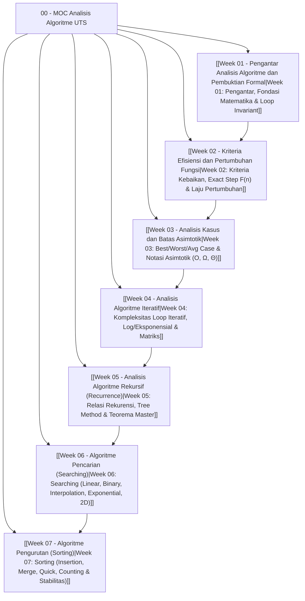
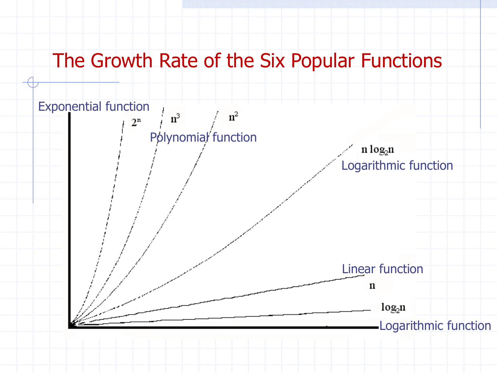
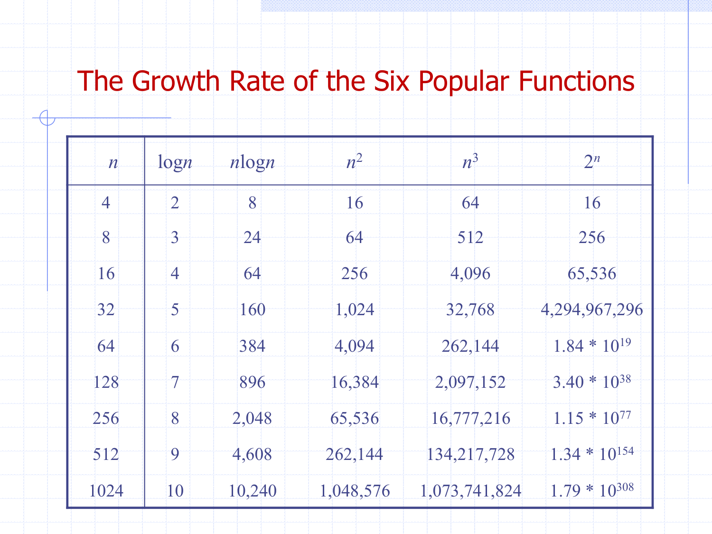
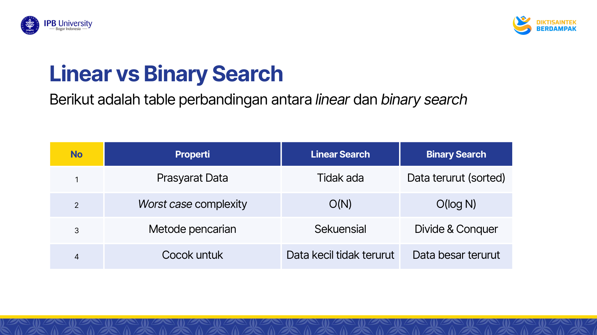
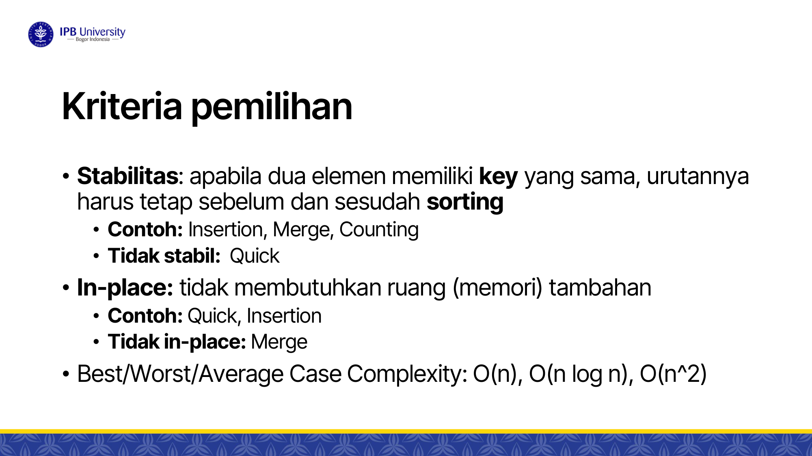
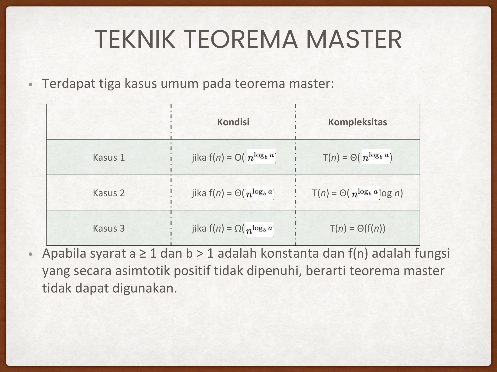
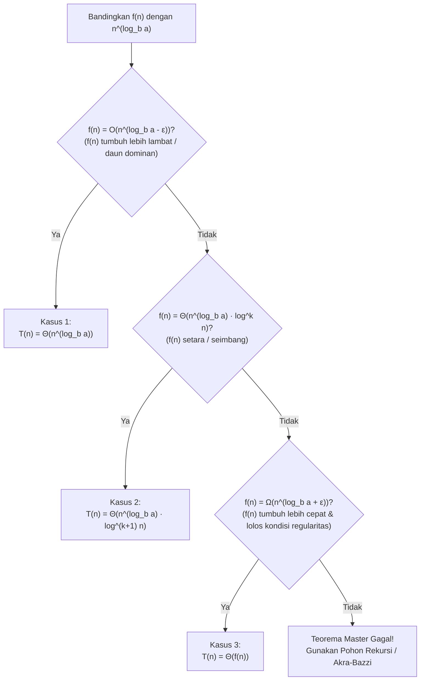

---
tags:
  - analisis-algoritma
  - uts
  - moc
  - study-guide
  - map-of-content
created: 2026-10-12
title: "00 - MOC Analisis Algoritme UTS (Map of Content & Panduan Belajar Lengkap)"
---

# 00 - Map of Content (MOC) Analisis Algoritme - Persiapan UTS

> [!abstract] Ringkasan Eksekutif
> Catatan ini merupakan pusat navigasi (*Map of Content*) untuk seluruh materi Ujian Tengah Semester (UTS) mata kuliah **Analisis Algoritme**. Disusun secara komprehensif dari **Week 01 hingga Week 07** berdasarkan 7 dokumen kuliah resmi tahun ajaran 2025/2026, buku teks standar (*Introduction to Algorithms* Cormen et al. / CLRS, Neapolitan, Weiss), serta kumpulan studi kasus analisis kompleksitas.

---

## 🗺️ Peta Navigasi Materi Mingguan



| Minggu | Topik Utama | Konsep Kunci | Catatan Vault |
| :---: | :--- | :--- | :--- |
| **01** | **Pengantar & Pembuktian Formal** | Resource bounds, model RAM, operasi primitif, logika proposisi, direct/indirect proof, induksi & loop invariant | [[Week 01 - Pengantar Analisis Algoritme dan Pembuktian Formal]] |
| **02** | **Kriteria Efisiensi & Pertumbuhan** | Kriteria kebaikan (*correctness* & *efficiency*), pembuktian induksi pada algoritme, perhitungan eksak F(n), growth rates | [[Week 02 - Kriteria Efisiensi dan Pertumbuhan Fungsi]] |
| **03** | **Analisis Kasus & Asimtotik** | Best/Worst/Average Case, definisi formal O, Ω, Θ, o, ω, konstanta (c, n₀), uji limit, sifat aljabar asimtotik | [[Week 03 - Analisis Kasus dan Batas Asimtotik]] |
| **04** | **Algoritme Iteratif** | Aturan sekuensial, percabangan, loop tunggal & bertingkat, loop variabel dependen (∑ i), loop logaritmik & eksponensial (O(log log n)), matriks | [[Week 04 - Analisis Algoritme Iteratif]] |
| **05** | **Algoritme Rekursif (Recurrence)** | Struktur basis & rekursi, metode substitusi, metode pohon rekursi (*recursion tree*), Teorema Master 3 kasus, Akra-Bazzi | [[Week 05 - Analisis Algoritme Rekursif (Recurrence)]] |
| **06** | **Algoritme Pencarian (Searching)** | Linear vs Binary, Interpolation search (O(log log n)), Exponential search (unbounded), pencarian matriks 2D (monoton / staircase O(m+n)) | [[Week 06 - Algoritme Pencarian (Searching)]] |
| **07** | **Algoritme Pengurutan (Sorting)** | Insertion Sort, Merge Sort (O(n log n)), Quick Sort & pivot terburuk (O(n²)), Counting Sort (O(n+k)), kriteria stabilitas | [[Week 07 - Algoritme Pengurutan (Sorting)]] |

---

## ⚡ Master Cheat Sheet: Matriks Perbandingan Inti

### 1. Definisi Formal Notasi Asimtotik


| Notasi | Nama Batas | Definisi Formal Matematis | Kondisi Limit (n → ∞) [f(n) / g(n)] | Makna Intuitif |
| :---: | :--- | :--- | :---: | :--- |
| **O(g(n))** | Batas Atas (*Upper Bound*) | Ada c > 0, n₀ > 0 sehingga: 0 ≤ f(n) ≤ c · g(n), untuk semua n ≥ n₀ | < ∞ (termasuk 0) | Laju pertumbuhan f(n) ≤ g(n) |
| **Ω(g(n))** | Batas Bawah (*Lower Bound*) | Ada c > 0, n₀ > 0 sehingga: 0 ≤ c · g(n) ≤ f(n), untuk semua n ≥ n₀ | > 0 (termasuk ∞) | Laju pertumbuhan f(n) ≥ g(n) |
| **Θ(g(n))** | Batas Ketat (*Tight Bound*) | Ada c₁, c₂ > 0, n₀ > 0 sehingga: c₁ · g(n) ≤ f(n) ≤ c₂ · g(n), untuk semua n ≥ n₀ | L dengan 0 < L < ∞ | Laju pertumbuhan f(n) setara g(n) |
| **o(g(n))** | Batas Atas Ketat (*Strict Upper*) | Untuk semua c > 0, ada n₀ > 0 sehingga: 0 ≤ f(n) < c · g(n), untuk semua n ≥ n₀ | = 0 | f(n) tumbuh jauh lebih lambat dari g(n) |
| **ω(g(n))** | Batas Bawah Ketat (*Strict Lower*) | Untuk semua c > 0, ada n₀ > 0 sehingga: 0 ≤ c · g(n) < f(n), untuk semua n ≥ n₀ | = ∞ | f(n) tumbuh jauh lebih cepat dari g(n) |

---

### 2. Spektrum Hierarki Laju Pertumbuhan Fungsi (Growth Rates)

Urutan dari yang paling efisien (tumbuh paling lambat) ke paling lambat (tumbuh paling boros/eksplosif):

> **Θ(1) < Θ(log log n) < Θ(log n) < Θ(√n) < Θ(n) < Θ(n log n) < Θ(n²) < Θ(n³) < Θ(2ⁿ) < Θ(n!) < Θ(nⁿ)**





---

### 3. Komparasi Algoritma Pencarian (Searching)



| Algoritma | Syarat Data Input | Best Case | Average Case | Worst Case | Space Complexity | Karakteristik Utama |
| :--- | :--- | :---: | :---: | :---: | :---: | :--- |
| **Linear Search** | Sembarang (acak/terurut) | O(1) | O(n) | O(n) | O(1) | Sederhana, tanpa prasyarat array |
| **Binary Search** | Harus terurut (*sorted*) | O(1) | O(log n) | O(log n) | O(1) iteratif / O(log n) rekursif | *Divide and conquer*, membagi 2 setiap iterasi |
| **Interpolation Search** | Terurut & berdistribusi seragam (*uniform*) | O(1) | O(log log n) | O(n) | O(1) | Menghitung estimasi posisi via gradien nilai |
| **Exponential Search** | Terurut (panjang tak tentu / unbounded) | O(1) | O(log i) | O(log i) | O(1) | Melipatgandakan indeks (2ᵏ), lalu binary search |
| **2D Unsorted Search** | Matriks m × n acak | O(1) | O(m · n) | O(m · n) | O(1) | Pengecekan sekuensial seluruh sel matriks |
| **2D Row-Sorted Search**| Setiap baris terurut | O(1) | O(m log n) | O(m log n) | O(1) | Binary search di setiap baris secara independen |
| **2D Monotonic / Staircase** | Baris dan kolom terurut menaik | O(1) | O(m + n) | O(m + n) | O(1) | Mulai dari sudut kanan-atas (atau kiri-bawah), eliminasi baris/kolom |

---

### 4. Komparasi Algoritma Pengurutan (Sorting)



| Algoritma | Best Case | Average Case | Worst Case | Space Memory | Stabil? | In-Place? | Metode Paradigma |
| :--- | :---: | :---: | :---: | :---: | :---: | :---: | :--- |
| **Insertion Sort** | O(n) | O(n²) | O(n²) | O(1) | **Ya** | **Ya** | *Incremental insertion* |
| **Bubble Sort** | O(n) (dg flag) | O(n²) | O(n²) | O(1) | **Ya** | **Ya** | *Pairwise swapping* |
| **Selection Sort** | O(n²) | O(n²) | O(n²) | O(1) | **Tidak** | **Ya** | *Minimum selection* |
| **Merge Sort** | O(n log n) | O(n log n) | O(n log n) | O(n) | **Ya** | **Tidak** | *Divide and Conquer* (merge) |
| **Quick Sort** | O(n log n) | O(n log n) | O(n²) | O(log n) call stack | **Tidak** | **Ya** | *Divide and Conquer* (partitioning) |
| **Counting Sort** | O(n + k) | O(n + k) | O(n + k) | O(k) | **Ya** | **Tidak** | *Non-comparison* (frekuensi) |

*Catatan: n = jumlah elemen, k = jangkauan nilai kunci (max - min + 1).*

---

### 5. Quick Reference: Tiga Kasus Teorema Master



Untuk relasi rekursif bentuk standar:
> **T(n) = a · T(n/b) + f(n)**, dengan syarat konstanta **a ≥ 1** dan **b > 1**

Hitung nilai kritis daun: **n^(log_b a)**, lalu bandingkan dengan fungsi penggabungan **f(n)**:



---

## 🎯 10 Jebakan Klasik Soal Ujian (Common Exam Traps)

> [!warning] Jangan Sampai Terjebak di Hal-Hal Ini!
> 1. **Big-O Bukan Berarti Worst-Case**: Big-O adalah **batas atas asimtotik**, bukan skenario. Skenario best-case pun memiliki batas Big-O (misal Best Case Insertion Sort adalah O(n)).
> 2. **Loop Invariant Memerlukan 3 Tahapan Lengkap**: Pembuktian loop invariant tanpa membuktikan **Initialization** (sebelum loop), **Maintenance** (selama loop), dan **Termination** (saat loop berhenti) akan kehilangan poin ujian.
> 3. **Variabel Dependen pada Loop Bersarang**:
>    ```python
>    for i in range(1, n+1):
>        for j in range(1, i+1): # j bergantung pada i
>            op()
>    ```
>    Kompleksitasnya adalah ∑ i = n(n+1)/2 = O(n²), **bukan** O(n).
> 4. **Increment Eksponensial dalam Loop**:
>    Jika indeks dikuadratkan pada setiap langkah (i = i²), jumlah iterasi sebelum mencapai n adalah O(log log n), **bukan** O(log n).
> 5. **Prasyarat Mutlak Interpolation Search**: Interpolation search hanya bernilai O(log log n) jika data **terurut DAN terdistribusi seragam**. Jika data condong eksponensial (misal 1, 2, 4, 8, ..., 2ⁿ), kompleksitasnya memburuk menjadi O(n).
> 6. **Kasus Terburuk Quick Sort**: Terjadi ketika array sudah terurut (atau terbalik) dan pemilihan pivot selalu di ujung (indeks 0 atau n-1), menghasilkan partisi 0 dan n-1 dengan waktu O(n²).
> 7. **Memori Tambahan Merge Sort**: Merge sort menjamin O(n log n) pada semua kasus, tetapi memerlukan alokasi array pembantu sebesar O(n) (*out-of-place*).
> 8. **Gap Polinomial pada Teorema Master**: Pada Kasus 1 dan Kasus 3, perbedaan antara f(n) dan n^(log_b a) harus berupa **pangkat polinomial** (n^ε untuk ε > 0). Selisih faktor logaritmik log n tidak memenuhi syarat kasus 1 atau 3!
> 9. **Batas Teorema Master pada Partisi Asimetris**: Relasi T(n) = T(n/4) + T(n/2) + c·n² **tidak bisa diselesaikan langsung dengan Teorema Master** karena ukuran subproblem berbeda (n/4 dan n/2). Harus diselesaikan dengan Metode Pohon Rekursi atau Akra-Bazzi.
> 10. **Counting Sort Efisien Hanya Jika k ≤ O(n)**: Jika nilai data berkisar antara 1 hingga 10⁹ namun jumlah elemen hanya 100, alokasi memori array penampung O(k) akan menyebabkan *memory overflow* dan running-time yang sangat lambat.
