---
tags:
  - analisis-algoritma
  - uts
  - week-01
  - loop-invariant
  - induction
  - formal-proof
created: 2026-10-12
week: 1
source: "Kuliah 1 Analgor 2025-2026.pdf, CS170 UC Berkeley, ODU Induction on Loops"
---

# Week 01 - Pengantar Analisis Algoritme dan Pembuktian Formal

> [!summary] Navigasi Catatan
> - **MOC Master**: [[00 - MOC Analisis Algoritma UTS|00 - Map of Content Analisis Algoritme UTS]]
> - **Next**: [[Week 02 - Kriteria Efisiensi dan Pertumbuhan Fungsi|Week 02 - Kriteria Efisiensi dan Pertumbuhan Fungsi]]

---

## 1. Fondasi Analisis Algoritme & Model Komputasi

### A. Definisi Algoritme
> [!important] Definisi Formal
> **Algoritme** adalah prosedur langkah-demi-langkah yang terdefinisi dengan jelas (*unambiguous*), terurut secara logis, dan menjamin penyelesaian masalah dalam jumlah waktu yang berhingga (*finite amount of time*).

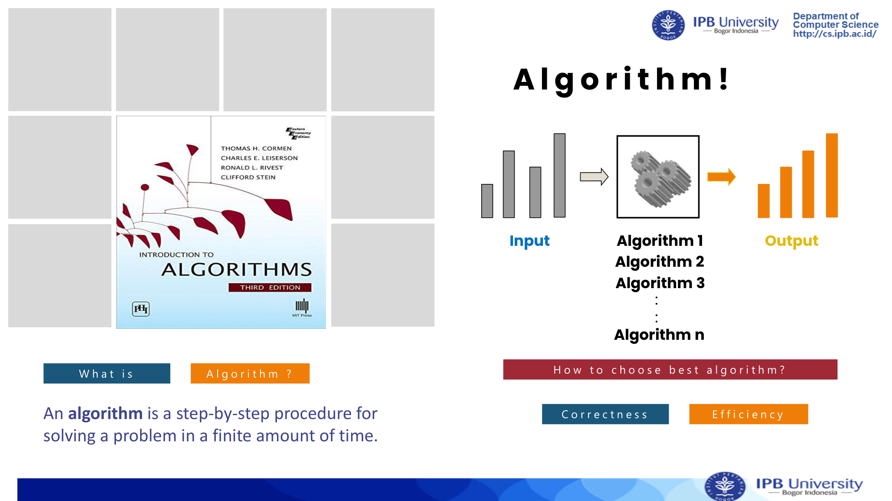

Sumber daya komputasi terbagi menjadi dua sumber daya utama yang **terbatas (*bounded resources*)**:
1. **Waktu Komputasi (*Computing Time*)**: Jumlah langkah eksekusi CPU yang dibutuhkan.
2. **Ruang Memori (*Memory Space*)**: Kapasitas memori RAM yang digunakan untuk variabel, struktur data, dan call stack.


---

### B. Mengapa Pendekatan Naif (Benchmarking Mesin) Gagal?
Seringkali muncul asumsi keliru: *"Uji saja kedua program di laptop lalu hitung waktu berjalannya (stopwatch / wall-clock time)!"*

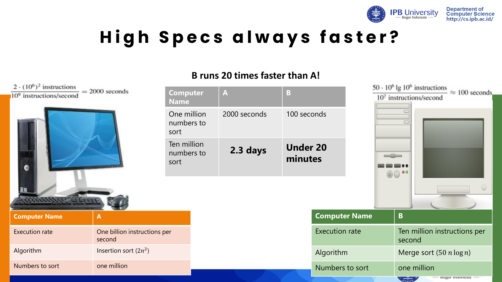

> [!warning] Kelemahan Pendekatan Naif (Empirical Runtime):
> - **Spesifikasi Mesin Berbeda**: Komputer dengan prosesor lebih cepat atau multi-core akan menghasilkan waktu lebih singkat meskipun algoritmenya buruk.
> - **Bahasa Pemrograman & Kompiler**: C++ vs Python memiliki optimasi internal berbeda.
> - **Beban Sistem Operasi**: Background process, caching, dan context switching mengacaukan hasil ukur.
> - **Ukuran Input Terbatas**: Algoritme yang cepat pada input kecil (n = 10) bisa meledak menjadi sangat lambat pada input skala besar (n = 10^6).

Oleh karena itu, diperlukan **analisis teoritis independen-mesin (*machine-independent analysis*)** menggunakan **Model RAM (*Random Access Machine*)**.

---

### C. Model Random Access Machine (RAM) & Operasi Primitif
Pada model RAM:
- Instruksi dieksekusi satu per satu secara sekuensial (tanpa konkurensi paralel).
- Setiap **Operasi Primitif (*Primitive / Significant Operation*)** diasumsikan memerlukan **waktu konstan O(1)**.

Daftar Operasi Primitif:
- Penugasan nilai (*Assignment*): `x = 5`
- Operasi Aritmatika dasar: `+`, `-`, `*`, `/`, `%`
- Operasi Perbandingan (*Comparison*): `<`, `<=`, `==`, `!=`, `>`, `>=`
- Pengaksesan elemen array (*Indexing*): `A[i]`
- Pemanggilan fungsi (*Function Call*) dan Pengembalian nilai (*Return statement*)

---

## 2. Fondasi Matematika Diskrit untuk Analisis Algoritme

### A. Notasi Interval (Selang)
Digunakan untuk menyatakan rentang nilai input atau indeks array:
- Interval Terbuka: (a, b) = \{ x \in \mathbb{R} \mid a < x < b \}
- Interval Tertutup: [a, b] = \{ x \in \mathbb{R} \mid a ≤ x ≤ b \}
- Interval Setengah Terbuka: [a, b) = \{ x \in \mathbb{R} \mid a ≤ x < b \}

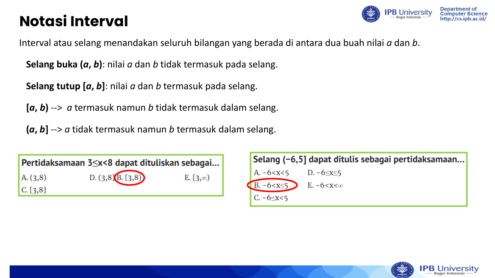

---

### B. Barisan, Deret, dan Faktorial
- **Deret Aritmatika**:
  $∑_{i=1}^n i = 1 + 2 + 3 + ... + n = \frac{n(n+1)}{2} = Θ(n²)$
  $∑_{i=1}^n i^2 = \frac{n(n+1)(2n+1)}{6} = Θ(n³)$
- **Deret Geometri** (dengan rasio r ≠ 1):
  $∑_{i=0}^k r^i = \frac{r^{k+1} - 1}{r - 1}$
  Jika |r| < 1 dan menuju tak hingga (k → ∞):
  $∑_{i=0}^∞ r^i = \frac{1}{1 - r}$
- **Faktorial (n!)**:
  $n! = ∏_{i=1}^n i = 1 × 2 × 3 × ... × n$
  Aproksimasi Stirling: n! ≈ \sqrt{2\pi n} ≤ft(\frac{n}{e}\right)^n → Θ(n \log n)  untuk  \log(n!).

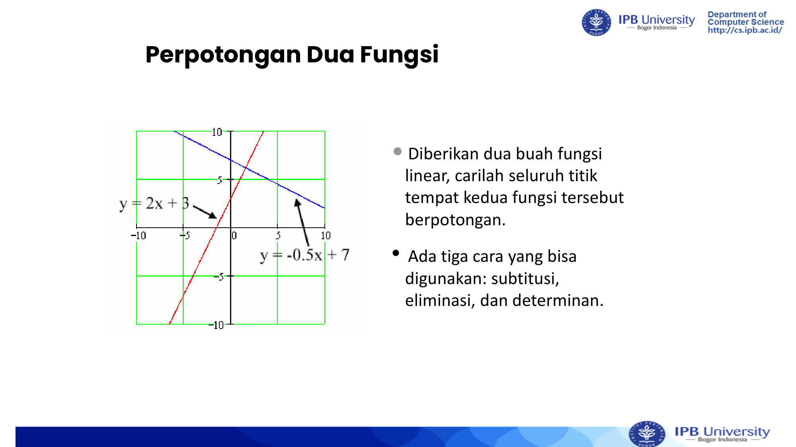

---

### C. Logika Matematika & Kaidah Inferensia
**Proposisi** adalah kalimat deklaratif yang bernilai mutlak **Benar (*True*)** atau **Salah (*False*)**, tetapi tidak keduanya secara bersamaan.

Contoh Klasifikasi Proposisi:
- `"300 > 200"` → **Proposisi** (Bernilai Benar).
- `"2 + 5 = 5"` → **Proposisi** (Bernilai Salah).
- `"x > 500"` → **Bukan Proposisi** (Nilai kebenaran bergantung variabel x).
- `"Tutup pintu itu!"` → **Bukan Proposisi** (Kalimat perintah).

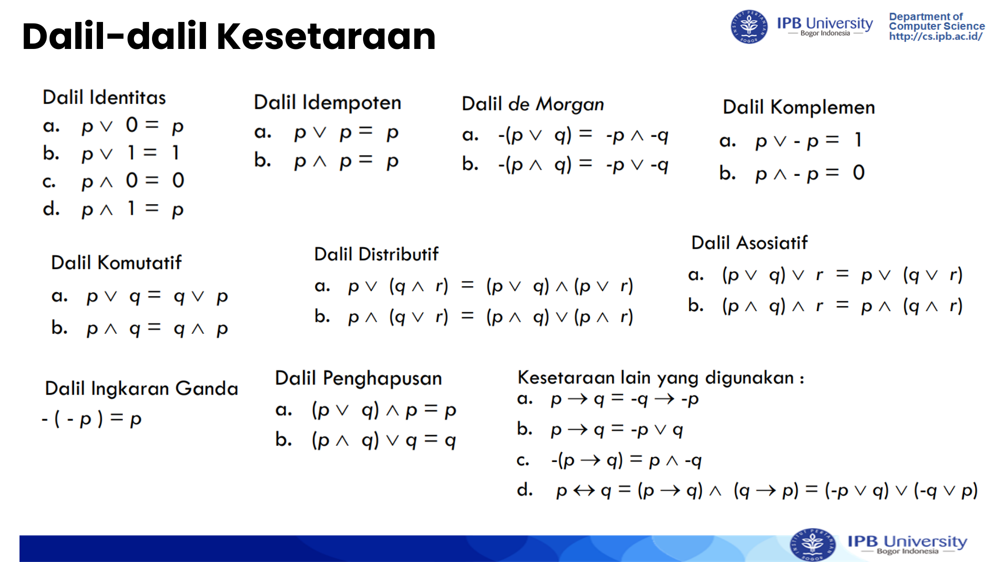

#### Tiga Kaidah Inferensia Kunci (Rules of Inference)
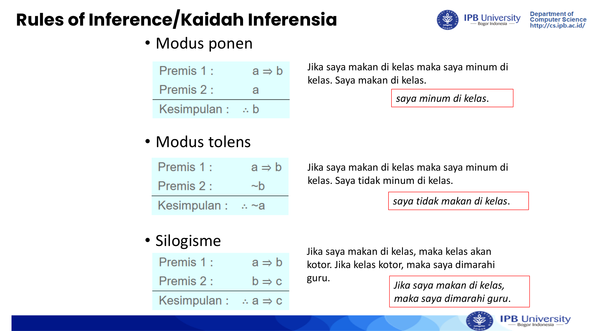

1. **Modus Ponens**:
   $\frac{P → Q,   P}{\therefore Q}$
   *Contoh*: Jika saya makan di kelas maka saya minum di kelas. Saya makan di kelas. Maka saya minum di kelas.
2. **Modus Tollens**:
   $\frac{P → Q,   ≠g Q}{\therefore ≠g P}$
   *Contoh*: Jika saya makan di kelas maka saya minum di kelas. Saya tidak minum di kelas. Maka saya tidak makan di kelas.
3. **Silogisme Hipotetis**:
   $\frac{P → Q,   Q → R}{\therefore P → R}$

---

## 3. Metode Pembuktian Formal (Proof Methods)

Untuk membuktikan kebenaran proposisi implikasi P → Q:

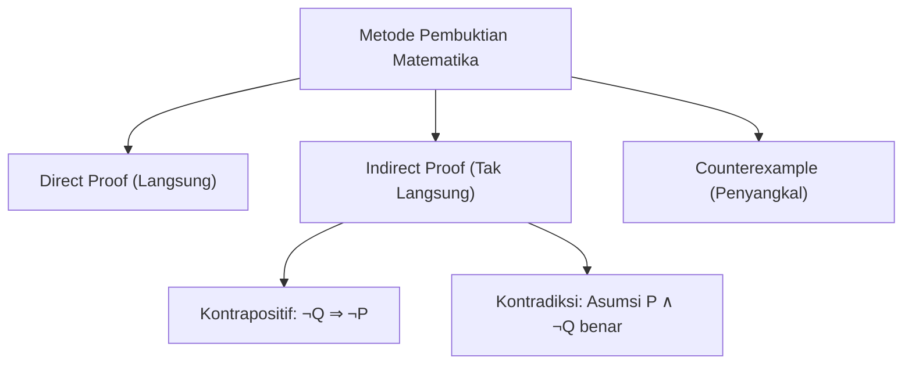

### A. Pembuktian Langsung (Direct Proof)
- **Langkah**: Asumsikan premis P bernilai benar. Gunakan aksioma, definisi, dan teorema yang ada untuk menyimpulkan secara langsung bahwa Q benar.
- **Contoh Soal**: Buktikan jika n bilangan bulat genap, maka n² bilangan bulat genap.
  - *Asumsi*: n genap → n = 2a untuk suatu bilangan bulat a.
  - *Perhitungan*: n² = (2a)^2 = 4a^2 = 2(2a^2).
  - *Misalkan* w = 2a^2, maka n² = 2w.
  - *Kesimpulan*: Karena n² dapat ditulis sebagai 2w, maka n² adalah bilangan bulat genap (**Terbukti**).

---

### B. Pembuktian Tak Langsung: Kontrapositif (Proof by Contrapositive)
- Menggunakan kesetaraan logis: (P → Q) ≡ (≠g Q → ≠g P).
- **Langkah**: Asumsikan negasi konklusi (≠g Q) benar, lalu buktikan bahwa negasi premis (≠g P) pasti terjadi.

---

### C. Pembuktian Tak Langsung: Kontradiksi (Proof by Contradiction)
- **Langkah**: Asumsikan pernyataan yang ingin dibuktikan adalah salah, yaitu asumsikan P \land ≠g Q bernilai benar.
- Lanjutkan penalaran logis hingga diperoleh suatu kontradiksi (seperti R \land ≠g R atau 1 = 0).
- Karena kontradiksi mustahil, maka asumsi awal salah → P → Q pasti benar.

---

### D. Metode Counterexample
Digunakan untuk **menggugurkan (disprove)** klaim universal untuk semua x \, [P(x) → Q(x)]. Cukup temukan **satu nilai spesifik x** di mana premis P(x) benar tetapi konklusi Q(x) salah.

---

## 4. Pembuktian Kebenaran Algoritme: Loop Invariant & Induksi Matematika

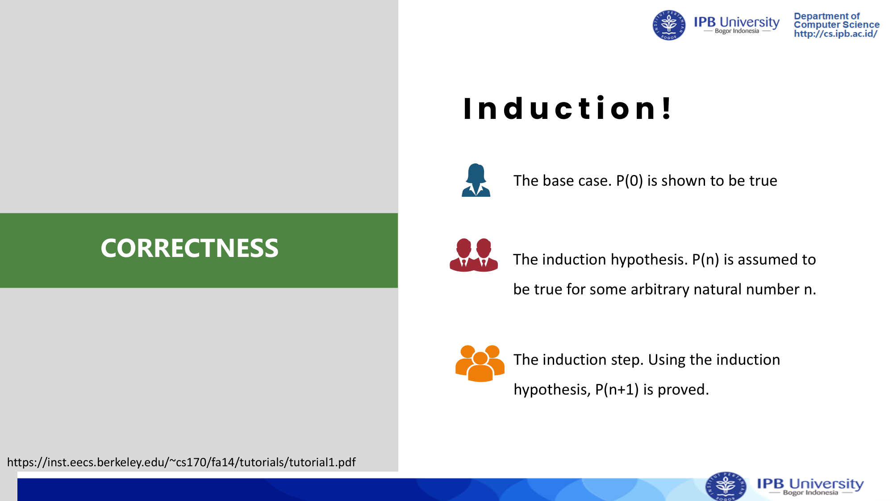

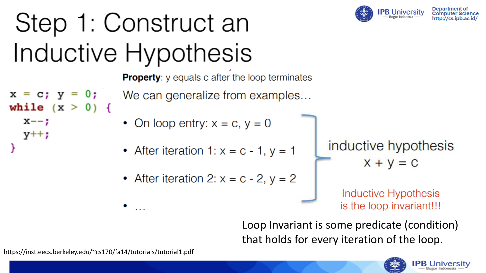

### A. Konsep Dasar Loop Invariant
> [!important] Definisi Loop Invariant
> **Loop Invariant** adalah suatu predikat logika (properti) yang bernilai **BENAR** sebelum loop dimulai, dan tetap **BENAR** setelah setiap iterasi loop dieksekusi.

Untuk membuktikan kebenaran algoritme iteratif secara formal, kita **wajib** membuktikan tiga properti:
1. **Inisialisasi (*Initialization / Base Case*)**: Properti bernilai benar sebelum iterasi pertama loop dimulai (k = 0).
2. **Perawatan (*Maintenance / Inductive Step*)**: Jika properti bernilai benar sebelum iterasi ke-k, maka properti tersebut tetap bernilai benar sebelum iterasi ke-(k+1).
3. **Terminasi (*Termination*)**: Ketika loop berhenti, kondisi invariant bersamaan dengan kondisi terminasi membuktikan bahwa output algoritme sesuai spesifikasi (*correctness property*).

---

### B. Studi Kasus 1: Algoritme Perkalian Bilangan Bulat (S = n × n)

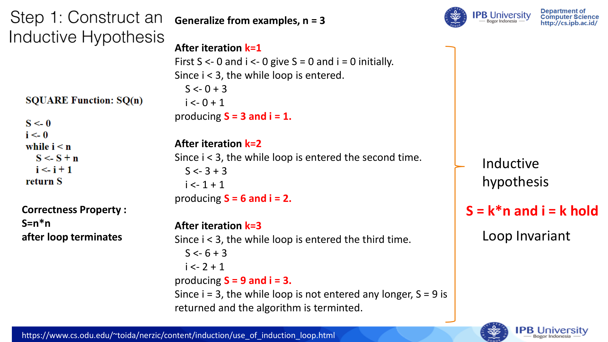

Diberikan algoritme untuk menghitung nilai n² melalui penjumlahan berulang:

```python
def square(n):
    S = 0
    i = 0
    while i < n:
        S = S + n
        i = i + 1
    return S
```

#### Pembuktian Formal via Loop Invariant:
- **Klaim Invariant**: Pada iterasi ke-k, berlaku predikat:
  $Invariant(k): S = k · n   dan   i = k$
- **Target Kebenaran (*Correctness Property*)**: Setelah loop terminasi, S = n².

1. **Inisialisasi (k = 0)**:
   - Sebelum loop dimasuki: S = 0 dan i = 0.
   - Substitusi k = 0: k · n = 0 · n = 0 = S, dan i = 0 = k.
   - **Base Case Terbukti Benar**.
2. **Perawatan (Induksi k → k + 1)**:
   - *Hipotesis Induksi*: Asumsikan pada awal iterasi ke-k, S = k · n dan i = k.
   - Karena i < n, loop dimasuki. Di dalam loop:
     $S_{baru} = S + n = (k · n) + n = (k + 1)n$
     $i_{baru} = i + 1 = k + 1$
   - Nilai baru memenuhi predikat untuk iterasi (k+1).
   - **Maintenance Terbukti Benar**.
3. **Terminasi**:
   - Loop berhenti saat kondisi `while i < n` menjadi salah, yaitu saat i = n.
   - Karena i = k, maka saat terminasi k = n.
   - Berdasarkan invariant:
     $S = k · n = n · n = n²$
   - **Algoritme Terbukti Benar (Correct)**.

---

### C. Studi Kasus 2: Algoritme Faktorial Iteratif (F = n!)

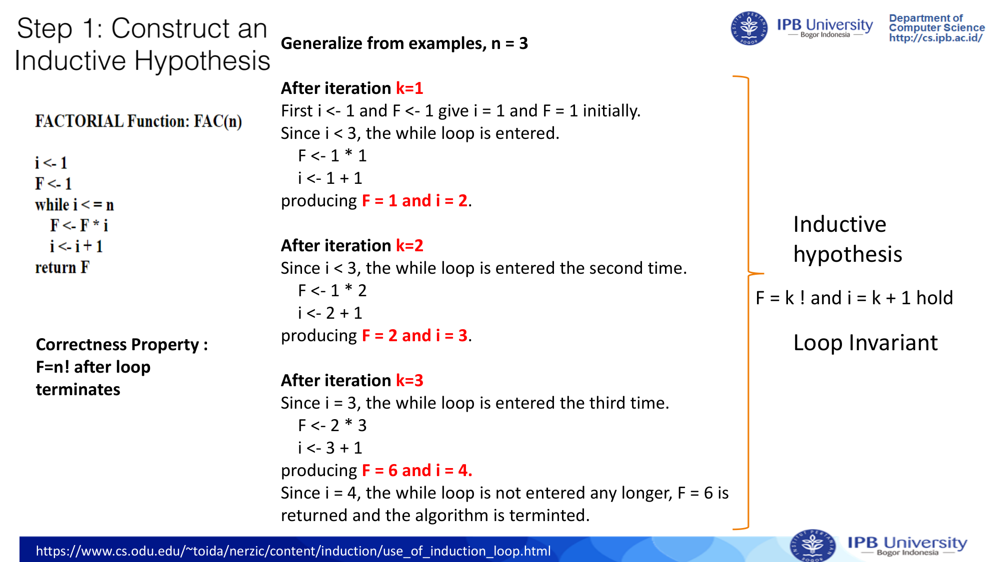

```python
def factorial(n):
    F = 1
    i = 1
    while i <= n:
        F = F * i
        i = i + 1
    return F
```

#### Pembuktian Formal via Loop Invariant:
- **Klaim Invariant**: Pada iterasi ke-k (dimulai dari k=1 saat loop pertama berjalan):
  $Invariant(k): F = (i - 1)! = k!   dan   i = k + 1$
- **Target Kebenaran**: Saat loop berhenti, F = n!.

1. **Inisialisasi (k = 0, sebelum loop)**:
   - Nilai awal: F = 1, i = 1.
   - Karena 0! = 1, maka F = 0! dan i = 0 + 1 = 1. Invariant valid.
2. **Perawatan (k → k + 1)**:
   - Pada iterasi ke-(k+1), nilai F dikalikan dengan i = k+1:
     $F_{baru} = F × (k + 1) = k! × (k + 1) = (k + 1)!$
     $i_{baru} = i + 1 = (k + 1) + 1$
   - Invariant terpelihara.
3. **Terminasi**:
   - Loop berhenti saat i > n, yaitu pada saat i = n + 1.
   - Karena i = k + 1, maka k = n.
   - Substitusi ke invariant:
     $F = k! = n!$
   - **Algoritme Terbukti Menghasilkan Faktorial n! Secara Benar**.

---

## 🎯 Rangkuman Cepat untuk Ujian (ADHD Takeaways)
- RAM Model mengabaikan spek hardware dan menganggap setiap operasi primitif bernilai O(1).
- Tiga kaidah inferensi: Modus Ponens (P → Q, P \vdash Q), Modus Tollens (P → Q, ≠g Q \vdash ≠g P), Silogisme (P → Q, Q → R \vdash P → R).
- Tiga pilar wajib loop invariant: **Initialization → Maintenance → Termination**. Lupa salah satu = pengurangan poin ujian!
