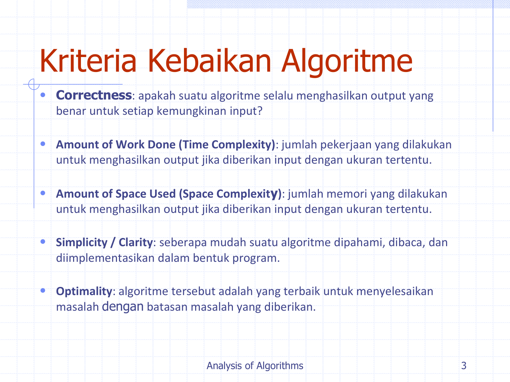
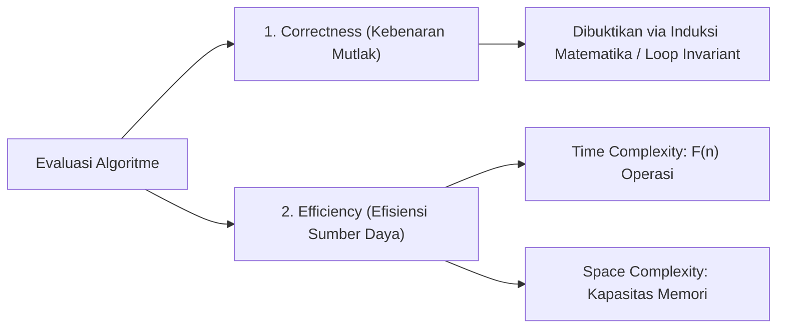
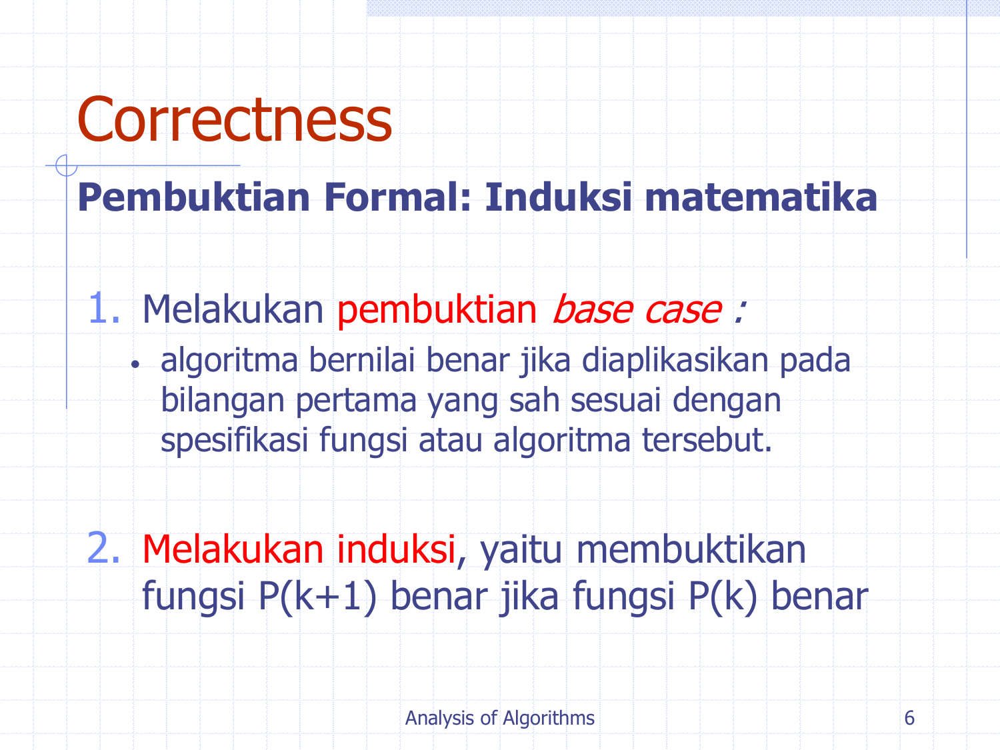
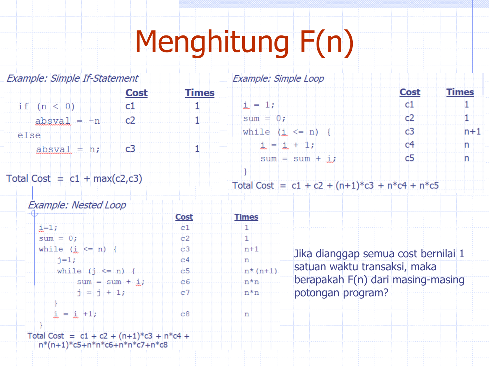
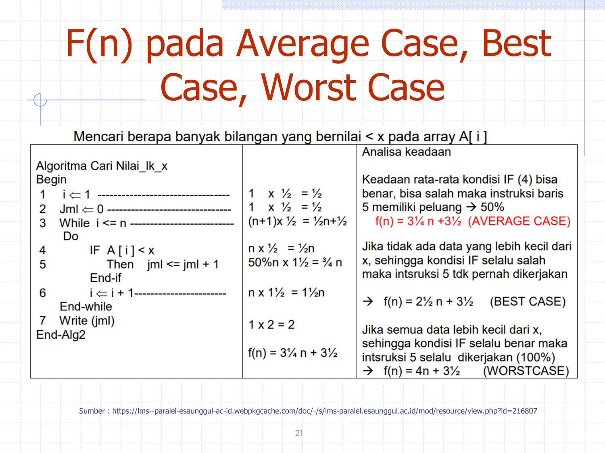
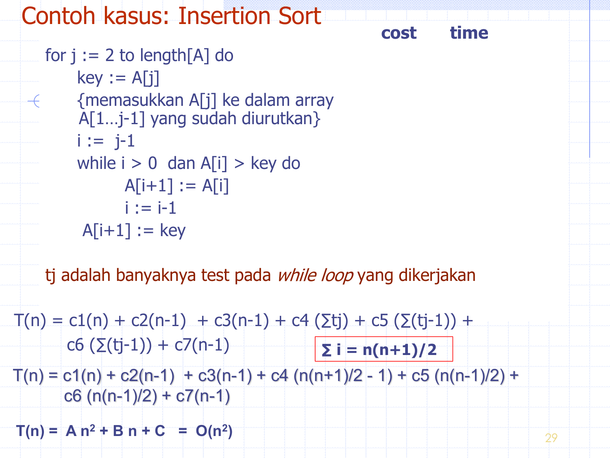
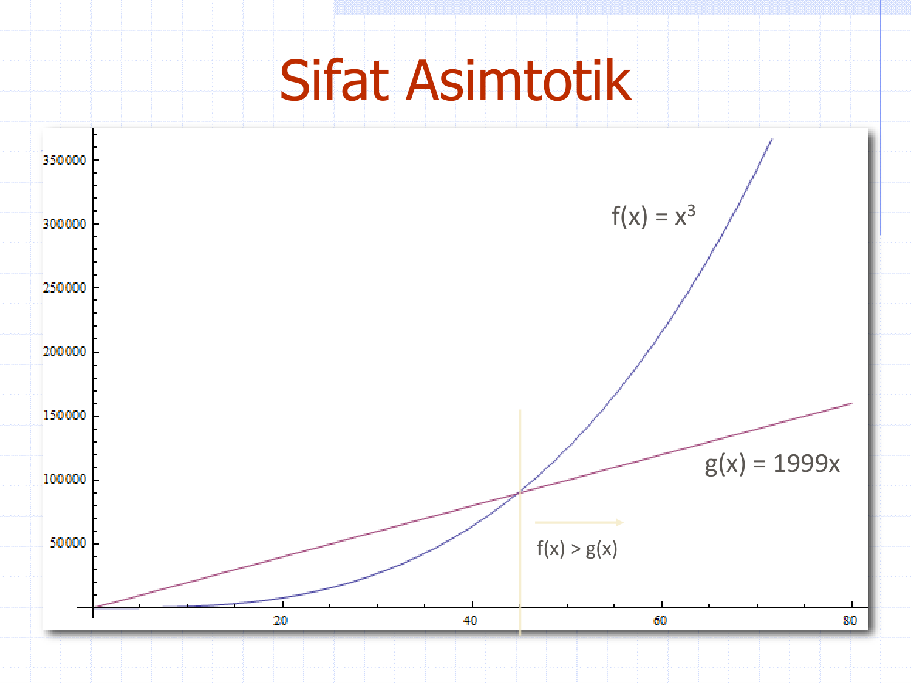
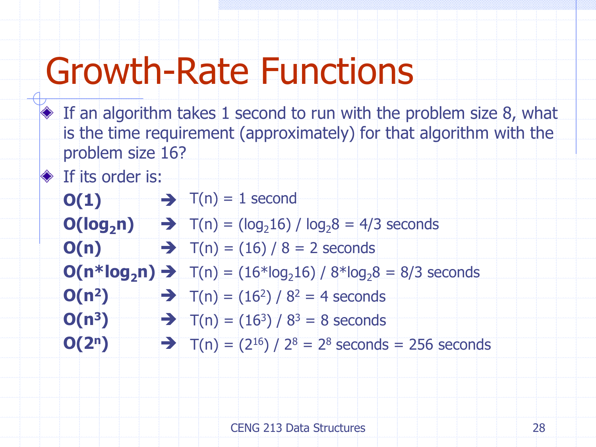
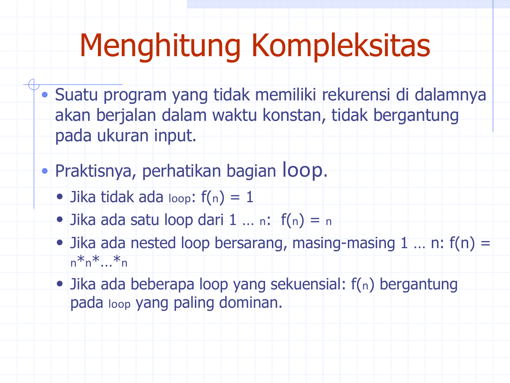

---
tags:
  - analisis-algoritma
  - uts
  - week-02
  - correctness
  - exact-step-count
  - growth-rates
  - big-o-introduction
created: 2026-10-12
week: 2
source: "Kuliah 2 Analgor 2025-2026.pdf, CENG 213 Data Structures"
---

# Week 02 - Kriteria Efisiensi dan Pertumbuhan Fungsi

> [!summary] Navigasi Catatan
> - **Prev**: [[Week 01 - Pengantar Analisis Algoritme dan Pembuktian Formal|Week 01 - Pengantar & Pembuktian Formal]]
> - **MOC Master**: [[00 - MOC Analisis Algoritma UTS|00 - Map of Content Analisis Algoritme UTS]]
> - **Next**: [[Week 03 - Analisis Kasus dan Batas Asimtotik|Week 03 - Analisis Kasus dan Batas Asimtotik]]

---

## 1. Kriteria Kebaikan Algoritme



Untuk mengevaluasi kelayakan sebuah algoritme, terdapat dua kriteria utama:
1. **Kebenaran (*Correctness*)**: Apakah algoritme selalu menghasilkan output yang benar dan sah (*valid*) untuk setiap kemungkinan input yang memenuhi spesifikasi?
2. **Jumlah Pekerjaan yang Dilakukan (*Amount of Work Done / Efficiency*)**: Berapa banyak sumber daya (waktu CPU dan memori RAM) yang dihabiskan untuk memproses input berukuran n?



---

## 2. Pembuktian Formal Correctness dengan Induksi



### Studi Kasus: Algoritme Perkalian Berulang
```c
int s = 0;
int i = 0;
while (i < n) {
    s = s + n;
    i = i + 1;
}
return s;
```

Tujuan: Buktikan bahwa setelah melalui loop sebanyak k kali, berlaku properti:
$Invariant:  s = k · n   dan   i = k$

1. **Basis Step (k = 0)**:
   - Sebelum loop dimasuki: s = 0 dan i = 0.
   - Substitusi k = 0 → s = 0 · n = 0 dan i = 0. (Terbukti).
2. **Induction Hypothesis**:
   - Asumsikan benar untuk sembarang nilai k = m: setelah m iterasi, s = m · n dan i = m.
3. **Inductive Step (k = m + 1)**:
   - Pada awal iterasi ke-(m+1), s = m · n dan i = m.
   - Di dalam body loop:
     $s ≤ftarrow s + n = m · n + n = (m + 1)n$
     $i ≤ftarrow i + 1 = m + 1$
   - Nilai baru memenuhi s = (m + 1)n dan i = m + 1. (Terbukti).
4. **Terminasi**:
   - Loop berhenti saat kondisi i < n gagal → i = n → k = n.
   - Maka nilai akhir: s = n · n = n². (Algoritme terbukti benar).

---

## 3. Perhitungan Langkah Eksak F(n) (Exact Step Count)

Analisis teoritis menghitung jumlah eksekusi operasi dominan terhadap ukuran input n.
Jika diasumsikan setiap baris instruksi dasar memiliki **cost waktu transaksi bernilai 1**, kita dapat menyusun fungsi total waktu F(n).





### Studi Kasus Eksekusi Detail: Insertion Sort



Perhatikan pseudocode Insertion Sort berikut beserta jumlah eksekusi per baris:

| Baris Kode | Cost | Jumlah Eksekusi (*Execution Count*) |
| :--- | :---: | :---: |
| `for j = 2 to length[A] do` | c_1 | n |
| `    key = A[j]` | c_2 | n - 1 |
| `    // sisipkan A[j] ke A[1..j-1]` | - | 0 (komentar) |
| `    i = j - 1` | c_3 | n - 1 |
| `    while i > 0 and A[i] > key do` | c_4 | ∑_{j=2}^n t_j |
| `        A[i + 1] = A[i]` | c_5 | ∑_{j=2}^n (t_j - 1) |
| `        i = i - 1` | c_6 | ∑_{j=2}^n (t_j - 1) |
| `    A[i + 1] = key` | c_7 | n - 1 |

*Catatan: t_j adalah jumlah evaluasi kondisi `while` untuk elemen indeks ke-j.*

Total fungsi waktu:
$T(n) = c_1 n + (c_2 + c_3 + c_7)(n - 1) + c_4 ∑_{j=2}^n t_j + (c_5 + c_6) ∑_{j=2}^n (t_j - 1)$

- **Kondisi Kasus Terbaik (*Best Case*)**: Array sudah terurut. Kondisi `A[i] > key` langsung bernilai salah saat pengujian pertama (t_j = 1).
  $∑_{j=2}^n 1 = n - 1,   ∑_{j=2}^n (1 - 1) = 0$
  $T(n) = c_1 n + (c_2 + c_3 + c_4 + c_7)(n - 1) = an + b = Θ(n)$
- **Kondisi Kasus Terburuk (*Worst Case*)**: Array terurut terbalik. Elemen harus dibandingkan dengan seluruh elemen sebelumnya (t_j = j).
  $∑_{j=2}^n j = \frac{n(n + 1)}{2} - 1,   ∑_{j=2}^n (j - 1) = \frac{n(n - 1)}{2}$
  $T(n) = A n² + B n + C = Θ(n²)$

---

## 4. Penyederhanaan Asimtotik & Aturan Laju Pertumbuhan

Dalam praktiknya, kita tidak memerlukan koefisien konstan detail A, B, C. Kita menyederhanakannya melalui **Prinsip Asimtotik**:
1. **Abaikan suku berpangkat lebih rendah (*Ignore lower-order terms*)**:
   $f(n) = 3n² + 6n + 12 → ambil suku tertinggi:  3n²$
2. **Abaikan konstanta pengali (*Ignore multiplicative constants*)**:
   $f(n) = 3n² → n² → O(n²)$
3. **Penggabungan fungsi (*Combine growth-rate functions*)**:
   $O(f(n)) + O(g(n)) = O(\max(f(n), g(n)))$
   $O(n³) + O(4n²) = O(n³ + 4n²) = O(n³)$




---

## 5. Perbandingan Pertumbuhan Enam Fungsi Populer


Tabel nilai fungsi untuk berbagai ukuran input n:

| n | \log₂ n | n \log₂ n | n² | n³ | 2ⁿ |
| :---: | :---: | :---: | :---: | :---: | :---: |
| **4** | 2 | 8 | 16 | 64 | 16 |
| **8** | 3 | 24 | 64 | 512 | 256 |
| **16** | 4 | 64 | 256 | 4.096 | 65.536 |
| **32** | 5 | 160 | 1.024 | 32.768 | 4{,}29 × 10^9 |
| **64** | 6 | 384 | 4.096 | 262.144 | 1{,}84 × 10^{19} |
| **128** | 7 | 896 | 16.384 | 2.097.152 | 3{,}40 × 10^{38} |
| **256** | 8 | 2.048 | 65.536 | 16.777.216 | 1{,}15 × 10^{77} |
| **512** | 9 | 4.608 | 262.144 | 134.217.728 | 1{,}34 × 10^{154} |
| **1024** | 10 | 10.240 | 1.048.576 | 1.073.741.824 | 1{,}79 × 10^{308} |

---

## 6. Latihan Skalabilitas Waktu (Time Scaling Exercise)



> [!example] Soal Skalabilitas Ujian (Slide 28)
> Suatu algoritme membutuhkan waktu **1 detik** untuk memproses input berukuran n_1 = 8. Berapakah estimasi waktu yang dibutuhkan jika ukuran input dilipatgandakan menjadi n_2 = 16?

Rasio pertumbuhan waktu:
$\frac{T(16)}{T(8)} = \frac{f(16)}{f(8)}$

1. **O(1)**: T(16) = 1 detik.
2. **O(\log₂ n)**: T(16) = \frac{\log₂ 16}{\log₂ 8} × 1 = \frac{4}{3} ≈ 1{,}33 detik.
3. **O(n)**: T(16) = \frac{16}{8} × 1 = 2 detik.
4. **O(n \log₂ n)**: T(16) = \frac{16 \log₂ 16}{8 \log₂ 8} × 1 = \frac{16 × 4}{8 × 3} = \frac{64}{24} = \frac{8}{3} ≈ 2{,}67 detik.
5. **O(n²)**: T(16) = \frac{16^2}{8^2} × 1 = ≤ft(\frac{16}{8}\right)^2 × 1 = 2^2 = 4 detik.
6. **O(n³)**: T(16) = \frac{16^3}{8^3} × 1 = 2^3 = 8 detik.
7. **O(2ⁿ)**: T(16) = \frac{2^{16}}{2^8} × 1 = 2^{16 - 8} = 2^8 = 256 detik (≈ 4{,}27 menit).

---

## 7. Pembahasan Latihan Kompleksitas Kode (Slide 30–38)



### Soal 1: Single Loop Sekuensial
```c
for (i = 0; i < n; i++) {
    sum += i;
}
```
- Iterasi berjalan dari 0 hingga n-1 (n kali).
- Operasi di dalam loop: O(1).
- **Kompleksitas: O(n)**.

### Soal 2: Nested Loop Independen
```c
for (i = 0; i < n; i++) {
    for (j = 0; j < n; j++) {
        k++;
    }
}
```
- Loop luar: n kali. Loop dalam: n kali.
- Total eksekusi: n × n = n².
- **Kompleksitas: O(n²)**.

### Soal 3: Nested Loop Variabel Dependen
```c
for (i = 0; i < n; i++) {
    for (j = 0; j <= i; j++) {
        k++;
    }
}
```
- Untuk i = 0, loop dalam berjalan 1 kali.
- Untuk i = n-1, loop dalam berjalan n kali.
- Total eksekusi: ∑_{i=1}^n i = \frac{n(n+1)}{2} = \frac{1}{2}n² + \frac{1}{2}n.
- **Kompleksitas: O(n²)**.

### Soal 4: Loop Logaritmik (i × 2)
```c
for (i = 1; i < n; i = i * 2) {
    count++;
}
```
- Nilai i berkembang: 1, 2, 4, 8, ..., 2^k.
- Loop berhenti saat 2^k ≥ n → k = ⌈ \log₂ n ⌉.
- **Kompleksitas: O(\log n)**.

---

## 🎯 Rangkuman Cepat untuk Ujian (ADHD Takeaways)
- Dua kriteria: Correctness (induksi) & Efficiency (step count F(n)).
- Formula exact Insertion sort: T(n) = Θ(n) pada best case, Θ(n²) pada worst case.
- Pola scaling jika n berlipat ganda: linear kali 2, kuadratik kali 4, kubik kali 8, eksponensial 2ⁿ berlipat ganda secara eksponensial 2^k.
