---
tags:
  - analisis-algoritma
  - uts
  - week-03
  - asymptotic-notations
  - big-o
  - big-omega
  - big-theta
  - case-analysis
created: 2026-10-12
week: 3
source: "Analysis of Algorithms 3_ganjil 2024-2025_SENT.pptx.pdf"
---

# Week 03 - Analisis Kasus dan Batas Asimtotik

> [!summary] Navigasi Catatan
> - **Prev**: [[Week 02 - Kriteria Efisiensi dan Pertumbuhan Fungsi|Week 02 - Kriteria Efisiensi dan Pertumbuhan Fungsi]]
> - **MOC Master**: [[00 - MOC Analisis Algoritma UTS|00 - Map of Content Analisis Algoritme UTS]]
> - **Next**: [[Week 04 - Analisis Algoritme Iteratif|Week 04 - Analisis Algoritme Iteratif]]

---

## 1. Analisis Tiga Kasus Eksekusi (Case Analysis)

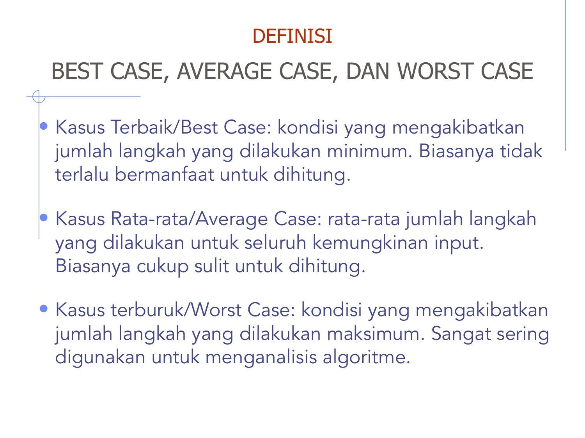

Waktu eksekusi suatu algoritme tidak hanya bergantung pada ukuran input n, tetapi juga pada **konfigurasi/susunan data input**. Oleh karena itu, dianalisis tiga skenario:

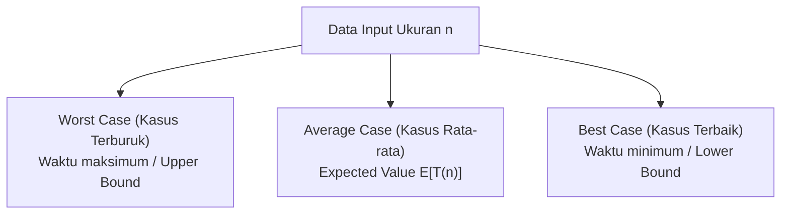

### A. Kasus Terburuk (Worst Case)
- **Definisi**: Kondisi input yang menyebabkan algoritme melakukan jumlah operasi **maksimum**.
- **Signifikansi**: Memberikan **jaminan batas atas mutlak (*upper bound guarantee*)**. Algoritme dipastikan tidak akan pernah berjalan lebih lambat dari batas ini. Sangat penting untuk sistem *real-time* dan *mission-critical*.

### B. Kasus Terbaik (Best Case)
- **Definisi**: Kondisi input yang menyebabkan algoritme melakukan jumlah operasi **minimum**.
- **Signifikansi**: Memberikan batas bawah (*lower bound*). Jarang dijadikan acuan utama karena terjadi hanya pada kondisi ideal tertentu yang sangat spesifik.

### C. Kasus Rata-Rata (Average Case)
- **Definisi**: Rata-rata matematis (*expected value*) dari jumlah operasi untuk seluruh kemungkinan input yang mungkin muncul.
- **Tantangan**: Memerlukan asumsi mengenai distribusi probabilitas input (misal distribusi seragam / uniform distribution).

---

## 2. Studi Kasus Analisis Tiga Skenario: Sequential (Linear) Search

Diberikan array A[1 ... n] dan nilai target x:

```python
def linear_search(A, n, x):
    for i in range(n):
        if A[i] == x:
            return i # Ditemukan
    return -1 # Tidak ditemukan
```

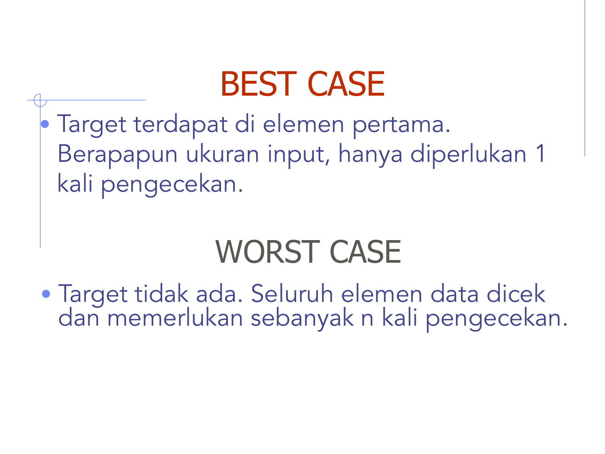

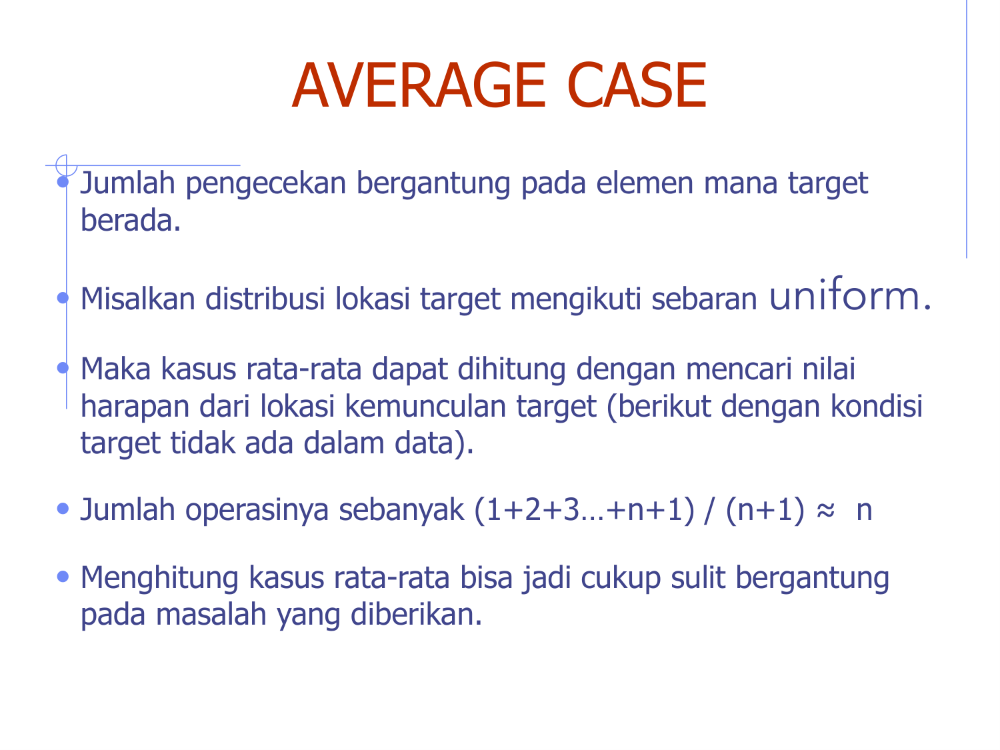

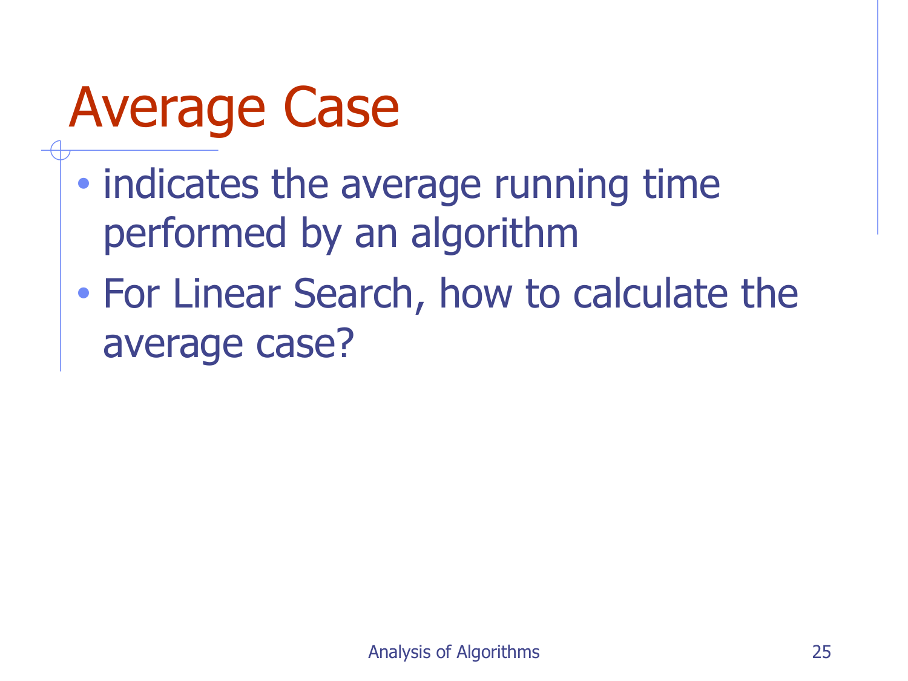

1. **Best Case**: Target x berada di indeks pertama (A[0]).
   - Jumlah pengecekan: 1 kali.
   - Kompleksitas: **Θ(1)**.
2. **Worst Case**: Target x berada di indeks terakhir atau tidak ada sama sekali dalam array.
   - Jumlah pengecekan: n kali.
   - Kompleksitas: **Θ(n)**.
3. **Average Case**:
   - Asumsikan peluang target x berada di sembarang indeks i \in \{1, ..., n\} adalah sama rata (P(i) = \frac{1}{n}).
   - Ekspektasi jumlah perbandingan:
     $E[T(n)] = ∑_{i=1}^n i · P(i) = \frac{1}{n} ∑_{i=1}^n i = \frac{1}{n} · \frac{n(n+1)}{2} = \frac{n+1}{2}$
   - Secara asimtotik: \frac{n+1}{2} = Θ(n).

---

## 3. Definisi Formal Notasi Asimtotik (The Big-O Family)

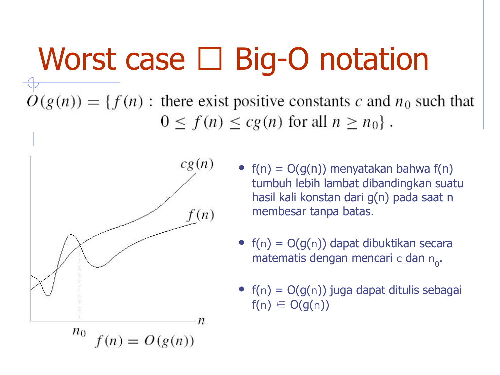

### A. Notasi Big-O (O) — Batas Atas Asimtotik (Asymptotic Upper Bound)
> [!important] Definisi Formal Big-O
> f(n) = O(g(n)) jika dan hanya jika terdapat konstanta positif c > 0 dan bilangan bulat n_0 > 0 sedemikian rupa sehingga:
> $0 ≤ f(n) ≤ c · g(n),   untuk semua n ≥ n_0$

Artinya, untuk nilai n yang cukup besar (n ≥ n_0), kurva fungsi f(n) tidak akan pernah melampaui kurva c · g(n).

#### Contoh Pembuktian Formal Big-O:
- **Soal 1: Buktikan n² + 1 = O(n²)**
  - Trik: Untuk setiap n ≥ 1, berlaku 1 ≤ n².
  - Maka: n² + 1 ≤ n² + n² = 2n².
  - Pilih konstanta **c = 2** dan **n_0 = 1**.
  - Karena n² + 1 ≤ 2n² berlaku untuk semua n ≥ 1, maka terbukti n² + 1 = O(n²).
- **Soal 2: Buktikan T(n) = 2n² + 6n + 1 = O(n²)**
  - Untuk setiap n ≥ 1, berlaku n ≤ n² dan 1 ≤ n².
  - Maka: 2n² + 6n + 1 ≤ 2n² + 6n² + 1n² = 9n².
  - Pilih konstanta **c = 9** dan **n_0 = 1**.
  - Terbukti bahwa 2n² + 6n + 1 = O(n²).

---

### B. Notasi Big-Omega (Ω) — Batas Bawah Asimtotik (Asymptotic Lower Bound)

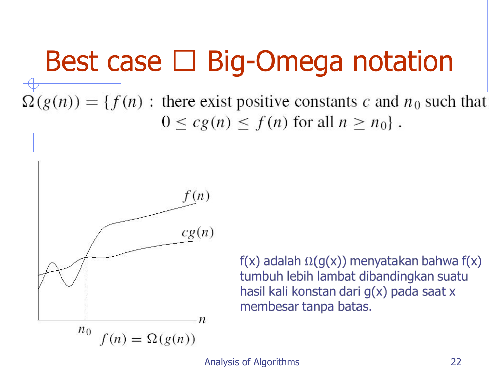

> [!important] Definisi Formal Big-Omega
> f(n) = Ω(g(n)) jika dan hanya jika terdapat konstanta positif c > 0 dan n_0 > 0 sedemikian rupa sehingga:
> $0 ≤ c · g(n) ≤ f(n),   untuk semua n ≥ n_0$

Artinya, kurva fungsi f(n) berada di atas kurva c · g(n) untuk seluruh n ≥ n_0.
- *Contoh*: 3n² + 2 = Ω(n²).
  - Untuk n ≥ 1, 3n² + 2 ≥ 3n² ≥ 1 · n².
  - Pilih c = 1, n_0 = 1. Terbukti.

---

### C. Notasi Big-Theta (Θ) — Batas Ketat (Asymptotic Tight Bound)
> [!important] Definisi Formal Big-Theta
> f(n) = Θ(g(n)) jika dan hanya jika f(n) = O(g(n)) dan f(n) = Ω(g(n)).
> Secara matematis: ada c_1 > 0, c_2 > 0, n_0 > 0 sedemikian rupa sehingga:
> $0 ≤ c_1 · g(n) ≤ f(n) ≤ c_2 · g(n),   untuk semua n ≥ n_0$

---

### D. Notasi Little-o (o) dan Little-omega (\omega)
- **Little-o (o)**: Batas atas non-ketat (*strictly smaller*).
  $\lim_{n → ∞} \frac{f(n)}{g(n)} = 0$
  *Contoh*: 2n = o(n²), tetapi 2n² ≠ o(n²).
- **Little-omega (\omega)**: Batas bawah non-ketat (*strictly larger*).
  $\lim_{n → ∞} \frac{f(n)}{g(n)} = ∞$
  *Contoh*: n² = \omega(n), tetapi n² ≠ \omega(2n²).

---

## 4. Sifat-Sifat Aljabar Notasi Asimtotik

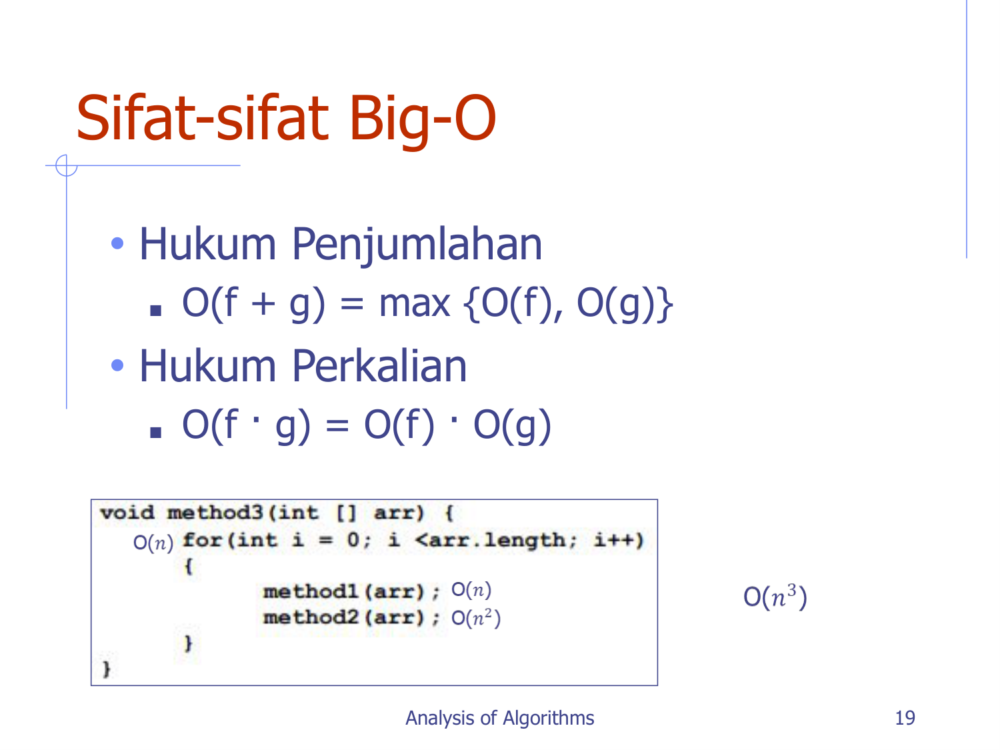

1. **Hukum Penjumlahan (*Sum Rule*)**:
   $O(f(n) + g(n)) = \max(O(f(n)), O(g(n)))$
   *Contoh*: O(n³ + 5n²) = O(n³).
2. **Hukum Perkalian (*Product Rule*)**:
   $O(f(n) · g(n)) = O(f(n)) · O(g(n))$
   *Contoh*: O(n · \log n) = O(n) · O(\log n).
3. **Transitivitas**:
   - Jika f(n) = O(g(n)) dan g(n) = O(h(n)), maka f(n) = O(h(n)).
   - Berlaku juga untuk Ω, Θ, o, \omega.
4. **Refleksivitas**:
   - f(n) = O(f(n)), f(n) = Ω(f(n)), f(n) = Θ(f(n)).
5. **Simetri & Simetri Transpos**:
   - f(n) = Θ(g(n)) \iff g(n) = Θ(f(n)).
   - f(n) = O(g(n)) \iff g(n) = Ω(f(n)).

---

## 5. Latihan Slide: Menentukan Titik Potong Ambang n_0

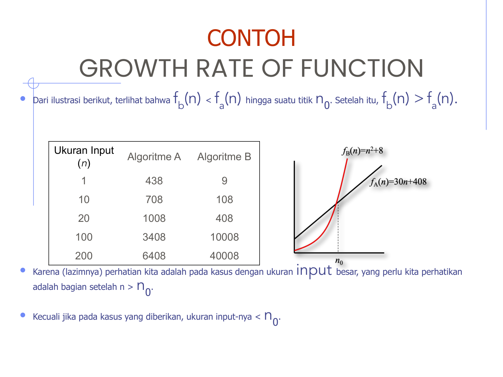

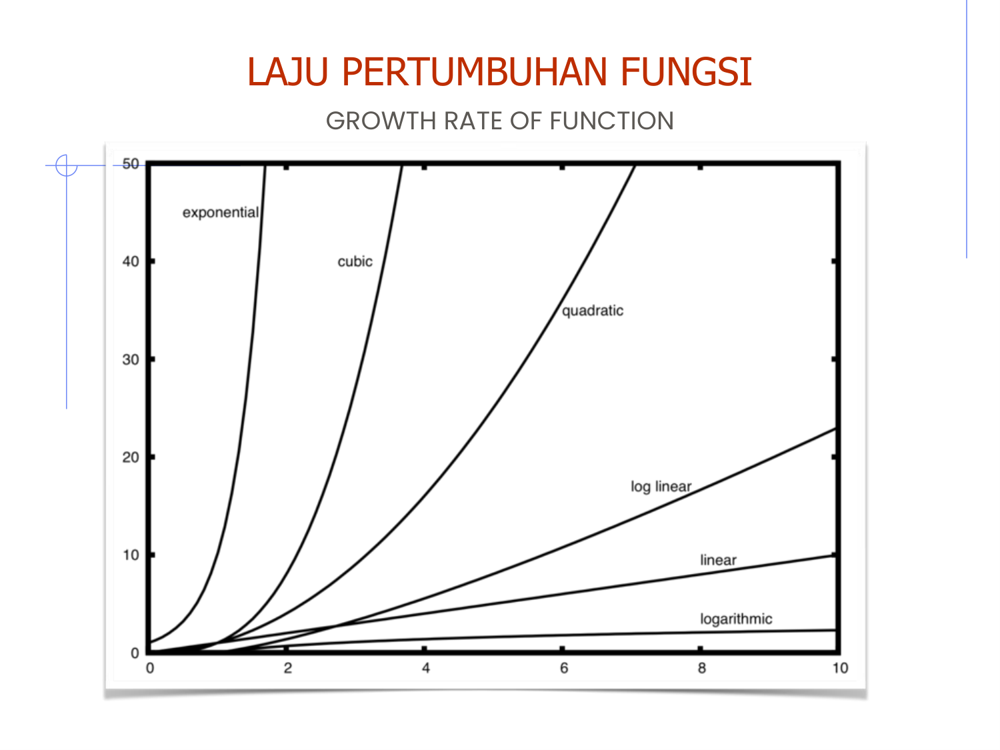

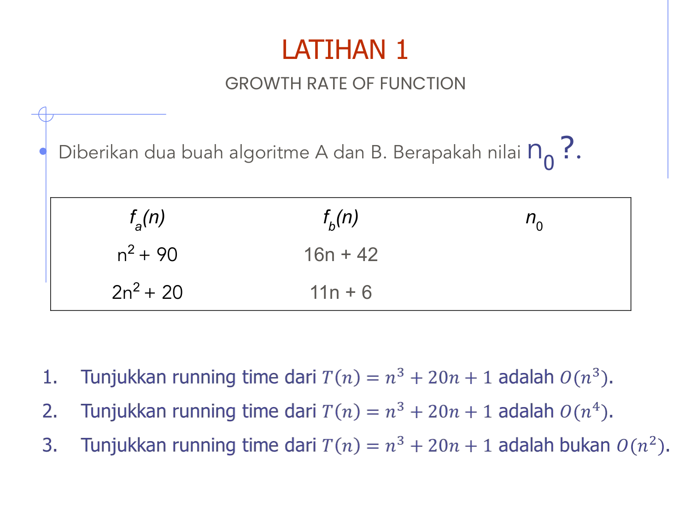

> [!example] Latihan Ujian Slide 26
> Tentukan nilai ambang n_0 di mana satu algoritme mulai mengungguli algoritme lain (f_a(n) vs f_b(n)).

### Soal A: f_a(n) = n² + 90 dan f_b(n) = 16n + 42
Cari perpotongan dengan menyamakan kedua fungsi:
$n² + 90 = 16n + 42 → n² - 16n + 48 = 0$
Faktorkan persamaan kuadrat:
$(n - 4)(n - 12) = 0 → n = 4   atau   n = 12$

- Untuk n < 4: f_a(n) > f_b(n)
- Untuk 4 < n < 12: f_a(n) < f_b(n) (Algoritme A lebih cepat)
- Untuk n > 12: f_a(n) > f_b(n) (Algoritme B jauh lebih cepat karena berordo linear O(n))
- **Maka n_0 = 12**. Setelah n ≥ 12, fungsi n² + 90 selalu lebih lambat.

### Soal B: f_a(n) = 2n² + 20 dan f_b(n) = 11n + 6
$2n² + 20 = 11n + 6 → 2n² - 11n + 14 = 0$
Hitung diskriminan D:
$D = (-11)^2 - 4(2)(14) = 121 - 112 = 9$
$n = \frac{11 \pm \sqrt{9}}{2(2)} = \frac{11 \pm 3}{4} → n_1 = \frac{8}{4} = 2,   n_2 = \frac{14}{4} = 3{,}5$
- Untuk bilangan bulat n ≥ 4: f_a(n) > f_b(n).
- **Maka n_0 = 4**.

---

## 6. Latihan Slide 27: Analisis Tiga Skenario Bubble Sort

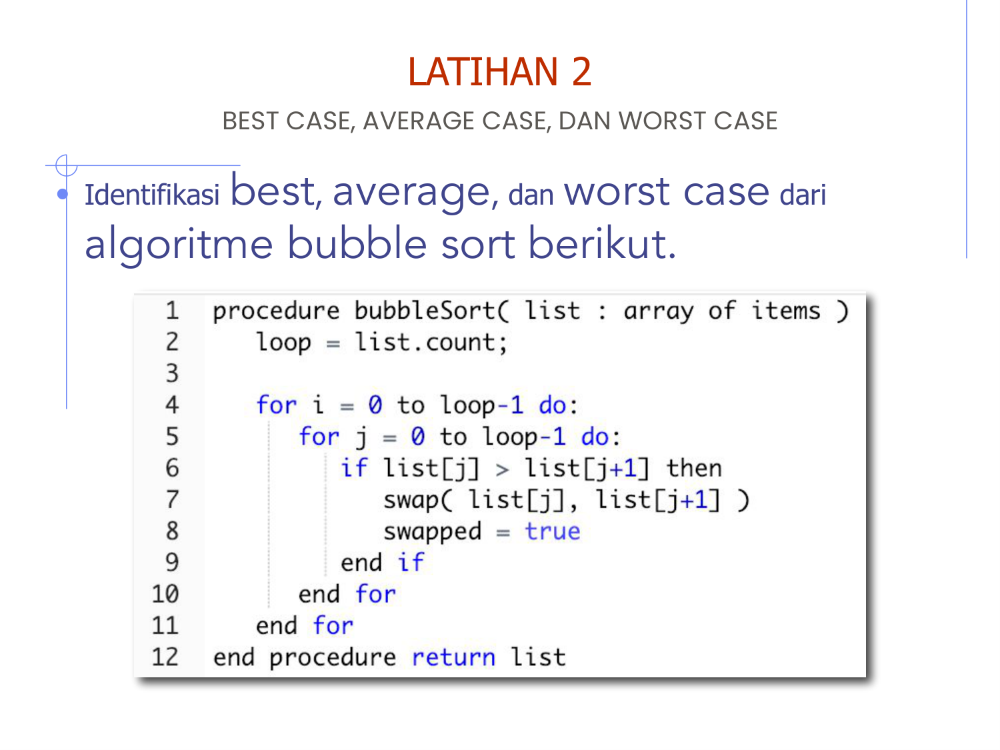

```python
def bubble_sort(A, n):
    for i in range(n - 1):
        swapped = False
        for j in range(n - 1 - i):
            if A[j] > A[j + 1]:
                A[j], A[j + 1] = A[j + 1], A[j]
                swapped = True
        if not swapped: # Optimasi Early Stop
            break
```

1. **Best Case**: Array sudah terurut menaik ([1, 2, 3, 4, 5]).
   - Pada iterasi luar pertama (i = 0), dilakukan n-1 perbandingan.
   - Variabel `swapped` tetap `False`, algoritme langsung berhenti (`break`).
   - Waktu: (n - 1) = Θ(n).
2. **Worst Case**: Array terurut terbalik ([5, 4, 3, 2, 1]).
   - Setiap elemen harus ditukar di setiap iterasi.
   - Jumlah perbandingan:
     $∑_{i=0}^{n-2} (n - 1 - i) = (n - 1) + (n - 2) + ... + 1 = \frac{n(n - 1)}{2} = Θ(n²)$
3. **Average Case**: Susunan array acak. Rata-rata perbandingan dan pertukaran tetap Θ(n²).

---

## 🎯 Rangkuman Cepat untuk Ujian (ADHD Takeaways)
- Big-O = Batas Atas (≤ c · g(n)).
- Big-Omega = Batas Bawah (≥ c · g(n)).
- Big-Theta = Batas Ketat (c_1 g(n) ≤ f(n) ≤ c_2 g(n)).
- Trik cari c dan n_0 untuk polinom: Jadikan semua suku memiliki pangkat tertinggi pada n ≥ 1, lalu jumlahkan koefisiennya untuk mendapatkan c.
