---
tags:
  - analisis-algoritma
  - uts
  - week-04
  - iterative-complexity
  - nested-loops
  - harmonic-series
  - matrix-multiplication
  - primality
created: 2026-10-12
week: 4
source: "Analysis of Algorithms 4_ganjil 2025-2026_SENT.pptx.pdf"
---

# Week 04 - Analisis Algoritme Iteratif

> [!summary] Navigasi Catatan
> - **Prev**: [[Week 03 - Analisis Kasus dan Batas Asimtotik|Week 03 - Analisis Kasus dan Batas Asimtotik]]
> - **MOC Master**: [[00 - MOC Analisis Algoritma UTS|00 - Map of Content Analisis Algoritme UTS]]
> - **Next**: [[Week 05 - Analisis Algoritme Rekursif (Recurrence)|Week 05 - Analisis Algoritme Rekursif (Recurrence)]]

---

## 1. Aturan Dasar Struktur Kontrol (Control Structures)

Dalam menganalisis kompleksitas kode iteratif non-rekursif, aturan asimtotik diturunkan dari struktur kontrol pemrograman:

### A. Operasi Sekuensial (Rule of Sum / Max)
Jika instruksi dijalankan berurutan:
$T(n) = T_1(n) + T_2(n) → O(T(n)) = \max(O(T_1(n)), O(T_2(n)))$

### B. Percabangan (Conditional If-Then-Else)
```c
if (kondisi) {
    blok_1(); // T1(n)
} else {
    blok_2(); // T2(n)
}
```
$T(n) = T_{kondisi} + \max(T_1(n), T_2(n)) = O(\max(T_1(n), T_2(n)))$

---

## 2. Tipologi Pola Looping & Analisis Matematis

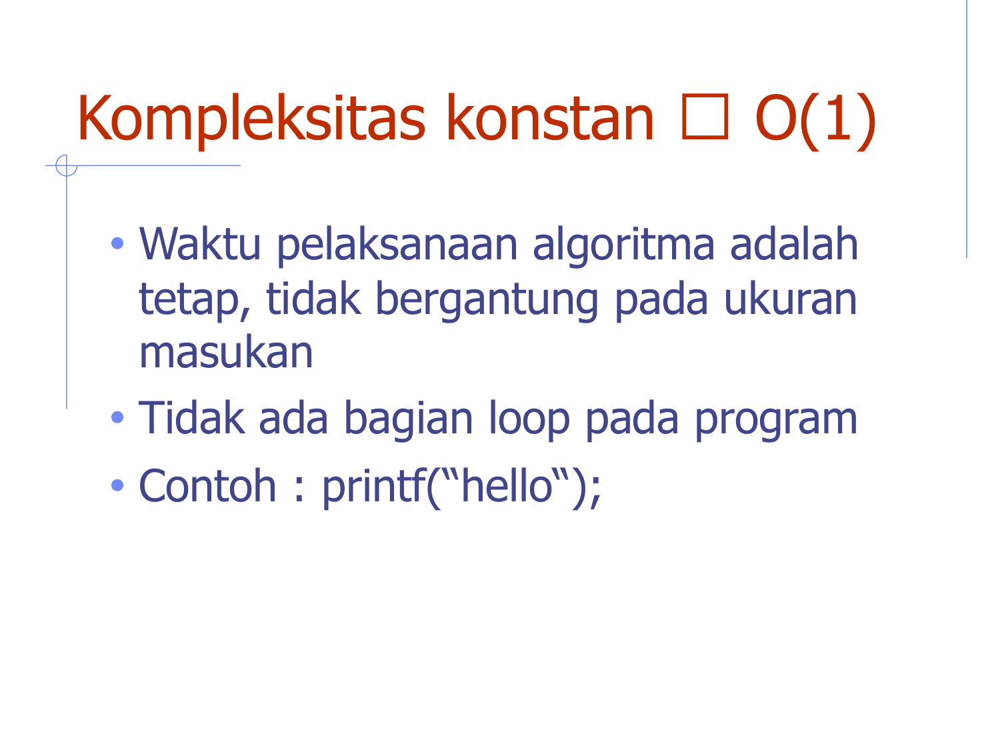

### A. Pola 1: Loop Linear Tunggal
Increment/decrement penjumlahan konstan (i = i + 1 atau i = i + c):
```c
for (int i = 0; i < n; i++) {
    operasi_konstan();
}
```
Jumlah iterasi = n → Θ(n).

---

### B. Pola 2: Loop Bersarang Independen (Nested Independent Loops)
Ukuran loop dalam tidak bergantung pada variabel loop luar:
```c
for (int i = 0; i < n; i++) {
    for (int j = 0; j < m; j++) {
        operasi_konstan();
    }
}
```
Total langkah = ∑_{i=1}^n ∑_{j=1}^m 1 = n × m → Θ(nm). Jika m = n, maka Θ(n²).

---

### C. Pola 3: Loop Bersarang Dependen (Dependent Nested Loops)
Batas loop dalam bergantung pada indeks loop luar (j ≤ i):
```c
for (int i = 1; i <= n; i++) {
    for (int j = 1; j <= i; j++) {
        operasi_konstan();
    }
}
```
Total langkah:
$∑_{i=1}^n i = 1 + 2 + 3 + ... + n = \frac{n(n + 1)}{2} = \frac{1}{2}n² + \frac{1}{2}n → Θ(n²)$

---

### D. Pola 4: Loop Logaritmik Geometris (i = i × c atau n = n / c)

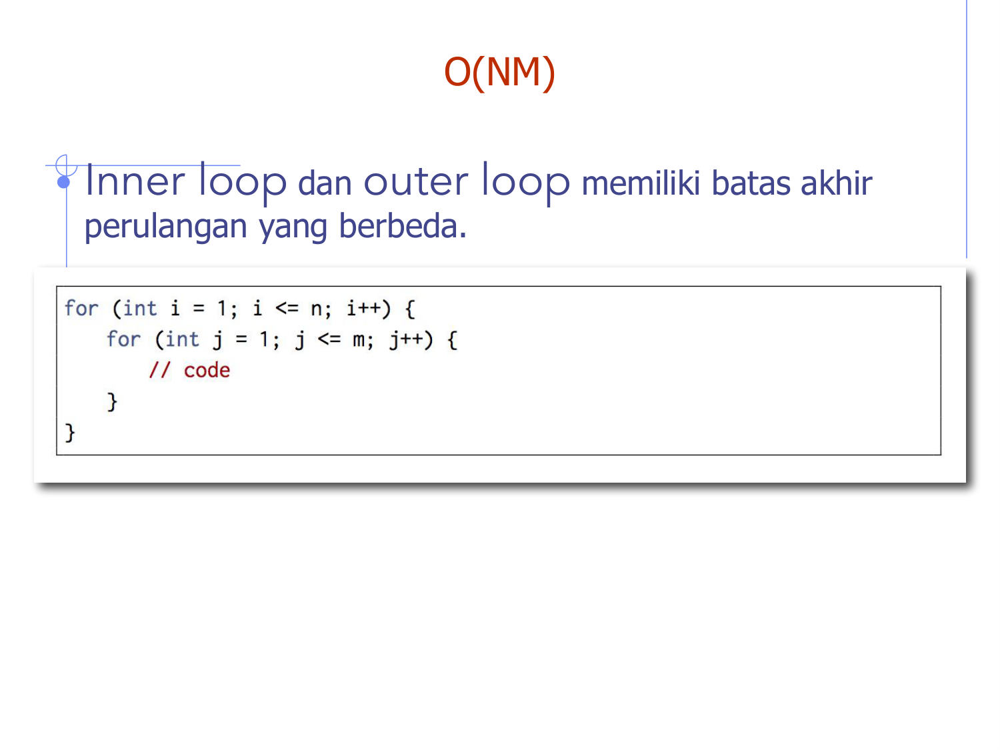

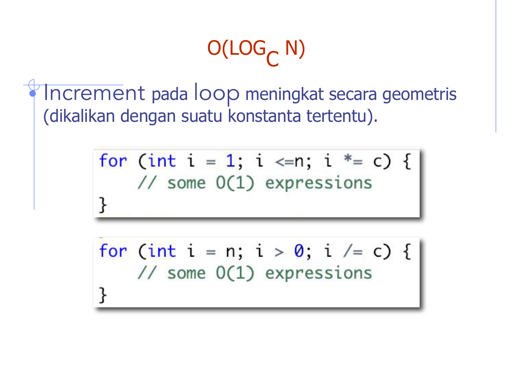

```c
for (int i = 1; i <= n; i = i * 2) {
    operasi_konstan();
}
```
- Nilai i pada iterasi ke-k: i_k = 2^k.
- Loop berhenti saat 2^k ≥ n → k = ⌈ \log₂ n ⌉.
- **Kompleksitas: Θ(\log n)**.

Jika loop membagi input (n = n / 2):
```c
while (n > 1) {
    n = n / 2;
}
```
Jumlah langkah tetap Θ(\log n).

---

### E. Pola 5: Loop Eksponensial Increment (O(\log \log n))

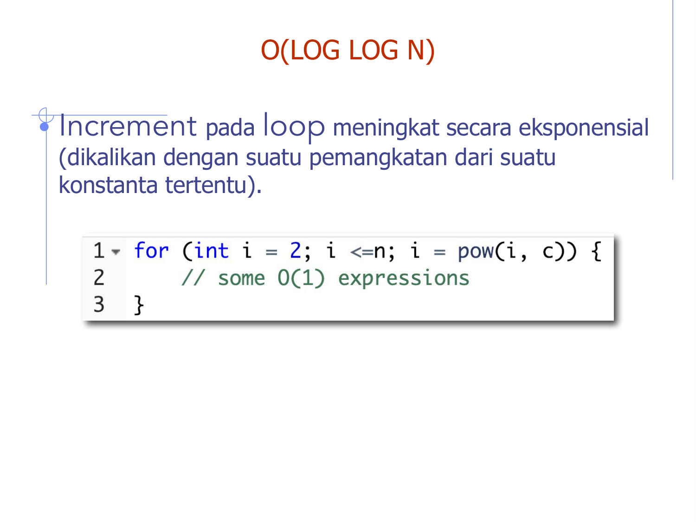

Increment variabel loop dinaikkan secara pemangkatan (i = i^2):
```c
for (int i = 2; i <= n; i = i * i) {
    operasi_konstan();
}
```
- Iterasi 1: i = 2 = 2^{2^0}
- Iterasi 2: i = 4 = 2^2 = 2^{2^1}
- Iterasi 3: i = 16 = 2^4 = 2^{2^2}
- Iterasi k: i_k = 2^{2^{k-1}}
- Loop berhenti saat 2^{2^{k-1}} ≥ n:
  $\log₂(2^{2^{k-1}}) ≥ \log₂ n → 2^{k-1} ≥ \log₂ n → k - 1 ≥ \log₂(\log₂ n)$
  $k = Θ(\log \log n)$
- **Kompleksitas: Θ(\log \log n)**.

---

## 3. Studi Kasus Algoritme dari Slide Kuliah

### A. Bubble Sort Analisis Iteratif

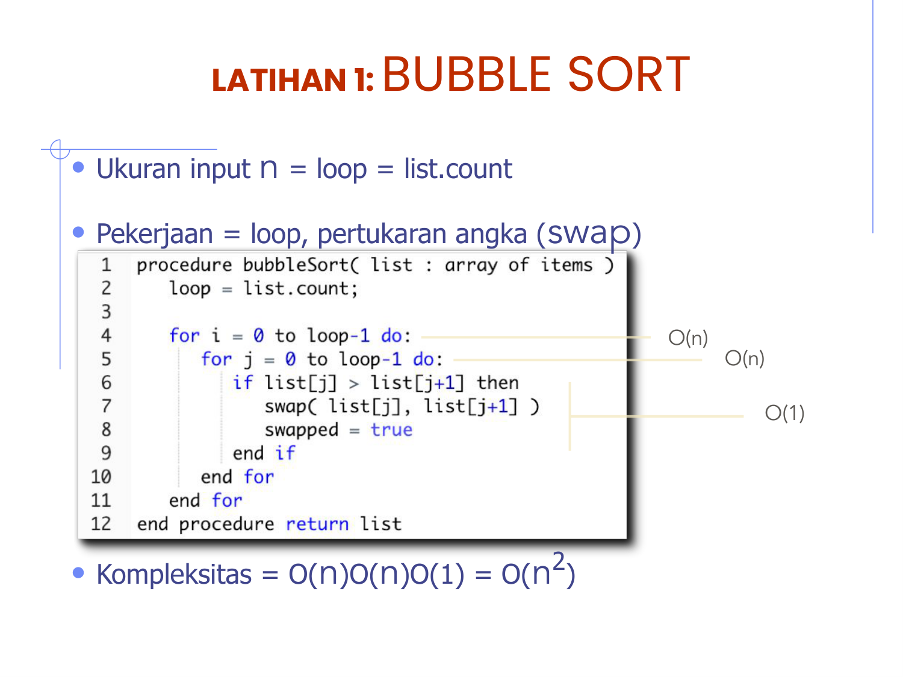

- Ukuran input n = list.count.
- Operasi dominan: perbandingan dan pertukaran (*swap*).
- Kompleksitas: O(n) · O(n) · O(1) = O(n²).

---

### B. Pattern Matching (String Searching Naif)

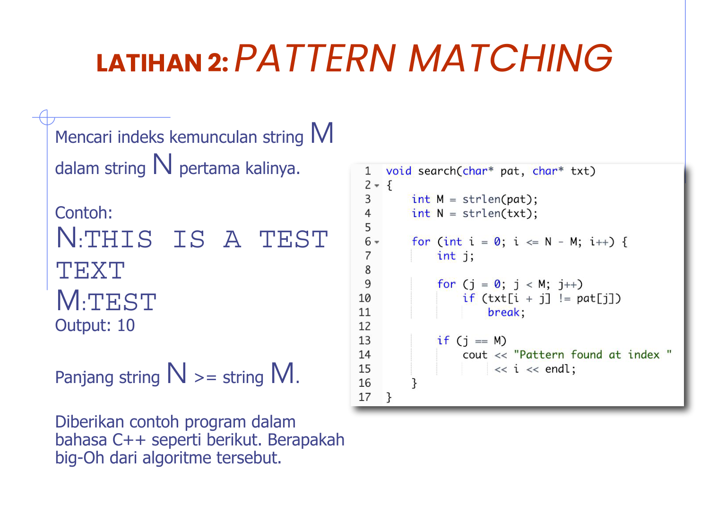

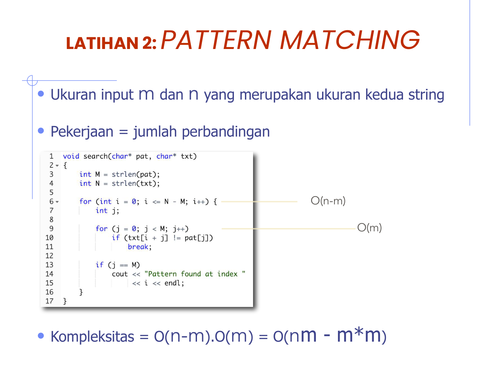

Mencari kemunculan substring pola M (panjang m) di dalam teks N (panjang n):
- Loop luar bergeser sebanyak: (n - m + 1) posisi.
- Loop dalam membandingkan karakter pola sebanyak: m karakter.
- Total kompleksitas terburuk:
  $O((n - m + 1) · m) = O(nm - m^2) → O(nm)$

---

### C. Perkalian Matriks (Matrix Multiplication)

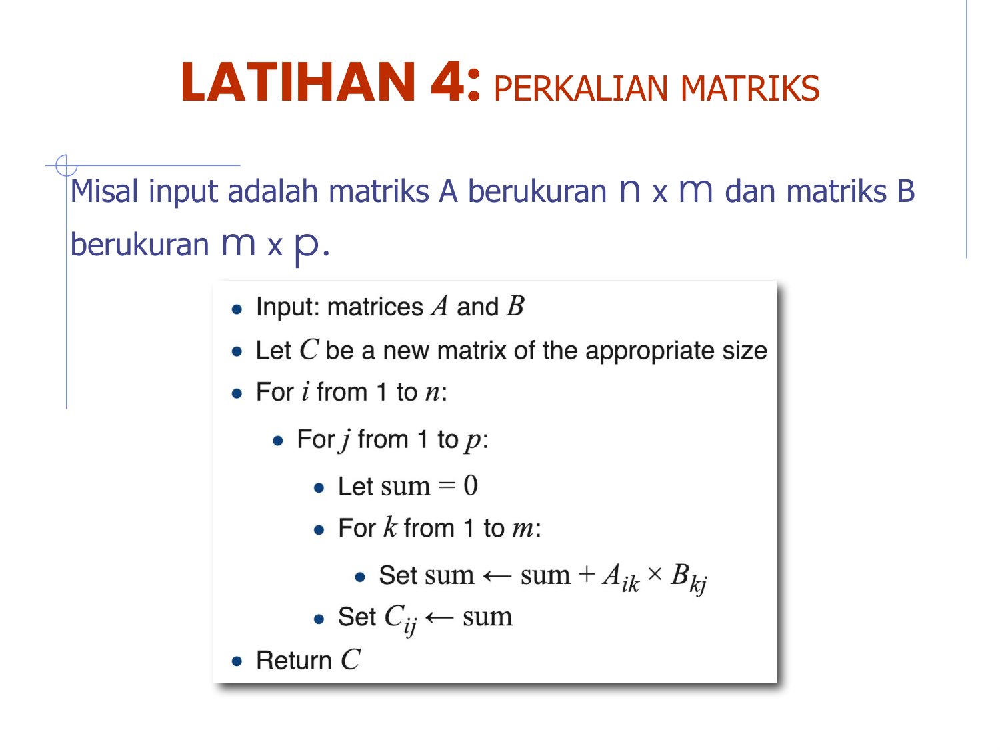

Diberikan matriks A berukuran n × m dan matriks B berukuran m × p:
```c
for (int i = 0; i < n; i++) {
    for (int j = 0; j < p; j++) {
        C[i][j] = 0;
        for (int k = 0; k < m; k++) {
            C[i][j] += A[i][k] * B[k][j]; // Perkalian primitif
        }
    }
}
```
- Loop 1 (baris A): berjalan n kali.
- Loop 2 (kolom B): berjalan p kali.
- Loop 3 (perkalian skalar k): berjalan m kali.
- **Total Operasi Perkalian**: n × p × m → Θ(n · m · p).
- Jika matriks persegi (n × n): **Θ(n³)**.

---

### D. Fibonacci Iteratif

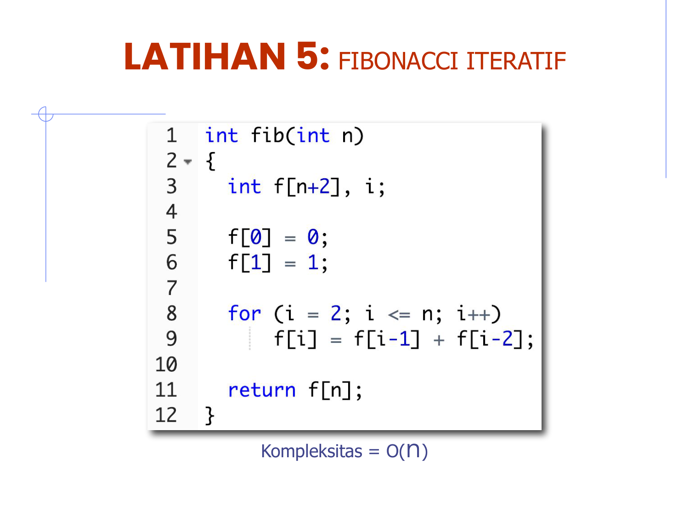

```python
def fibonacci(n):
    if n <= 1:
        return n
    a, b = 0, 1
    for i in range(2, n + 1):
        c = a + b
        a = b
        b = c
    return b
```
- Satu loop tunggal dari 2 hingga n → (n - 1) iterasi.
- **Time Complexity: Θ(n)**.
- **Space Complexity: Θ(1)** (hanya 3 variabel penampung). Jauh lebih unggul dibandingkan rekursif naif yang bernilai Θ(2ⁿ)!

---

### E. Studi Kasus Desain: Uji Faktor Pembagi / Bilangan Prima (n ≤ 10^{12})

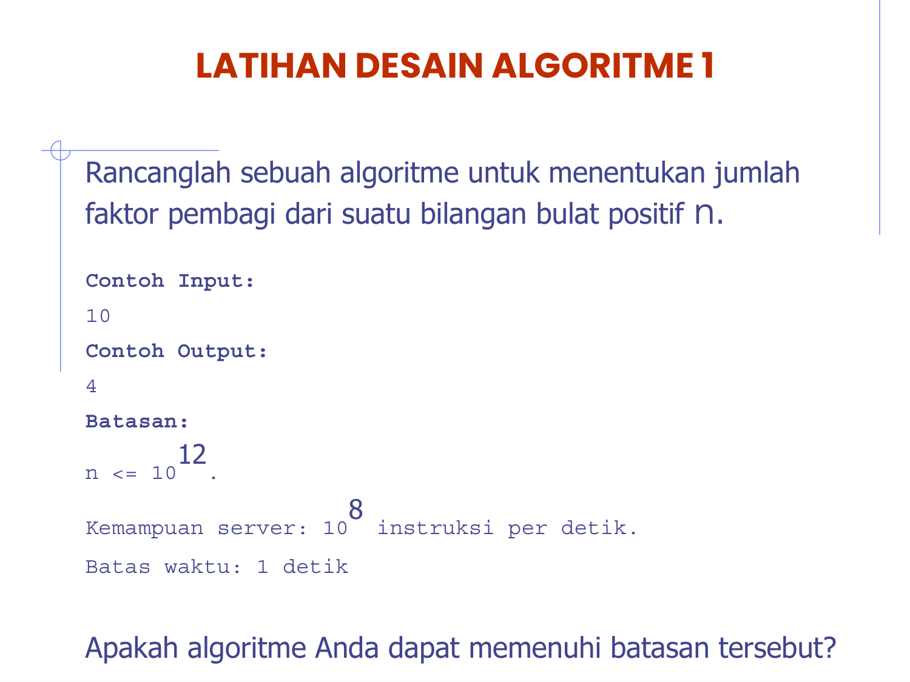

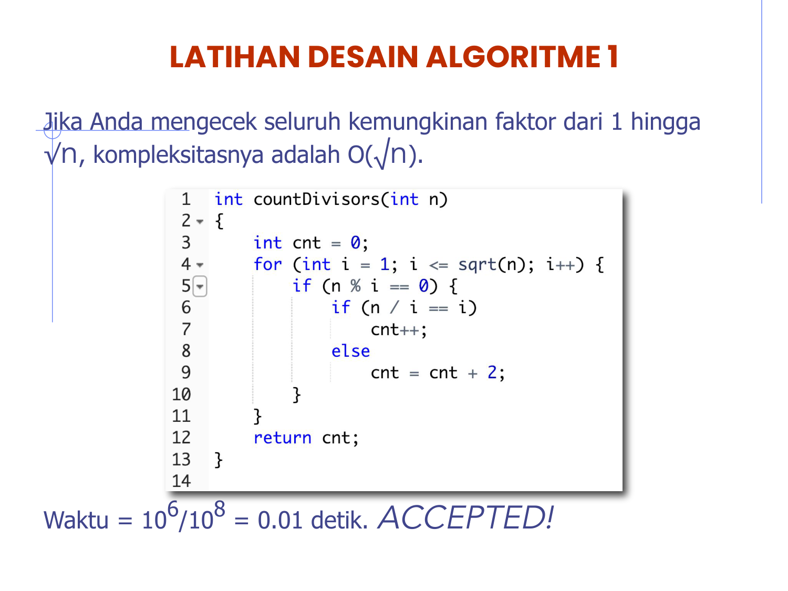

> [!important] Batasan Real-World Engineering
> Server mengeksekusi 10^8 operasi per detik. Batas waktu eksekusi: **1 detik**. Input n ≤ 10^{12}.

1. **Pendekatan Naif (O(n))**:
   - Cek semua bilangan dari 1 hingga n.
   - Jumlah operasi: 10^{12}.
   - Waktu tempuh: \frac{10^{12}}{10^8} = 10^4  detik ≈ 2{,}77  jam → **Time Limit Exceeded (TLE)**.
2. **Pendekatan Optimal (O(√n))**:
   - Faktor selalu muncul berpasangan: jika d membagi n, maka \frac{n}{d} juga membagi n.
   - Jika d ≤ \frac{n}{d}, maka d^2 ≤ n → d ≤ √n. Cukup uji sampai √n!
   - Jumlah operasi: \sqrt{10^{12}} = 10^6.
   - Waktu tempuh: \frac{10^6}{10^8} = 0{,}01  detik → **ACCEPTED!**

---

## 4. Pembahasan Detail Soal Kompleksitas Loop Unik (Slide 28–45)

### Soal 1: Penjumlahan Akumulatif dalam Kondisi Loop (`s <= n`)

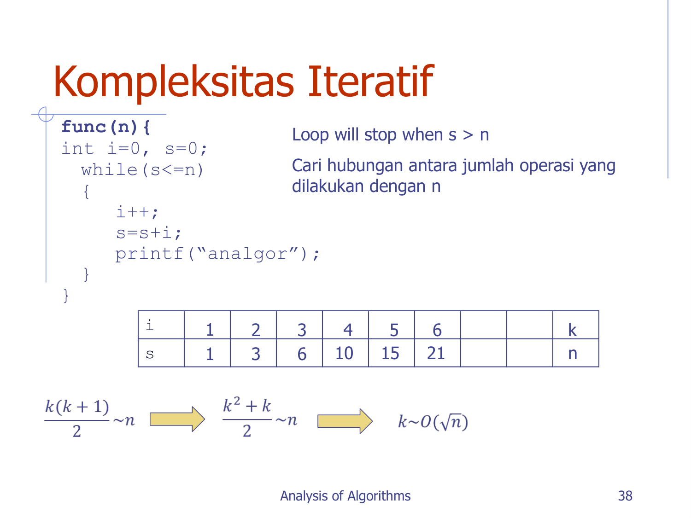

```c
func(n) {
    int i = 0, s = 0;
    while (s <= n) {
        i++;
        s = s + i;
        printf("analgor");
    }
}
```
- Nilai s bertambah:
  - Iterasi 1: s = 1
  - Iterasi 2: s = 1 + 2 = 3
  - Iterasi 3: s = 1 + 2 + 3 = 6
  - Iterasi k: s_k = \frac{k(k + 1)}{2} ≈ \frac{k^2}{2}
- Loop berhenti ketika s_k > n:
  $\frac{k^2}{2} > n → k^2 > 2n → k = Θ(√n)$
- **Kompleksitas: Θ(√n)**.

---

### Soal 2: Nested Loop dengan Harmonic Series

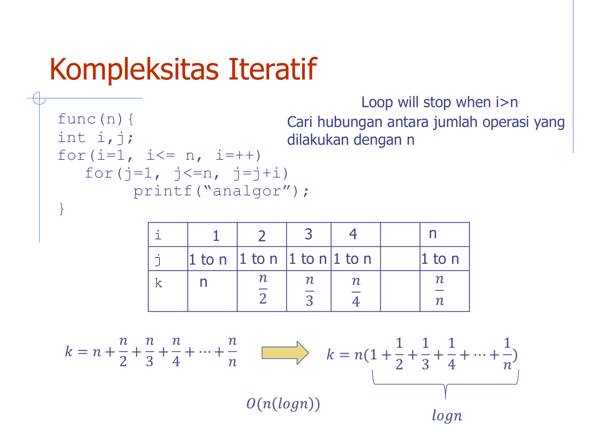

```c
func(n) {
    int i, j;
    for (i = 1; i <= n; i++) {
        for (j = 1; j <= n; j = j + i) {
            printf("analgor");
        }
    }
}
```
- Loop luar: i bernilai 1, 2, 3, ..., n.
- Pada nilai i tertentu, loop dalam bertambah dengan step i, sehingga berjalan sebanyak ⌈ \frac{n}{i} ⌉ kali.
- Total operasi:
  $∑_{i=1}^n \frac{n}{i} = n ∑_{i=1}^n \frac{1}{i}$
- Deret ∑_{i=1}^n \frac{1}{i} adalah **Deret Harmonik (H_n)** yang bernilai ln n + γ = Θ(\log n).
- Maka total waktu: n × Θ(\log n) → **Θ(n \log n)**.

---

### Soal 3: Nested Independent Loops Kombinasi Logaritmik (Slide 44 & 45)

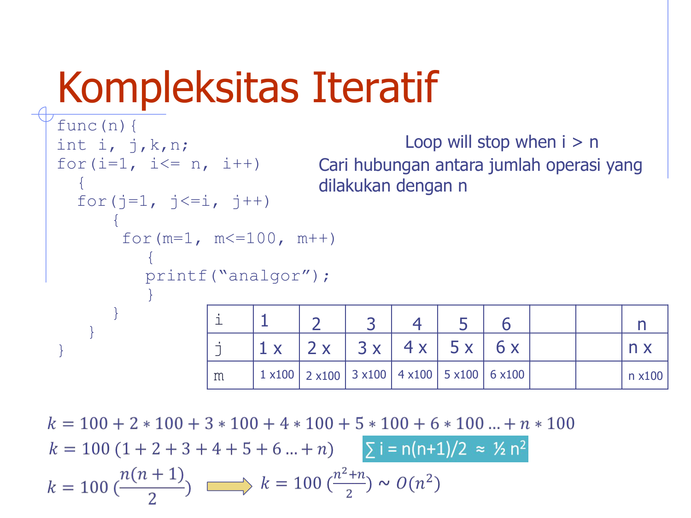

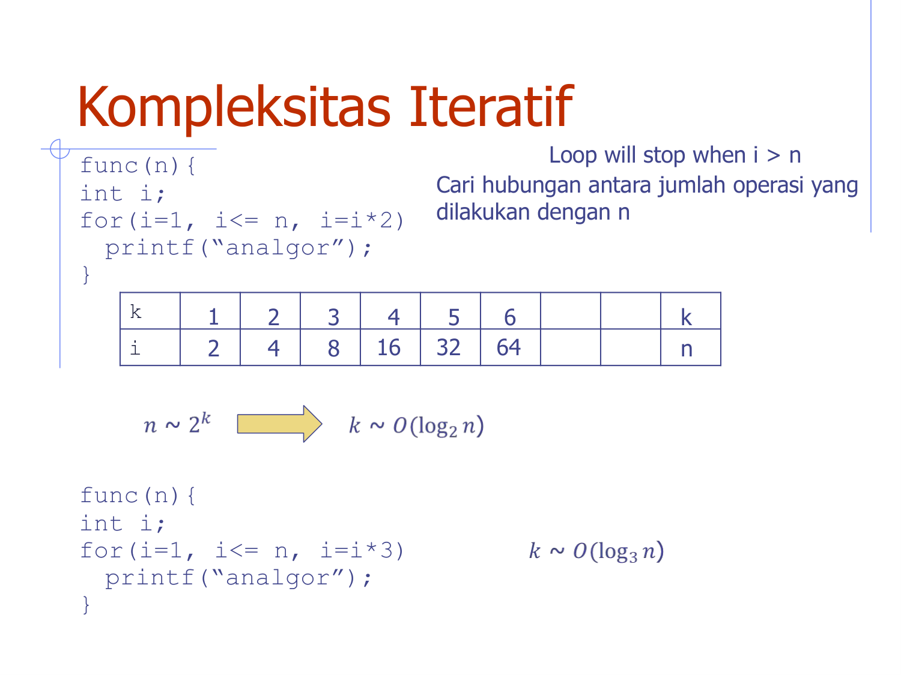

```c
// Kode Slide 44
for (i = n/2; i <= n; i++)           // Berjalan (n - n/2 + 1) ≈ n/2 kali
    for (j = 1; j <= n/2; j++)       // Berjalan n/2 kali
        for (m = 1; m <= n; m = m*2) // Berjalan log2(n) kali
            printf("analgor");
```
- Total: \frac{n}{2} × \frac{n}{2} × \log₂ n = \frac{1}{4} n² \log₂ n → **Θ(n² \log n)**.

```c
// Kode Slide 45
for (i = n/2; i <= n; i++)           // Berjalan n/2 kali
    for (j = 1; j <= n; j = j*2)     // Berjalan log2(n) kali
        for (m = 1; m <= n; m = m*2) // Berjalan log2(n) kali
            printf("analgor");
```
- Total: \frac{n}{2} × \log₂ n × \log₂ n = \frac{1}{2} n \log^2 n → **Θ(n \log^2 n)**.

---

## 🎯 Rangkuman Cepat untuk Ujian (ADHD Takeaways)
- Akumulasi s = s + i dengan `s <= n` menghasilkan waktu **Θ(√n)**.
- Pola pembagi j = j + i menghasilkan deret harmonik **Θ(n \log n)**.
- i = i × c → Θ(\log n).
- i = i^2 → Θ(\log \log n).
- Perkalian matriks n × m dan m × p → Θ(n · m · p).
