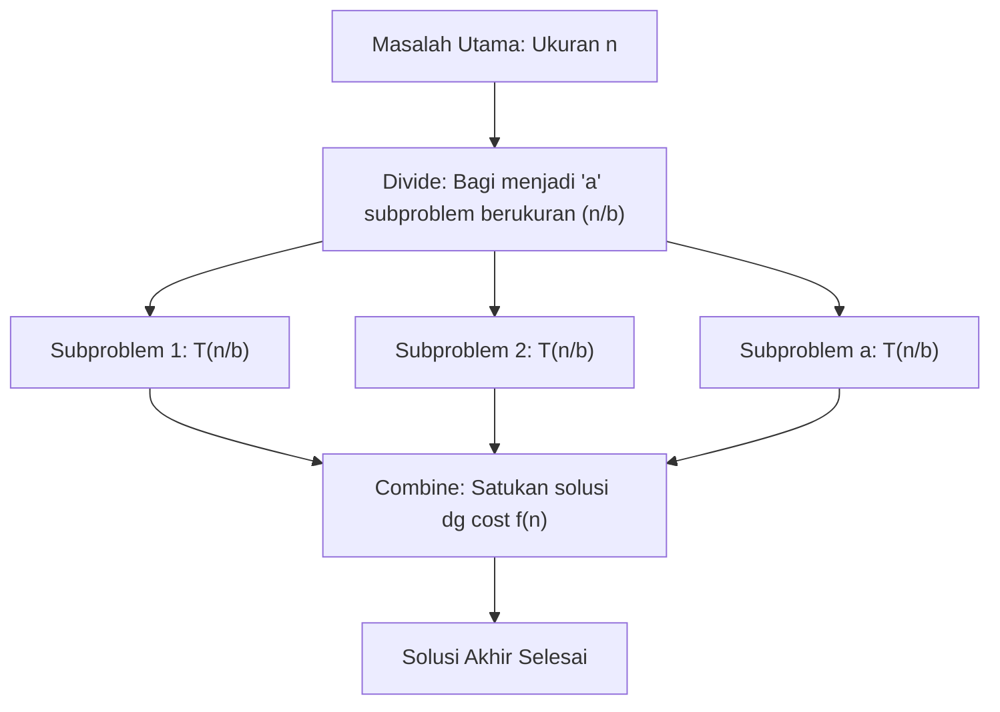

---
tags:
  - analisis-algoritma
  - uts
  - week-05
  - recurrence-relations
  - master-theorem
  - recursion-tree
  - substitution-method
  - akra-bazzi
created: 2026-10-12
week: 5
source: "05 Analisis Algoritme Rekursif_SENT.pdf"
---

# Week 05 - Analisis Algoritme Rekursif (Recurrence Relations)

> [!summary] Navigasi Catatan
> - **Prev**: [[Week 04 - Analisis Algoritme Iteratif|Week 04 - Analisis Algoritme Iteratif]]
> - **MOC Master**: [[00 - MOC Analisis Algoritma UTS|00 - Map of Content Analisis Algoritme UTS]]
> - **Next**: [[Week 06 - Algoritme Pencarian (Searching)|Week 06 - Algoritme Pencarian (Searching)]]

---

## 1. Konsep Dasar Algoritme Rekursif

> [!important] Definisi Rekursi
> **Rekursi** adalah teknik pemecahan masalah di mana solusi dari masalah berukuran n bergantung pada solusi masalah serupa dengan ukuran yang lebih kecil (*subproblem* berukuran < n).

Struktur dasar algoritme rekursif wajib memiliki dua komponen:
1. **Langkah Basis (*Base Case*)**: Kondisi atomik yang dapat diselesaikan langsung tanpa memanggil fungsi itu sendiri. Berfungsi sebagai **kondisi terminasi**.
2. **Langkah Rekursif (*Recursive Step / Inductive Step*)**: Membagi masalah menjadi satu atau lebih subproblem yang lebih kecil, memanggil fungsi dirinya sendiri, lalu menggabungkan hasilnya (*combine*).

---

## 2. Formulasi Relasi Rekurensi (Recurrence Relation)

Persamaan matematis untuk waktu eksekusi rekursif:
$T(n) = a T≤ft(\frac{n}{b}\right) + f(n)$

Komponen persamaan:
- **a**: Jumlah subproblem yang dihasilkan pada setiap pemanggilan rekursif (a ≥ 1).
- **\frac{n}{b}**: Ukuran subproblem relatif terhadap ukuran masalah asal (b > 1).
- **f(n)**: Usaha komputasi non-rekursif untuk membagi input (*divide*) dan menggabungkan hasil (*combine*).

### Studi Kasus 1: Binary Search
- Setiap langkah membagi list menjadi 2 bagian sama besar (b = 2).
- Hanya memproses **1** bagian yang relevan (a = 1).
- Usaha perbandingan nilai tengah adalah konstan (f(n) = Θ(1)).
- **Relasi Rekurensi**:
  $T(n) = T≤ft(\frac{n}{2}\right) + 1$

---

### Studi Kasus 2: Merge Sort
- Membagi list menjadi 2 bagian berukuran \frac{n}{2} (b = 2).
- Kedua bagian **harus diselesaikan** secara rekursif (a = 2).
- Menggabungkan (*merge*) dua subarray terurut berukuran total n memerlukan paling banyak n - 1 perbandingan (f(n) = Θ(n)).
- **Relasi Rekurensi**:
  $T(n) = 2T≤ft(\frac{n}{2}\right) + n$

---

## 3. Tiga Metode Menyelesaikan Relasi Rekurensi

Terdapat 3 pendekatan standar:
1. **Teknik Substitusi (*Substitution Method*)**
2. **Teknik Pohon Rekursif (*Recursion Tree Method*)**
3. **Teknik Teorema Master (*Master Theorem Method*)**

---

### Metode 1: Teknik Substitusi (Guess and Check)
1. **Tebak** pola batas atas notasi asimtotik (O(g(n))).
2. **Buktikan** menggunakan induksi matematika bahwa T(n) ≤ c · g(n).
3. Tentukan konstanta c dan base case n_0.

Sangat bermanfaat untuk relasi non-trivial atau rekurensi yang tidak memenuhi prasyarat Teorema Master (misal ukuran subproblem bervariasi).

---

### Metode 2: Teknik Pohon Rekursif (Recursion Tree Method)

Langkah-langkah:
1. Gambar pemanggilan rekursif sebagai node pohon.
2. Setiap node menyimpan biaya non-rekursifnya (f(ukuran)).
3. Hitung jumlah total biaya pada setiap level (kedalaman i).
4. Jumlahkan deret biaya seluruh level dari level 0 hingga daun (*leaves*).

#### Contoh Soal Slide 20–22:
Selesaikan relasi dengan subproblem asimetris:
$T(n) = T≤ft(\frac{n}{4}\right) + T≤ft(\frac{n}{2}\right) + c n²$

- **Level 0 (Root)**:
  $Cost = c n²$
- **Level 1**:
  $Cost = c≤ft(\frac{n}{4}\right)^2 + c≤ft(\frac{n}{2}\right)^2 = c n² ≤ft(\frac{1}{16} + \frac{1}{4}\right) = c n² ≤ft(\frac{5}{16}\right)$
- **Level 2**:
  Subproblem dipecah lagi menjadi (n/16, n/8) dan (n/8, n/4):
  $Cost = c n² ≤ft(\frac{5}{16}\right)^2$
- **Level k**:
  $Cost = c n² ≤ft(\frac{5}{16}\right)^k$
- **Total Biaya Seluruh Pohon**:
  $S_n = c n² ∑_{k=0}^∞ ≤ft(\frac{5}{16}\right)^k$
  Karena rasio r = \frac{5}{16} < 1, gunakan rumus deret geometri tak hingga ∑_{k=0}^∞ r^k = \frac{1}{1 - r}:
  $S_n = c n² · \frac{1}{1 - \frac{5}{16}} = c n² · \frac{16}{11} = \frac{16}{11} c n²$
- **Kesimpulan**: Karena \frac{16}{11} c adalah konstanta, maka T(n) = Θ(n²).

---

## 4. Metode Teorema Master (Master Theorem)

Berlaku untuk bentuk baku:
$T(n) = a T≤ft(\frac{n}{b}\right) + f(n),   a ≥ 1, \, b > 1$

Kunci utama: Hitung eksponen kritis daun pohon n^{\log_b a}, lalu bandingkan laju pertumbuhannya dengan fungsi combine f(n):

### Tiga Kasus Teorema Master:
1. **Kasus 1 (f(n) tumbuh secara polinomial LEBIH LAMBAT dari daun)**:
   $f(n) = O≤ft(n^{\log_b a - ε}\right)  untuk suatu  ε > 0 → T(n) = Θ≤ft(n^{\log_b a}\right)$
   *(Biaya didominasi oleh total pekerjaan pada daun).*
2. **Kasus 2 (f(n) dan daun tumbuh SETARA / SEIMBANG)**:
   $f(n) = Θ≤ft(n^{\log_b a} \log^k n\right)  untuk  k ≥ 0 → T(n) = Θ≤ft(n^{\log_b a} \log^{k+1} n\right)$
   *(Jika k = 0, yaitu f(n) = Θ(n^{\log_b a}), maka T(n) = Θ(n^{\log_b a} \log n)).*
3. **Kasus 3 (f(n) tumbuh secara polinomial LEBIH CEPAT dari daun)**:
   $f(n) = Ω≤ft(n^{\log_b a + ε}\right)  untuk suatu  ε > 0$
   Serta memenuhi **Kondisi Regularitas**: a f(n/b) ≤ c f(n) untuk suatu konstanta c < 1 dan n besar.
   $→ T(n) = Θ(f(n))$
   *(Biaya didominasi oleh pekerjaan root).*

---

## 5. Pembahasan Lengkap Latihan Resmi Teorema Master (Slide 26–27)

Berikut tabel analisis lengkap dari 5 soal latihan resmi di slide kuliah:

| No | Relasi Rekurensi | a | b | f(n) | n^{\log_b a} | Relasi f(n) thd n^{\log_b a} | Kasus | Hasil Kompleksitas |
| :---: | :--- | :---: | :---: | :---: | :---: | :---: | :---: | :---: |
| **1** | T(n) = 3T(n/2) + n² | 3 | 2 | n² | n^{\log₂ 3} ≈ n^{1{,}585} | Ω (n² lebih cepat) | **Kasus 3** | **Θ(n²)** |
| **2** | T(n) = 4T(n/2) + n² | 4 | 2 | n² | n^{\log₂ 4} = n² | Θ (setara) | **Kasus 2** | **Θ(n² \log n)** |
| **3** | T(n) = T(n/2) + 2ⁿ | 1 | 2 | 2ⁿ | n^{\log₂ 1} = n^0 = 1 | Ω (2ⁿ jauh lebih cepat) | **Kasus 3** | **Θ(2ⁿ)** |
| **4** | T(n) = 2ⁿ T(n/2) + n^n | 2ⁿ | 2 | n^n | Tidak konstan | - | **Gagal** | **Teorema Master Tidak Berlaku** |
| **5** | T(n) = 16T(n/4) + n | 16 | 4 | n | n^{\log_4 16} = n² | O (n lebih lambat dari n²) | **Kasus 1** | **Θ(n²)** |

### Pembahasan Rinci Tiap Butir Soal:
- **Soal 1: T(n) = 3T(n/2) + n²**
  - a = 3, b = 2 → n^{\log₂ 3} ≈ n^{1{,}585}.
  - f(n) = n² = Ω(n^{1{,}585 + 0{,}415}).
  - Uji Regularitas: a f(n/b) = 3 (n/2)^2 = \frac{3}{4} n² ≤ c n² dengan c = \frac{3}{4} < 1. Terpenuhi!
  - Solusi: T(n) = Θ(n²).
- **Soal 2: T(n) = 4T(n/2) + n²**
  - a = 4, b = 2 → n^{\log₂ 4} = n².
  - f(n) = n² = Θ(n²). (Kasus 2 dengan k = 0).
  - Solusi: T(n) = Θ(n² \log n).
- **Soal 3: T(n) = T(n/2) + 2ⁿ**
  - a = 1, b = 2 → n^{\log₂ 1} = n^0 = 1.
  - f(n) = 2ⁿ = Ω(n^{0 + ε}).
  - Uji Regularitas: 1 · 2^{n/2} ≤ c · 2ⁿ untuk c = \frac{1}{2} < 1. Terpenuhi!
  - Solusi: T(n) = Θ(2ⁿ).
- **Soal 4: T(n) = 2ⁿ T(n/2) + n^n**
  - Syarat Teorema Master: a dan b harus berupa **konstanta**.
  - Pada soal ini, a = 2ⁿ adalah **fungsi dari n**, bukan konstanta!
  - Teorema Master **tidak dapat digunakan**.
- **Soal 5: T(n) = 16T(n/4) + n**
  - a = 16, b = 4 → n^{\log_4 16} = n².
  - f(n) = n = O(n^{2 - 1}) dengan ε = 1 > 0. (Kasus 1).
  - Solusi: T(n) = Θ(n²).

---

## 6. Pengantar Metode Akra-Bazzi (Slide 29)

Jika relasi rekursif memiliki subproblem yang tidak seragam:
$T(n) = ∑_{i=1}^k a_i T(b_i n) + g(n)$
Contoh: T(n) = T(n/4) + T(n/2) + cn².
Teorema Master gagal karena ada dua rasio partisi berbeda (b_1 = 4, b_2 = 2). **Metode Akra-Bazzi** menyelesaikan ini dengan mencari nilai p unik sedemikian rupa sehingga ∑ a_i b_i^p = 1, lalu mengintegralkan fungsinya.

---

## 🎯 Rangkuman Cepat untuk Ujian (ADHD Takeaways)
- Tiga kasus Master Theorem: Bandingkan f(n) dengan n^{\log_b a}.
  - f(n) lebih kecil secara polinomial → ambil daun Θ(n^{\log_b a}).
  - f(n) setara → kalikan faktor log Θ(n^{\log_b a} \log n).
  - f(n) lebih besar secara polinomial + lolos regularitas → ambil root Θ(f(n)).
- Jika a variabel (2ⁿ) atau subproblem asimetris (n/4 dan n/2), Master Theorem GAGAL → gunakan Recursion Tree.
