---
tags:
  - analisis-algoritma
  - uts
  - week-05
  - recurrence-relations
  - master-theorem
  - recursion-tree
  - substitution-method
  - akra-bazzi
created: 2026-10-12
week: 5
source: "05 Analisis Algoritme Rekursif_SENT.pdf"
---

# Week 05 - Analisis Algoritme Rekursif (Recurrence Relations)

> [!summary] Navigasi Catatan
> - **Prev**: [[Week 04 - Analisis Algoritme Iteratif|Week 04 - Analisis Algoritme Iteratif]]
> - **MOC Master**: [[00 - MOC Analisis Algoritma UTS|00 - Map of Content Analisis Algoritme UTS]]
> - **Next**: [[Week 06 - Algoritme Pencarian (Searching)|Week 06 - Algoritme Pencarian (Searching)]]

---

## 1. Konsep Dasar Algoritme Rekursif

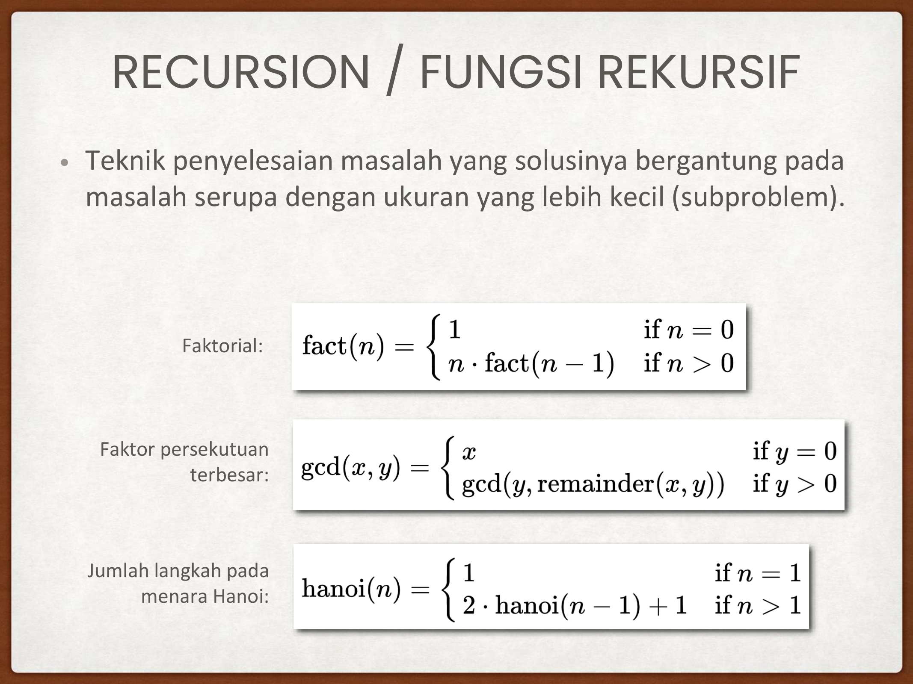

> [!important] Definisi Rekursi
> **Rekursi** adalah teknik pemecahan masalah di mana solusi dari masalah berukuran $n$ bergantung pada solusi masalah serupa dengan ukuran yang lebih kecil (*subproblem* berukuran $< n$).

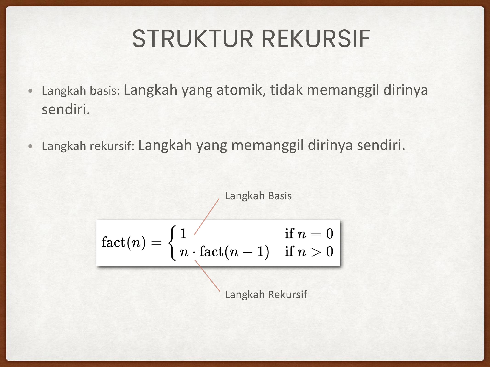

Struktur dasar algoritme rekursif wajib memiliki dua komponen:
1. **Langkah Basis (*Base Case*)**: Kondisi atomik yang dapat diselesaikan langsung tanpa memanggil fungsi itu sendiri. Berfungsi sebagai **kondisi terminasi**.
2. **Langkah Rekursif (*Recursive Step / Inductive Step*)**: Membagi masalah menjadi satu atau lebih subproblem yang lebih kecil, memanggil fungsi dirinya sendiri, lalu menggabungkan hasilnya (*combine*).

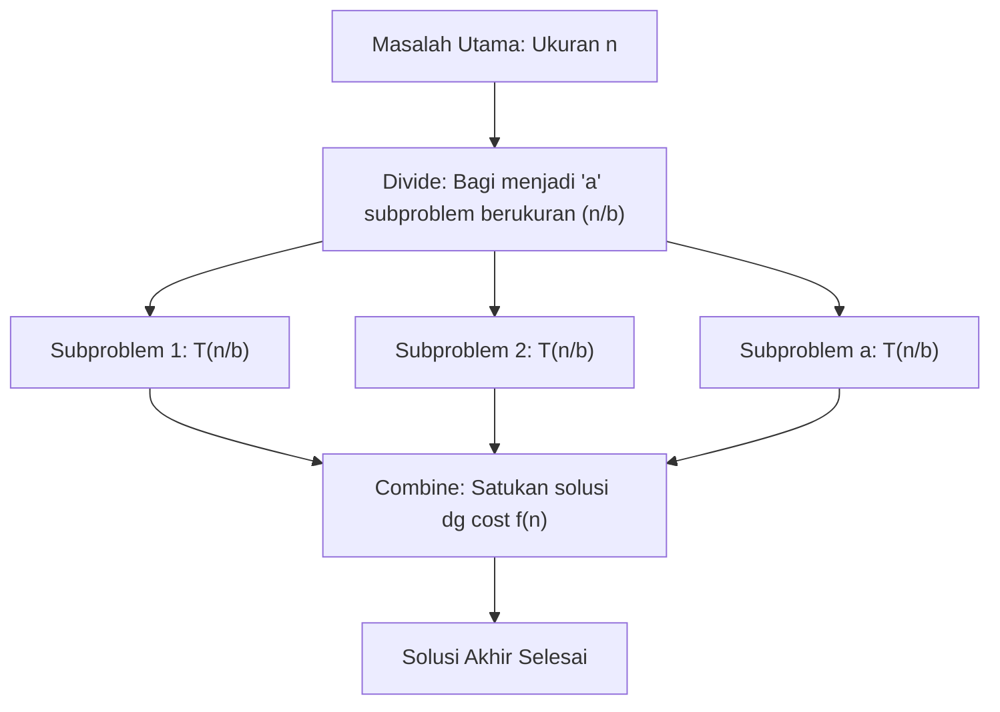

---

## 2. Formulasi Relasi Rekurensi (Recurrence Relation)

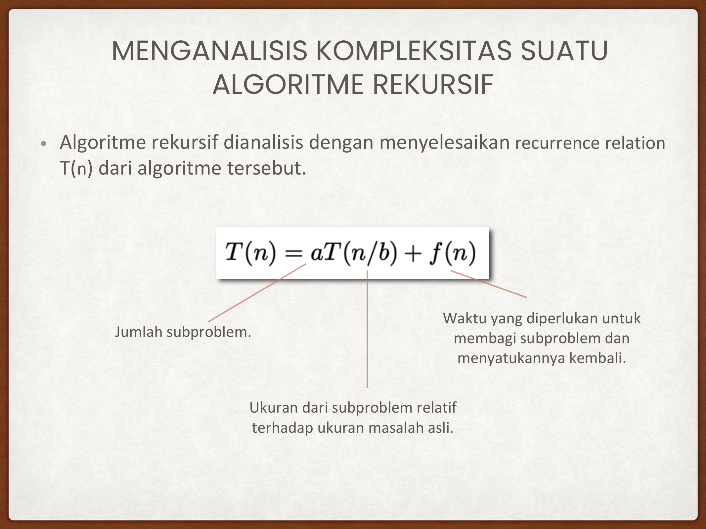

Persamaan matematis untuk waktu eksekusi rekursif:
$$T(n) = a T\left(\frac{n}{b}\right) + f(n)$$

Komponen persamaan:
- **$a$**: Jumlah subproblem yang dihasilkan pada setiap pemanggilan rekursif ($a \ge 1$).
- **$\frac{n}{b}$**: Ukuran subproblem relatif terhadap ukuran masalah asal ($b > 1$).
- **$f(n)$**: Usaha komputasi non-rekursif untuk membagi input (*divide*) dan menggabungkan hasil (*combine*).

### Studi Kasus 1: Binary Search
- Setiap langkah membagi list menjadi 2 bagian sama besar ($b = 2$).
- Hanya memproses **1** bagian yang relevan ($a = 1$).
- Usaha perbandingan nilai tengah adalah konstan ($f(n) = \Theta(1)$).
- **Relasi Rekurensi**:
  $$T(n) = T\left(\frac{n}{2}\right) + 1$$

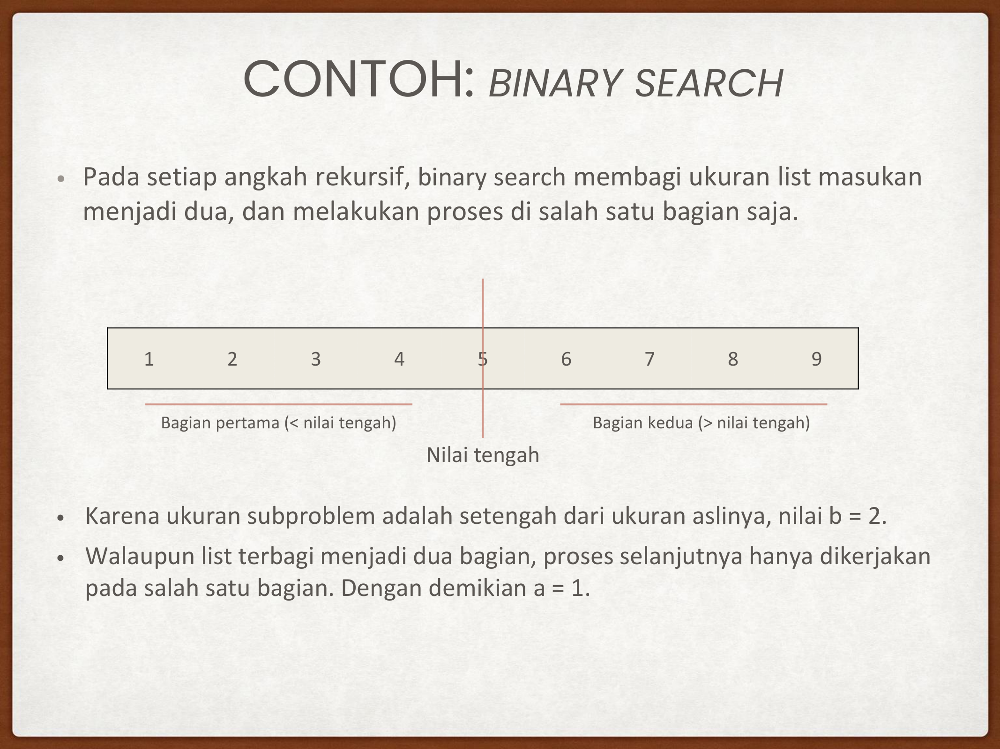

---

### Studi Kasus 2: Merge Sort
- Membagi list menjadi 2 bagian berukuran $\frac{n}{2}$ ($b = 2$).
- Kedua bagian **harus diselesaikan** secara rekursif ($a = 2$).
- Menggabungkan (*merge*) dua subarray terurut berukuran total $n$ memerlukan paling banyak $n - 1$ perbandingan ($f(n) = \Theta(n)$).
- **Relasi Rekurensi**:
  $$T(n) = 2T\left(\frac{n}{2}\right) + n$$

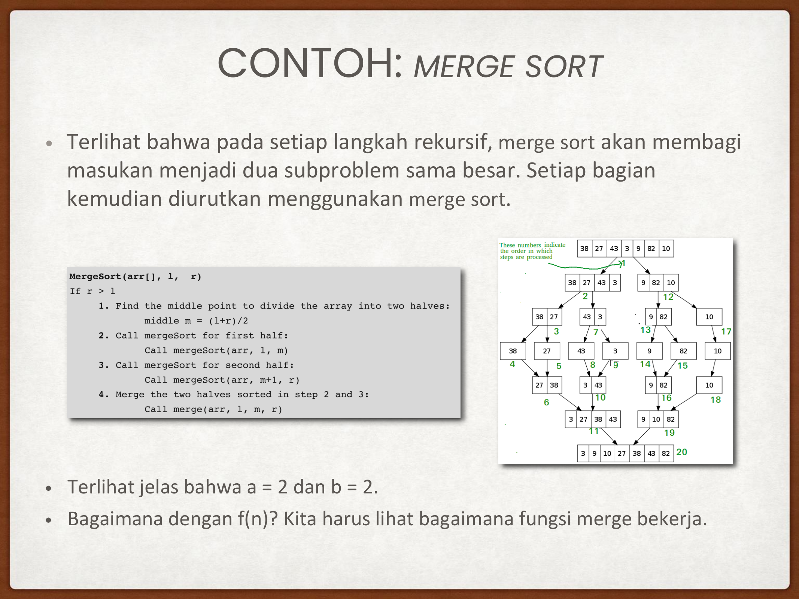

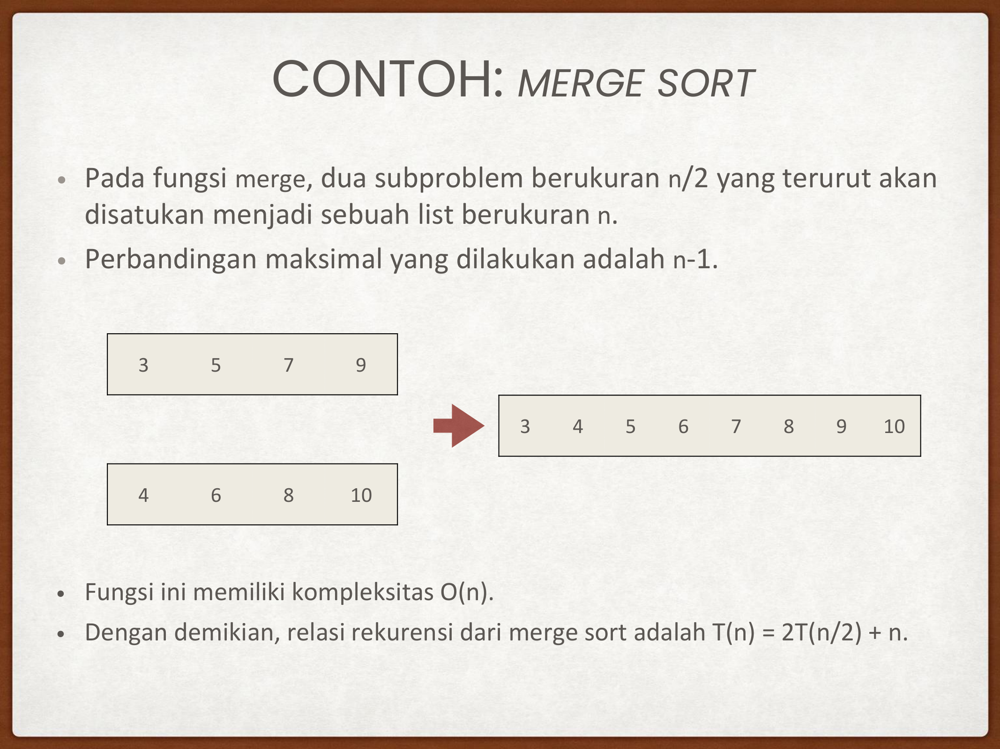

---

## 3. Tiga Metode Menyelesaikan Relasi Rekurensi

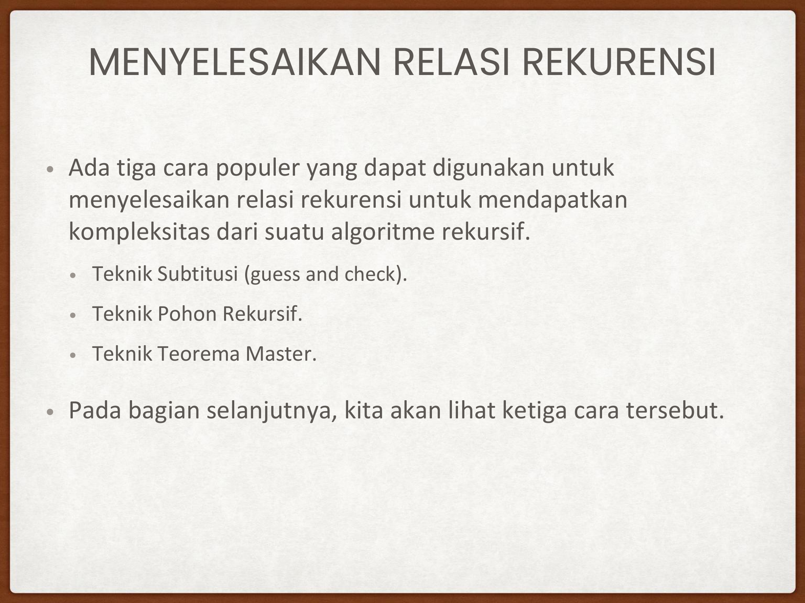

Terdapat 3 pendekatan standar:
1. **Teknik Substitusi (*Substitution Method*)**
2. **Teknik Pohon Rekursif (*Recursion Tree Method*)**
3. **Teknik Teorema Master (*Master Theorem Method*)**

---

### Metode 1: Teknik Substitusi (Guess and Check)
1. **Tebak** pola batas atas notasi asimtotik ($O(g(n))$).
2. **Buktikan** menggunakan induksi matematika bahwa $T(n) \le c \cdot g(n)$.
3. Tentukan konstanta $c$ dan base case $n_0$.

Sangat bermanfaat untuk relasi non-trivial atau rekurensi yang tidak memenuhi prasyarat Teorema Master (misal ukuran subproblem bervariasi).

---

### Metode 2: Teknik Pohon Rekursif (Recursion Tree Method)

Langkah-langkah:
1. Gambar pemanggilan rekursif sebagai node pohon.
2. Setiap node menyimpan biaya non-rekursifnya ($f(\text{ukuran})$).
3. Hitung jumlah total biaya pada setiap level (kedalaman $i$).
4. Jumlahkan deret biaya seluruh level dari level $0$ hingga daun (*leaves*).

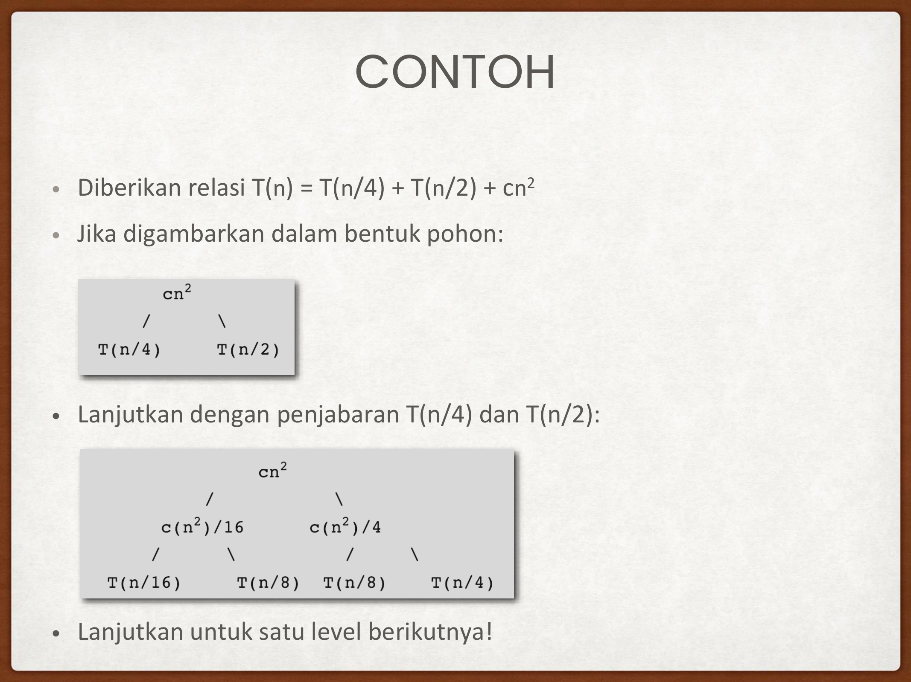

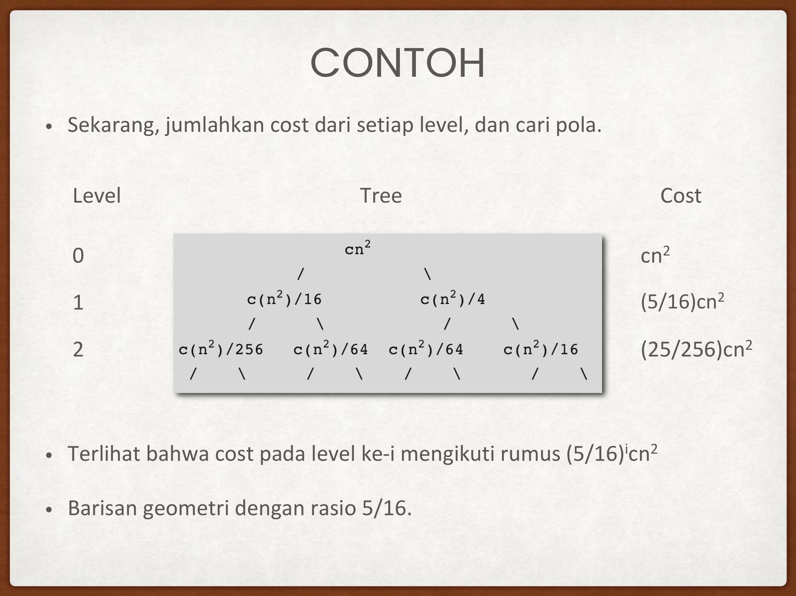

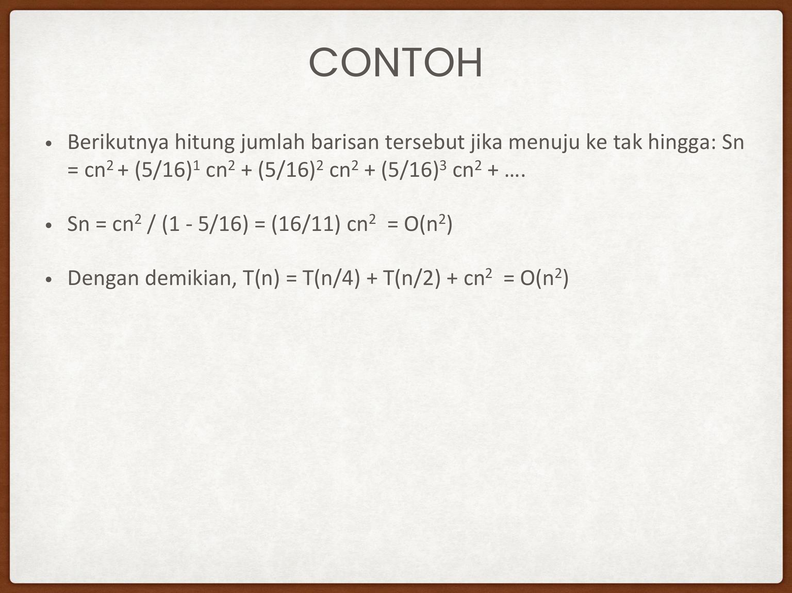

#### Contoh Soal Slide 20–22:
Selesaikan relasi dengan subproblem asimetris:
$$T(n) = T\left(\frac{n}{4}\right) + T\left(\frac{n}{2}\right) + c n^2$$

- **Level 0 (Root)**:
  $$\text{Cost} = c n^2$$
- **Level 1**:
  $$\text{Cost} = c\left(\frac{n}{4}\right)^2 + c\left(\frac{n}{2}\right)^2 = c n^2 \left(\frac{1}{16} + \frac{1}{4}\right) = c n^2 \left(\frac{5}{16}\right)$$
- **Level 2**:
  Subproblem dipecah lagi menjadi $(n/16, n/8)$ dan $(n/8, n/4)$:
  $$\text{Cost} = c n^2 \left(\frac{5}{16}\right)^2$$
- **Level $k$**:
  $$\text{Cost} = c n^2 \left(\frac{5}{16}\right)^k$$
- **Total Biaya Seluruh Pohon**:
  $$S_n = c n^2 \sum_{k=0}^\infty \left(\frac{5}{16}\right)^k$$
  Karena rasio $r = \frac{5}{16} < 1$, gunakan rumus deret geometri tak hingga $\sum_{k=0}^\infty r^k = \frac{1}{1 - r}$:
  $$S_n = c n^2 \cdot \frac{1}{1 - \frac{5}{16}} = c n^2 \cdot \frac{16}{11} = \frac{16}{11} c n^2$$
- **Kesimpulan**: Karena $\frac{16}{11} c$ adalah konstanta, maka $T(n) = \Theta(n^2)$.

---

## 4. Metode Teorema Master (Master Theorem)

Berlaku untuk bentuk baku:
$$T(n) = a T\left(\frac{n}{b}\right) + f(n), \quad a \ge 1, \, b > 1$$

Kunci utama: Hitung eksponen kritis daun pohon $n^{\log_b a}$, lalu bandingkan laju pertumbuhannya dengan fungsi combine $f(n)$:

### Tiga Kasus Teorema Master:
1. **Kasus 1 ($f(n)$ tumbuh secara polinomial LEBIH LAMBAT dari daun)**:
   $$f(n) = O\left(n^{\log_b a - \epsilon}\right) \text{ untuk suatu } \epsilon > 0 \implies T(n) = \Theta\left(n^{\log_b a}\right)$$
   *(Biaya didominasi oleh total pekerjaan pada daun).*
2. **Kasus 2 ($f(n)$ dan daun tumbuh SETARA / SEIMBANG)**:
   $$f(n) = \Theta\left(n^{\log_b a} \log^k n\right) \text{ untuk } k \ge 0 \implies T(n) = \Theta\left(n^{\log_b a} \log^{k+1} n\right)$$
   *(Jika $k = 0$, yaitu $f(n) = \Theta(n^{\log_b a})$, maka $T(n) = \Theta(n^{\log_b a} \log n)$).*
3. **Kasus 3 ($f(n)$ tumbuh secara polinomial LEBIH CEPAT dari daun)**:
   $$f(n) = \Omega\left(n^{\log_b a + \epsilon}\right) \text{ untuk suatu } \epsilon > 0$$
   Serta memenuhi **Kondisi Regularitas**: $a f(n/b) \le c f(n)$ untuk suatu konstanta $c < 1$ dan $n$ besar.
   $$\implies T(n) = \Theta(f(n))$$
   *(Biaya didominasi oleh pekerjaan root).*

---

## 5. Pembahasan Lengkap Latihan Resmi Teorema Master (Slide 26–27)

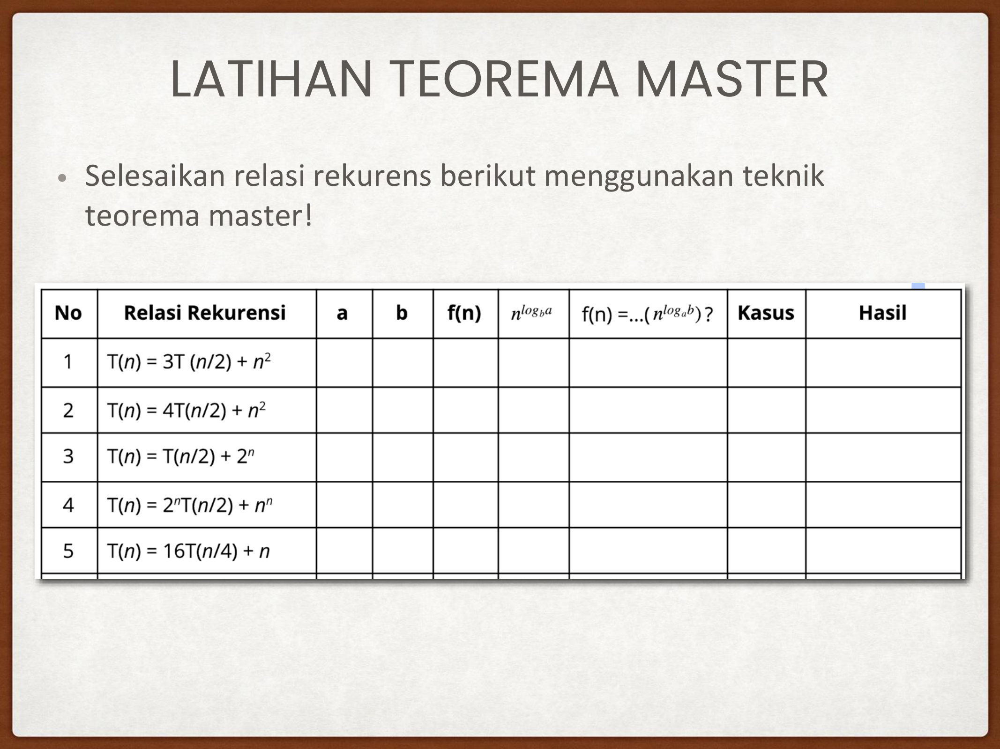

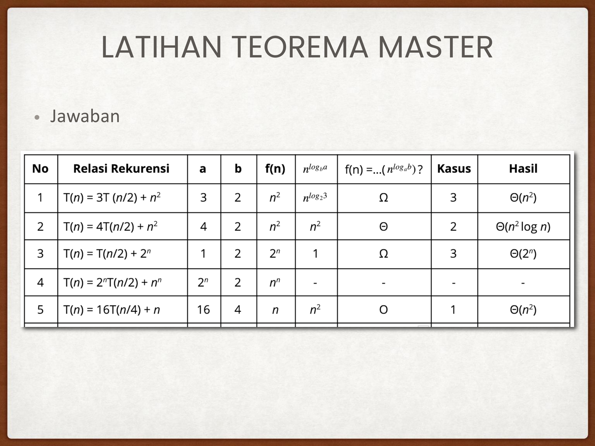

Berikut tabel analisis lengkap dari 5 soal latihan resmi di slide kuliah:

| No | Relasi Rekurensi | $a$ | $b$ | $f(n)$ | $n^{\log_b a}$ | Relasi $f(n)$ thd $n^{\log_b a}$ | Kasus | Hasil Kompleksitas |
| :---: | :--- | :---: | :---: | :---: | :---: | :---: | :---: | :---: |
| **1** | $T(n) = 3T(n/2) + n^2$ | $3$ | $2$ | $n^2$ | $n^{\log_2 3} \approx n^{1{,}585}$ | $\Omega$ ($n^2$ lebih cepat) | **Kasus 3** | **$\Theta(n^2)$** |
| **2** | $T(n) = 4T(n/2) + n^2$ | $4$ | $2$ | $n^2$ | $n^{\log_2 4} = n^2$ | $\Theta$ (setara) | **Kasus 2** | **$\Theta(n^2 \log n)$** |
| **3** | $T(n) = T(n/2) + 2^n$ | $1$ | $2$ | $2^n$ | $n^{\log_2 1} = n^0 = 1$ | $\Omega$ ($2^n$ jauh lebih cepat) | **Kasus 3** | **$\Theta(2^n)$** |
| **4** | $T(n) = 2^n T(n/2) + n^n$ | $2^n$ | $2$ | $n^n$ | Tidak konstan | - | **Gagal** | **Teorema Master Tidak Berlaku** |
| **5** | $T(n) = 16T(n/4) + n$ | $16$ | $4$ | $n$ | $n^{\log_4 16} = n^2$ | $O$ ($n$ lebih lambat dari $n^2$) | **Kasus 1** | **$\Theta(n^2)$** |

### Pembahasan Rinci Tiap Butir Soal:
- **Soal 1: $T(n) = 3T(n/2) + n^2$**
  - $a = 3, b = 2 \implies n^{\log_2 3} \approx n^{1{,}585}$.
  - $f(n) = n^2 = \Omega(n^{1{,}585 + 0{,}415})$.
  - Uji Regularitas: $a f(n/b) = 3 (n/2)^2 = \frac{3}{4} n^2 \le c n^2$ dengan $c = \frac{3}{4} < 1$. Terpenuhi!
  - Solusi: $T(n) = \Theta(n^2)$.
- **Soal 2: $T(n) = 4T(n/2) + n^2$**
  - $a = 4, b = 2 \implies n^{\log_2 4} = n^2$.
  - $f(n) = n^2 = \Theta(n^2)$. (Kasus 2 dengan $k = 0$).
  - Solusi: $T(n) = \Theta(n^2 \log n)$.
- **Soal 3: $T(n) = T(n/2) + 2^n$**
  - $a = 1, b = 2 \implies n^{\log_2 1} = n^0 = 1$.
  - $f(n) = 2^n = \Omega(n^{0 + \epsilon})$.
  - Uji Regularitas: $1 \cdot 2^{n/2} \le c \cdot 2^n$ untuk $c = \frac{1}{2} < 1$. Terpenuhi!
  - Solusi: $T(n) = \Theta(2^n)$.
- **Soal 4: $T(n) = 2^n T(n/2) + n^n$**
  - Syarat Teorema Master: $a$ dan $b$ harus berupa **konstanta**.
  - Pada soal ini, $a = 2^n$ adalah **fungsi dari $n$**, bukan konstanta!
  - Teorema Master **tidak dapat digunakan**.
- **Soal 5: $T(n) = 16T(n/4) + n$**
  - $a = 16, b = 4 \implies n^{\log_4 16} = n^2$.
  - $f(n) = n = O(n^{2 - 1})$ dengan $\epsilon = 1 > 0$. (Kasus 1).
  - Solusi: $T(n) = \Theta(n^2)$.

---

## 6. Pengantar Metode Akra-Bazzi (Slide 29)

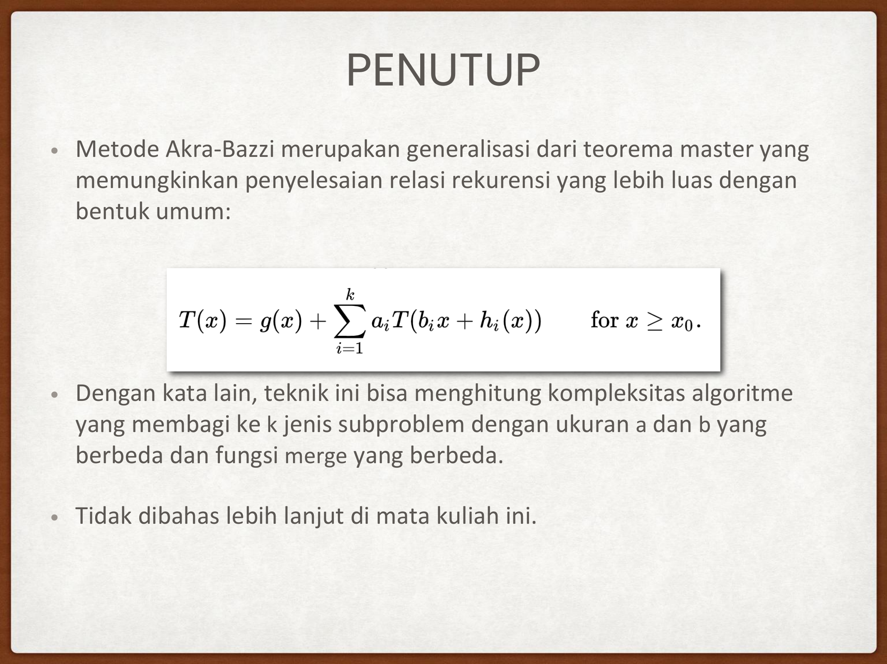

Jika relasi rekursif memiliki subproblem yang tidak seragam:
$$T(n) = \sum_{i=1}^k a_i T(b_i n) + g(n)$$
Contoh: $T(n) = T(n/4) + T(n/2) + cn^2$.
Teorema Master gagal karena ada dua rasio partisi berbeda ($b_1 = 4, b_2 = 2$). **Metode Akra-Bazzi** menyelesaikan ini dengan mencari nilai $p$ unik sedemikian rupa sehingga $\sum a_i b_i^p = 1$, lalu mengintegralkan fungsinya.

---

## 🎯 Rangkuman Cepat untuk Ujian (ADHD Takeaways)
- Tiga kasus Master Theorem: Bandingkan $f(n)$ dengan $n^{\log_b a}$.
  - $f(n)$ lebih kecil secara polinomial $\implies$ ambil daun $\Theta(n^{\log_b a})$.
  - $f(n)$ setara $\implies$ kalikan faktor log $\Theta(n^{\log_b a} \log n)$.
  - $f(n)$ lebih besar secara polinomial + lolos regularitas $\implies$ ambil root $\Theta(f(n))$.
- Jika $a$ variabel ($2^n$) atau subproblem asimetris ($n/4$ dan $n/2$), Master Theorem GAGAL $\implies$ gunakan Recursion Tree.
