---
tags:
  - analisis-algoritma
  - uts
  - week-06
  - searching
  - binary-search
  - interpolation-search
  - exponential-search
  - staircase-search
  - 2d-matrix-search
created: 2026-10-12
week: 6
source: "06 Searching SENT 2025-2026.pdf"
---

# Week 06 - Algoritme Pencarian (Searching)

> [!summary] Navigasi Catatan
> - **Prev**: [[Week 05 - Analisis Algoritme Rekursif (Recurrence)|Week 05 - Analisis Algoritme Rekursif (Recurrence)]]
> - **MOC Master**: [[00 - MOC Analisis Algoritma UTS|00 - Map of Content Analisis Algoritme UTS]]
> - **Next**: [[Week 07 - Algoritme Pengurutan (Sorting)|Week 07 - Algoritme Pengurutan (Sorting)]]

---

## 1. Tinjauan Algoritme Pencarian Klasik

Tujuan: Diberikan array $A[1 \dots n]$ dan kunci pencarian $a$, temukan indeks $i$ sedemikian rupa sehingga $A[i] = a$.


### Matriks Komparasi: Linear Search vs Binary Search

| Properti | Linear Search | Binary Search |
| :--- | :--- | :--- |
| **Prasyarat Data** | Tidak ada (acak atau terurut) | **Wajib terurut (*sorted*)** |
| **Strategi Algoritme** | Sekuensial (satu per satu dari awal) | *Divide and Conquer* (bagi dua) |
| **Best Case Complexity** | $O(1)$ (elemen di indeks 0) | $O(1)$ (elemen di titik tengah) |
| **Worst Case Complexity**| $O(n)$ (elemen di akhir / tidak ada) | $O(\log n)$ |
| **Average Case Complexity**| $O(n)$ | $O(\log n)$ |
| **Space Complexity** | $O(1)$ | $O(1)$ (iteratif) / $O(\log n)$ (rekursif stack) |
| **Kesesuaian Penggunaan**| Data kecil atau data dinamis yang sering berubah | Data berukuran besar dan statis |

---

## 2. Interpolation Search (Pencarian Interpolasi)

### A. Konsep dan Intuisi

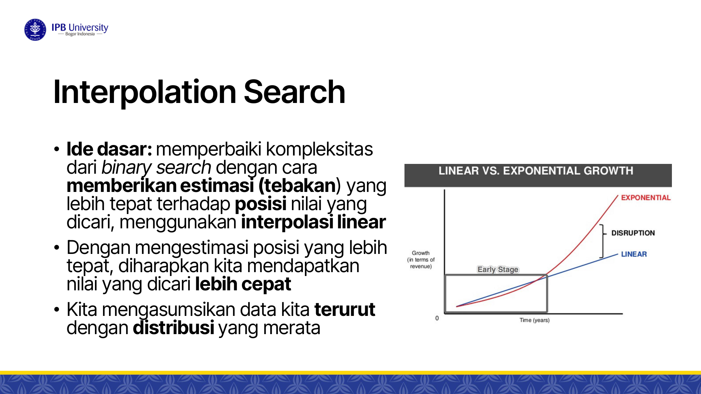

Jika Binary Search selalu membelah tepat di tengah ($\text{mid} = \frac{\text{low} + \text{high}}{2}$) tanpa mempedulikan nilai target, **Interpolation Search** meniru cara manusia mencari nama di buku telepon: jika mencari nama berawalan "B", kita membuka halaman dekat awal; jika mencari nama "Z", kita membuka halaman dekat akhir.

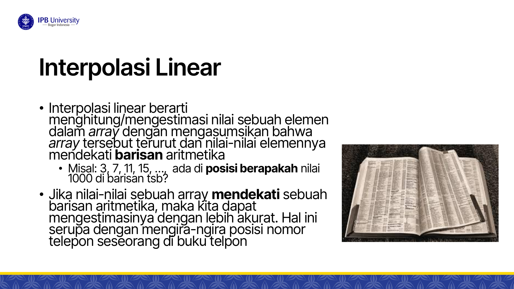

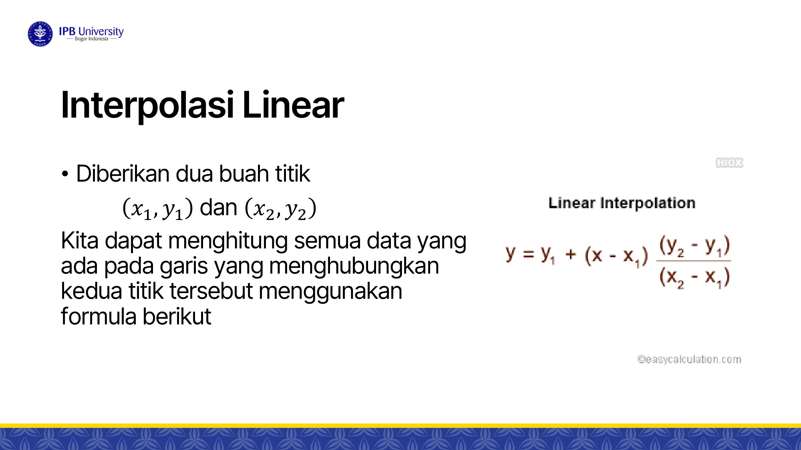

### B. Penurunan Rumus Posisi Interpolasi Linear
Asumsikan nilai elemen array terurut dan mendekati **barisan aritmatika (distribusi seragam / uniform)**.
Diberikan titik awal $(\text{low}, A[\text{low}])$ dan titik akhir $(\text{high}, A[\text{high}])$. Berdasarkan persamaan garis lurus:

$$\frac{y - y_1}{y_2 - y_1} = \frac{x - x_1}{x_2 - x_1}$$

Substitusikan $y = \text{key}$ (nilai yang dicari), $y_1 = A[\text{low}]$, $y_2 = A[\text{high}]$, $x = \text{pos}$, $x_1 = \text{low}$, $x_2 = \text{high}$:

$$\frac{\text{key} - A[\text{low}]}{A[\text{high}] - A[\text{low}]} = \frac{\text{pos} - \text{low}}{\text{high} - \text{low}}$$

Sehingga diperoleh **Rumus Posisi Probe**:
$$\text{pos} = \text{low} + \left\lfloor \frac{\text{key} - A[\text{low}]}{A[\text{high}] - A[\text{low}]} \times (\text{high} - \text{low}) \right\rfloor$$

---

### C. Implementasi Algoritme

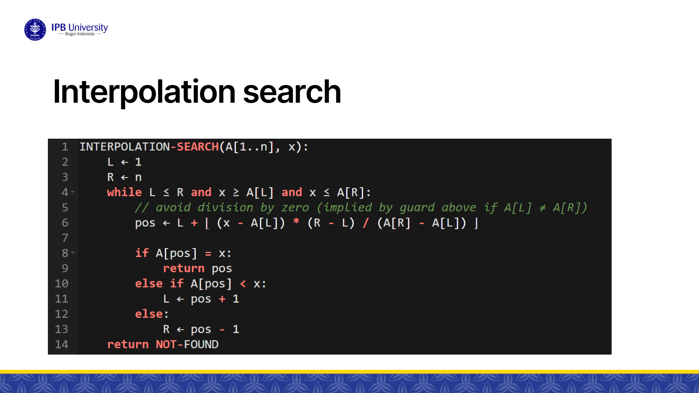

```python
def interpolation_search(A, n, key):
    low = 0
    high = n - 1
    
    # Syarat terminasi penting: key harus berada dalam rentang [A[low], A[high]]
    while low <= high and key >= A[low] and key <= A[high]:
        if low == high:
            if A[low] == key:
                return low
            return -1
            
        # Hitung estimasi posisi probe
        pos = low + int(((key - A[low]) * (high - low)) / (A[high] - A[low]))
        
        if A[pos] == key:
            return pos
        elif A[pos] < key:
            low = pos + 1
        else:
            high = pos - 1
            
    return -1
```

---

### D. Analisis Kompleksitas Interpolation Search

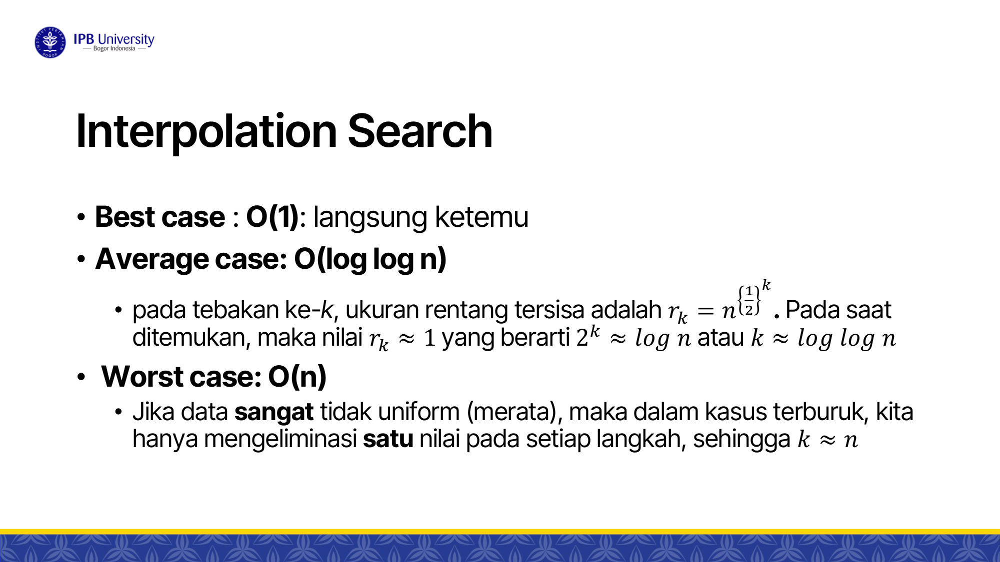

- **Best Case: $O(1)$** $\implies$ Tebakan pertama langsung tepat mengenai target.
- **Average Case: $O(\log \log n)$**:
  - Pada data berdistribusi seragam, ukuran rentang pencarian yang tersisa menyusut secara kuadratik:
    $$r_k = n^{1/2^k}$$
  - Algoritme berhenti saat rentang tersisa $r_k \approx 1$:
    $$n^{1/2^k} \approx 2 \implies \frac{1}{2^k} \log_2 n \approx 1 \implies 2^k \approx \log_2 n \implies k \approx \log_2(\log_2 n)$$
  - *Perbandingan*: Untuk $n = 10^9$, Binary Search butuh $\approx 30$ perbandingan, sedangkan Interpolation Search rata-rata hanya butuh $\approx \log_2(30) \approx 5$ perbandingan!
- **Worst Case: $O(n)$**:
  - Terjadi jika data **sangat tidak seragam (skewed/eksponensial)**, contoh: $A = [1, 2, 4, 8, 16, 32, \dots, 2^n]$ atau $A = [1, 2, 3, 4, \dots, 10^9]$. Estimasi interpolasi hanya menggeser `low` sejauh $1$ indeks per langkah.

---

## 3. Exponential Search

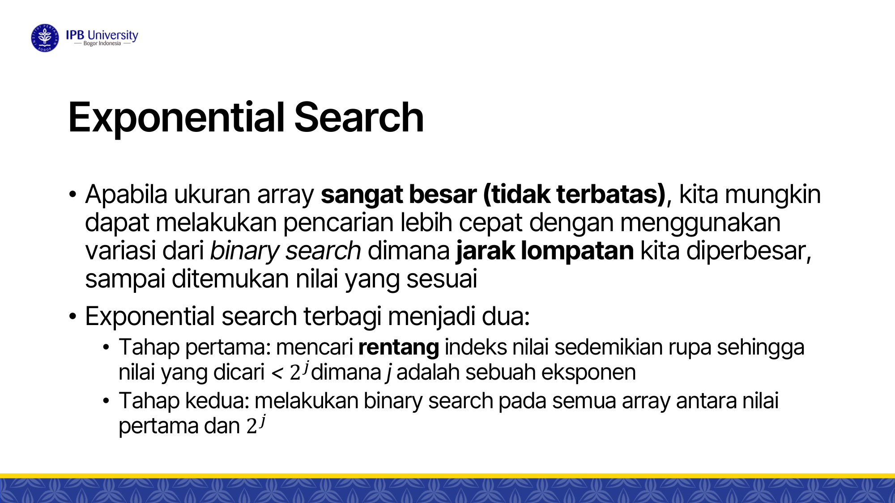

### A. Konsep dan Mekanisme
Digunakan ketika ukuran array sangat besar atau **tidak diketahui batas akhirnya (*unbounded / infinite list*)**.
Algoritme terdiri dari 2 fase:
1. **Fase 1 (Mencari Rentang)**: Mulai dari indeks $i = 1$. Gandakan indeks secara eksponensial ($i = 1, 2, 4, 8, 16, \dots, 2^j$) selama $A[i] < \text{key}$ dan $i < n$.
2. **Fase 2 (Binary Search)**: Lakukan binary search standar pada rentang sub-array:
   $$\left[\frac{i}{2}, \, \min(i, n - 1)\right]$$

### B. Implementasi
```python
def exponential_search(A, n, key):
    if A[0] == key:
        return 0
    
    # Fase 1: Gandakan rentang
    i = 1
    while i < n and A[i] <= key:
        i = i * 2
        
    # Fase 2: Binary Search pada rentang [i // 2, min(i, n - 1)]
    return binary_search(A, i // 2, min(i, n - 1), key)
```

### C. Analisis Kompleksitas
- Jika elemen berada pada indeks ke-$p$:
  - Fase penggandaan butuh $\lceil \log_2 p \rceil$ langkah.
  - Fase binary search pada interval berukuran $p$ butuh $O(\log p)$ langkah.
- **Total Kompleksitas: $O(\log p)$**.
- Jika elemen berada dekat bagian depan array ($p \ll n$), Exponential Search jauh lebih cepat daripada Binary Search standar ($O(\log p)$ vs $O(\log n)$).

---

## 4. Pencarian dalam Ruang 2D (Matriks $m \times n$)

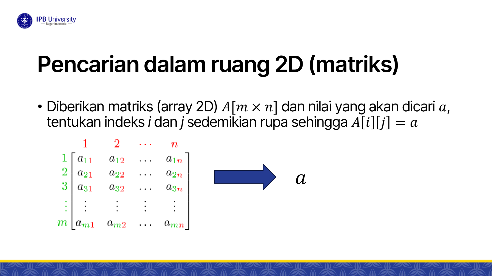

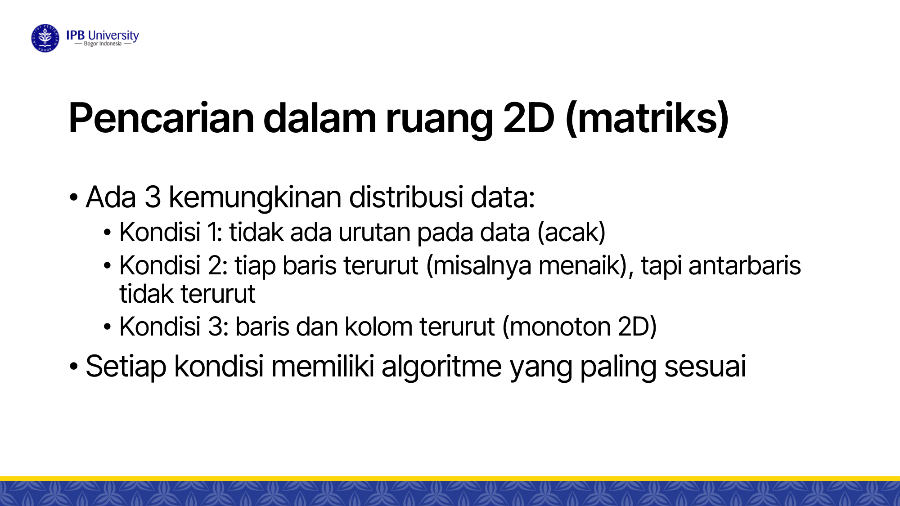

Diberikan matriks $A[m \times n]$ dan target nilai $a$. Terdapat 3 variasi kondisi data:

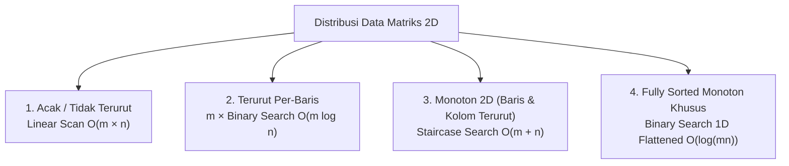

---

### Kondisi 1: Matriks Acak (Tidak Terurut)
- Setiap sel harus diperiksa satu per satu via nested loop.
- **Kompleksitas: $O(m \times n)$**.

---

### Kondisi 2: Terurut Per Baris (Antar-baris Acak)
- Setiap baris $i$ terurut menaik, namun tidak ada hubungan antara baris $i$ dan baris $i+1$.
- Terapkan Binary Search pada masing-masing dari $m$ baris.
- Biaya per baris: $O(\log n)$.
- Total biaya terburuk:
  $$m \times O(\log n) \implies O(m \log n)$$

---

### Kondisi 3: Matriks Terurut 2D (Monoton Baris dan Kolom) $\to$ Staircase Search

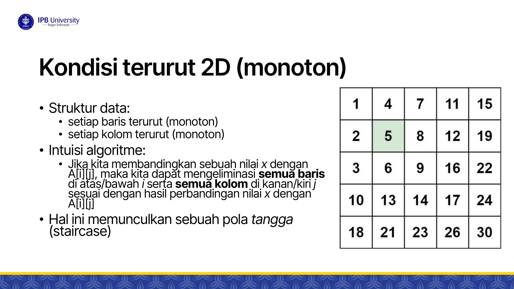

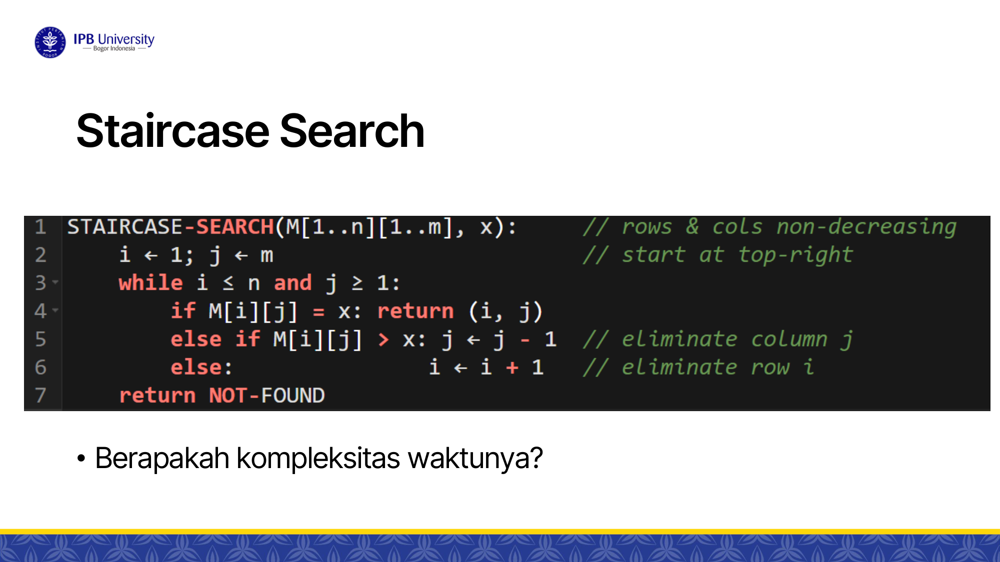

Properti:
- Setiap baris terurut menaik: $A[i][j] \le A[i][j+1]$
- Setiap kolom terurut menaik: $A[i][j] \le A[i+1][j]$

#### Intuisi & Algoritme Tangga (Staircase Search):
Mulai dari **sudut kanan atas (*top-right*)** pada posisi $(i = 0, j = n - 1)$:
- Jika $A[i][j] == \text{key}$ $\implies$ **Ditemukan!**
- Jika $A[i][j] > \text{key}$ $\implies$ Seluruh elemen di bawah kolom $j$ pasti $> \text{key}$. **Eliminasi kolom $j$** ($j = j - 1$).
- Jika $A[i][j] < \text{key}$ $\implies$ Seluruh elemen di sebelah kiri baris $i$ pasti $< \text{key}$. **Eliminasi baris $i$** ($i = i + 1$).

*(Bisa juga dimulai dari sudut kiri bawah $(i = m - 1, j = 0)$).*

```python
def staircase_search(A, m, n, key):
    i = 0
    j = n - 1
    
    while i < m and j >= 0:
        if A[i][j] == key:
            return (i, j)
        elif A[i][j] > key:
            j -= 1 # Geser ke kiri (eliminasi kolom)
        else:
            i += 1 # Geser ke bawah (eliminasi baris)
            
    return (-1, -1)
```

#### Kompleksitas:
- Setiap langkah memotong 1 baris ($i$ bertambah) atau 1 kolom ($j$ berkurang).
- Jumlah langkah maksimal: $m$ pergeseran ke bawah $+ n$ pergeseran ke kiri.
- **Time Complexity: $O(m + n)$**.
- **Space Complexity: $O(1)$**.
- Jauh lebih efisien daripada $O(m \log n)$ pada kondisi 2!

---

### Kondisi 4: Matriks Flattened Monoton Terurut Penuh (Latihan Slide 20)

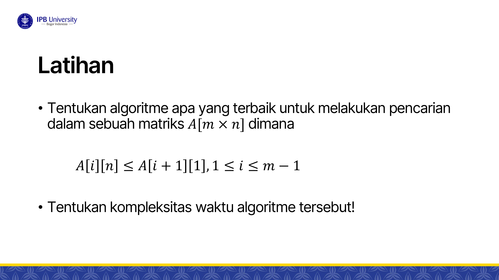

> [!example] Soal Latihan Slide 20
> Diberikan matriks $A[m \times n]$ dengan aturan:
> $$A[i][n] \le A[i+1][1], \quad \forall 1 \le i \le m-1$$
> Elemen terakhir suatu baris selalu lebih kecil atau sama dengan elemen pertama baris berikutnya.

#### Solusi Optimal:
Kondisi ini menyatakan bahwa seluruh elemen matriks jika dibentangkan (*flatten*) membentuk **1 array terurut linear berukuran $N = m \times n$**.
Kita dapat menjalankan **Binary Search Virtual 1D**:
- Rentang indeks virtual: $0$ sampai $m \times n - 1$.
- Konversi indeks virtual $\text{mid}$ ke koordinat 2D:
  $$\text{baris } i = \lfloor \text{mid} / n \rfloor, \quad \text{kolom } j = \text{mid} \pmod n$$
- **Kompleksitas: $O(\log(m \cdot n)) = O(\log m + \log n)$**.

---

## 🎯 Rangkuman Cepat untuk Ujian (ADHD Takeaways)
- Interpolation Search butuh data **terurut & uniform** $\implies$ average $O(\log \log n)$, worst case $O(n)$.
- Exponential Search melipatgandakan rentang ($2^j$) lalu binary search $\implies O(\log p)$ untuk target di posisi $p$.
- Matriks 2D monoton baris-kolom $\implies$ **Staircase Search mulai dari top-right** $\implies O(m + n)$.
- Matriks monoton penuh ($A[i][n] \le A[i+1][1]$) $\implies$ **Binary Search virtual** $\implies O(\log(mn))$.
