---
tags:
  - analisis-algoritma
  - uts
  - week-07
  - sorting
  - insertion-sort
  - merge-sort
  - quick-sort
  - counting-sort
  - stability
  - comparison-sort
created: 2026-10-12
week: 7
source: "07 Sorting 2526.pdf"
---

# Week 07 - Algoritme Pengurutan (Sorting)

> [!summary] Navigasi Catatan
> - **Prev**: [[Week 06 - Algoritme Pencarian (Searching)|Week 06 - Algoritme Pencarian (Searching)]]
> - **MOC Master**: [[00 - MOC Analisis Algoritma UTS|00 - Map of Content Analisis Algoritme UTS]]

---

## 1. Taksonomi & Kriteria Evaluasi Algoritme Pengurutan

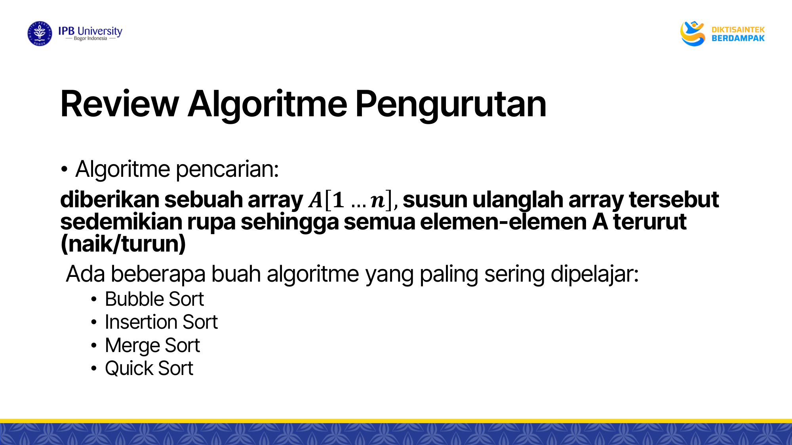

Diberikan array $A[1 \dots n]$, susun ulang elemen sedemikian rupa sehingga $A[1] \le A[2] \le \dots \le A[n]$.

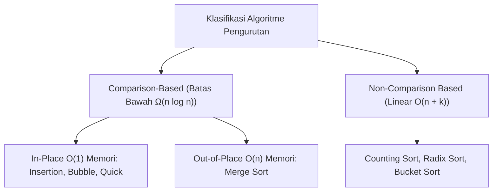

### Kriteria Pemilihan Algoritme Pengurutan:
1. **Kompleksitas Waktu (*Time Complexity*)**: Best, Average, dan Worst Case.
2. **Kebutuhan Memori Tambahan (*In-Place vs Out-of-Place*)**:
   - *In-Place*: Hanya menggunakan memori tambahan konstan $O(1)$ di luar array input (atau $O(\log n)$ call stack). Contoh: Insertion Sort, Quick Sort.
   - *Out-of-Place*: Membutuhkan alokasi array pembantu sebesar $\Omega(n)$. Contoh: Merge Sort, Counting Sort.
3. **Stabilitas (*Stability*)**:
   - Sebuah algoritme dikatakan **Stabil (*Stable*)** jika elemen-elemen yang memiliki kunci nilai sama mempertahankan urutan posisi relatifnya sebelum dan setelah pengurutan.
   - *Contoh*: Jika input berisi data `[(2, mutia), (3, faqih), (2, insan)]`, algoritme stabil menjamin `(2, mutia)` selalu muncul sebelum `(2, insan)`.


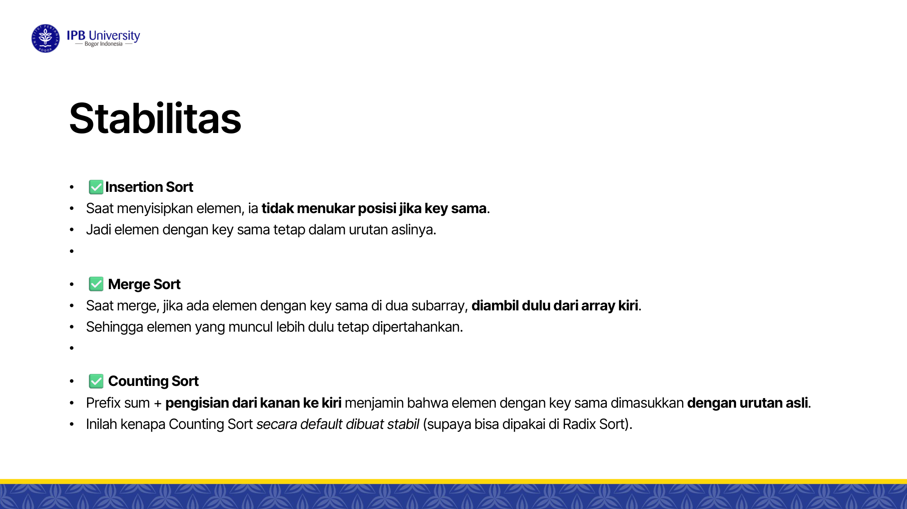

---

## 2. Insertion Sort

### A. Prinsip Kerja

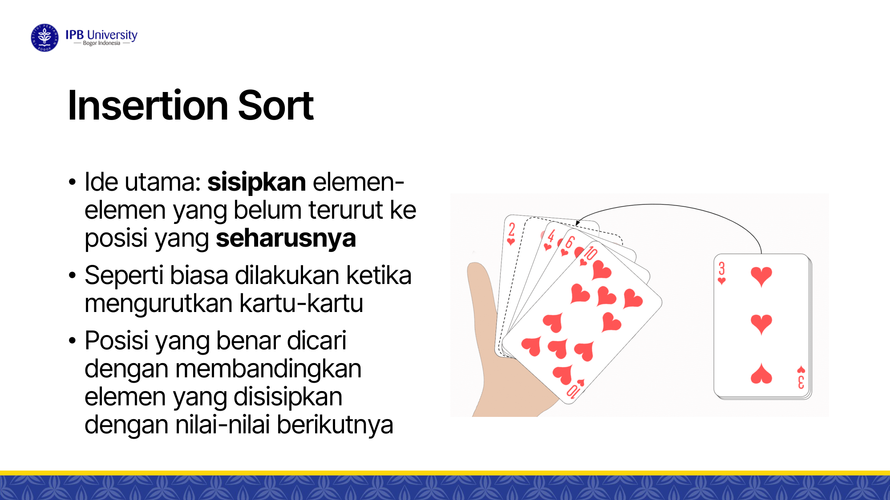

Meniru cara pemain kartu menyusun kartu di tangannya:
- Bagian kiri array dianggap sebagai sub-array yang sudah terurut.
- Ambil satu elemen berikutnya (`key = A[j]`), bandingkan ke arah kiri, geser elemen-elemen yang lebih besar dari `key` ke kanan, lalu letakkan `key` di posisi yang tepat.

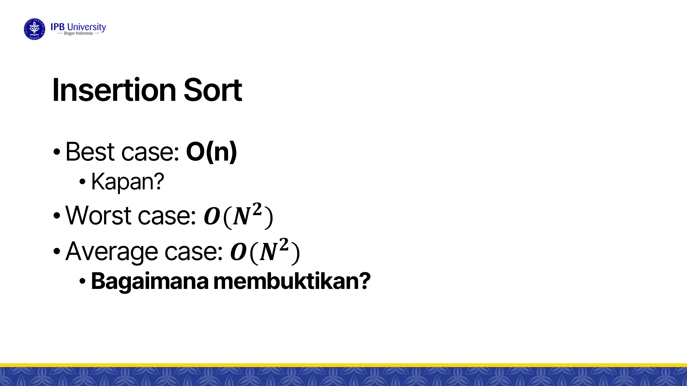

```python
def insertion_sort(A, n):
    for j in range(1, n):
        key = A[j]
        i = j - 1
        # Geser elemen yang lebih besar dari key ke kanan
        while i >= 0 and A[i] > key:
            A[i + 1] = A[i]
            i -= 1
        A[i + 1] = key
```

### B. Analisis Kompleksitas

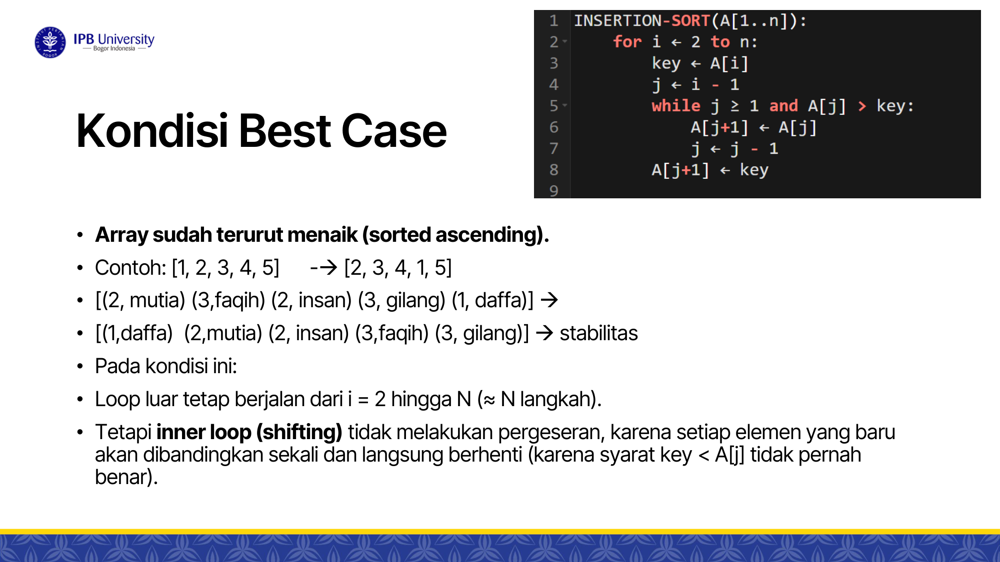

- **Best Case: $O(n)$**:
  - Terjadi ketika **array sudah terurut menaik** ($[1, 2, 3, 4, 5]$).
  - Loop `while` langsung gagal pada perbandingan pertama karena `A[i] > key` bernilai false.
  - Jumlah shifting $= 0$. Total operasi $= (n - 1) = \Theta(n)$.
- **Worst Case: $O(n^2)$**:
  - Terjadi ketika **array terurut terbalik** ($[5, 4, 3, 2, 1]$).
  - Setiap elemen ke-$j$ harus dibandingkan dan digeser sebanyak $j$ kali.
  - Total langkah: $\sum_{j=1}^{n-1} j = \frac{n(n - 1)}{2} = \Theta(n^2)$.
- **Average Case: $O(n^2)$**:
  - Rata-rata elemen harus digeser sebanyak $\frac{j}{2}$ kali $\implies \Theta(n^2)$.
- **Karakteristik**: In-place ($O(1)$ space), **Stabil** (tidak menukar jika nilai identik).

---

## 3. Merge Sort

### A. Prinsip Divide and Conquer

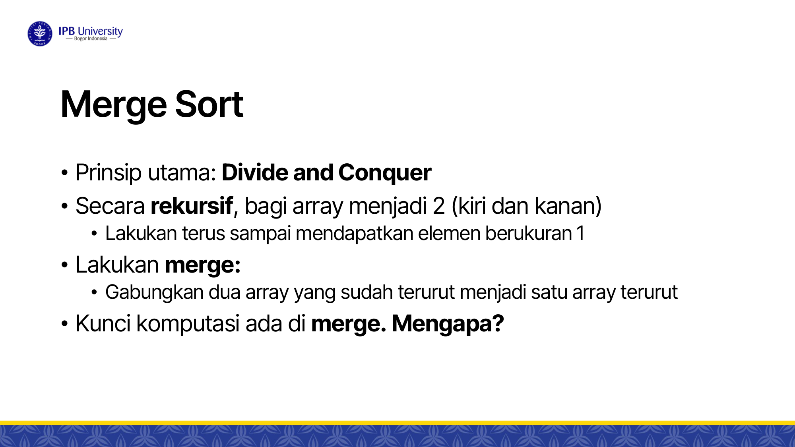

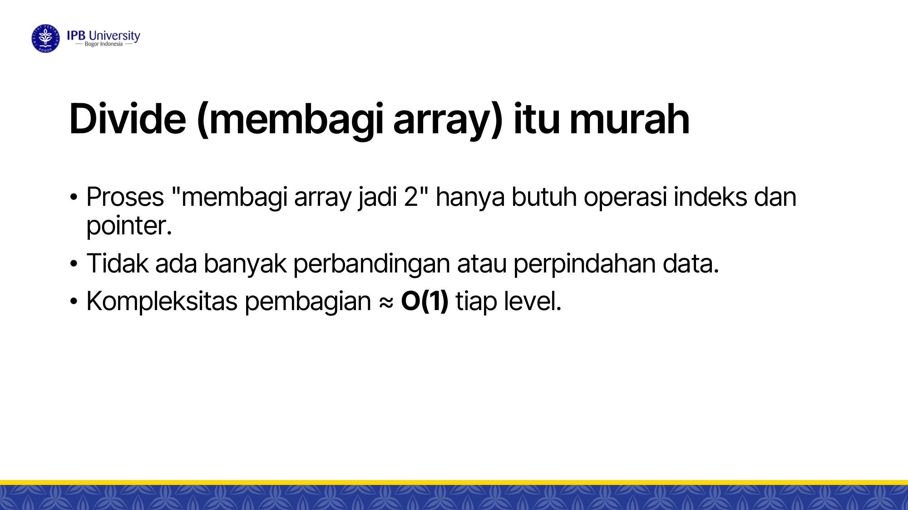

1. **Divide**: Bagi array menjadi dua subarray berukuran $\frac{n}{2}$ di titik tengah. Operasi ini murah: **$O(1)$** (hanya manipulasi indeks).
2. **Conquer**: Urutkan kedua subarray secara rekursif.
3. **Combine (Merge)**: Gabungkan kedua subarray yang sudah terurut menjadi satu array terurut utuh.

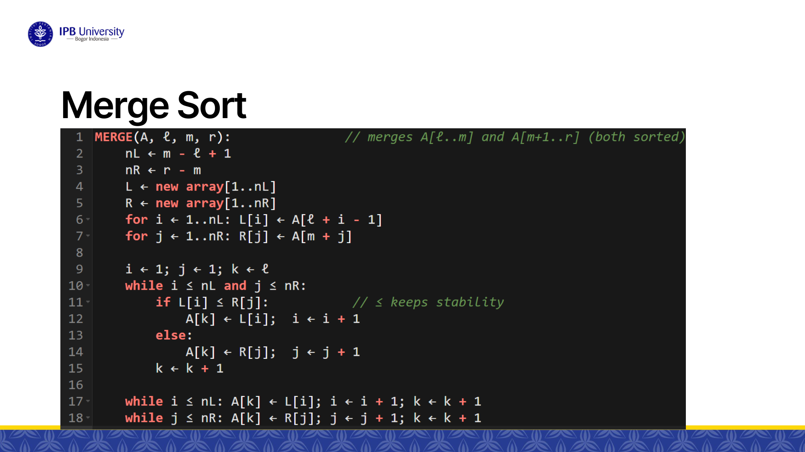

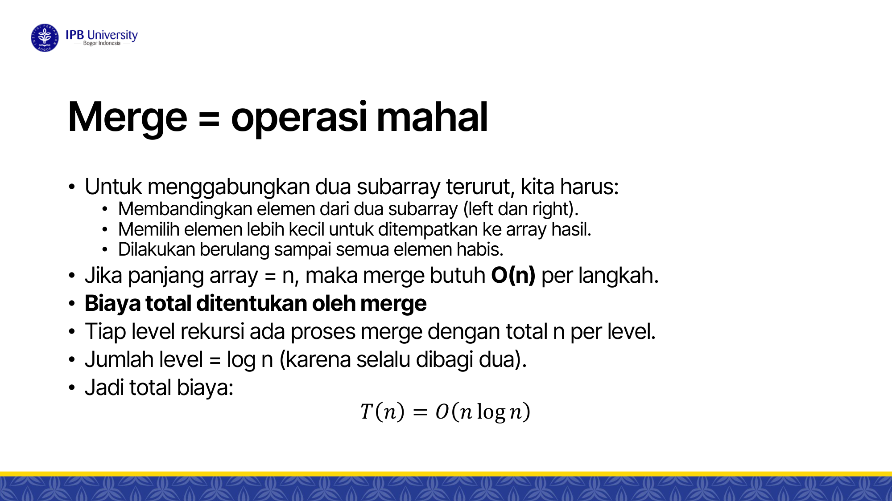

> [!important] Operasi Merge adalah Komputasi Utama
> Menggabungkan dua subarray terurut berukuran total $n$ memerlukan paling banyak $n - 1$ perbandingan. Setiap perbandingan menempatkan minimal satu elemen ke array hasil. Maka operasi merge memerlukan waktu linear **$O(n)$**.

```python
def merge_sort(A):
    if len(A) <= 1:
        return A
        
    mid = len(A) // 2
    left = merge_sort(A[:mid])
    right = merge_sort(A[mid:])
    
    return merge(left, right)

def merge(left, right):
    result = []
    i = j = 0
    while i < len(left) and j < len(right):
        # Gunakan <= untuk menjamin STABILITAS
        if left[i] <= right[j]:
            result.append(left[i])
            i += 1
        else:
            result.append(right[j])
            j += 1
    result.extend(left[i:])
    result.extend(right[j:])
    return result
```

### B. Analisis Relasi Rekurensi
$$T(n) = 2T\left(\frac{n}{2}\right) + O(n)$$
Berdasarkan Teorema Master ($a = 2, b = 2, f(n) = n \implies n^{\log_2 2} = n$, Kasus 2):
$$T(n) = \Theta(n \log n)$$

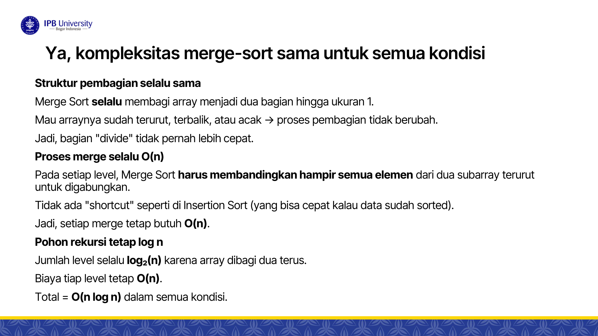

### C. Mengapa Merge Sort Bernilai Konsisten $\Theta(n \log n)$ di Semua Kasus?
- **Struktur pembagian selalu sama**: Mau array sudah terurut, terbalik, atau acak, pohon rekursi selalu memiliki kedalaman $\log_2 n$.
- **Proses merge selalu linear**: Setiap level pohon rekursi memproses total $n$ elemen pada tahap merge.
- Total biaya $= \log_2 n \text{ level} \times O(n) \text{ per level} = \Theta(n \log n)$ pada **Best, Worst, dan Average Case**.
- **Kelemahan**: Membutuhkan alokasi array tambahan sebesar **$O(n)$** (*not in-place*).

---

## 4. Quick Sort

### A. Prinsip Partisi & Pivot

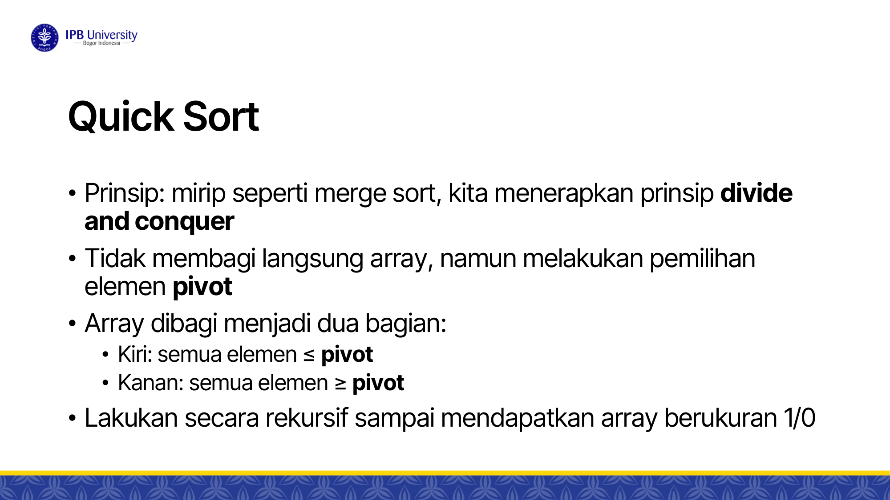

1. Pilih sebuah elemen sebagai **Pivot** (misal elemen pertama, terakhir, tengah, atau acak).
2. **Partisi**: Atur ulang array sedemikian rupa sehingga semua elemen yang $\le \text{pivot}$ berada di sebelah kiri, dan elemen $\ge \text{pivot}$ berada di sebelah kanan. Biaya partisi $= O(n)$.
3. Rekursif jalankan Quick Sort pada sisi kiri dan sisi kanan pivot.

```python
def quick_sort(A, low, high):
    if low < high:
        pi = partition(A, low, high) # Partisi menghasilkan indeks pivot tepat
        quick_sort(A, low, pi - 1)
        quick_sort(A, pi + 1, high)

def partition(A, low, high):
    pivot = A[high] # Pivot elemen terakhir
    i = low - 1
    for j in range(low, high):
        if A[j] <= pivot:
            i += 1
            A[i], A[j] = A[j], A[i]
    A[i + 1], A[high] = A[high], A[i + 1]
    return i + 1
```

### B. Relasi Rekurensi & Analisis Kasus

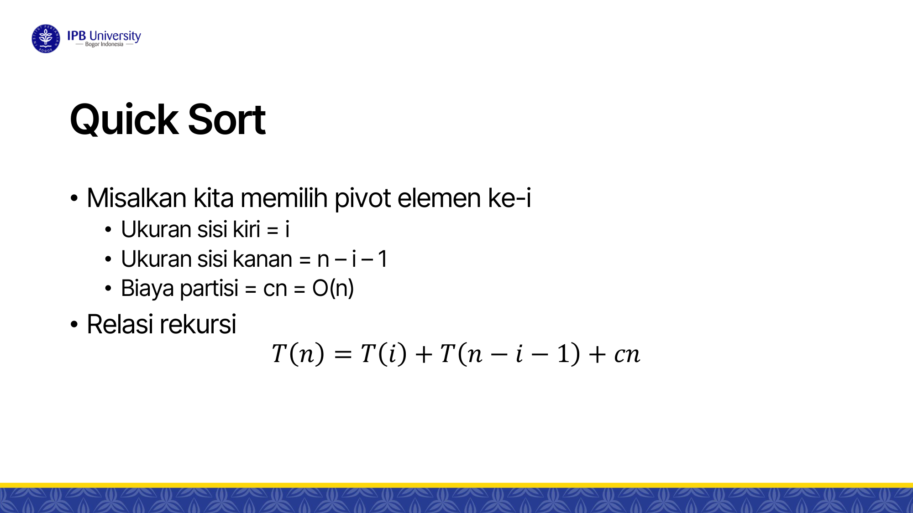

Jika pivot jatuh pada posisi ke-$i$:
$$T(n) = T(i) + T(n - i - 1) + c n$$

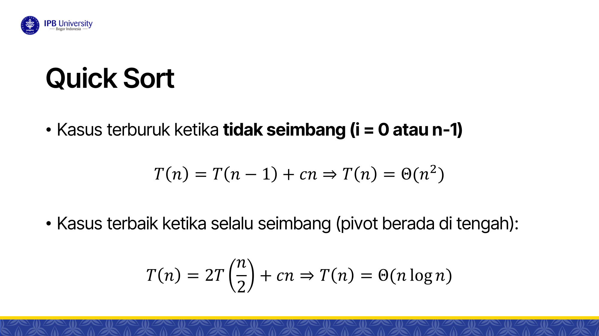

1. **Kasus Terbaik (*Best Case*)**:
   - Pivot selalu tepat membagi array menjadi dua bagian sama besar ($i \approx \frac{n}{2}$).
   - $T(n) = 2T(n/2) + cn \implies \Theta(n \log n)$.
2. **Kasus Terburuk (*Worst Case*)**:
   - Terjadi ketika partisi **sangat tidak seimbang** ($i = 0$ atau $i = n - 1$).
   - Sering terjadi jika array **sudah terurut atau terbalik** dan pivot dipilih di ujung array.
   - Relasi: $T(n) = T(n - 1) + T(0) + cn = T(n - 1) + cn$.
   - Penjumlahan deret: $cn + c(n - 1) + c(n - 2) + \dots + c = c \frac{n(n + 1)}{2} \implies \Theta(n^2)$.
3. **Kasus Rata-Rata (*Average Case*)**:
   - Ekspektasi pembagian menghasilkan rasio seimbang (seperti $9:1$ atau $1:1$).
   - Menghasilkan kompleksitas **$\Theta(n \log n)$**.
- **Karakteristik**: In-place ($O(\log n)$ stack space), **Tidak Stabil** (penukaran partisi dapat melompati elemen identik).

---

## 5. Counting Sort (Non-Comparison Sort)

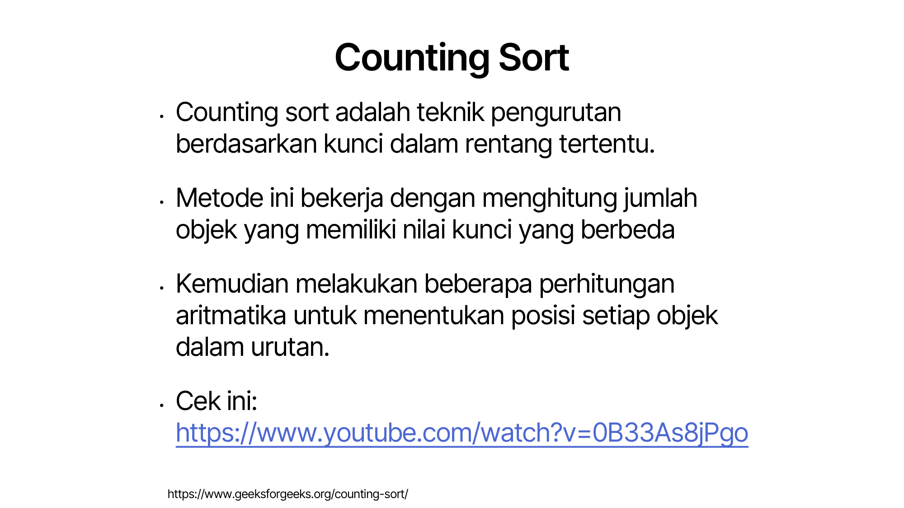

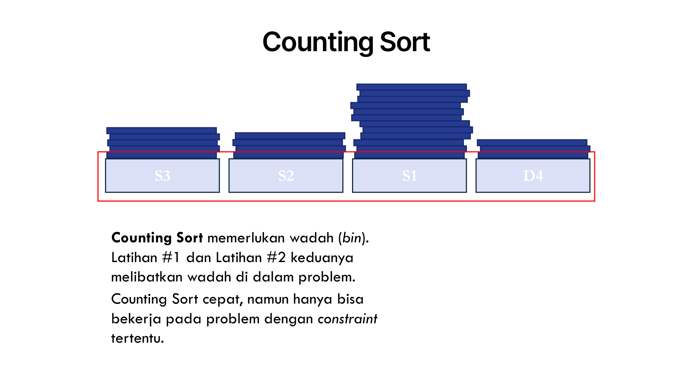

### A. Konsep dan Syarat Penggunaan
Counting Sort tidak menggunakan perbandingan ($<$ atau $>$), melainkan menghitung **frekuensi kemunculan setiap nilai kunci diskret**.

> [!important] Syarat Mutlak Counting Sort
> - Elemen harus berupa **bilangan bulat diskret** (*integers*).
> - Jangkauan nilai kunci $k = \max - \min + 1$ harus diketahui dan berhingga.

### B. Langkah Algoritme (4 Fase)
1. **Inisialisasi Array Hitung**: Buat array `count` berukuran $k$ dengan nilai awal $0$.
2. **Frekuensi Elemen**: Lakukan scanning array input $A$, tambahkan `count[A[i]]++` $\implies O(n)$.
3. **Prefix Sum (Akumulasi)**: Ubah `count[i] = count[i] + count[i - 1]` untuk menyimpan posisi akhir setiap elemen $\implies O(k)$.
4. **Penempatan ke Array Output**: Lakukan iterasi mundur dari indeks $n-1$ ke $0$ pada array input, letakkan elemen ke `output[count[A[i]] - 1]`, lalu kurangi `count[A[i]]--` $\implies O(n)$.
   *(Iterasi mundur menjamin **Kestabilan Algoritme**).*

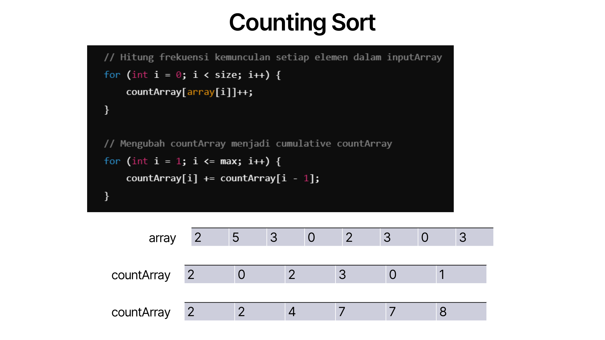

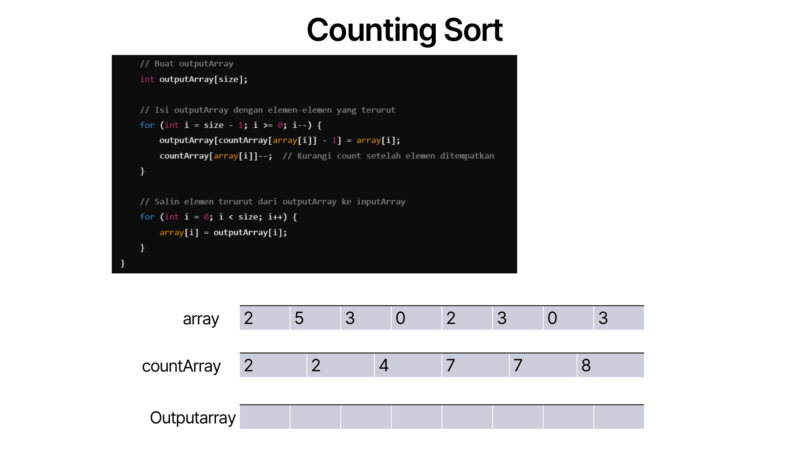

```python
def counting_sort(A, n):
    max_val = max(A)
    min_val = min(A)
    k = max_val - min_val + 1
    
    count = [0] * k
    output = [0] * n
    
    # 1. Hitung frekuensi
    for num in A:
        count[num - min_val] += 1
        
    # 2. Hitung prefix sum
    for i in range(1, k):
        count[i] += count[i - 1]
        
    # 3. Bangun array output (mundur agar stabil)
    for i in range(n - 1, -1, -1):
        num = A[i]
        output[count[num - min_val] - 1] = num
        count[num - min_val] -= 1
        
    return output
```

### C. Analisis Kompleksitas

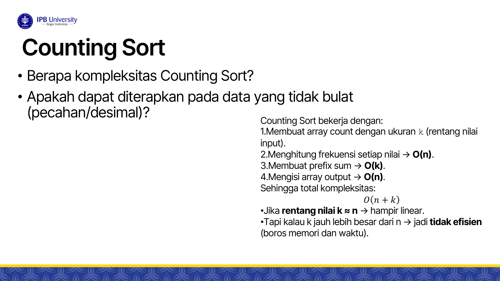

- **Waktu**: $O(n) + O(k) + O(n) = \Theta(n + k)$.
- **Memori Tambahan**: $O(k)$ untuk array `count` dan $O(n)$ untuk array `output` $\implies \Theta(n + k)$.
- **Kapan Efisien?**:
  - Jika $k = O(n)$ (misal menyortir $1.000.000$ nilai usia manusia antara $0$ s.d. $120$), waktu eksekusi adalah **Linear $\Theta(n)$**! Jauh lebih cepat daripada Merge Sort / Quick Sort.
- **Kapan Gagal / Tidak Efisien?**:
  - Jika $k \gg n$ (misal hanya menyortir $100$ data dengan nilai kunci mencapai $10^9$), alokasi memori $10^9$ akan menyebabkan *Memory Overflow* dan pemborosan waktu loop prefix sum.

---

## 6. Matriks Perbandingan Komprehensif Algoritme Pengurutan

| Algoritme | Best Case | Average Case | Worst Case | Space Complexity | Stabil? | In-Place? | Catatan Utama |
| :--- | :---: | :---: | :---: | :---: | :---: | :---: | :--- |
| **Insertion Sort** | $\Theta(n)$ | $\Theta(n^2)$ | $\Theta(n^2)$ | $O(1)$ | **Ya** | **Ya** | Terbaik untuk data berukuran sangat kecil atau nyaris terurut |
| **Selection Sort** | $\Theta(n^2)$ | $\Theta(n^2)$ | $\Theta(n^2)$ | $O(1)$ | Tidak | **Ya** | Minimal dalam jumlah penukaran (maksimal $n$ swap) |
| **Bubble Sort** | $\Theta(n)$ (dg flag) | $\Theta(n^2)$ | $\Theta(n^2)$ | $O(1)$ | **Ya** | **Ya** | Mudah dipahami, tidak efisien di dunia industri |
| **Merge Sort** | $\Theta(n \log n)$ | $\Theta(n \log n)$ | $\Theta(n \log n)$ | $O(n)$ | **Ya** | Tidak | Waktu stabil terjamin, memori boros, standar untuk Linked List |
| **Quick Sort** | $\Theta(n \log n)$ | $\Theta(n \log n)$ | $\Theta(n^2)$ | $O(\log n)$ | Tidak | **Ya** | Rata-rata tercepat di CPU (*cache locality* unggul) |
| **Counting Sort** | $\Theta(n + k)$ | $\Theta(n + k)$ | $\Theta(n + k)$ | $O(n + k)$ | **Ya** | Tidak | Non-comparison linear, syarat kunci diskret terbatas |

---

## 🎯 Rangkuman Cepat untuk Ujian (ADHD Takeaways)
- Comparison sort lower bound teoritis adalah $\Omega(n \log n)$.
- Merge Sort konsisten $O(n \log n)$ di semua kondisi karena pohon selalu dibagi 2 dan merge selalu $O(n)$, namun butuh memori tambahan $O(n)$.
- Quick Sort worst-case $O(n^2)$ jika pivot ekstrem pada data terurut/terbalik.
- Counting Sort mencapai $O(n + k)$ tanpa perbandingan; stabil berkat backward iteration.
- Stabilitas: urutan elemen bernilai sama tidak berubah sebelum dan sesudah sorting (Insertion, Merge, Counting = Stabil; Quick = Tidak Stabil).
