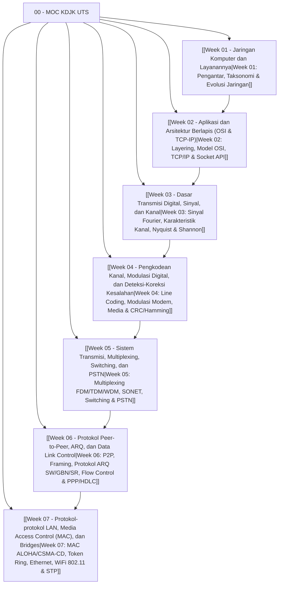

---
tags:
  - kdjk
  - kom1314
  - jaringan-komputer
  - komunikasi-data
  - uts
  - moc
  - study-guide
  - map-of-content
created: 2026-10-13
title: "00 - MOC KDJK UTS (Map of Content & Panduan Belajar Lengkap)"
---

# 00 - Map of Content (MOC) Komunikasi Data & Jaringan Komputer - Persiapan UTS

> [!abstract] Ringkasan Eksekutif
> Catatan ini merupakan pusat navigasi (*Map of Content*) untuk seluruh materi Ujian Tengah Semester (UTS) mata kuliah **Komunikasi Data dan Jaringan Komputer (KDJK / KOM1314)**. Disusun secara komprehensif dari **Week 01 hingga Week 07** berdasarkan silabus resmi perkuliahan, buku teks standar *Communication Networks: Fundamental Concepts and Key Architectures 2nd Edition* (Alberto Leon-Garcia & Indra Widjaja), slide kuliah, serta aset visual diagram teknis di folder attachments.

---

## 🗺️ Peta Navigasi Materi Mingguan

| Minggu | Pokok Bahasan | Sub Pokok Bahasan & Konsep Kunci | Catatan Vault |
| :---: | :--- | :--- | :--- |
| **01** | **Jaringan Komputer dan Layanannya** | Overview telekomunikasi & sejarah internet, taksonomi jaringan (LAN/MAN/WAN, topologi fisik & logis), pendekatan perancangan jaringan, faktor pendorong evolusi komunikasi | [[Week 01 - Jaringan Komputer dan Layanannya]] |
| **02** | **Aplikasi & Arsitektur Berlapis** | Prinsip layering & enkapsulasi, Model Referensi OSI 7 Layer vs TCP/IP 4/5 Layer, Berkeley Sockets API, protokol aplikasi inti (HTTP, DNS, SMTP, FTP) & utilitas jaringan (ping, traceroute) | [[Week 02 - Aplikasi dan Arsitektur Berlapis (OSI & TCP-IP)]] |
| **03** | **Dasar Transmisi Digital (Sinyal & Kanal)** | Analisis Fourier & spektrum sinyal, sinyal analog vs digital, karakteristik kanal (bandwidth, atenuasi, distorsi tunda, noise), batas teoritis kapasitas Nyquist ($2B \log_2 M$) & Shannon ($B \log_2(1 + \text{SNR})$) | [[Week 03 - Dasar Transmisi Digital, Sinyal, dan Kanal]] |
| **04** | **Pengkodean Kanal, Modulasi & Error Control** | Line coding (NRZ, RZ, AMI, Manchester), modulasi digital & modem (ASK, FSK, PSK, QAM), karakteristik media transmisi kabel & nirkabel, deteksi & koreksi kesalahan (Parity, Checksum, CRC Polinomial, Hamming Code) | [[Week 04 - Pengkodean Kanal, Modulasi Digital, dan Deteksi-Koreksi Kesalahan]] |
| **05** | **Sistem Transmisi, Switching & PSTN** | Teknik multiplexing (FDM, TDM, WDM, DWDM), standar SONET/SDH, circuit switching (Crossbar, Clos, TSI, T-S-T), infrastruktur PSTN, pensinyalan in-band vs out-of-band (SS7), rekayasa trafik & rumus Erlang B | [[Week 05 - Sistem Transmisi, Multiplexing, Switching, dan PSTN]] |
| **06** | **Protokol Peer-to-Peer & Data Link** | Model layanan P2P & framing (character/bit stuffing), protokol ARQ (Stop-and-Wait, Go-Back-N, Selective Repeat), formulasi efisiensi throughput ($\eta$), sliding window flow control, standar HDLC & PPP | [[Week 06 - Protokol Peer-to-Peer, ARQ, dan Data Link Control]] |
| **07** | **Protokol LAN & Media Access Control** | Multi-access communication, Random Access (Pure/Slotted ALOHA, CSMA, CSMA/CD, CSMA/CA), Scheduled Access (Polling, Token Ring), standar Ethernet IEEE 802.3, FDDI, IEEE 802.11 WiFi, Transparent Bridges, Spanning Tree Protocol (STP), VLAN | [[Week 07 - Protokol-protokol LAN, Media Access Control (MAC), dan Bridges]] |

---

## ⚡ Master Cheat Sheet: Matriks Perbandingan Inti

### 1. Komparasi Arsitektur OSI 7-Layer vs TCP/IP

| No. Layer | Model OSI (7 Layer) | Protokol / Unit Data (PDU) | Model TCP/IP (4/5 Layer) | Fungsi Utama |
| :---: | :--- | :--- | :--- | :--- |
| **7** | **Application** | Data / Message (HTTP, DNS, SMTP) | **Application Layer** (Layer 5/4) | Antarmuka interaksi pengguna dan pertukaran data program aplikasi |
| **6** | **Presentation** | Data (Format, ASCII, TLS/SSL) | *(Dilebur ke Application)* | Translasi format data, enkripsi/dekripsi, kompresi data |
| **5** | **Session** | Data (RPC, NetBIOS) | *(Dilebur ke Application)* | Manajemen sesi komunikasi, kontrol dialog (*half/full duplex*) |
| **4** | **Transport** | **Segment** (TCP) / **Datagram** (UDP) | **Transport Layer** (Layer 4) | Komunikasi *end-to-end* antar proses, reassembly, reliabilitas & flow control |
| **3** | **Network** | **Packet** (IP, ICMP, ARP, OSPF) | **Internet / Network Layer** (Layer 3) | Pengalamatan logis (IP Address) dan perutean jalur (*routing*) antar-jaringan |
| **2** | **Data Link** | **Frame** (Ethernet, PPP, HDLC, MAC) | **Data Link Layer** / Host-to-Network | Transmisi data *hop-to-hop* bebas error antar node bersebelahan pada media fisik |
| **1** | **Physical** | **Bits** (0 dan 1, Tegangan, Sinyal Optik) | **Physical Layer** / Host-to-Network | Konversi bit ke sinyal fisik, spesifikasi mekanik & elektris media transmisi |

---

### 2. Formula Inti Komunikasi Data & Transmisi

| Konsep | Formula Matematis | Variabel & Satuan | Keterangan & Kasus Penggunaan |
| :--- | :--- | :--- | :--- |
| **Kapasitas Kanal Nyquist** | $C = 2B \log_2(M)$ | $B$ = Bandwidth (Hz), $M$ = Jumlah level sinyal | Batas kapasitas maksimum pada kanal **tanpa noise (*noiseless*)** |
| **Kapasitas Kanal Shannon** | $C = B \log_2(1 + \text{SNR})$ | $B$ = Bandwidth (Hz), $\text{SNR} = \frac{P_{\text{signal}}}{P_{\text{noise}}}$ (rasio linear) | Batas kapasitas teoritis tertinggi pada kanal **berderau Gaussian (AWGN)** |
| **Konversi SNR ke dB** | $\text{SNR}_{\text{dB}} = 10 \log_{10}(\text{SNR})$ | $\text{SNR} = 10^{(\text{SNR}_{\text{dB}} / 10)}$ | Hubungan desibel daya sinyal terhadap daya derau |
| **Waktu Transmisi ($T_{\text{trans}}$)** | $T_{\text{trans}} = \frac{L}{R}$ | $L$ = Panjang frame (bits), $R$ = Transmission rate (bps) | Waktu yang dibutuhkan untuk memompakan seluruh bit frame ke media |
| **Waktu Propagasi ($T_{\text{prop}}$)** | $T_{\text{prop}} = \frac{d}{v}$ | $d$ = Jarak fisik (meter), $v$ = Kecepatan rambat sinyal ($\approx 2 \times 10^8$ m/s di kabel) | Waktu tempuh ujung bit pertama dari pengirim ke penerima |
| **Parameter Normalisasi Delay ($a$)** | $a = \frac{T_{\text{prop}}}{T_{\text{trans}}} = \frac{d \cdot R}{v \cdot L}$ | $a$ tanpa dimensi (*dimensionless*) | Jika $a \ll 1$: transmisi dominan (LAN). Jika $a \gg 1$: propagasi dominan (Satelit/WAN) |
| **Bandwidth-Delay Product (BDP)** | $\text{BDP} = R \times \text{RTT}$ | $R$ = Laju data (bps), $\text{RTT} \approx 2 \times T_{\text{prop}}$ | Volume bit maksimum yang berada di dalam pipa transmisi secara simultan |

---

### 3. Matriks Perbandingan Protokol ARQ (Error Control)

| Parameter | Stop-and-Wait ARQ | Go-Back-N ARQ | Selective Repeat ARQ |
| :--- | :---: | :---: | :---: |
| **Window Pengirim ($W_s$)** | $1$ | $N = 2^m - 1$ | $2^{m-1}$ |
| **Window Penerima ($W_r$)** | $1$ | $1$ | $W_s = 2^{m-1}$ |
| **Kebutuhan Buffer Penerima** | Minimal (1 frame) | Minimal (1 frame) | Besar ($W_r$ frame, perlu resequencing) |
| **Respons Frame Error** | Menunggu timeout, kirim ulang frame yang hilang | Buang semua frame berikutnya, kirim ulang mulai frame rusak (*retransmit $N$*) | Buffer frame yang benar, kirim ulang **hanya** frame yang hilang (NAK/timeout) |
| **Penomoran Sequence Number ($m$ bit)** | Membutuhkan 1 bit ($0$ dan $1$) | Membutuhkan $m$ bit (Maks $W_s < 2^m$) | Membutuhkan $m$ bit (Maks $W_s + W_r \le 2^m \Rightarrow W_s \le 2^{m-1}$) |
| **Efisiensi Bebas Error ($P_f = 0$)** | $\eta = \frac{1}{1 + 2a}$ | $\eta = \min\left(1, \frac{N}{1 + 2a}\right)$ | $\eta = \min\left(1, \frac{N}{1 + 2a}\right)$ |
| **Efisiensi dengan Error ($P_f > 0$)** | $\eta = \frac{1 - P_f}{1 + 2a}$ | $\eta = \frac{1 - P_f}{1 + 2a \cdot P_f}$ *(untuk $N \ge 1+2a$)* | $\eta = (1 - P_f)$ *(untuk $N \ge 1+2a$)* |
| **Kinerja pada Kanal Delay Tinggi ($a \gg 1$)** | Sangat Buruk (Pipa transmisi kosong) | Menengah (Boros bandwidth saat terjadi error) | **Paling Optimal** (Hanya retransmisi paket rusak) |

---

### 4. Matriks Komparasi Protokol Media Access Control (MAC)

| Protokol MAC | Kategori | Throughput Maksimum ($S_{\max}$) | Karakteristik Operasional & Mekanisme Tabrakan (*Collision*) |
| :--- | :--- | :---: | :--- |
| **Pure ALOHA** | Random Access | $\frac{1}{2e} \approx 18.4\%$ pada $G = 0.5$ | Node transmisi langsung tanpa mendengar kanal. *Vulnerable period* = $2 \times T_{\text{frame}}$. |
| **Slotted ALOHA** | Random Access | $\frac{1}{e} \approx 36.8\%$ pada $G = 1.0$ | Waktu dibagi menjadi slot diskrit. Transmisi hanya di awal slot. *Vulnerable period* = $1 \times T_{\text{frame}}$. |
| **CSMA (Carrier Sense)** | Random Access | Tergantung parameter $a$ & persistensi | *Listen before talk*. 1-Persistent (agresif), Non-persistent (acak tunda saat sibuk), p-Persistent. |
| **CSMA/CD** | Random Access | Mendekati $100\%$ jika $a \to 0$ | *Listen while talking*. Digunakan di **Ethernet kabel (IEEE 802.3)**. Deteksi tabrakan via lonjakan voltase, kirim Jam Signal, jalankan *Binary Exponential Backoff*. Syarat: $T_{\text{frame}} \ge 2 \times T_{\text{prop}}$. |
| **CSMA/CA** | Random Access | Bergantung overhead IFS & ACK | *Collision Avoidance*. Digunakan di **WiFi nirkabel (IEEE 802.11)**. Memakai IFS (DIFS/SIFS), NAV (*Network Allocation Vector*), dan handshaking RTS/CTS untuk mengatasi *Hidden Terminal Problem*. |
| **Polling** | Controlled Access | Tinggi saat beban penuh | Ada stasiun *Primary/Master* yang menginterogasi stasiun *Secondary/Slave*. Menghilangkan tabrakan, tetapi memiliki single point of failure dan *polling delay*. |
| **Token Ring (802.5)** | Controlled Access | Mendekati $100\%$ saat trafik padat | Frame khusus (*token*) diedarkan melingkar. Node yang memegang token berhak transmisi frame data. Adil, deterministik, tanpa tabrakan. |
| **FDDI** | Controlled Access | $100$ Mbps multi-station | Berbasis Dual Ring serat optik dengan mekanisme proteksi *wrap-around* saat terjadi pemutusan kabel fisik. |

---

### 5. Cheat Sheet Port Standar & Protokol Internet Populer

| Protokol | Layer | Transport | Port Default | Fungsi Pokok |
| :--- | :--- | :---: | :---: | :--- |
| **DNS** (*Domain Name System*) | Application | UDP (kueri) / TCP (zone xfer) | **53** | Resolusi nama domain FQDN ke alamat IP |
| **HTTP** (*Hypertext Transfer Protocol*) | Application | TCP | **80** | Pengiriman dokumen web tanpa enkripsi |
| **HTTPS** (*HTTP Secure*) | Application | TCP (TLS/SSL) | **443** | Pengiriman dokumen web terenkripsi |
| **FTP** (*File Transfer Protocol*) | Application | TCP | **20** (Data), **21** (Control) | Transfer berkas dengan dua kanal terpisah |
| **SSH** (*Secure Shell*) | Application | TCP | **22** | Remote console terminal terenkripsi aman |
| **Telnet** | Application | TCP | **23** | Remote console terminal teks polos (*tidak aman*) |
| **SMTP** (*Simple Mail Transfer Protocol*) | Application | TCP | **25** (MTA) / **587** (MSA) | Pengiriman dan relai email antar-server |
| **POP3** (*Post Office Protocol v3*) | Application | TCP | **110** (Plain) / **995** (SSL) | Pengunduhan email dari server ke klien lokal |
| **IMAP** (*Internet Message Access Protocol*) | Application | TCP | **143** (Plain) / **993** (SSL) | Manajemen dan sinkronisasi email dua arah |
| **DHCP** (*Dynamic Host Config Protocol*) | Application | UDP | **67** (Server), **68** (Client) | Alokasi otomatis IP address via DORA flow |
