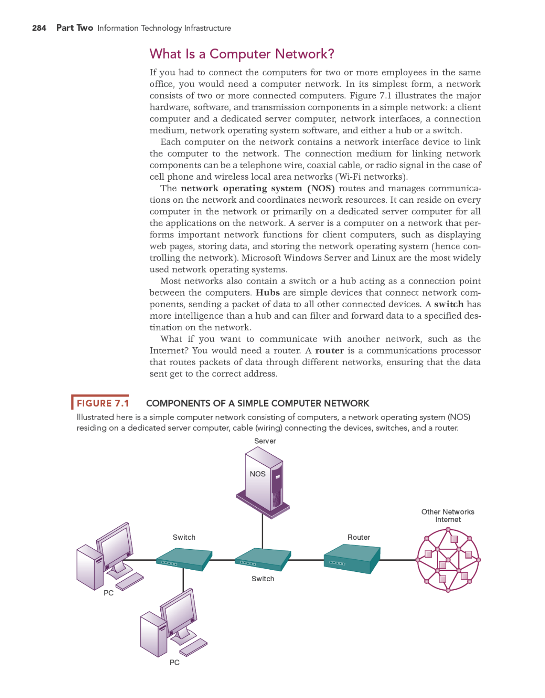
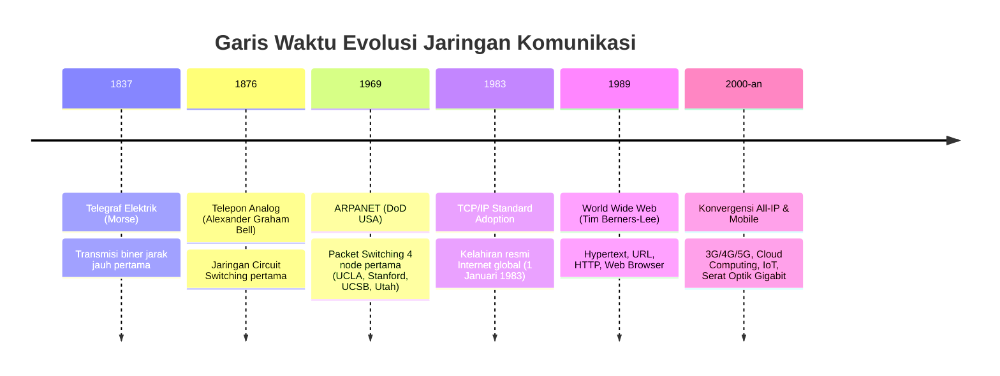
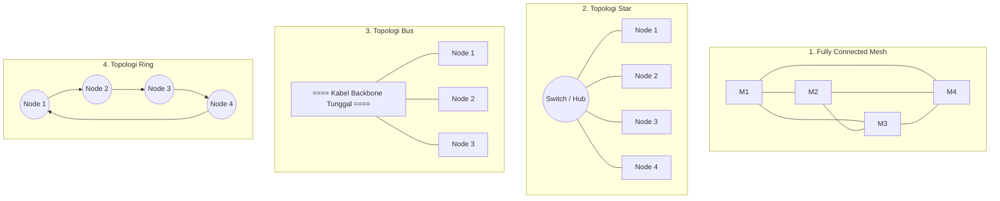
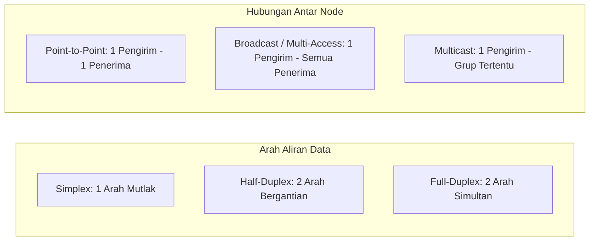
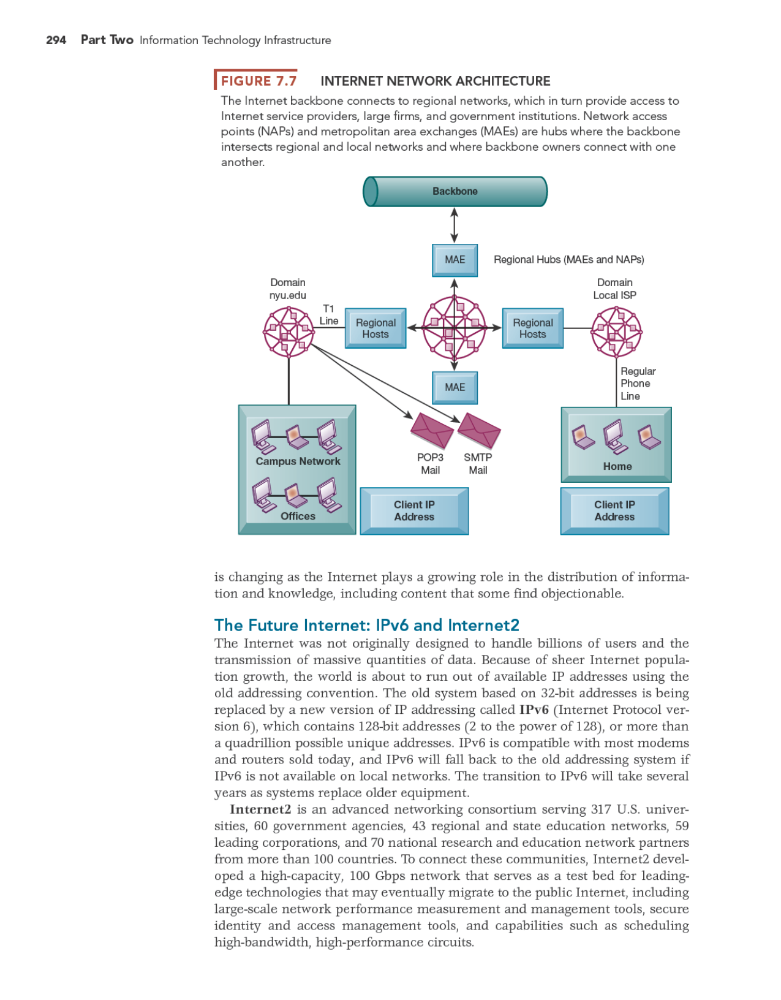

---
tags:
  - kdjk
  - kom1314
  - jaringan-komputer
  - telekomunikasi
  - week-01
  - uts
created: 2026-10-13
week: 1
source: "Garcia-2003 ch1-Communication Networks and Services, Kontrak Kuliah KDJK"
title: "Week 01 - Jaringan Komputer dan Layanannya"
---

# Week 01 - Jaringan Komputer dan Layanannya

> [!summary] Navigasi Catatan
> - **MOC Master**: [[00 - MOC KDJK UTS|00 - Map of Content KDJK UTS]]
> - **Next**: [[Week 02 - Aplikasi dan Arsitektur Berlapis (OSI & TCP-IP)|Week 02 - Aplikasi dan Arsitektur Berlapis (OSI & TCP-IP)]]

---

## 1. Overview & Sejarah Telekomunikasi dan Jaringan Komputer

### A. Pengertian Jaringan Komputer & Telekomunikasi
> [!important] Definisi Konsep
> **Jaringan Komputer (*Computer Network*)** adalah kumpulan node otonom (komputer, server, perangkat jaringan) yang saling terhubung melalui media transmisi fisik atau nirkabel, serta berkomunikasi menggunakan sekumpulan aturan baku (*protokol*) untuk bertukar data dan berbagi sumber daya (*resource sharing*).
>
> **Telekomunikasi** adalah proses transmisi sinyal, tanda, pesan, tulisan, gambar, suara, atau informasi dalam bentuk apa pun melalui kawat, gelombang radio, sistem optik, atau sistem elektromagnetik lainnya.

Komponen fundamental jaringan komunikasi:
1. **Pesan (*Message*)**: Informasi atau data yang akan dikirimkan.
2. **Pengirim (*Sender / Source*)**: Node yang menghasilkan dan mentransmisikan data.
3. **Penerima (*Receiver / Destination*)**: Node tujuan yang menerima dan memproses data.
4. **Media Transmisi (*Medium / Channel*)**: Jalur fisik tempat data merambat (misal: kabel tembaga, serat optik, udara gelombang radio).
5. **Protokol (*Protocol*)**: Himpunan kesepakatan formal yang mengatur sintaks, semantik, dan waktu pertukaran data antar perangkat.

---

### B. Lintasan Sejarah Evolusi Jaringan Komputer

1. **Era Telegraf (1830-an - 1840-an)**: Sistem transmisi digital pertama berbasis pulsa arus listrik (kode Morse). Karakter diwakili oleh kombinasi titik (*dot*) dan garis (*dash*).
2. **Era Jaringan Telepon PSTN (1870-an - 1960-an)**: Berbasis teknologi **Circuit Switching** (penyambungan sirkuit fisik khusus per panggilan). Sinyal suara berupa analog dan terikat kuat pada kabel tembaga.
3. **Era Paket Switching & ARPANET (1960-an - 1970-an)**: Paul Baran dan Donald Davies mengusulkan pemecahan data menjadi blok-blok kecil (*packets*). Lahirlah **ARPANET** pada tahun 1969 yang menjadi cikal bakal Internet.
4. **Adopsi Protokol TCP/IP (1983)**: ARPANET beralih dari protokol NCP ke arsitektur **TCP/IP** (Transmission Control Protocol / Internet Protocol), memungkinkan interkoneksi heterogen multi-jaringan (*internetworking*).
5. **Ledakan World Wide Web (WWW) (1990-an)**: Diciptakannya sistem web oleh Tim Berners-Lee di CERN membuka akses Internet bagi masyarakat umum dan komersial.

---

## 2. Taksonomi & Klasifikasi Jaringan Komunikasi

Jaringan komputer diklasifikasikan berdasarkan cakupan geografis, topologi fisik/logis, mode transmisi, dan hubungan antar node.

### A. Klasifikasi Berdasarkan Skala Geografis

| Tipe Jaringan | Kepanjangan | Skala Jarak Tipikal | Kepemilikan & Media Transmisi | Kecepatan Tipikal |
| :--- | :--- | :---: | :--- | :---: |
| **PAN** | *Personal Area Network* | $1 \text{ s/d } 10 \text{ meter}$ | Pribadi (Bluetooth, ZigBee, USB, WiFi Direct) | $1 - 24 \text{ Mbps}$ |
| **LAN** | *Local Area Network* | $10 \text{ m s/d } 1 \text{ km}$ (Gedung/Kampus) | Privat perusahaan/organisasi (UTP Cat6, WiFi 802.11, Switch) | $100 \text{ Mbps} - 10 \text{ Gbps}$ |
| **MAN** | *Metropolitan Area Network* | $5 \text{ s/d } 50 \text{ km}$ (Satu Kota) | Konsorsium operator / ISP (Metro Ethernet, Serat optik DWDM) | $1 - 100 \text{ Gbps}$ |
| **WAN** | *Wide Area Network* | Antar kota, negara, benua | Provider telekomunikasi publik (Satelit, Kabel laut serat optik) | Sangat bervariasi |

---

### B. Klasifikasi Berdasarkan Topologi Jaringan

Topologi menggambarkan tata letak fisik (*physical layout*) kabel dan perangkat, serta alur logis (*logical flow*) data di dalam jaringan.

#### Komparasi Analitis Karakteristik Topologi:

1. **Topologi Mesh (Jala Penuh / Full Mesh)**:
   - Setiap node terhubung langsung ke setiap node lainnya melalui tautan point-to-point khusus.
   - **Formula Jumlah Tautan Fisik**:
     $$\text{Jumlah Tautan (Links)} = \frac{N(N - 1)}{2}$$
     dengan $N$ adalah jumlah node komputer.
   - **Kelebihan**: Toleransi kesalahan (*fault tolerance*) tertinggi, tidak ada interferensi kanal bersama, keamanan tinggi.
   - **Kekurangan**: Jumlah kabel dan port I/O meledak secara kuadratik $O(N^2)$, instalasi sangat mahal dan rumit.

> [!example] Perhitungan Tautan Topologi Mesh
> Jika sebuah gedung kantor memiliki $N = 20$ komputer yang ingin dihubungkan secara *Full Mesh*:
> $$\text{Jumlah Kabel} = \frac{20 \times (20 - 1)}{2} = \frac{20 \times 19}{2} = 190 \text{ tautan fisik}$$
> Setiap komputer wajib memiliki $N - 1 = 19$ port kartu jaringan (NIC). Hal ini membuktikan full-mesh tidak praktis untuk LAN besar.

2. **Topologi Star (Bintang)**:
   - Setiap perangkat terhubung langsung ke satu perangkat sentral (*Switch / Hub*).
   - **Jumlah Kabel**: $N$ tautan kabel.
   - **Kelebihan**: Paling populer di LAN modern; mudah dikonfigurasi; isolasi kerusakan mudah (jika satu kabel putus, hanya komputer tersebut yang mati).
   - **Kekurangan**: Perangkat sentral menjadi titik kegagalan tunggal (*Single Point of Failure / SPOF*).

3. **Topologi Bus**:
   - Seluruh node berbagi satu kabel koaksial tunggal (*backbone*) bersama dengan terminator di kedua ujungnya.
   - **Kelebihan**: Hemat kabel, instalasi sederhana untuk jaringan kecil lawas.
   - **Kekurangan**: Rentan tabrakan (*collision*), jika kabel utama putus seluruh jaringan lumpuh, sulit isolasi kesalahan (*troubleshooting* rumit).

4. **Topologi Ring (Cincin)**:
   - Setiap node terhubung ke dua node tetangga membentuk loop tertutup searah (*unidirectional*) atau dua arah (*bidirectional*).
   - **Kelebihan**: Akses media teratur menggunakan peredaran token (tanpa tabrakan).
   - **Kekurangan**: Jika satu node atau segmen cincin rusak tanpa proteksi dual-ring, seluruh sirkuit terputus.

---

### C. Klasifikasi Berdasarkan Mode Transmisi & Hubungan Node

- **Simplex**: Transmisi hanya berlangsung satu arah permanen. Contoh: Siaran Radio komersial, TV terrestrial, sinyal keyboard ke CPU.
- **Half-Duplex**: Transmisi dapat dua arah, namun tidak boleh bersamaan (harus bergantian antre). Contoh: Walkie-talkie, Ethernet jadul berbasis Hub.
- **Full-Duplex**: Transmisi dapat berlangsung dua arah secara simultan tanpa saling mengganggu. Contoh: Sambungan telepon, Switch Ethernet modern full-duplex (jalur Tx dan Rx terpisah).

---

## 3. Pendekatan Perancangan Jaringan (Network Design Approaches)

Dalam merancang arsitektur jaringan skala besar, diterapkan prinsip rekayasa sistem terstruktur:

### A. Prinsip Hierarki Jaringan (Cisco Three-Layer Model)
Jaringan skala kampus atau enterprise dirancang modular dalam tiga tingkatan logis:
1. **Core Layer (Jalur Tulang Punggung / Backbone)**:
   - Berfokus pada kecepatan switching dan perutean paket setinggi mungkin tanpa melakukan inspeksi paket yang berat (*packet filtering*).
   - Menghubungkan antar data center dan distribusi regional.
2. **Distribution Layer (Lapisan Kebijakan & Agregasi)**:
   - Mengontrol alur lalu lintas data antardepartemen, menerapkan Access Control Lists (ACL), Quality of Service (QoS), routing antarsubnet (VLAN), dan isolasi broadcast domain.
3. **Access Layer (Lapisan Akses Pengguna)**:
   - Antarmuka langsung yang menghubungkan komputer pengguna akhir (*end-hosts*), printer, dan access point ke switch jaringan lokal.

### B. Prinsip "End-to-End" (End-to-End Argument)
> [!important] Teorema Kunci Desain Internet
> Fungsi jaringan sebaiknya diimplementasikan pada node ujung (*end-systems / hosts*), kecuali jika fungsi tersebut dapat diimplementasikan sepenuhnya dan dengan efisiensi jauh lebih baik di dalam inti jaringan (*network core*).
>
> Contoh: Logika reliabilitas data, penanganan frame rusak, dan flow control diserahkan ke protokol transport (TCP) di komputer ujung, sehingga router inti (*IP core routers*) tetap sederhana, murah, dan dapat memproses paket secepat kilat (*stateless best-effort routing*).

---

## 4. Faktor-faktor Kunci dalam Evolusi Jaringan Komunikasi

Evolusi pesat dari jaringan telegraf analog hingga jaringan serat optik All-IP 5G dipicu oleh lima kekuatan penggerak utama:

1. **Eksplosi Volume Lalu Lintas Data (*Traffic Explosion*)**:
   - Peralihan dari aplikasi berbasis teks sederhana menjadi transmisi video definisi tinggi (*4K/8K streaming*), komputasi awan (*Cloud*), kecerdasan buatan, dan Big Data.
2. **Konvergensi Layanan (*Service Convergence*)**:
   - Di masa lampau, suara (PSTN), video (televisi siaran), dan data (komputer) memiliki infrastruktur terpisah. Kini seluruh media tersebut berkonvergensi menjadi satu arsitektur **All-IP Network**.
3. **Lompatan Teknologi Media Fisik (*Transmission Breakthroughs*)**:
   - Kabel tembaga dengan keterbatasan jarak dan bandwidth digantikan oleh kabel serat optik dengan teknologi **DWDM (*Dense Wavelength Division Multiplexing*)** yang mampu mengalirkan Terabit per detik.
4. **Hukum Moore & Penurunan Biaya Komputasi**:
   - Chip mikroprosesor jaringan (ASIC/FPGA) makin cepat dan murah, memungkinkan router memproses puluhan juta paket per detik pada harga terjangkau.
5. **Peranan Standar Global & Regulasi Terbuka**:
   - Organisasi standardisasi seperti **IETF (*Internet Engineering Task Force*)**, **IEEE (*Institute of Electrical and Electronics Engineers*)**, dan **ITU-T** menetapkan spesifikasi terbuka (*open standards*) yang mencegah monopoli vendor (*vendor lock-in*).

---

## 💡 Ringkasan & Konsep Kunci Ujian

> [!tip] Rangkuman Kilat UTS
> - **Jaringan Komputer**: Hubungan node otonom untuk berbagi sumber daya via protokol baku.
> - **Formula Mesh Penuh**: $\frac{N(N-1)}{2}$ tautan kabel fisik, keandalan maksimal namun boros biaya.
> - **Star Topology**: Standar de facto LAN modern dengan Switch sebagai konsentrator sentral.
> - **End-to-End Argument**: Inti jaringan dibuat sederhana (*stateless* & cepat), kecerdasan diletakkan di node ujung (*hosts*).
> - **Konvergensi**: Penyatuan layanan telekomunikasi suara, video, dan teks ke dalam protokol tunggal (IP).
