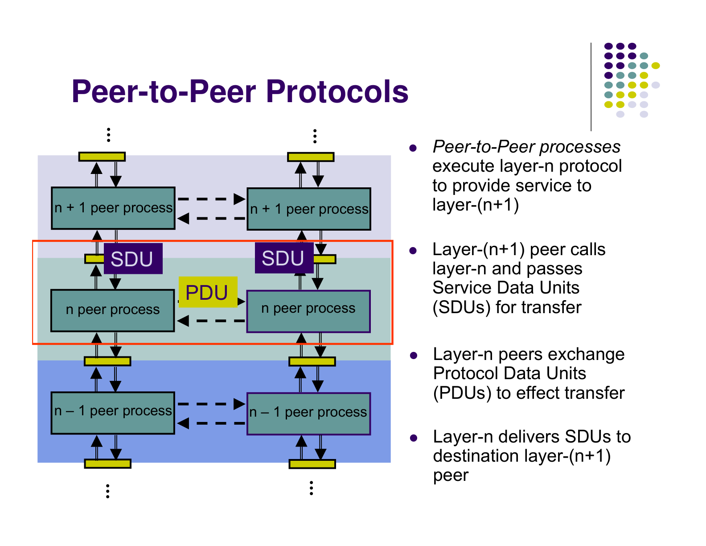
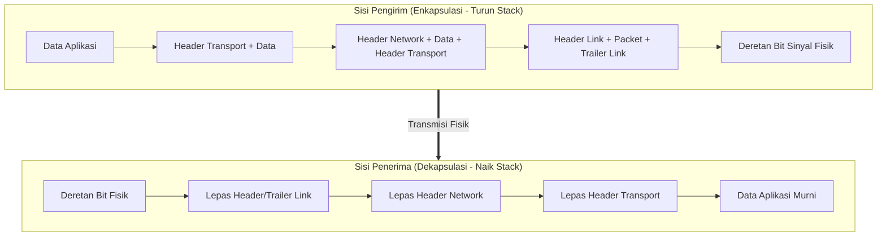
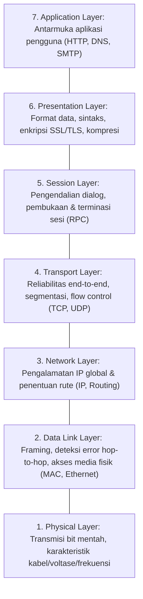
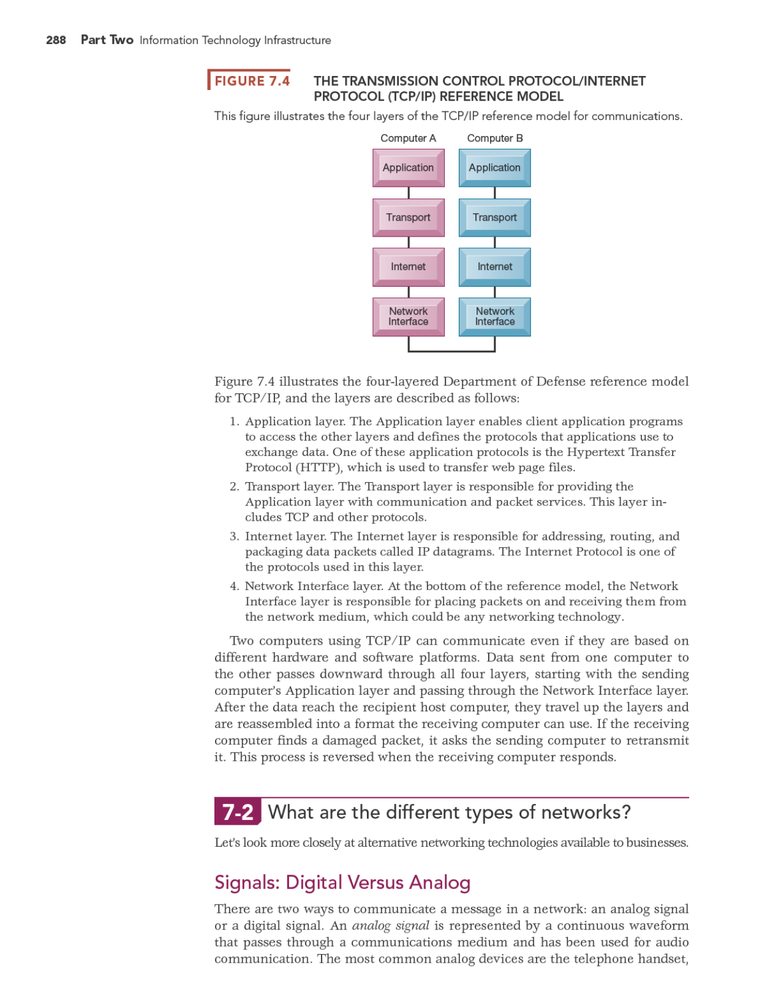
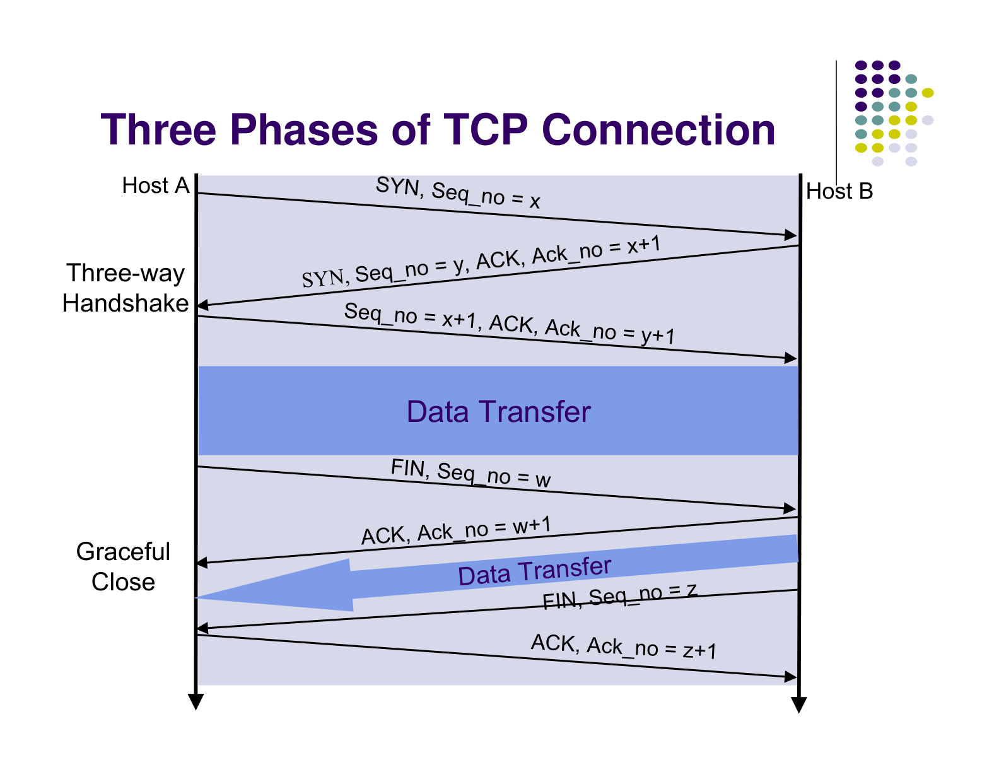
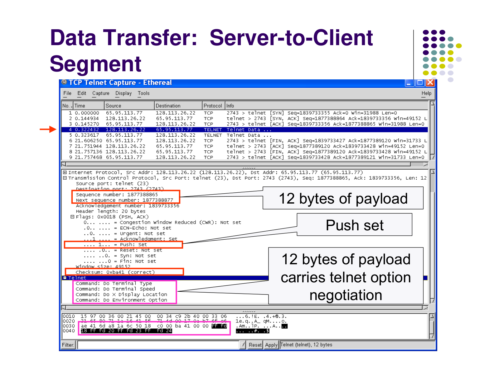
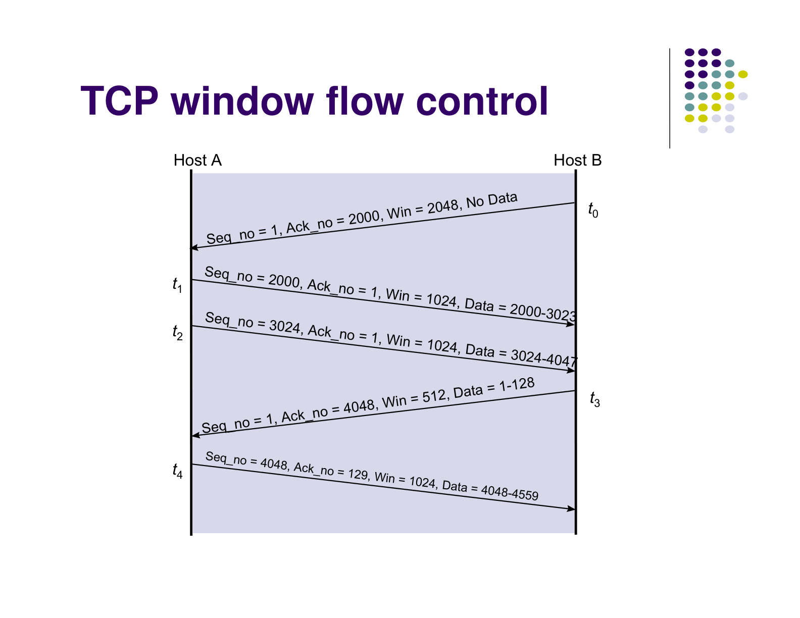
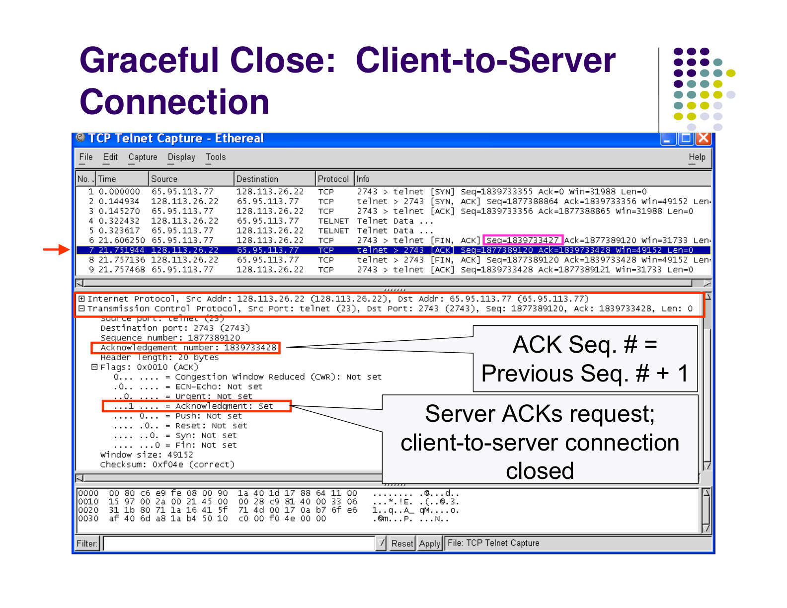
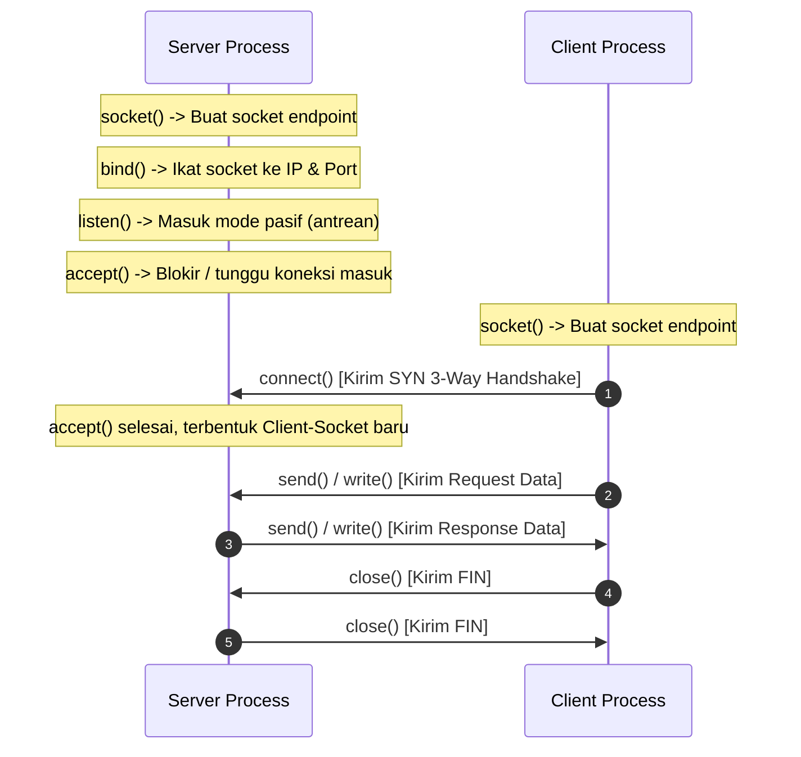
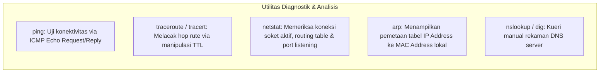

---
tags:
  - kdjk
  - kom1314
  - jaringan-komputer
  - osi-layer
  - tcp-ip
  - socket-programming
  - week-02
  - uts
created: 2026-10-13
week: 2
source: "Garcia-2003 ch2-Applications and Layered Architectures, Kontrak Kuliah KDJK"
title: "Week 02 - Aplikasi dan Arsitektur Berlapis (OSI & TCP-IP)"
---

# Week 02 - Aplikasi dan Arsitektur Berlapis (OSI & TCP-IP)

> [!summary] Navigasi Catatan
> - **Prev**: [[Week 01 - Jaringan Komputer dan Layanannya|Week 01 - Jaringan Komputer dan Layanannya]]
> - **MOC Master**: [[00 - MOC KDJK UTS|00 - Map of Content KDJK UTS]]
> - **Next**: [[Week 03 - Dasar Transmisi Digital, Sinyal, dan Kanal|Week 03 - Dasar Transmisi Digital, Sinyal, dan Kanal]]

---

## 1. Konsep dan Filosofi Arsitektur Berlapis (Layering Architecture)

### A. Mengapa Diperlukan Arsitektur Berlapis?
Komunikasi antar-komputer melibatkan kompleksitas perangkat keras, sistem operasi, antarmuka fisik, pengalamatan, dan aplikasi yang sangat heterogen. Jika dirancang monolitik (*all-in-one*), modifikasi kecil pada perangkat keras akan merusak seluruh program aplikasi.

> [!important] Prinsip Layering & Abstraksi
> **Arsitektur Berlapis (*Layered Architecture*)** memecah sistem komunikasi yang kompleks menjadi beberapa tingkatan modular (*layers*). Setiap lapisan:
> 1. Bertanggung jawab atas satu kelompok fungsi spesifik.
> 2. Menyediakan layanan (*services*) bagi lapisan di atasnya melalui antarmuka formal (*Service Access Point / SAP*).
> 3. Memanfaatkan layanan yang disediakan oleh lapisan tepat di bawahnya.
> 4. Menyembunyikan detail implementasi internal (*information hiding / abstraction*).

#### Analogi Pengiriman Surat Pos
1. **Pengguna menulis surat**: Berisi pesan manusia (Setara *Application Layer*).
2. **Surat dimasukkan amplop dan diberi alamat penerima/pengirim**: Enkapsulasi alamat (Setara *Network Layer*).
3. **Amplop diserahkan ke kurir kantor pos**: Pengelompokan paket ke dalam karung logistik (Setara *Data Link Layer*).
4. **Karung diangkut truk/pesawat antar-kota**: Moda transportasi fisik (Setara *Physical Layer*).

---

### B. Enkapsulasi, Dekapsulasi, SDU, dan PDU

Dalam komunikasi berlapis, data berpindah secara vertikal melalui *protocol stack*:

> [!note] Terminologi Satuan Data Protokol
> - **SDU (*Service Data Unit*)**: Muatan data murni (*payload*) yang diterima dari satu lapisan lebih tinggi sebelum ditambah informasi kontrol.
> - **PCI (*Protocol Control Information*)**: Header (atau trailer) yang ditambahkan oleh lapisan lokal untuk koordinasi dengan lapisan sejawat (*peer*).
> - **PDU (*Protocol Data Unit*)**: Hasil gabungan $\text{PDU} = \text{PCI} + \text{SDU}$.
>   - Layer Transport: **Segment** (TCP) atau **Datagram** (UDP).
>   - Layer Network: **Packet**.
>   - Layer Data Link: **Frame** (memiliki Header dan Trailer FCS).
>   - Layer Physical: **Bits**.

---

## 2. Model Referensi OSI (Open Systems Interconnection)

Dirilis oleh ISO (*International Organization for Standardization*) sebagai kerangka teoritis 7 lapisan:

### Rincian Fungsi 7 Lapisan OSI:

1. **Layer 1 - Physical**:
   - Mentransmisikan bit tunggal melalui media transmisi fisik.
   - Mengatur level tegangan listrik, laju bit transmisi (*bit rate*), jenis konektor (RJ45), dan sinkronisasi pulsa bit.
2. **Layer 2 - Data Link**:
   - Membentuk paket menjadi **frame**, menambahkan alamat fisik (**MAC Address**), mendeteksi error via CRC, dan mengatur akses media transmisi bersama (*Medium Access Control*).
   - Menjamin komunikasi andal antar node yang bertetangga langsung dalam satu segmen jaringan fisik (*hop-by-hop*).
3. **Layer 3 - Network**:
   - Bertanggung jawab atas pengalamatan logis global (**IP Address**) dan menentukan rute terbaik (**routing**) agar paket data dapat menyeberang berbagai jaringan heterogen (*host-to-host delivery*).
4. **Layer 4 - Transport**:
   - Menyediakan pengiriman pesan *end-to-end* antar-proses aplikasi di komputer yang berbeda (*process-to-process delivery*).
   - Menangani segmentasi, reassembly, penomoran urutan paket, retransmisi paket hilang, dan pengaturan laju alir (*flow control*).
5. **Layer 5 - Session**:
   - Membuka, memelihara, menyinkronkan (*checkpointing*), dan menutup sesi dialog komunikasi antar aplikasi.
6. **Layer 6 - Presentation**:
   - Berfokus pada sintaks dan semantik informasi: konversi set karakter (ASCII ke EBCDIC), enkripsi/dekripsi kriptografi, dan kompresi data.
7. **Layer 7 - Application**:
   - Menyediakan antarmuka langsung bagi pengguna atau aplikasi perangkat lunak untuk mengakses layanan jaringan (browsing, transfer file, email).

---

## 3. Arsitektur Protokol TCP/IP (Internet Architecture)

Model TCP/IP merupakan standar praktis yang digunakan secara global pada Internet. Berbeda dari OSI yang bersifat preskriptif, TCP/IP lahir secara deskriptif dari implementasi nyata ARPANET.

### Perbandingan Arsitektural OSI vs TCP/IP:

| Fitur / Karakteristik | Model OSI (7 Layer) | Model TCP/IP (4 atau 5 Layer) |
| :--- | :--- | :--- |
| **Jumlah Lapisan** | 7 Lapisan Kaku | 4 atau 5 Lapisan Praktis |
| **Lapisan Atas (5, 6, 7)** | Dipisah ketat (*Session*, *Presentation*, *Application*) | Digabung menjadi satu lapisan **Application Layer** |
| **Lapisan Bawah (1 & 2)** | Dipisah ketat (*Physical* dan *Data Link*) | Sering digabung menjadi *Host-to-Network* / *Network Access* |
| **Status Historis** | Model konseptual teoritis (standar akademis) | Protokol implementasi nyata yang menjalankan Internet dunia |
| **Filosofi Koneksi** | Mendukung connectionless & connection-oriented di network layer | Network Layer mutlak **Connectionless (IP)**, reliabilitas di Transport Layer |

---

## 4. Mekanisme Protokol Lapisan Transport: TCP vs UDP

Lapisan Transport menggunakan **Nomor Port (*Port Numbers*)** untuk membedakan proses/aplikasi pada host yang sama:
- **Port 0 - 1023**: *Well-Known Ports* (layanan sistem standar, misal: HTTP 80, DNS 53).
- **Port 1024 - 49151**: *Registered Ports*.
- **Port 49152 - 65535**: *Dynamic / Private / Ephemeral Ports* (port acak klien).

### A. TCP (Transmission Control Protocol)
- **Karakteristik**: *Connection-oriented*, andal (*reliable*), menjamin urutan data utuh (*in-order delivery*), *flow control*, dan *congestion control*.

#### 1. Pembentukan Koneksi: TCP Three-Way Handshake

1. **Host A $\to$ Host B**: Mengirim segmen `SYN` dengan nomor urut acak $\text{seq} = x$.
2. **Host B $\to$ Host A**: Membalas dengan segmen `SYN + ACK`, dengan $\text{seq} = y$ dan $\text{ack} = x + 1$.
3. **Host A $\to$ Host B**: Mengirim segmen `ACK` konfirmasi akhir dengan $\text{ack} = y + 1$.

#### 2. Pertukaran Data & Kontrol Jendela Alir (Sliding Window Flow Control)

- TCP menggunakan nomor urutan berbasis byte (*byte-stream sequence numbers*).
- Penerima mengabarkan ukuran penyangga yang masih kosong melalui field `Receive Window (rwnd)` di dalam header TCP, mencegah pengirim membanjiri buffer penerima.

#### 3. Penutupan Koneksi: TCP Four-Way Handshake (Graceful Teardown)

- Menggunakan bendera `FIN` dan konfirmasi `ACK` dari masing-masing pihak secara independen (karena saluran bersifat *full-duplex*).

---

### B. UDP (User Datagram Protocol)
- **Karakteristik**: *Connectionless*, tidak ada jaminan reliabilitas (*unreliable*), tanpa flow control, tanpa pengurutan segmen.
- **Kelebihan**: Sangat ringan (*overhead* header hanya 8 byte vs 20 byte pada TCP), latensi rendah.
- **Kasus Penggunaan**: Streaming video langsung (*live audio/video*), game daring (*real-time gaming*), dan kueri DNS cepat.

---

## 5. API Berkeley Sockets (Socket Programming)

> [!important] Definisi Socket
> **Socket** adalah abstraksi antarmuka pemrograman aplikasi (API) sistem operasi yang berfungsi sebagai titik ujung (*endpoint*) komunikasi dua arah antar-proses melalui jaringan komputer.
> Sebuah socket diidentifikasi secara unik oleh pasangan tuple:
> $$\text{Socket Address} = (\text{IP Address}, \text{Port Number})$$

### Alur Kerja Pemrograman Socket TCP (Client-Server):

#### Ringkasan Fungsi Panggilan Sistem Socket Berkeley:
- `socket(domain, type, protocol)`: Membuat deskriptor soket baru (misal: `AF_INET`, `SOCK_STREAM` untuk TCP atau `SOCK_DGRAM` untuk UDP).
- `bind(sockfd, addr, addrlen)`: Mengaitkan soket dengan alamat IP lokal dan port tertentu (umumnya sisi Server).
- `listen(sockfd, backlog)`: Menginstruksikan soket TCP server untuk menerima permintaan koneksi masuk dengan batas antrean *backlog*.
- `accept(sockfd, addr, addrlen)`: Mengekstraksi koneksi pertama dari antrean dan menghasilkan deskriptor soket baru khusus untuk melayani klien tersebut.
- `connect(sockfd, addr, addrlen)`: Di sisi Klien untuk menginisiasi 3-way handshake menuju alamat IP dan port Server tujuan.
- `send()` / `recv()` (atau `read()` / `write()`): Mengirim dan menerima byte data melalui koneksi aktif.
- `close(sockfd)`: Menutup koneksi dan melepaskan sumber daya memori socket.

---

## 6. Protokol Aplikasi & Utilitas TCP/IP

### A. Protokol Aplikasi Populer
1. **HTTP / HTTPS (Port 80 / 443)**: Protokol request-response untuk web. HTTP/1.1 mendukung *persistent connections*, HTTP/2 mendukung *multiplexing over single TCP connection*, dan HTTP/3 menggunakan **QUIC** (berbasis UDP).
2. **DNS (Port 53)**: Sistem basis data terdistribusi hierarkis untuk memetakan nama domain (*misal: unpad.ac.id*) ke alamat IP numerik (*103.x.x.x*). Menggunakan UDP untuk resolusi cepat dan TCP untuk transfer zona antar server nama (*zone transfer*).
3. **SMTP, POP3, IMAP**:
   - **SMTP (Port 25/587)**: Mengirimkan email dari klien ke mail server pengirim atau antar mail server (*push protocol*).
   - **POP3 (Port 110/995)**: Mengunduh email ke perangkat lokal dan umumnya menghapusnya dari server.
   - **IMAP (Port 143/993)**: Mengelola dan menyinkronkan email secara real-time langsung di folder server.

---

### B. Utilitas Diagnostik Jaringan TCP/IP

> [!tip] Cara Kerja Mendalam `traceroute` / `tracert`
> Utilitas ini memanfaatkan field **TTL (*Time to Live*)** pada header IP untuk memetakan router perantara:
> 1. Mengirim paket dengan nilai $\text{TTL} = 1$. Router hop pertama mengurangi TTL menjadi 0, membuang paket, dan mengirimkan pesan kesalahan balik **ICMP Time Exceeded**. Alamat IP router 1 berhasil dicatat.
> 2. Mengirim paket berikutnya dengan $\text{TTL} = 2$. Router hop kedua membuang paket dan membalas dengan **ICMP Time Exceeded**.
> 3. Proses diulang dengan $\text{TTL} = 3, 4, 5, \dots$ sampai paket tiba di host tujuan (yang membalas dengan ICMP Port Unreachable atau Echo Reply).
