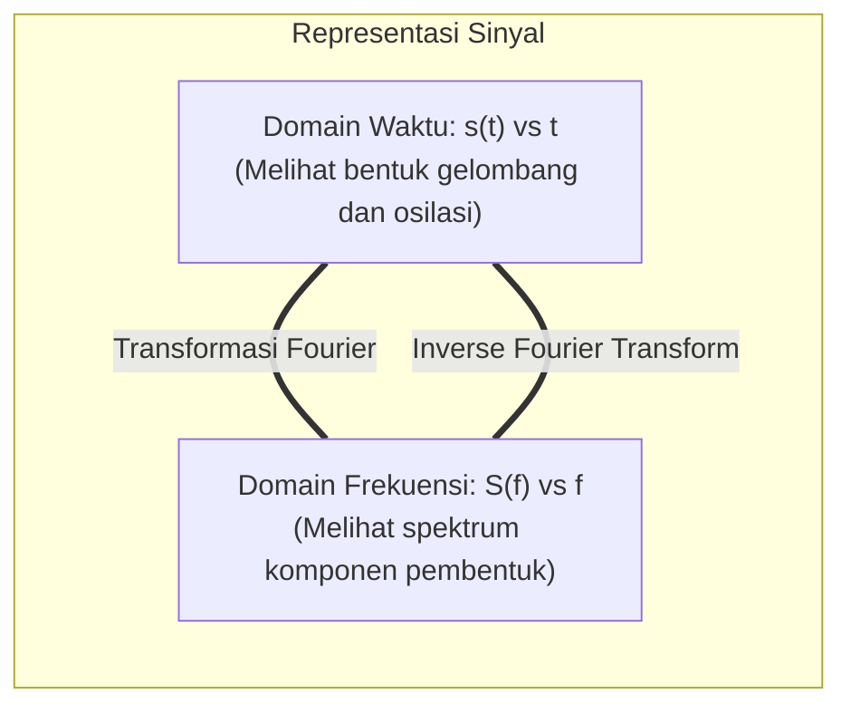
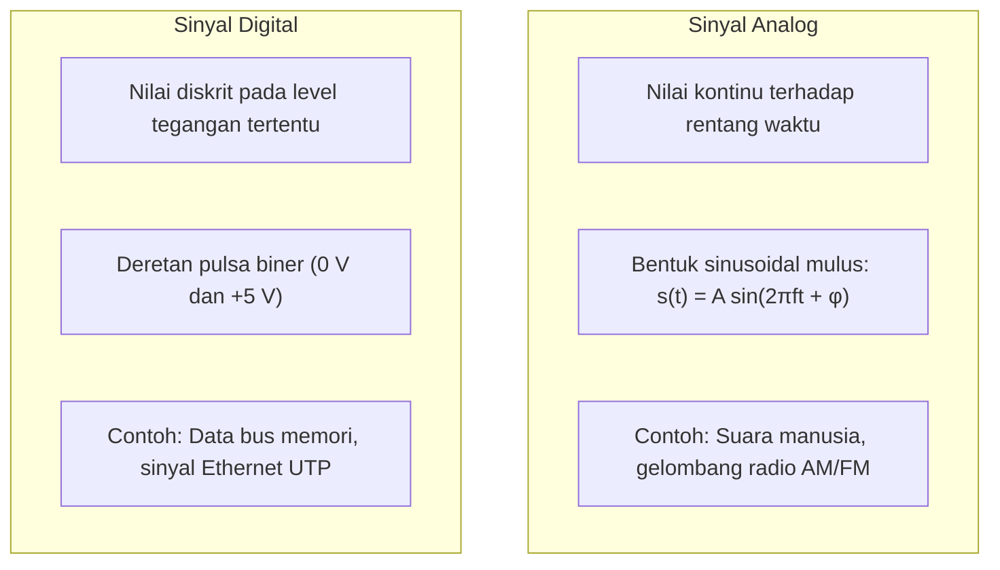
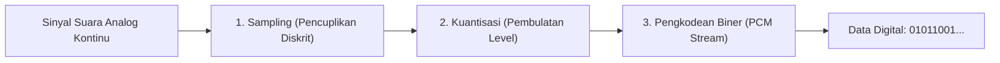
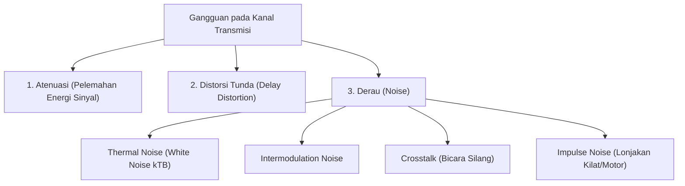

---
tags:
  - kdjk
  - kom1314
  - komunikasi-data
  - sinyal-fourier
  - transmisi-digital
  - nyquist-shannon
  - week-03
  - uts
created: 2026-10-13
week: 3
source: "Garcia-2003 ch3-Digital Transmission Fundamentals, Kontrak Kuliah KDJK"
title: "Week 03 - Dasar Transmisi Digital, Sinyal, dan Kanal"
---

# Week 03 - Dasar Transmisi Digital, Sinyal, dan Kanal

> [!summary] Navigasi Catatan
> - **Prev**: [[Week 02 - Aplikasi dan Arsitektur Berlapis (OSI & TCP-IP)|Week 02 - Aplikasi dan Arsitektur Berlapis (OSI & TCP-IP)]]
> - **MOC Master**: [[00 - MOC KDJK UTS|00 - Map of Content KDJK UTS]]
> - **Next**: [[Week 04 - Pengkodean Kanal, Modulasi Digital, dan Deteksi-Koreksi Kesalahan|Week 04 - Pengkodean Kanal, Modulasi Digital, dan Deteksi-Koreksi Kesalahan]]

---

## 1. Analisis Sinyal & Transformasi Fourier

Dalam komunikasi data, informasi ditransmisikan dalam bentuk gelombang elektromagnetik. Memahami sinyal membutuhkan dua perspektif: **Domain Waktu (*Time Domain*)** dan **Domain Frekuensi (*Frequency Domain*)**.

### A. Teorema Fourier (Deret & Transformasi Fourier)
Jean-Baptiste Fourier membuktikan bahwa:
> [!important] Teorema Fourier
> Setiap fungsi atau sinyal periodik $s(t)$ dengan periode $T$ dapat diuraikan secara eksak menjadi penjumlahan tak hingga dari gelombang sinus dan kosinus harmonik:
> $$s(t) = c + \sum_{n=1}^{\infty} a_n \sin(2\pi n f_0 t) + \sum_{n=1}^{\infty} b_n \cos(2\pi n f_0 t)$$
> di mana:
> - $f_0 = \frac{1}{T}$ adalah **Frekuensi Fundamental (*Fundamental Frequency*)**.
> - $n f_0$ adalah **Harmonik ke-$n$ (*Harmonics*)**.
> - $a_n, b_n$ adalah amplitudo dari masing-masing komponen harmonik.

#### Penguraian Gelombang Kotak (Square Wave)
Pulsa biner digital yang ideal berbentuk gelombang kotak periodik dapat diuraikan menjadi komponen frekuensi harmonik ganjil:
$$s(t) = \frac{4A}{\pi} \left( \sin(2\pi f t) + \frac{1}{3}\sin(6\pi f t) + \frac{1}{5}\sin(10\pi f t) + \frac{1}{7}\sin(14\pi f t) + \dots \right)$$

> [!tip] Intisari Penting untuk Transmisi
> Gelombang kotak digital membutuhkan **frekuensi tak hingga (*infinite bandwidth*)** untuk menghasilkan sudut siku yang sempurna. Karena kanal fisik nyata memiliki batasan frekuensi (bandwidth terbatas), harmonik frekuensi tinggi akan terpotong (*teratenuasi*), menyebabkan pulsa digital menjadi membulat dan terdistorsi.

---

## 2. Karakteristik Sinyal Analog vs Sinyal Digital

### Parameter Kunci Sinyal Sinusoidal Analog:
1. **Amplitudo Puncak ($A$)**: Nilai tegangan maksimum atau kuat medan sinyal (satuan: Volt).
2. **Frekuensi ($f$)**: Jumlah osilasi atau siklus gelombang lengkap per detik (satuan: Hertz / Hz).
3. **Periode ($T$)**: Waktu yang dibutuhkan untuk menyelesaikan satu siklus penuh:
   $$T = \frac{1}{f}$$
4. **Fasa ($\theta$ atau $\phi$)**: Posisi relatif gelombang pada waktu $t = 0$ (satuan: Derajat atau Radian).
5. **Panjang Gelombang ($\lambda$)**: Jarak spasial fisik yang ditempuh satu siklus gelombang saat merambat dengan kecepatan $v$:
   $$\lambda = \frac{v}{f}$$
   *(Untuk gelombang radio di udara bebas, $v \approx c = 3 \times 10^8 \text{ m/s}$)*.

---

## 3. Representasi Informasi Digital & Digitalisasi Sinyal (PCM)

Untuk mentransmisikan informasi suara analog ke jaringan digital, dilakukan konversi menggunakan metode **Pulse Code Modulation (PCM)** melalui tiga tahapan:

1. **Sampling (Pencuplikan)**: Mengambil sampel amplitudo sinyal analog pada interval waktu teratur $T_s$.
   > [!important] Teorema Sampling Nyquist
   > Agar sinyal analog kontinu dengan bandwidth tertinggi $f_{\max}$ dapat direkonstruksi kembali secara sempurna tanpa kehilangan informasi, laju pencuplikan (*sampling rate*) $f_s$ harus memenuhi:
   > $$f_s \ge 2 \times f_{\max}$$
   > Frekuensi minimum $2 f_{\max}$ disebut sebagai **Laju Nyquist (*Nyquist Rate*)**.
2. **Kuantisasi (*Quantization*)**: Memetakan nilai sampel kontinu ke dalam sejumlah level diskrit terhingga $L = 2^n$. Selisih antara nilai riil dan level kuantisasi menghasilkan **Derau Kuantisasi (*Quantization Noise*)**.
3. **Encoding (Pengkodean)**: Mengubah setiap level kuantisasi menjadi $n$-bit kode biner.

> [!example] Contoh Perhitungan Digitalisasi Suara Standar PSTN (Kanal Telepon)
> - Frekuensi suara percakapan manusia dibatasi hingga $f_{\max} = 4000 \text{ Hz}$ (4 kHz).
> - Menurut Nyquist:
>   $$f_s = 2 \times 4000 = 8000 \text{ sampel/detik}$$
> - Setiap sampel dikodekan ke dalam $n = 8 \text{ bit}$ (256 level kuantisasi).
> - **Laju Bit Standar Kanal Suara PCM (DS0)**:
>   $$\text{Bit Rate} = 8000 \text{ sampel/detik} \times 8 \text{ bit/sampel} = 64.000 \text{ bps} = 64 \text{ kbps}$$

---

## 4. Karakteristik Kanal Komunikasi & Gangguan Transmisi

Kanal transmisi nyata mengalami keterbatasan fisik yang menurunkan kualitas sinyal:

### A. Bandwidth Kanal
**Bandwidth ($B$)** adalah lebar rentang spektrum frekuensi yang dapat dilewatkan oleh sebuah media transmisi dengan redaman yang masih dapat ditoleransi:
$$B = f_{\text{high}} - f_{\text{low}} \quad (\text{satuan: Hertz})$$

### B. Atenuasi (Pelemahan Daya) & Satuan Desibel (dB)
Energi sinyal melemah seiring bertambahnya jarak perambatan. Besaran penguatan (*gain*) atau redaman (*loss*) diukur dalam desibel:
$$\text{Loss}_{\text{dB}} = 10 \log_{10}\left(\frac{P_{\text{input}}}{P_{\text{output}}}\right)$$

### C. Distorsi Tunda (Delay Distortion)
Komponen frekuensi yang berbeda merambat dengan kecepatan fase yang sedikit berbeda di dalam kabel. Akibatnya, komponen-komponen frekuensi dari pulsa yang sama tiba di penerima pada waktu yang berbeda, menyebabkan pelebaran pulsa (*pulse spreading*) dan memicu **Inter-Symbol Interference (ISI)**.

### D. Derau (Noise)
- **Thermal Noise (White Noise)**: Timbul akibat agitasi termal acak elektron dalam konduktor. Bersifat merata di semua frekuensi. Daya derau:
  $$N = k \cdot T \cdot B \quad (\text{Watt})$$
  *(dengan $k = 1.38 \times 10^{-23} \text{ J/K}$ konstanta Boltzmann, $T$ suhu Kelvin, $B$ bandwidth).*
- **Crosstalk**: Gandengan induksi elektromagnetik antar-kabel bersebelahan (misal: mendengar percakapan orang lain secara samar di telepon analog).
- **Impulse Noise**: Lonjakan daya tajam dalam durasi mikrodetik akibat petir atau sakelar elektromagnetik daya tinggi; penyebab utama rusaknya bit biner pada saluran tembaga.

---

## 5. Keterbatasan Fundamental Transmisi Digital (Nyquist vs Shannon)

Kapasitas maksimum kanal transmisi diatur oleh dua hukum fundamental fisika informasi:

### A. Formula Kapasitas Nyquist (Kanal Bebas Derau / Noiseless Channel)
Harry Nyquist (1928) merumuskan bahwa pada kanal ideal bebas derau dengan bandwidth $B$, laju transmisi maksimum ditentukan oleh jumlah level sinyal diskrit $M$:

> [!important] Teorema Kapasitas Nyquist
> $$C_{\text{Nyquist}} = 2 B \log_2(M) \quad (\text{bps})$$
> di mana:
> - $C$ = Kapasitas data maksimum (bit per second).
> - $B$ = Bandwidth kanal (Hertz).
> - $M$ = Jumlah level diskrit sinyal yang digunakan (untuk biner $M=2 \Rightarrow \log_2 2 = 1$).

---

### B. Formula Kapasitas Shannon (Kanal Berderau / Noisy Channel)
Claude Shannon (1948) memperluas teori informasi untuk kanal nyata yang memiliki derau termal Gaussian acak (AWGN):

> [!important] Teorema Kapasitas Shannon
> $$C_{\text{Shannon}} = B \log_2(1 + \text{SNR}) \quad (\text{bps})$$
> di mana:
> - $\text{SNR}$ adalah rasio daya sinyal terhadap daya derau dalam nilai linear:
>   $$\text{SNR} = \frac{P_{\text{signal}}}{P_{\text{noise}}}$$
> - Hubungan dengan satuan desibel:
>   $$\text{SNR}_{\text{dB}} = 10 \log_{10}(\text{SNR}) \iff \text{SNR} = 10^{\left(\frac{\text{SNR}_{\text{dB}}}{10}\right)}$$

> [!warning] Jebakan Ujian: Nilai SNR Linear vs Desibel
> Jangan pernah memasukkan nilai desibel langsung ke dalam rumus Shannon! Selalu ubah nilai dB ke bentuk linear terlebih dahulu.
> Misal $\text{SNR}_{\text{dB}} = 30 \text{ dB} \Rightarrow \text{SNR} = 10^{30/10} = 10^3 = 1000$.

---

## 📝 Contoh Soal Komprehensif UTS & Pembahasan

> [!example] Soal Perhitungan Terintegrasi Shannon dan Nyquist
> Sebuah saluran transmisi telepon memiliki bandwidth $B = 3000 \text{ Hz}$ dan rasio sinyal terhadap derau $\text{SNR}_{\text{dB}} = 30 \text{ dB}$.
> 1. Hitung kapasitas teoritis maksimum menurut Shannon!
> 2. Jika kita ingin mentransmisikan data mendekati kapasitas teoritis tersebut, berapakah jumlah level sinyal ($M$) minimum yang harus digunakan menurut formula Nyquist?

#### Pembahasan:
**Langkah 1: Konversi SNR dB ke linear**
$$\text{SNR} = 10^{\frac{30}{10}} = 10^3 = 1000$$

**Langkah 2: Hitung Kapasitas Shannon**
$$C = B \log_2(1 + \text{SNR})$$
$$C = 3000 \times \log_2(1 + 1000) = 3000 \times \log_2(1001)$$
Karena $2^9 = 512$ dan $2^{10} = 1024$, maka $\log_2(1001) \approx 9.967$:
$$C = 3000 \times 9.967 \approx 29.901 \text{ bps} \approx 30 \text{ kbps}$$

**Langkah 3: Hitung Jumlah Level Sinyal ($M$) dengan Rumus Nyquist**
Kita samakan laju data Nyquist dengan batas Shannon:
$$C_{\text{Nyquist}} \ge 29.901 \text{ bps}$$
$$2 B \log_2(M) \ge 29.901$$
$$2 \times 3000 \times \log_2(M) \ge 29.901$$
$$6000 \times \log_2(M) \ge 29.901$$
$$\log_2(M) \ge \frac{29.901}{6000} \approx 4.983$$
$$M \ge 2^{4.983} \approx 31.64$$

Karena jumlah level sinyal dalam sistem digital praktis harus berupa perpangkatan 2 ($M = 2^k$):
$$k = \lceil 4.983 \rceil = 5 \text{ bit per simbol} \implies M = 2^5 = 32 \text{ level}$$

**Kesimpulan**: Diperlukan minimal $M = 32 \text{ level sinyal}$ untuk mencapai laju data mendekati batas Shannon.
