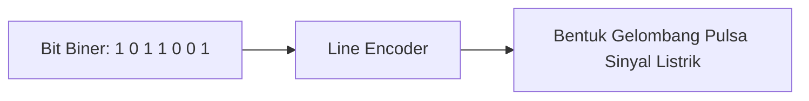
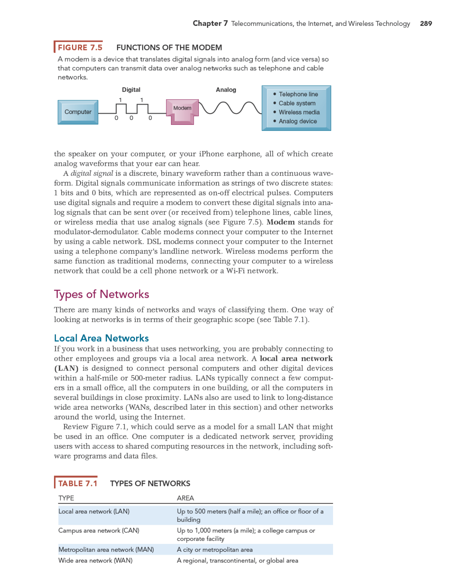
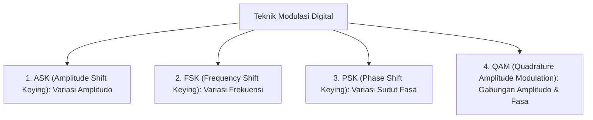
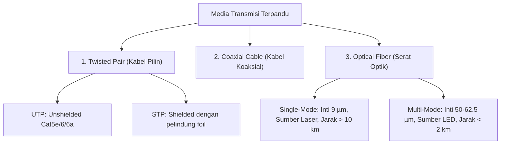
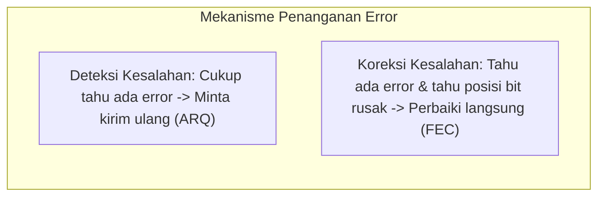

---
tags:
  - kdjk
  - kom1314
  - line-coding
  - modulasi-digital
  - media-transmisi
  - deteksi-koreksi-error
  - crc-polinomial
  - kode-hamming
  - week-04
  - uts
created: 2026-10-13
week: 4
source: "Garcia-2003 ch3-Digital Transmission Fundamentals, Kontrak Kuliah KDJK"
title: "Week 04 - Pengkodean Kanal, Modulasi Digital, dan Deteksi-Koreksi Kesalahan"
---

# Week 04 - Pengkodean Kanal, Modulasi Digital, dan Deteksi-Koreksi Kesalahan

> [!summary] Navigasi Catatan
> - **Prev**: [[Week 03 - Dasar Transmisi Digital, Sinyal, dan Kanal|Week 03 - Dasar Transmisi Digital, Sinyal, dan Kanal]]
> - **MOC Master**: [[00 - MOC KDJK UTS|00 - Map of Content KDJK UTS]]
> - **Next**: [[Week 05 - Sistem Transmisi, Multiplexing, Switching, dan PSTN|Week 05 - Sistem Transmisi, Multiplexing, Switching, dan PSTN]]

---

## 1. Pengkodean Saluran / Kanal (Line Coding)

> [!important] Definisi Line Coding
> **Line Coding** adalah proses pemetaan deretan bit biner (0 dan 1) menjadi pulsa-pulsa sinyal digital diskrit berbasis level tegangan listrik yang cocok ditransmisikan melalui saluran transmisi *baseband*.



### A. Kriteria Kualitas Skema Line Coding
1. **Kemampuan Sinkronisasi Diri (*Self-Clocking*)**: Sinyal harus menyediakan transisi tegangan yang cukup agar rangkaian penerima dapat menyinkronkan pewaktu (*clock recovery*) tanpa membutuhkan kabel clock terpisah.
2. **Ketiadaan Komponen DC (*No DC Component*)**: Komponen tegangan rata-rata searah (DC) menyebabkan pemborosan energi dan tidak dapat melewati komponen transformator isolasi AC di saluran telepon.
3. **Efisiensi Bandwidth**: Menggunakan spektrum frekuensi sekecil mungkin untuk laju bit tertentu.
4. **Ketahanan Terhadap Derau (*Noise Immunity*)**: Tingkat kemungkinan terjadinya kesalahan bit (*Bit Error Rate / BER*) rendah.

---

### B. Skema-Skema Line Coding Populer

| Skema Line Coding | Representasi Biner `0` dan `1` | Kelebihan | Kekurangan & Karakteristik |
| :--- | :--- | :--- | :--- |
| **Unipolar NRZ** | `1` = Voltase $+V$, `0` = Voltase $0\text{ V}$ | Sangat sederhana | Komponen DC sangat tinggi, kehilangan sinkronisasi jika ada rentetan 0 atau 1 panjang |
| **Polar NRZ-L** | `0` = $+V$, `1` = $-V$ (level tegangan absolut) | Lebih tahan derau dibanding unipolar | Komponen DC masih ada, masalah sinkronisasi pada bit berulang |
| **Polar NRZ-I** | Ada transisi di awal bit = `1`, Tidak ada transisi = `0` | Bagus jika bit 1 sering muncul (*differential*) | Hilang clock jika menerima deretan panjang bit `0` |
| **Bipolar AMI** | `0` = $0\text{ V}$, `1` = bergantian $+V$ dan $-V$ (*Alternate Mark Inversion*) | Komponen DC = 0, dapat mendeteksi pelanggaran bipolar (*bipolar violation*) | Hilang sinkronisasi jika menerima deretan panjang bit `0` |
| **Manchester** | `0` = transisi Tinggi ke Rendah, `1` = transisi Rendah ke Tinggi | **Self-clocking sempurna**, DC component = 0. Digunakan di **IEEE 802.3 Ethernet 10 Mbps** | Membutuhkan bandwidth **2x lipat** laju data (1 baud = 0.5 bit) |
| **Diff. Manchester** | Transisi di awal bit = `0`, Tanpa transisi di awal = `1` (selalu ada transisi di tengah bit) | Sinkronisasi sempurna, kebal polaritas kabel terbalik. Digunakan di **Token Ring 802.5** | Membutuhkan bandwidth ganda |
| **Block Coding (4B/5B)** | Setiap 4-bit data dipetakan ke 5-bit kode transmisi | Menjamin tidak ada lebih dari 3 nol beruntun, overhead bandwidth hanya $25\%$ | Menggunakan tabel konversi kode sebelum NRZ-I |

---

## 2. Modem & Modulasi Digital (Digital Bandpass Modulation)

Jika sinyal digital harus merambat melalui media pita lebar analog (*bandpass channel*) seperti kabel telepon tembaga analog, transmisi nirkabel radio seluler, atau satelit, sinyal digital harus ditumpangkan ke atas **Gelombang Pembawa Sinusoidal (*Carrier Wave*)**:
$$s(t) = A(t) \cos(2\pi f_c t + \phi(t))$$



> [!important] Definisi Modem
> **Modem (*Modulator - Demodulator*)**:
> - **Modulator (Sisi Kirim)**: Mengubah bit digital menjadi sinyal analog sinusoidal terombak.
> - **Demodulator (Sisi Terima)**: Mengembalikan sinyal analog terombak menjadi bit digital 0 dan 1 semula.

---

### A. Empat Teknik Dasar Modulasi Digital



1. **ASK (*Amplitude Shift Keying*)**:
   - Bit `1` diwakili oleh gelombang sinus bervoltase $A$, sedangkan bit `0` diwakili oleh tanpa gelombang ($0\text{ V}$ atau OOK / *On-Off Keying*).
   - *Kelemahan*: Sangat rentan terhadap interferensi derau lonjakan tegangan (*noise*).
2. **FSK (*Frequency Shift Keying*)**:
   - Bit `1` menggunakan frekuensi tinggi $f_1$, sedangkan bit `0` menggunakan frekuensi rendah $f_2$.
   - Lebih kebal derau dibanding ASK; digunakan pada modem jadul Bell 103 (300 bps).
3. **PSK (*Phase Shift Keying*)**:
   - Nilai bit diwakili oleh pergeseran fasa sudut gelombang pembawa:
     - **BPSK (*Binary PSK*)**: 2 sudut fasa ($0^\circ$ dan $180^\circ$). Membawa $1 \text{ bit/simbol}$.
     - **QPSK (*Quadrature PSK*)**: 4 sudut fasa ($45^\circ, 135^\circ, 225^\circ, 315^\circ$). Membawa $2 \text{ bit/simbol}$.
     - **8-PSK**: 8 sudut fasa berbeda. Membawa $\log_2 8 = 3 \text{ bit/simbol}$.
4. **QAM (*Quadrature Amplitude Modulation*)**:
   - Mengombinasikan dua pembawa sinusoidal yang saling tegak lurus (*orthogonally in quadrature*: $\cos$ dan $\sin$) dengan variasi amplitudo sekaligus fasa.
   - **16-QAM**: Memiliki 16 titik konstelasi, mengangkut $\log_2(16) = 4 \text{ bit per simbol/baud}$.
   - **64-QAM**: Memiliki 64 titik konstelasi, mengangkut $\log_2(64) = 6 \text{ bit per simbol/baud}$.
   - **256-QAM**: Mengangkut 8 bit per simbol; standar modem kabel DOCSIS dan WiFi 5/6.

> [!important] Hubungan Bit Rate vs Baud Rate (Symbol Rate)
> $$\text{Bit Rate (bps)} = \text{Baud Rate (symbols/sec)} \times N$$
> di mana $N = \log_2(M)$ adalah jumlah bit yang dibawa oleh setiap simbol/level ($M$).

---

## 3. Karakteristik & Properti Media Transmisi

Media transmisi terbagi menjadi **Media Terpandu (*Guided / Wired Media*)** dan **Media Tak Terpandu (*Unguided / Wireless Media*)**:

### A. Media Terpandu (Kabel Fisik)



1. **Twisted Pair Cable**:
   - Terdiri dari pasangan kawat tembaga yang dipilin bersama.
   - *Fungsi pemilinan*: Membatalkan radiasi elektromagnetik luar dan meminimalkan gangguan percakapan silang (**crosstalk**) antar-pasangan.
   - Kategori Populer: Cat5e (100-1000 Mbps, 100 MHz), Cat6 (1-10 Gbps, 250 MHz), Cat6a (10 Gbps, 500 MHz). Jarak transmisi maksimal tanpa repeater = $100\text{ meter}$.
2. **Coaxial Cable**:
   - Memiliki konduktor tembaga pusat, diselimuti dielektrik isolator, lapisan anyaman pelindung tembaga/aluminium (*braided shield*), dan jaket plastik luar.
   - Kebal interferensi elektromagnetik tinggi. Standar: Baseband 50 Ohm (Ethernet lawas 10BASE2/10BASE5), Broadband 75 Ohm (Kabel TV & Internet TV kabel).
3. **Optical Fiber (Serat Optik)**:
   - Mentransmisikan pulsa cahaya inframerah melalui silika kaca murni berbasis prinsip **Pembiasan Internal Total (*Total Internal Reflection*)**: indeks bias inti (*core*, $n_1$) harus lebih besar dari indeks bias selubung (*cladding*, $n_2$).
   - **Keunggulan**: Bandwidth luar biasa besar (Gbps hingga Tbps), atenuasi sangat rendah, kebal mutlak terhadap interferensi elektromagnetik (EMI) dan petir, aman dari penyadapan listrik.

---

### B. Media Tak Terpandu (Nirkabel / Wireless)

| Jenis Gelombang | Rentang Frekuensi | Karakteristik Perambatan | Kasus Penggunaan Khas |
| :--- | :---: | :--- | :--- |
| **Gelombang Radio** | $3 \text{ kHz} - 1 \text{ GHz}$ | *Omnidirectional* (memancar ke segala arah), dapat menembus tembok | Siaran radio FM/AM, komunikasi maritim, walkie-talkie |
| **Gelombang Mikro (Microwave)** | $1 \text{ GHz} - 300 \text{ GHz}$ | *Unidirectional / Line-of-sight* (fokus terarah), butuh antena parabola, teratenuasi hujan (*rain fade*) | Link menara BTS seluler, satelit geostasioner, WiFi (2.4/5 GHz) |
| **Inframerah (Infrared)** | $300 \text{ GHz} - 400 \text{ THz}$ | Jarak pendek, garis lurus mutlak, **tidak dapat menembus tembok** | Remote kontrol televisi, sensor jarak transceiver IrDA |

---

## 4. Deteksi dan Koreksi Kesalahan (Error Control)

Kanal transmisi yang mengalami gangguan derau dapat merusak bit biner menjadi terbalik ($0 \to 1$ atau $1 \to 0$).
- **Single-bit error**: Hanya 1 bit rusak dalam sebuah blok data.
- **Burst error**: Dua atau lebih bit berurutan mengalami kerusakan akibat lonjakan derau sesaat (*impulse noise*).



---

### A. Metode Deteksi Kesalahan

#### 1. Parity Check (Bit Paritas)
- **Even Parity (Paritas Genap)**: Menambahkan 1 bit ekstra di ujung sehingga total jumlah bit `1` selalu berjumlah **genap**.
- **Odd Parity (Paritas Ganjil)**: Total jumlah bit `1` selalu berjumlah **ganjil**.
- *Keterbatasan*: Hanya mampu mendeteksi jumlah error ganjil (1 bit, 3 bit). Jika terjadi 2 bit rusak bersamaan, paritas gagal mendeteksi error!

#### 2. Internet Checksum (RFC 1071)
- Digunakan pada header IP, TCP, dan UDP.
- Data dibagi menjadi blok-blok 16-bit. Seluruh blok dijumlahkan menggunakan aritmatika komplemen satu (*one's complement addition*). Hasil penjumlahan dibalik (*inversi bit*) untuk membentuk checksum.
- Penerima menjumlahkan seluruh blok beserta checksum; jika hasilnya semua bit `1` (`0xFFFF`), data diterima utuh.

---

#### 3. Cyclic Redundancy Check (CRC / Pengkodean Polinomial)
Metode deteksi kesalahan paling kuat pada protokol Data Link (Ethernet, WiFi, HDLC) berbasis pembagian biner modulo-2.

> [!important] Prosedur Algoritma CRC
> Misalkan data awal $D$ sepanjang $k$ bit, dan polinomial pembagi generator $G(x)$ berderajat $r$ (sepanjang $r + 1$ bit):
> 1. Tambahkan $r$ buah bit `0` di belakang data $D$ menghasilkan $D \cdot 2^r$.
> 2. Bagi $D \cdot 2^r$ dengan polinomial generator $G$ menggunakan **pembagian biner modulo-2 (operasi XOR tanpa simpanan/borrow)**.
> 3. Sisa pembagian (*remainder*) sepanjang $r$ bit adalah **Frame Check Sequence (FCS)**.
> 4. Frame yang ditransmisikan adalah: $T = D \cdot 2^r + \text{FCS}$.
> 5. **Di sisi Penerima**: Bagi frame yang diterima dengan generator $G$. Jika sisa pembagian sama dengan **nol**, maka frame bebas error!

> [!example] Contoh Perhitungan Detail CRC Polinomial Modulo-2
> Diketahui data biner $D = 101001$ dan generator polinomial $G(x) = x^3 + x^2 + 1$.
> Tentukan nilai bit FCS dan frame lengkap yang dikirimkan!

#### Penyelesaian:
1. Konversi polinomial $G(x)$ ke bentuk biner:
   $$G(x) = 1 \cdot x^3 + 1 \cdot x^2 + 0 \cdot x^1 + 1 \cdot x^0 \implies G = 1101_2$$
   Derajat polinomial $r = 3$.
2. Tambahkan $r = 3$ buah angka nol ke data:
   $$D \cdot 2^3 = 101001000$$
3. Lakukan pembagian modulo-2 (XOR):
```text
            110101   (Hasil bagi)
       --------------
 1101 / 101001000
        1101
        ---- (XOR)
         1110
         1101
         ----
          0111 (turunkan 1)
          0000
          ----
           1110
           1101
           ----
            0110 (turunkan 0)
            0000
            ----
             1100 (turunkan 0)
             1101
             ----
              001  <--- Sisa Pembagian (FCS) sepanjang 3 bit: 001
```
4. **Nilai FCS** = `001`.
5. **Frame yang ditransmisikan ($T$)** = `101001001`.

---

### B. Koreksi Kesalahan & Kode Hamming

Dikembangkan oleh Richard Hamming (1950) untuk memperbaiki kesalahan tanpa retransmisi (**Forward Error Correction / FEC**).

> [!important] Teorema Jarak Hamming (Hamming Distance $d_{\min}$)
> **Jarak Hamming ($d$)** antara dua kata kode adalah jumlah posisi bit yang berbeda di antara keduanya.
> - Untuk **mendeteksi** hingga $s$ buah bit error, jarak minimum harus memenuhi:
>   $$d_{\min} \ge s + 1$$
> - Untuk **mengoreksi** hingga $t$ buah bit error, jarak minimum harus memenuhi:
>   $$d_{\min} \ge 2t + 1$$

#### Struktur Kode Hamming $(7, 4)$
Mengkodekan 4 bit data ($d_1, d_2, d_3, d_4$) dengan 3 bit paritas redundan ($p_1, p_2, p_3$) menjadi total 7 bit kata kode.
Bit paritas diletakkan pada indeks posisi perpangkatan 2 ($1, 2, 4, 8, \dots$):

| Posisi Bit | 1 ($2^0$) | 2 ($2^1$) | 3 | 4 ($2^2$) | 5 | 6 | 7 |
| :---: | :---: | :---: | :---: | :---: | :---: | :---: | :---: |
| **Identitas Bit** | **$p_1$** | **$p_2$** | $d_1$ | **$p_3$** | $d_2$ | $d_3$ | $d_4$ |
| **Cakupan Bit Paritas** | $1, 3, 5, 7$ | $2, 3, 6, 7$ | — | $4, 5, 6, 7$ | — | — | — |

- Penerima menghitung bit sindrom ($s_3 s_2 s_1$). Jika nilai sindrom $\ne 000$, nilai desimal sindrom tersebut langsung menunjukkan **nomor urut posisi bit yang rusak**, sehingga bit tersebut dapat dibalik kembali secara akurat.
