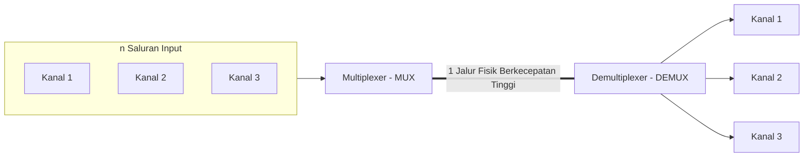
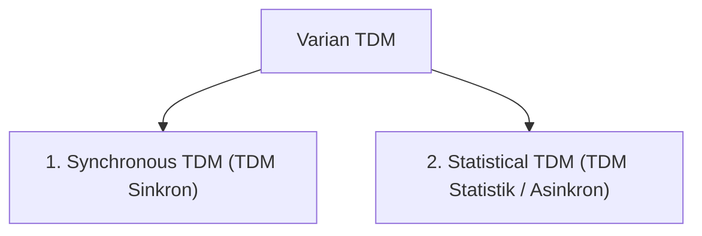
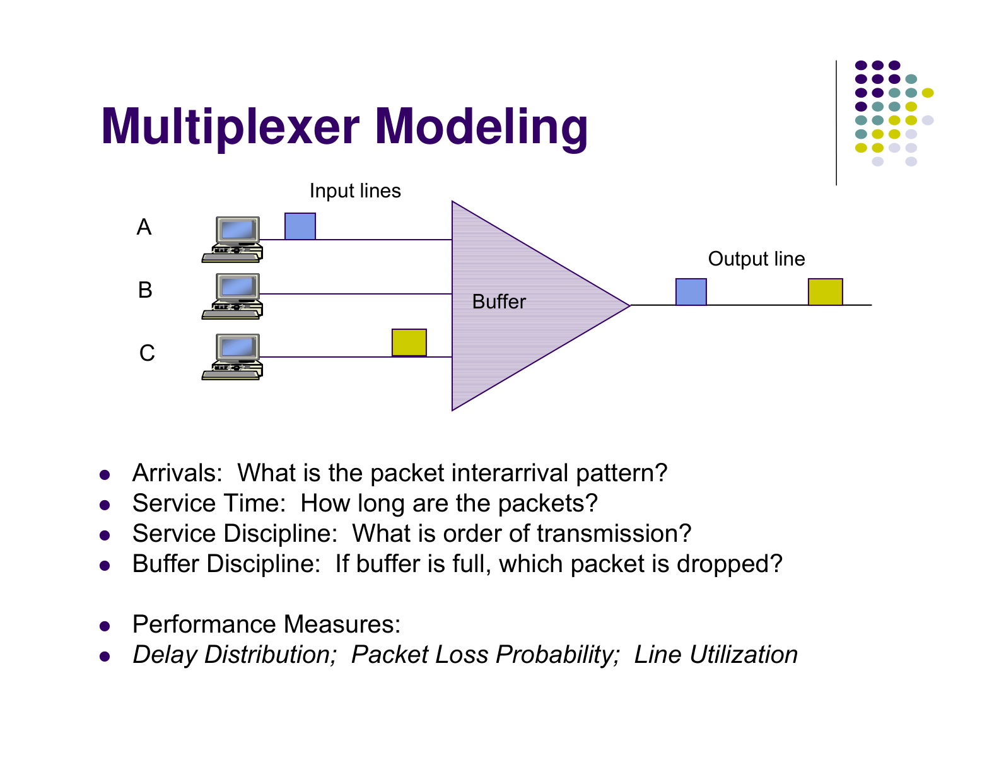
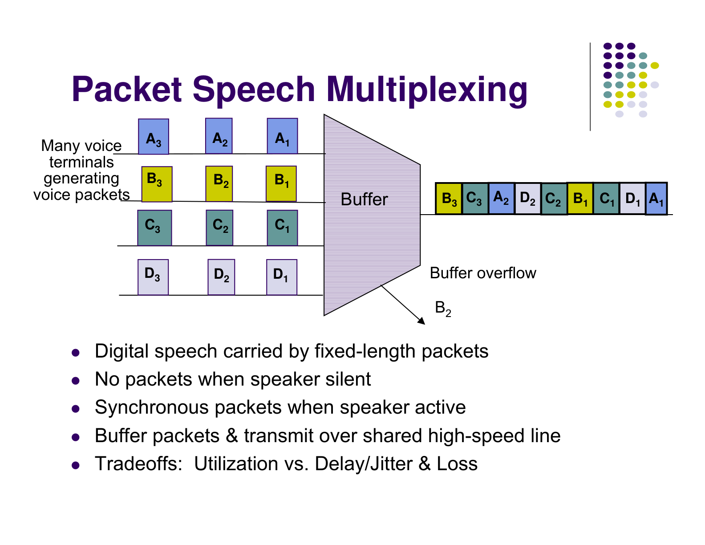
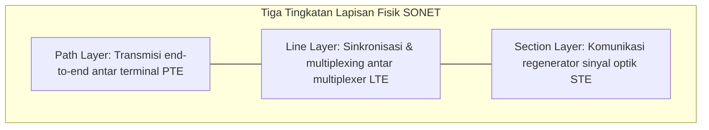
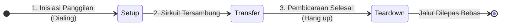
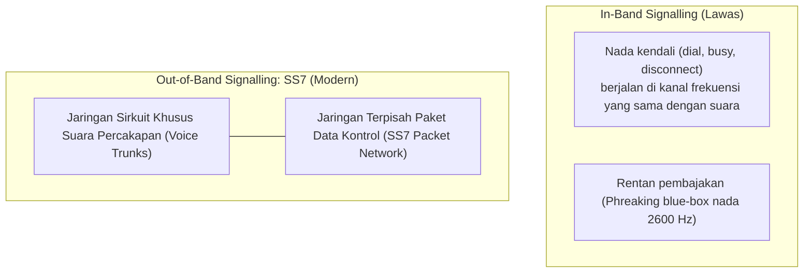
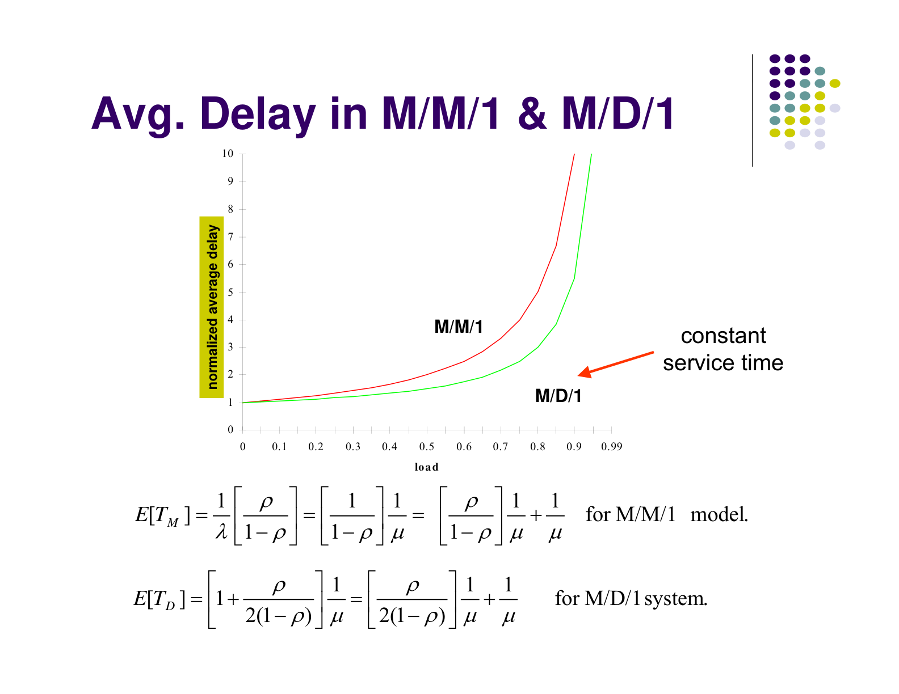
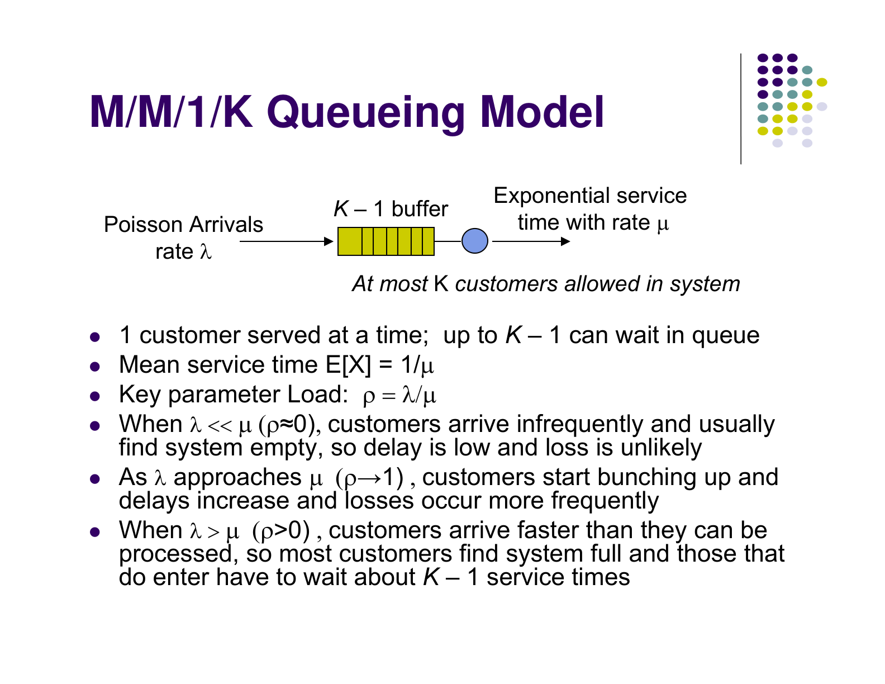

---
tags:
  - kdjk
  - kom1314
  - multiplexing
  - sonet-sdh
  - switching
  - pstn
  - pensinyalan-ss7
  - rekayasa-trafik-erlang
  - week-05
  - uts
created: 2026-10-13
week: 5
source: "Garcia-2003 ch4/ch5, 2021_5_Transmission_Systems, LGW2EChapter5Presentation"
title: "Week 05 - Sistem Transmisi, Multiplexing, Switching, dan PSTN"
---

# Week 05 - Sistem Transmisi, Multiplexing, Switching, dan PSTN

> [!summary] Navigasi Catatan
> - **Prev**: [[Week 04 - Pengkodean Kanal, Modulasi Digital, dan Deteksi-Koreksi Kesalahan|Week 04 - Pengkodean Kanal, Modulasi Digital, dan Deteksi-Koreksi Kesalahan]]
> - **MOC Master**: [[00 - MOC KDJK UTS|00 - Map of Content KDJK UTS]]
> - **Next**: [[Week 06 - Protokol Peer-to-Peer, ARQ, dan Data Link Control|Week 06 - Protokol Peer-to-Peer, ARQ, dan Data Link Control]]

---

## 1. Konsep & Ragam Teknik Multiplexing

> [!important] Definisi Multiplexing
> **Multiplexing** adalah teknik penggabungan beberapa aliran data independen dari kanal-kanal berkecepatan rendah menjadi satu aliran data gabungan untuk ditransmisikan secara serentak melalui satu media transmisi fisik tunggal berkecepatan tinggi.
> - **Multiplexer (MUX)**: Menggabungkan $n$ saluran input menjadi 1 saluran bersama.
> - **Demultiplexer (DEMUX)**: Memisahkan kembali aliran gabungan menjadi $n$ saluran output semula.



---

### A. Frequency Division Multiplexing (FDM)
- Mengalokasikan spektrum frekuensi total menjadi beberapa sub-pita frekuensi (*sub-bands*) non-overlapping. Setiap pengguna mendapatkan pita frekuensi khusus sepanjang waktu.
- Diperlukan **Guard Bands** (pita frekuensi pengaman tak terpakai) di antara kanal-kanal untuk mencegah interferensi tumpang-tindih (*overlapping crosstalk*).
- *Contoh*: Siaran Radio FM/AM, TV kabel analog, seluler generasi 1 (1G AMPS).

---

### B. Time Division Multiplexing (TDM)
Membagi waktu transmisi menjadi slot-slot diskrit berulang yang dikelompokkan ke dalam struktur **Frame**.



#### 1. Synchronous TDM (TDM Sinkron)
- Setiap node pengirim dialokasikan **satu slot waktu tetap** di setiap frame, tanpa memandang apakah node tersebut memiliki data untuk dikirim atau sedang menganggur (*idle*).
- Jika stasiun sedang tidak aktif, slot waktu tersebut tetap lewat dalam keadaan kosong (**pemborosan kapasitas link**).
- *Kelebihan*: Implementasi sederhana, tidak membutuhkan informasi pengalamatan (*addressing overhead*), urutan data terjamin.

#### 2. Statistical TDM (TDM Statistik / STDM)
- Slot waktu dialokasikan secara dinamis **hanya** untuk saluran input yang aktif memiliki data.
- Menghasilkan pemanfaatan kapasitas saluran yang jauh lebih efisien (*gain statistik*).
- **Konsekuensi**: Setiap slot waktu wajib menyertakan identitas alamat pengirim/penerima (*address header*), serta membutuhkan memori antrean penyangga (**buffer**) untuk menampung lonjakan paket sesaat.





---

### C. Wavelength Division Multiplexing (WDM & DWDM)
- Konsep FDM yang diterapkan pada medium **Kabel Serat Optik (*Optical Fiber*)**.
- Sinyal dari berbagai sumber ditransmisikan menggunakan panjang gelombang cahaya laser yang berbeda-beda ($\lambda_1, \lambda_2, \dots, \lambda_n$) dan digabungkan melalui prisma/kisi difraksi optik ke dalam satu helai serat optik.
- **DWDM (*Dense WDM*)**: Merapatkan jarak antar-panjang gelombang hingga spasi sub-nanometer ($0.8 \text{ nm}$ atau $0.4 \text{ nm}$ pada jendela transmisi $1550 \text{ nm}$), memungkinkan satu helai serat optik membawa lebih dari 80 hingga 160 kanal optik independen dengan total kapasitas berorde **Terabit per detik (Tbps)**.

---

## 2. Standar Transmisi Optik: SONET / SDH

Standar jaringan transmisi serat optik sinkron kecepatan tinggi yang dirilis oleh ANSI (**SONET - Synchronous Optical Network**) di Amerika Utara dan ITU-T (**SDH - Synchronous Digital Hierarchy**) di kancah internasional.



### A. Format Frame Dasar STS-1 (Synchronous Transport Signal - 1)
Frame dasar SONET STS-1 memiliki durasi waktu standar:
$$T_{\text{frame}} = 125 \ \mu\text{s} \implies 8000 \text{ frame per detik}$$

Struktur frame STS-1 digambarkan sebagai matriks 2D berukuran:
$$\text{Ukuran Frame} = 9 \text{ baris} \times 90 \text{ kolom} = 810 \text{ byte}$$

```text
       <------------------ 90 Kolom (Bytes) ------------------>
      +-----------------+--------------------------------------+
   1  | Transport O/H   |                                      |
   2  | (Section + Line)|                                      |
  ... |  3 Kolom        |     Synchronous Payload Envelope     |
   9  |  = 27 Bytes     |           (SPE)                      |
      |                 |         87 Kolom = 783 Bytes         |
      +-----------------+--------------------------------------+
```

> [!example] Perhitungan Laju Data (Bit Rate) STS-1 / OC-1
> $$\text{Bit Rate STS-1} = 810 \text{ byte/frame} \times 8 \text{ bit/byte} \times 8000 \text{ frame/detik} = 51.840.000 \text{ bps} = 51.84 \text{ Mbps}$$
> - Laju Muatan Bersih (*Payload Capacity*):
>   $$\text{Kapasitas SPE} = 783 \text{ byte} \times 8 \times 8000 = 50.112 \text{ Mbps}$$

### B. Hierarki Kecepatan SONET (STS/OC) dan SDH (STM)

| Standar SONET Electrical | Standar SONET Optical | Standar Internasional SDH | Laju Bit Total (Gross Rate) |
| :--- | :--- | :--- | :---: |
| **STS-1** | **OC-1** | — | $51.84 \text{ Mbps}$ |
| **STS-3** | **OC-3** | **STM-1** | $155.52 \text{ Mbps}$ |
| **STS-12** | **OC-12** | **STM-4** | $622.08 \text{ Mbps}$ |
| **STS-48** | **OC-48** | **STM-16** | $2.488 \text{ Gbps}$ ($2.5\text{G}$) |
| **STS-192** | **OC-192** | **STM-64** | $9.953 \text{ Gbps}$ ($10\text{G}$) |
| **STS-768** | **OC-768** | **STM-256** | $39.813 \text{ Gbps}$ ($40\text{G}$) |

---

## 3. Arsitektur Circuit Switching & Desain Perangkat Switch

Dalam jaringan **Circuit Switching**, jalur transmisi fisik khusus (*dedicated path*) dibangun terlebih dahulu melalui proses pensinyalan sebelum pertukaran data dapat dimulai.



---

### A. Space-Division Switching (Pensaklaran Ruang)
Menyediakan jalur fisik terpisah secara spasial antar-port input dan port output.

1. **Matriks Crossbar Switch**:
   - Memiliki $N$ saluran input dan $N$ saluran output yang berpotongan pada matriks sakelar (*crosspoints*).
   - **Kelemahan**: Membutuhkan $N^2$ buah titik sakelar crosspoint. Untuk switch berkapasitas besar ($N = 10.000$), dibutuhkan $10^8$ titik sakelar (sangat tidak realistis dan mahal).
   - Jika satu titik sakelar rusak, sambungan tertentu gagal.

2. **Multistage Switches (Clos Network 3-Stage)**:
   - Didesain oleh Charles Clos (1953) untuk mengurangi jumlah sakelar crosspoint dengan menyusun sakelar dalam 3 tingkatan (*Stage 1: Input, Stage 2: Intermediate, Stage 3: Output*).
   > [!important] Teorema Non-Blocking Strictly Clos
   > Agar sebuah sakelar Clos 3 tingkat bersifat **Strictly Non-Blocking** (setiap panggilan baru selalu dapat disambungkan tanpa terhalang koneksi panggilan lain), jumlah sakelar tahap tengah $k$ harus memenuhi:
   > $$k \ge 2n - 1$$
   > di mana $n$ adalah jumlah port input per blok sakelar tahap pertama.

---

### B. Time-Division Switching & Time-Slot Interchange (TSI)
Memetakan slot waktu kedatangan data input ke slot waktu keluaran yang berbeda menggunakan memori akses acak (**TDM RAM Buffer**). Data ditulis ke memori secara sekuensial dan dibaca keluar berdasarkan tabel kontrol koneksi (*Connection Memory*).

### C. Kombinasi Hybrid: Time-Space-Time (T-S-T) Switch
Switch digital modern telekomunikasi berskala besar menggabungkan keunggulan keduanya:
- **Tahap 1 (TSI)**: Mengubah slot waktu input.
- **Tahap 2 (Space Crossbar)**: Memindahkan data antar-jalur spasial fisik yang berbeda.
- **Tahap 3 (TSI)**: Mengatur ulang slot waktu agar pas dengan format transmisi trunk output.

---

## 4. Jaringan Telepon PSTN & Arsitektur Pensinyalan SS7

> [!important] Struktur Fisik Jaringan PSTN (Public Switched Telephone Network)
> 1. **Local Loop (Subscriber Loop)**: Sepasang kawat tembaga pilin (*twisted pair*) analog yang menghubungkan pesawat telepon rumah ke sentral lokal.
> 2. **Central Office (CO) / Local Exchange**: Sentral telepon pertama tempat kabel pelanggan dihubungkan ke sakelar digital.
> 3. **Tandem / Toll Office**: Sentral sakelar transit jarak jauh antar kota/provinsi.
> 4. **Trunk Lines**: Saluran pipa transmisi serat optik digital berkecepatan tinggi yang menghubungkan antarsentral telepon.

---

### Sistem Pensinyalan: In-Band vs Out-of-Band (SS7)



#### Arsitektur Signalling System No. 7 (SS7)
SS7 adalah jaringan paket data switching khusus yang beroperasi secara independen di samping jaringan suara PSTN.
Komponen Arsitektur SS7:
1. **SSP (*Service Switching Point*)**: Sakelar telepon lokal yang menginisiasi atau menerima panggilan dan mengirimkan pesan kueri pensinyalan.
2. **STP (*Signal Transfer Point*)**: Router paket data SS7 yang merutekan pesan kontrol pensinyalan antarsentral.
3. **SCP (*Service Control Point*)**: Basis data sentral terdistribusi yang menyimpan informasi nomor khusus (seperti panggilan bebas pulsa 0800, database routing seluler HLR/VLR, dan nomor portabel).

---

## 5. Rekayasa Trafik Telekomunikasi & Pemodelan Antrean

Untuk menentukan berapa banyak saluran *trunk* yang harus dibangun oleh operator telekomunikasi tanpa mengalami kebangkrutan atau menyebabkan panggilan sering ditolak (*call blocking*), digunakan teori probabilitas trafik yang dirumuskan oleh **A.K. Erlang**.





### A. Satuan Intensitas Trafik: Erlang ($A$)
> [!important] Formula Intensitas Trafik
> $$A = \lambda \times H \quad (\text{Erlang})$$
> di mana:
> - $\lambda$ = Laju kedatangan rata-rata panggilan (*arrival rate*, panggilan per jam).
> - $H$ = Waktu pendudukan saluran rata-rata per panggilan (*average holding time / call duration*, dalam satuan jam).
> - $A = 1 \text{ Erlang}$ berarti satu saluran sirkuit terpakai penuh $100\%$ selama satu jam terus-menerus (3600 detik).

---

### B. Rumus Probabilitas Blokir: Erlang B Formula
Digunakan pada sistem telepon di mana panggilan yang datang saat semua saluran sibuk langsung dibatalkan (*Blocked Calls Cleared* / sistem tanpa antrean):

$$P_b = B(c, A) = \frac{\frac{A^c}{c!}}{\sum_{k=0}^{c} \frac{A^k}{k!}}$$
di mana:
- $c$ = Jumlah saluran trunk sirkuit fisik yang tersedia.
- $A$ = Intensitas trafik total yang ditawarkan (*offered traffic* dalam Erlang).
- $P_b$ = Probabilitas pemblokiran / penolakan panggilan (*Grade of Service / GoS*).

> [!example] Contoh Perhitungan Trafik Telepon
> Sebuah kantor menerima rata-rata $\lambda = 120$ panggilan per jam pada jam sibuk (*busy hour*). Rata-rata durasi percakapan telepon $H = 3$ menit ($180\text{ detik}$).
> 1. Hitung intensitas trafik dalam satuan Erlang!
> 2. Berapakah jumlah saluran minimum jika tidak boleh ada yang diblokir saat beban rata-rata?

#### Pembahasan:
1. Konversi durasi ke jam:
   $$H = \frac{3 \text{ menit}}{60 \text{ menit/jam}} = 0.05 \text{ jam}$$
2. Hitung intensitas trafik ($A$):
   $$A = \lambda \times H = 120 \times 0.05 = 6 \text{ Erlang}$$
   Artinya, rata-rata dibutuhkan 6 sirkuit aktif secara simultan setiap saat untuk melayani beban tersebut.
