---
tags:
  - kdjk
  - kom1314
  - data-link-layer
  - framing
  - protokol-arq
  - stop-and-wait
  - go-back-n
  - selective-repeat
  - hdlc-ppp
  - week-06
  - uts
created: 2026-10-13
week: 6
source: "Garcia-2003 ch5, LGW2EChapter5Presentation, Kontrak Kuliah KDJK"
title: "Week 06 - Protokol Peer-to-Peer, ARQ, dan Data Link Control"
---

# Week 06 - Protokol Peer-to-Peer, ARQ, dan Data Link Control

> [!summary] Navigasi Catatan
> - **Prev**: [[Week 05 - Sistem Transmisi, Multiplexing, Switching, dan PSTN|Week 05 - Sistem Transmisi, Multiplexing, Switching, dan PSTN]]
> - **MOC Master**: [[00 - MOC KDJK UTS|00 - Map of Content KDJK UTS]]
> - **Next**: [[Week 07 - Protokol-protokol LAN, Media Access Control (MAC), dan Bridges|Week 07 - Protokol-protokol LAN, Media Access Control (MAC), dan Bridges]]

---

## 1. Protokol Peer-to-Peer & Model-Model Layanan

> [!important] Definisi Komunikasi Peer-to-Peer (P2P)
> **Protokol Peer-to-Peer** pada konteks arsitektur jaringan berlapis merujuk pada kesepakatan interaksi pertukaran pesan kendali dan data antar dua entitas logis yang berada pada **tingkatan lapisan (*layer*) yang sama** (misal: entitas Data Link di Node A berkomunikasi langsung dengan entitas Data Link di Node B).

```mermaid
graph LR
    subgraph Node_A["Host / Node A"]
        A_App[Layer Aplikasi]
        A_Net[Layer Network]
        A_DL[Layer Data Link]
        A_Phy[Layer Fisik]
        A_App --- A_Net --- A_DL --- A_Phy
    end

    subgraph Node_B["Host / Node B"]
        B_App[Layer Aplikasi]
        B_Net[Layer Network]
        B_DL[Layer Data Link]
        B_Phy[Layer Fisik]
        B_App --- B_Net --- B_DL --- B_Phy
    end

    A_DL ===|Protokol Peer-to-Peer Data Link (ARQ & Framing)| B_DL
    A_Phy ===|Bit Stream Fisik| B_Phy
```

### Model Layanan Komunikasi:
1. **Connection-Oriented vs Connectionless**:
   - *Connection-Oriented*: Memerlukan tiga fase formal (pembentukan koneksi, transfer data, pemutusan koneksi). Parameter transmisi dinegosiasikan di awal.
   - *Connectionless*: Setiap paket data dikirim secara independen tanpa persiapan rute sebelumnya (*datagram mode*).
2. **Reliable vs Unreliable Service**:
   - *Reliable*: Menjamin seluruh data tiba di tujuan tanpa cacat, tanpa duplikasi, dan lengkap melalui mekanisme konfirmasi (**ACK**) dan pengiriman ulang (**retransmisi**).
   - *Unreliable / Best-Effort*: Tidak ada konfirmasi penerimaan; paket yang rusak langsung dibuang untuk mengutamakan kecepatan.

---

## 2. Metode Pembingkaian (Framing) & Sinkronisasi Batas

Lapisan Fisik hanya mengenali aliran bit mentah yang tidak terstruktur. Lapisan Data Link bertugas mengelompokkan bit-bit tersebut menjadi unit diskrit yang disebut **Frame**.

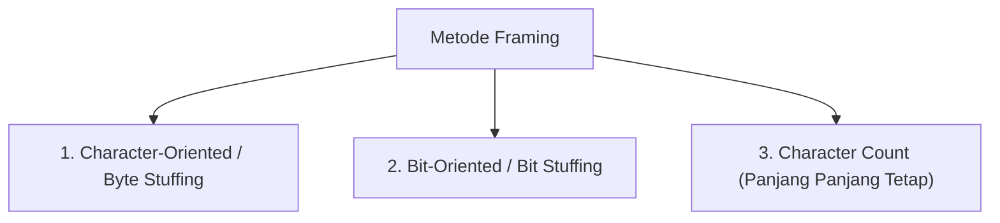

---

### A. Character-Oriented Framing & Byte Stuffing
Digunakan pada protokol berbasis teks (misal: BISYNC, PPP):
- Frame diawali oleh karakter kontrol khusus seperti `DLE STX` (*Data Link Escape - Start of Text*) dan diakhiri oleh `DLE ETX` (*End of Text*).
- **Masalah**: Jika data biner yang dikirimkan kebetulan memiliki pola biner yang sama dengan karakter kontrol `DLE`, penerima akan salah mengira bahwa frame telah berakhir prematur!
- **Solusi (Byte Stuffing / Character Stuffing)**:
  Pengirim secara otomatis menyisipkan satu karakter escape `DLE` tambahan di depan setiap kemunculan pola `DLE` di dalam muatan data. Di sisi penerima, setiap kali mendeteksi dua karakter `DLE DLE` beruntun, penerima akan membuang `DLE` pertama dan memperlakukan `DLE` kedua sebagai data murni.

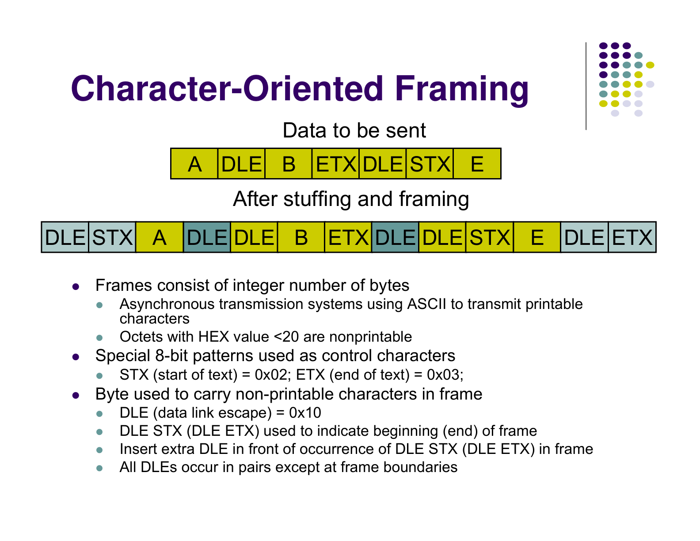

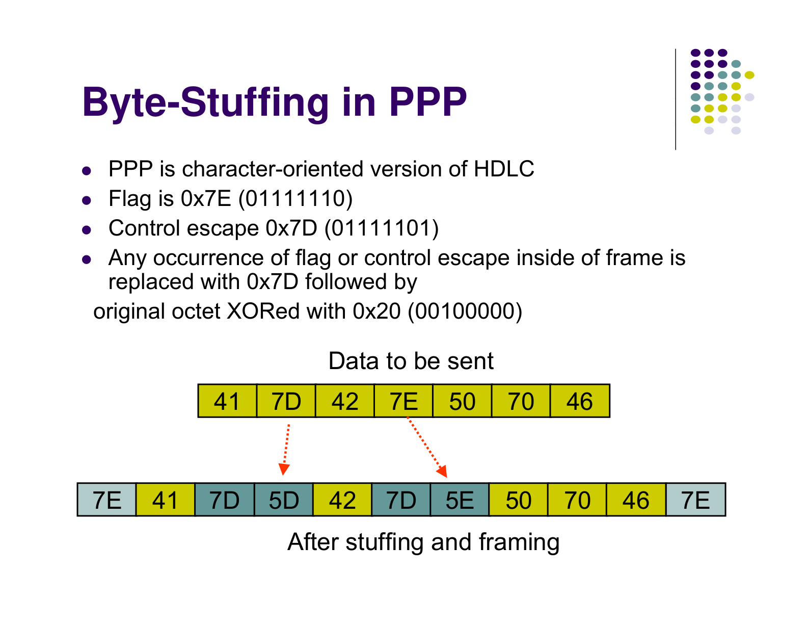

---

### B. Bit-Oriented Framing & Bit Stuffing
Digunakan pada protokol modern berkecepatan tinggi (misal: **HDLC**, SDLC):
- Batas awal dan akhir frame ditandai oleh pola bit penanda (**Flag**) 8-bit yang unik:
  $$\text{Flag} = \mathbf{01111110_2} \quad (\text{Enam buah angka 1 diapit oleh dua angka 0})$$

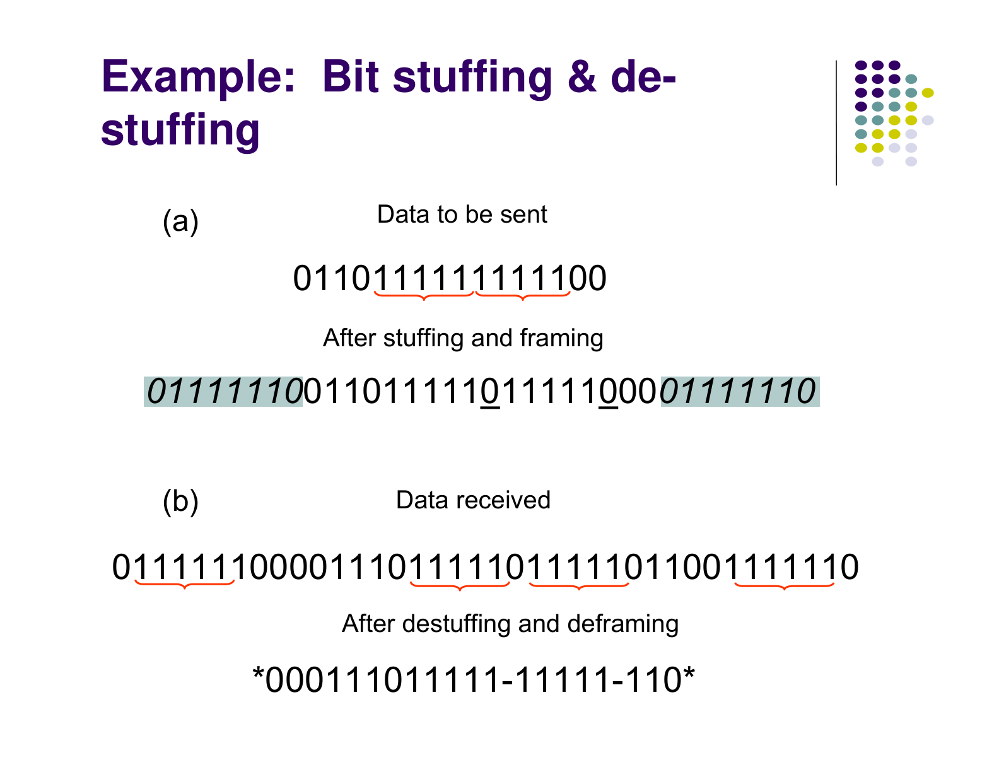

> [!important] Aturan Algoritma Bit Stuffing
> 1. **Di Sisi Pengirim**:
>    Pengirim terus memantau aliran bit data. Setiap kali mendeteksi **lima buah bit `1` berturut-turut** (`11111`), pengirim **wajib menyisipkan sebuah bit `0` secara otomatis**, terlepas dari apakah bit berikutnya bernilai `0` atau `1`.
>    *Tujuan*: Menjamin bahwa pola enam angka `1` (`01111110`) tidak akan pernah muncul secara tidak sengaja di dalam payload data!
> 2. **Di Sisi Penerima**:
>    Penerima memantau aliran bit. Jika mendeteksi lima bit `1` berurutan yang diikuti oleh bit `0`:
>    - Penerima langsung **membuang (*destuff*) bit `0` tersebut** dan menyimpan data aslinya.
>    - Jika setelah lima bit `1` diikuti oleh bit `1` keenam dan bit `0`, penerima mengenali bahwa ini adalah **Flag** penutup frame!
>    - Jika ada tujuh bit `1` berturut-turut, ini menandakan **Error / Abort**.

---

## 3. Protokol Automatic Repeat reQuest (ARQ)

Jika frame yang diterima rusak (dideteksi via CRC) atau hilang di perjalanan, protokol ARQ mengoordinasikan pengiriman ulang data secara otomatis menggunakan timer dan nomor urutan (*sequence number*).

### Parameter Kunci Normalisasi Waktu Transmisi ($a$)
Efisiensi protokol ARQ sangat dipengaruhi oleh rasio waktu propagasi terhadap waktu transmisi frame:
$$a = \frac{T_{\text{prop}}}{T_{\text{trans}}} = \frac{\frac{d}{v}}{\frac{L}{R}} = \frac{d \cdot R}{v \cdot L}$$
- Jika $a \ll 1$ (misal pada LAN jarak pendek berkecepatan rendah): waktu transmisi mendominasi, saluran mudah dimanfaatkan.
- Jika $a \gg 1$ (misal pada tautan satelit atau serat optik gigabit jarak jauh): waktu tunda rambat mendominasi pipa transmisi, dibutuhkan jendela transmisi besar (*pipelining*).

---

### A. Stop-and-Wait ARQ
Protokol paling sederhana: Pengirim mengirimkan **1 frame**, menyalakan timer, lalu berhenti dan menunggu datangnya paket konfirmasi (**ACK**) sebelum diizinkan mengirim frame berikutnya.

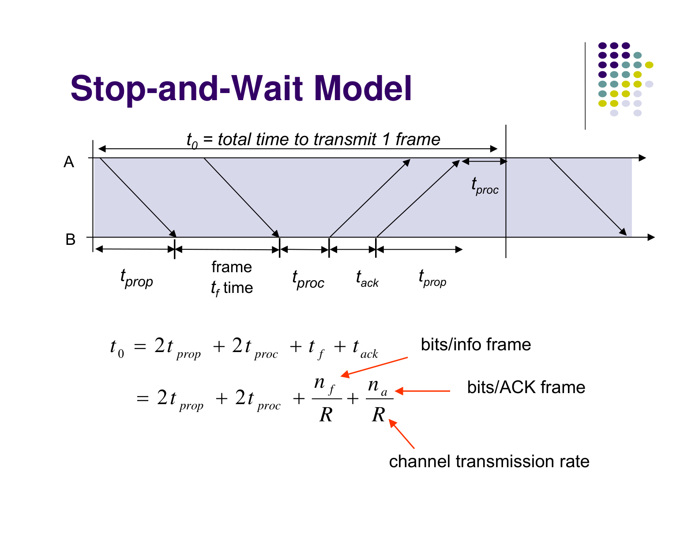

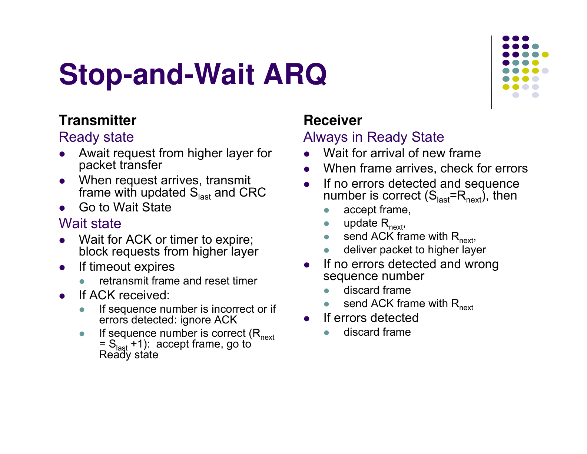

1. **Penomoran Frame**: Cukup menggunakan sequence number 1-bit bolak-balik: $0$ dan $1$ (modulo 2). Frame bernomor $S_n$, dan ACK meminta frame berikutnya $R_n$.
2. **Penanganan Frame Hilang / Rusak**: Jika ACK tidak kunjung tiba hingga timer habis (*timeout*), pengirim mengirimkan ulang frame yang sama.
3. **Analisis Efisiensi Throughput ($\eta$)**:
   Total waktu satu siklus tanpa error:
   $$T_{\text{total}} = T_{\text{trans}} + 2 T_{\text{prop}} + T_{\text{ACK}} \approx T_{\text{trans}} + 2 T_{\text{prop}} = T_{\text{trans}}(1 + 2a)$$
   $$\eta_{\text{SW}} = \frac{T_{\text{trans}}}{T_{\text{total}}} = \frac{1}{1 + 2a}$$
   Jika terdapat probabilitas kegagalan frame sebesar $P_f$:
   $$\eta_{\text{SW}} = \frac{1 - P_f}{1 + 2a}$$

> [!warning] Kelemahan Fatal Stop-and-Wait
> Jika nilai $a$ besar (misal $a = 100$ pada tautan satelit), efisiensinya hancur menjadi:
> $$\eta = \frac{1}{1 + 2(100)} = \frac{1}{201} \approx 0.5\%$$
> Saluran transmisi menganggur kosong selama $99.5\%$ waktu hanya untuk menunggu ACK bolak-balik!

---

### B. Go-Back-N (GBN) ARQ (Sliding Window)
Memperbaiki kelemahan Stop-and-Wait dengan menerapkan konsep **Pipelining**: Pengirim diizinkan mentransmisikan hingga $N$ frame secara terus-menerus tanpa menunggu ACK seketika, menggunakan **Jendela Pengirim (*Sender Window*) $W_s = N$**.

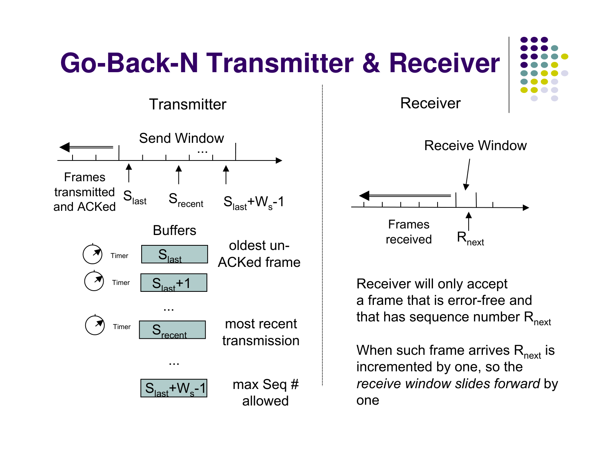

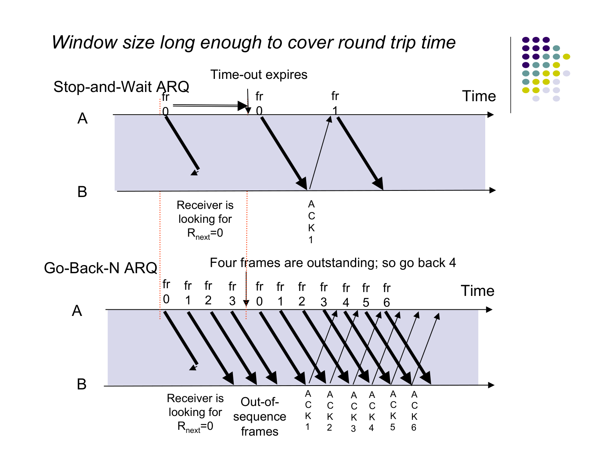

1. **Ukuran Jendela**:
   - Pengirim: $W_s = N = 2^m - 1$ (untuk field nomor urut sepanjang $m$ bit).
   - Penerima: $W_r = 1$ (Hanya menerima frame yang tiba persis sesuai urutan).
2. **Prinsip Operasi**:
   - Penerima hanya memiliki buffer 1 frame. Penerima membuang semua frame berikutnya yang tiba di luar urutan (*out-of-order*), meskipun frame tersebut tiba dengan CRC sempurna.
   - Penerima mengirimkan **Cumulative ACK** ($R_n = k$ menandakan seluruh frame hingga nomor $k-1$ telah diterima dengan selamat, dan kini menunggu frame ke-$k$).
   - Jika terjadi timeout pada frame ke-$k$, pengirim harus memutar mundur jendelanya dan **mengirim ulang seluruh frame dari nomor $k$ hingga $k + N - 1$** (**Go-Back-N**).
3. **Syarat Ukuran Jendela Maksimum**:
   $$W_s \le 2^m - 1$$
   *(Jika $W_s = 2^m$, penerima tidak dapat membedakan antara ACK untuk frame baru atau frame retransmisi akibat ACK hilang!)*
4. **Efisiensi Throughput**:
   $$\eta_{\text{GBN}} = \frac{1 - P_f}{1 + 2a \cdot P_f} \quad (\text{untuk } N \ge 1 + 2a)$$

---

### C. Selective Repeat (SR) ARQ
Menghilangkan pemborosan retransmisi pada GBN dengan cara memperbesar buffer penerima: $W_r > 1$.

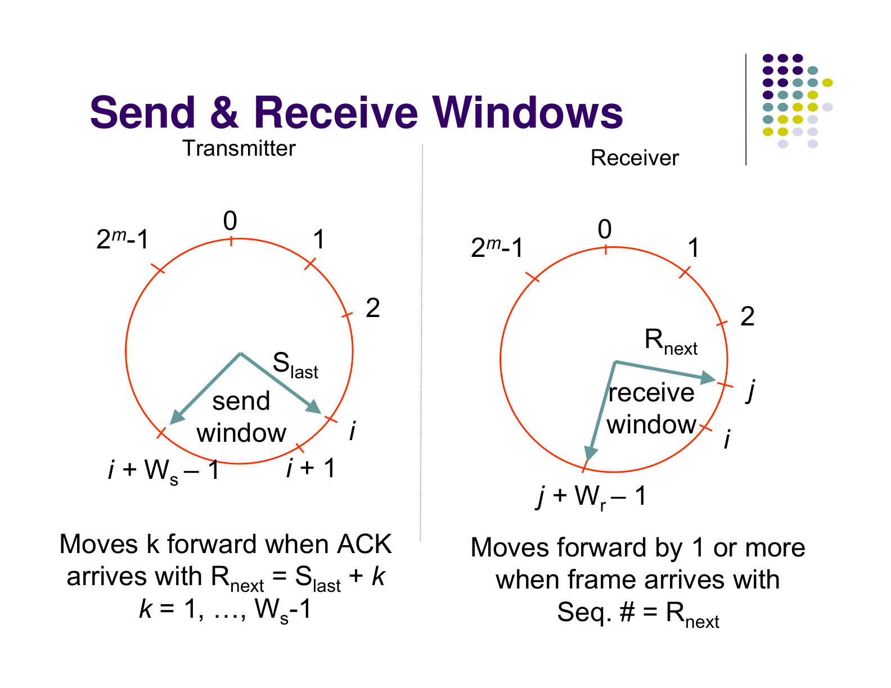

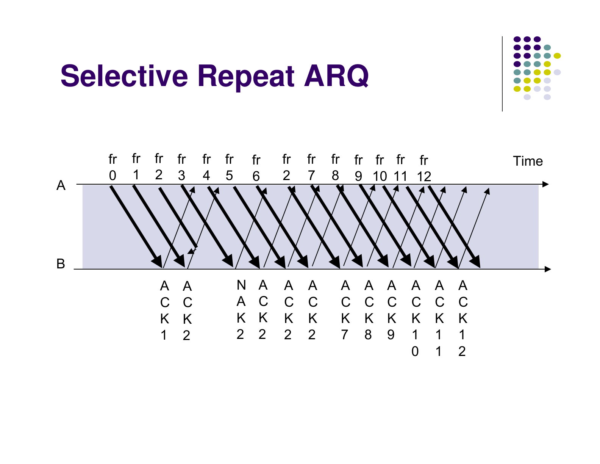

1. **Prinsip Operasi**:
   - Penerima menerima dan menyimpan (*buffer*) frame yang tiba di luar urutan asalkan berada dalam rentang jendela penerima $W_r$.
   - Penerima mengirimkan **Negative ACK (NAK)** khusus untuk frame yang hilang atau melompat.
   - Pengirim **hanya mentransmisikan ulang paket yang secara spesifik dilaporkan hilang**, sementara paket lain yang sudah berada di buffer penerima tidak perlu dikirim ulang!
2. **Syarat Ukuran Jendela Kritis**:
   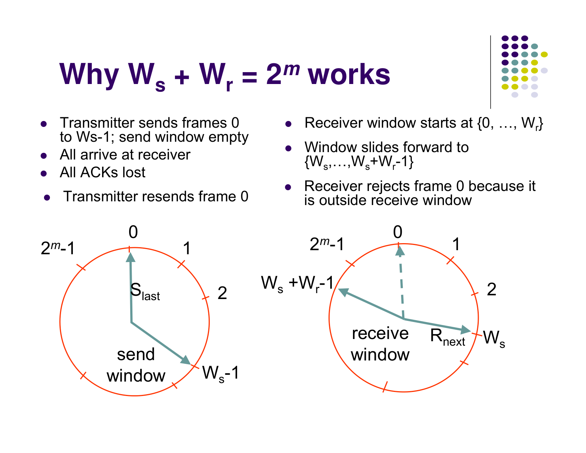
   Agar jendela pengirim dan penerima tidak tumpang tindih (*window overlap ambiguity*):
   $$W_s + W_r \le 2^m \implies \text{Jika } W_s = W_r, \text{ maka } W_s \le 2^{m-1} = \frac{2^m}{2}$$
   *Contoh*: Jika menggunakan sequence number 3 bit ($2^3 = 8$ nomor: $0 \dots 7$), maka ukuran jendela maksimum pengirim dan penerima adalah $W_s = W_r = 4$.
3. **Efisiensi Throughput**:
   $$\eta_{\text{SR}} = 1 - P_f \quad (\text{untuk } W_s \ge 1 + 2a)$$
   Efisiensi tidak lagi terpengaruh oleh delay propagasi $a$, menjadikannya protokol paling optimal untuk link latensi tinggi / satelit.

---

### Perbandingan Efisiensi Throughput Tiga Protokol ARQ

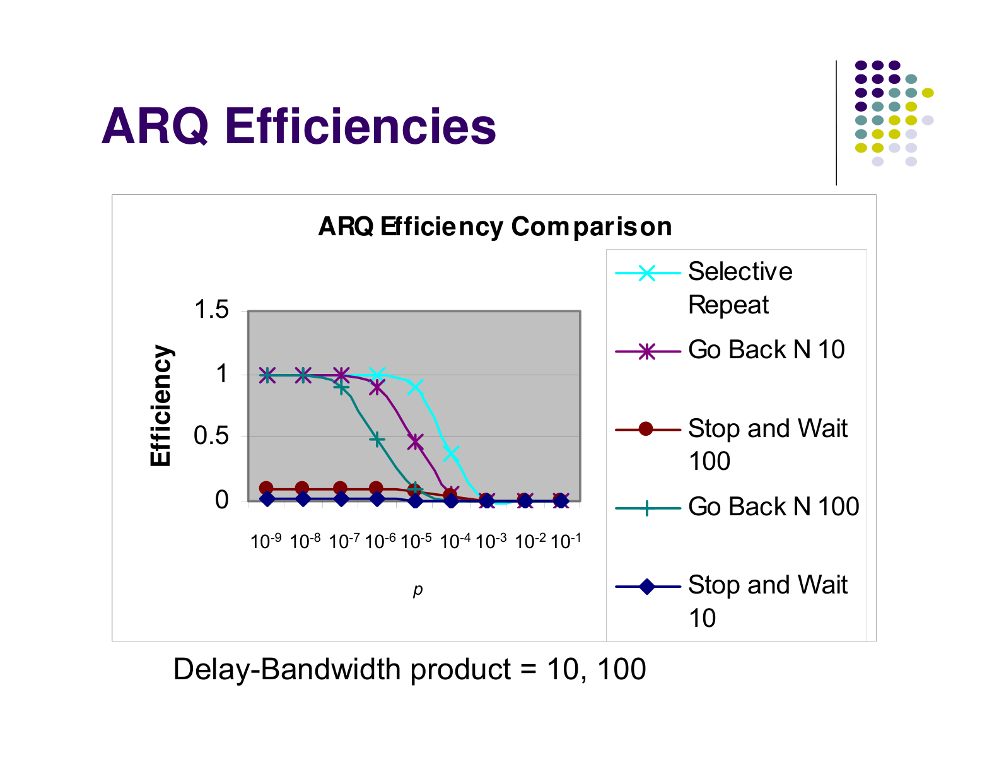

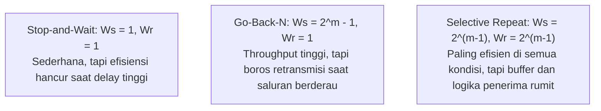

---

## 4. Protokol Standar Lapisan Data Link: HDLC dan PPP

### A. High-Level Data Link Control (HDLC)
Standar protokol data link bit-oriented yang dikembangkan oleh ISO:
- Menggunakan pembingkaian Bit Stuffing dengan flag `01111110`.

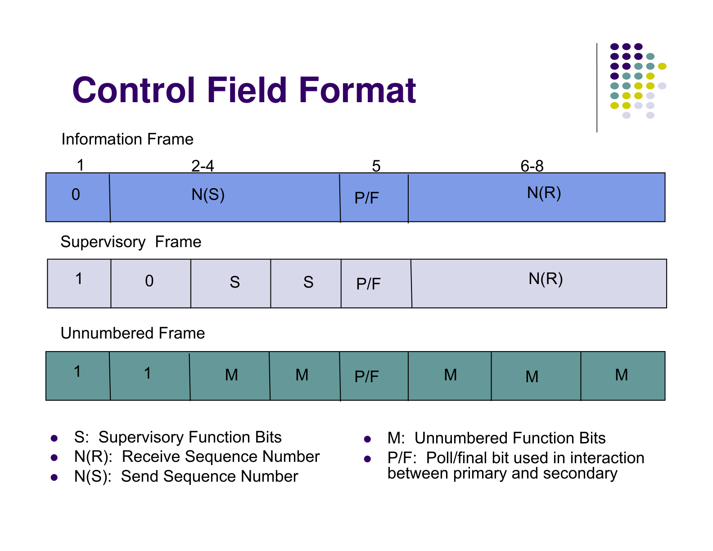

#### Tiga Jenis Format Frame HDLC:
1. **Information Frames (I-Frames)**: Mengangkut data pengguna dari lapisan network. Menyertakan nomor urut kirim $N(S)$ dan nomor urut ACK balasan $N(R)$ (*piggybacking*).
2. **Supervisory Frames (S-Frames)**: Mengatur flow control dan error control:
   - `RR` (*Receive Ready*): ACK positif, siap menerima data berikutnya.
   - `RNR` (*Receive Not Ready*): ACK positif, namun meminta pengirim menghentikan transmisi sementara (*buffer penuh*).
   - `REJ` (*Reject*): NAK pada protokol Go-Back-N, meminta retransmisi mulai frame $N(R)$.
   - `SREJ` (*Selective Reject*): NAK pada protokol Selective Repeat.
3. **Unnumbered Frames (U-Frames)**: Manajemen inisiasi dan pemutusan link (misal: `SABM` untuk membuka mode seimbang, `DISC` untuk disconnect, `UA` untuk konfirmasi acknowledge).

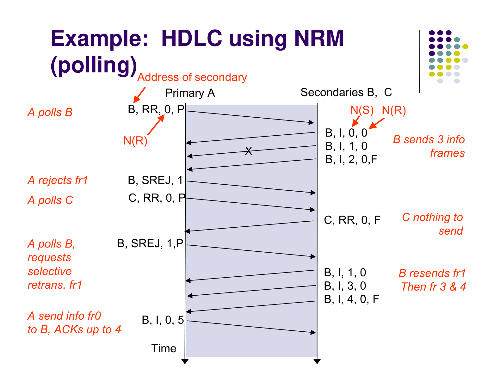

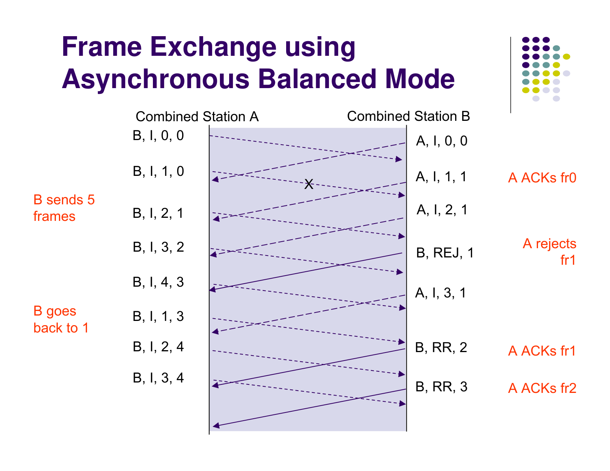

---

### B. Point-to-Point Protocol (PPP - RFC 1661)
Protokol data link standar de facto untuk koneksi langsung antar dua node (kabel serial, modem dial-up, ADSL PPPoE).

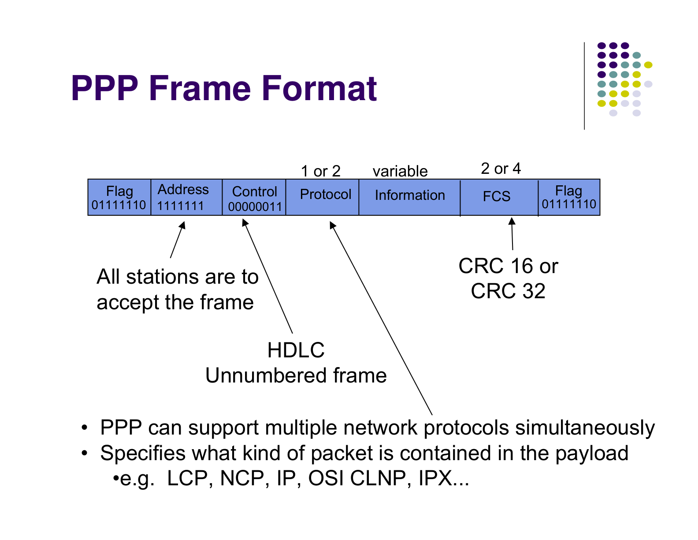

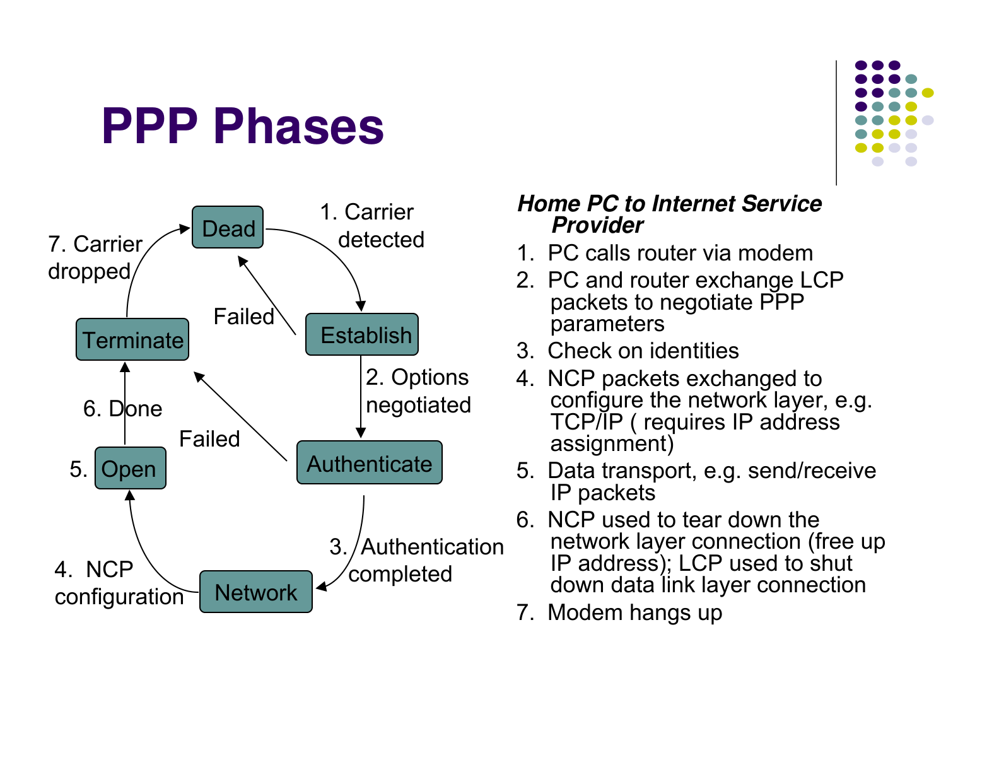

#### Dua Sub-Protokol Utama dalam PPP:
1. **Link Control Protocol (LCP)**:
   - Bertanggung jawab membangun, mengonfigurasi, menguji parameter kualitas link, dan memutuskan sambungan fisik Data Link.
   - Menegosiasikan ukuran frame maksimum (MTU) dan opsi autentikasi.
2. **Network Control Protocol (NCP)**:
   - Serangkaian protokol independen untuk menegosiasikan konfigurasi lapisan jaringan di atas PPP (misal: **IPCP** untuk menegosiasikan alamat IP dinamis klien).
3. **Mekanisme Autentikasi Pengguna**:
   - **PAP (*Password Authentication Protocol*)**: Autentikasi 2 langkah sederhana dengan mengirimkan username dan password dalam teks polos (*cleartext* - tidak aman).
   - **CHAP (*Challenge Handshake Authentication Protocol*)**: Autentikasi 3 langkah berbasis enkripsi hash (*three-way handshake dengan nonce challenge dan respons MD5*) sehingga password tidak pernah dikirimkan melalui kabel.
