---
tags:
  - kdjk
  - kom1314
  - lan-protocols
  - mac-layer
  - aloha-csma-cd
  - ethernet-ieee-802-3
  - wifi-802-11
  - transparent-bridges
  - spanning-tree-protocol
  - vlan
  - week-07
  - uts
created: 2026-10-13
week: 7
source: "Garcia-2003 ch6-Local Area Networks, Chapter 6 (1).pdf, Kontrak Kuliah KDJK"
title: "Week 07 - Protokol-protokol LAN, Media Access Control (MAC), dan Bridges"
---

# Week 07 - Protokol-protokol LAN, Media Access Control (MAC), dan Bridges

> [!summary] Navigasi Catatan
> - **Prev**: [[Week 06 - Protokol Peer-to-Peer, ARQ, dan Data Link Control|Week 06 - Protokol Peer-to-Peer, ARQ, dan Data Link Control]]
> - **MOC Master**: [[00 - MOC KDJK UTS|00 - Map of Content KDJK UTS]]

---

## 1. Arsitektur LAN & Sublapisan Data Link (LLC vs MAC)

Pada jaringan lokal (*Local Area Network / LAN*), sejumlah komputer berbagi media transmisi fisik yang sama (**shared multi-access medium**). Jika dua perangkat mentransmisikan data secara bersamaan, sinyal mereka akan saling bertabrakan dan rusak (**Collision**).

Komite IEEE 802 membagi Lapisan Data Link menjadi dua sublapisan:

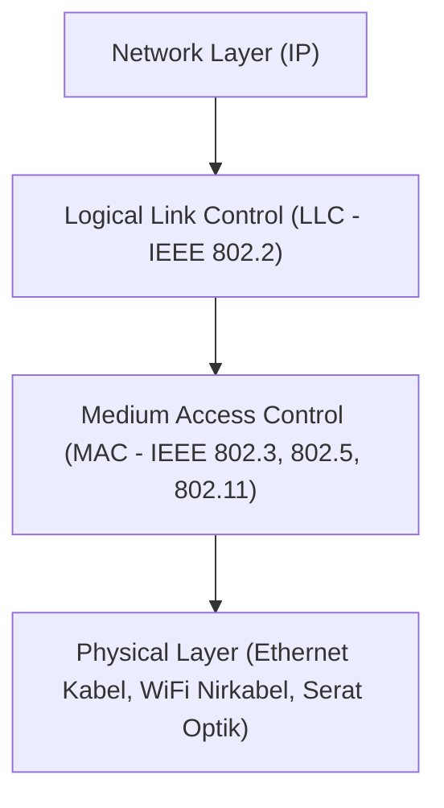

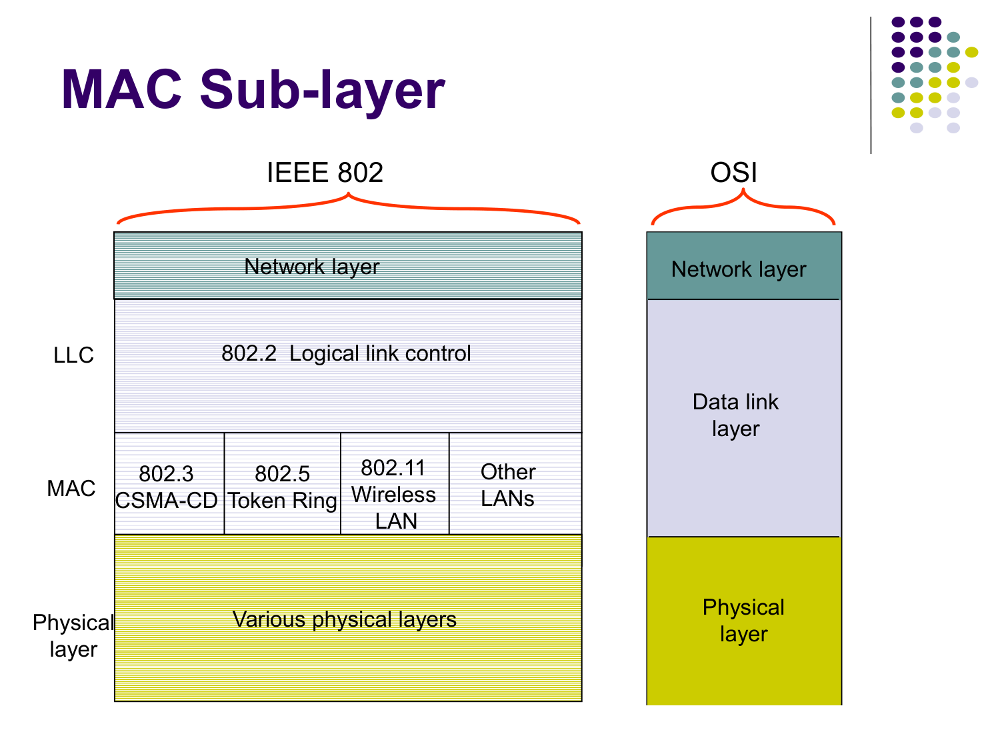

1. **LLC (*Logical Link Control* - IEEE 802.2)**:
   - Menyediakan antarmuka seragam independen-media bagi lapisan jaringan (Network Layer).
   - Menangani flow control, multiplexing berbagai protokol lapisan atas menggunakan **SAP (*Service Access Point*)**, dan retransmisi opsional.
2. **MAC (*Medium Access Control*)**:
   - Berinteraksi langsung dengan Lapisan Fisik.
   - Bertanggung jawab membingkai data, memeriksa integritas frame (CRC FCS), membaca **Alamat Fisik (MAC Address 48-bit)**, dan menjalankan aturan protokol arbitrase akses media untuk mencegah tabrakan.

---

## 2. Taksonomi Protokol Media Access Control (MAC)

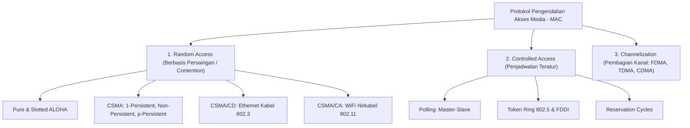

---

## 3. Protokol Random Access (ALOHA & CSMA)

Pada sistem akses acak, tidak ada stasiun superior dan tidak ada jadwal transmisi tetap. Stasiun bersaing secara bebas untuk merebut kanal.

### A. Pure ALOHA vs Slotted ALOHA

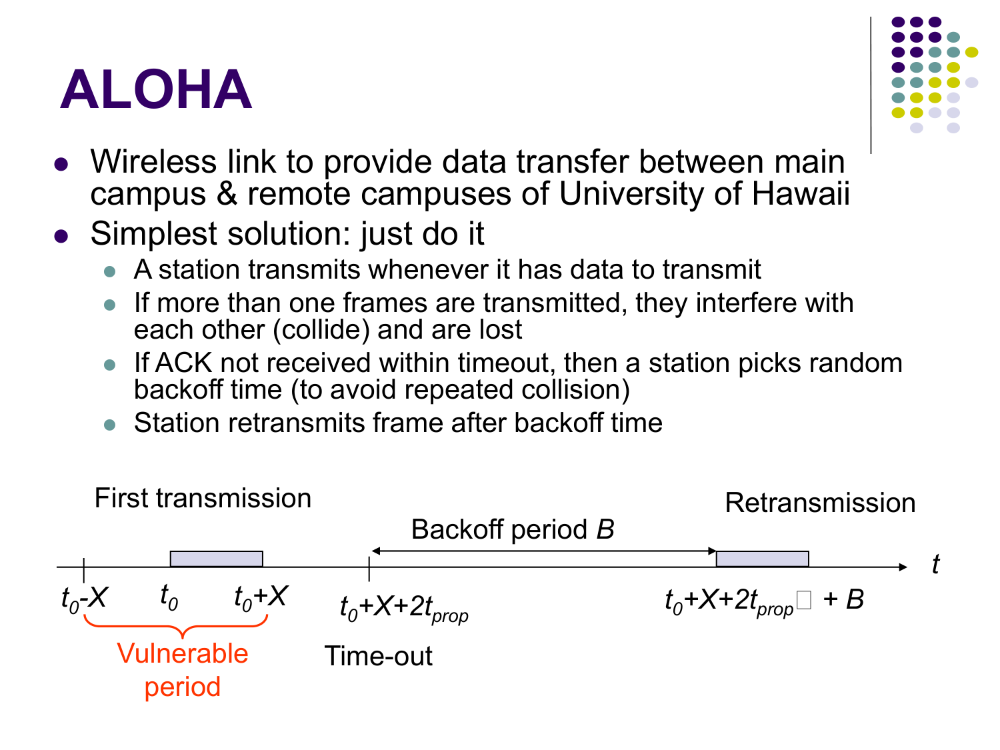

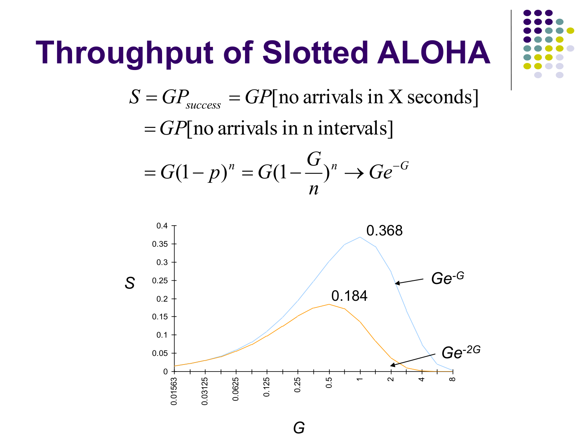

1. **Pure ALOHA (Norman Abramson, Univ. of Hawaii 1970)**:
   - Setiap stasiun dapat langsung mentransmisikan frame kapan saja memiliki data.
   - **Periode Rentan (*Vulnerable Period*)**:
     $$V = 2 \times T_{\text{frame}}$$
     *(Frame akan tabrakan jika ada stasiun lain yang mulai transmisi antara waktu $t_0 - T$ hingga $t_0 + T$)*.
   - **Formula Throughput ($S$)**:
     $$S = G \cdot e^{-2G}$$
     di mana $G$ adalah total laju kedatangan frame yang ditawarkan.
   - **Throughput Maksimum**:
     $$S_{\max} = \frac{1}{2e} \approx 0.184 \quad (18.4\%) \quad \text{pada } G = 0.5$$

2. **Slotted ALOHA (Robert Metcalfe, 1972)**:
   - Waktu dibagi menjadi slot-slot diskrit berdurasi $T_{\text{frame}}$. Stasiun **hanya diizinkan mentransmisikan data tepat di awal setiap slot waktu**.
   - **Periode Rentan Terpotong Setengah**:
     $$V = 1 \times T_{\text{frame}}$$
   - **Formula Throughput ($S$)**:
     $$S = G \cdot e^{-G}$$
   - **Throughput Maksimum**:
     $$S_{\max} = \frac{1}{e} \approx 0.368 \quad (36.8\%) \quad \text{pada } G = 1.0$$
     *(Efisiensi meningkat dua kali lipat dibanding Pure ALOHA!)*

---

### B. CSMA (Carrier Sense Multiple Access)
Memperbaiki kelemahan ALOHA dengan prinsip: **"Listen before talk"** (Dengarkan saluran sebelum mulai memancarkan sinyal).

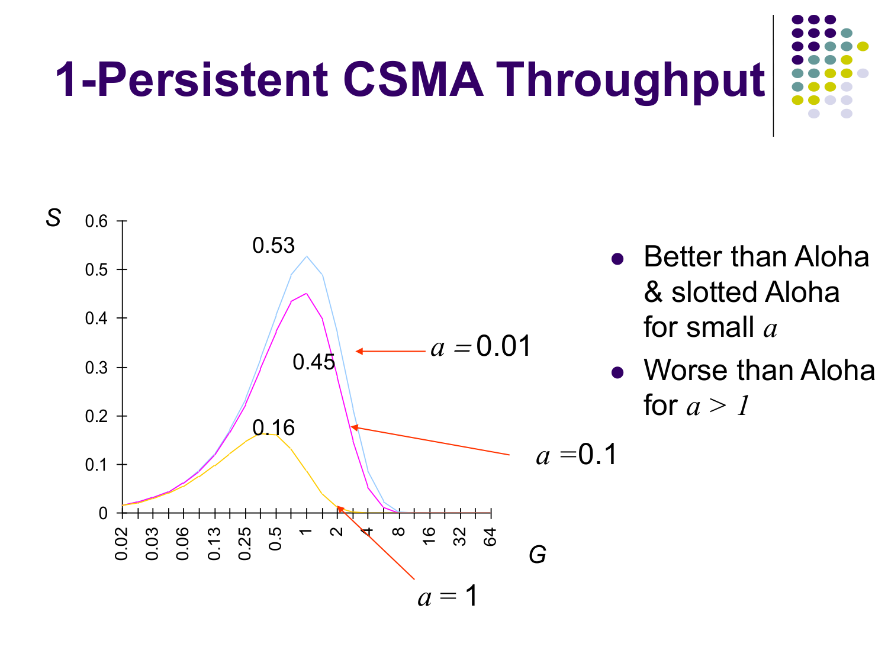

- **1-Persistent CSMA**: Dengarkan kanal. Jika sibuk, terus pantau kanal secara terus-menerus. Begitu kanal terdeteksi kosong, langsung transmisi dengan probabilitas $1$.
  *Kelemahan*: Jika ada dua node yang sama-sama menunggu saluran kosong, keduanya akan transmisi bersamaan seketika kanal bebas $\to$ tabrakan pasti terjadi!
- **Non-Persistent CSMA**: Dengarkan kanal. Jika sibuk, stasiun tidak terus memantau, melainkan **menunggu waktu tunda acak (*random backoff*)** sebelum memeriksa kanal kembali.
  *Kelebihan*: Mengurangi kemungkinan tabrakan secara signifikan; *Kekurangan*: Saluran sering terbiarkan kosong sia-sia.
- **p-Persistent CSMA**: Digunakan pada kanal berslot. Begitu kanal bebas, transmisi dengan probabilitas $p$, atau tunda satu slot dengan probabilitas $(1 - p)$.

---

### C. CSMA/CD (Carrier Sense Multiple Access with Collision Detection)
Standar de facto yang mendasari jaringan **Ethernet Kabel (IEEE 802.3)**. Menggabungkan prinsip: **"Listen before talk"** dan **"Listen while talking"**.

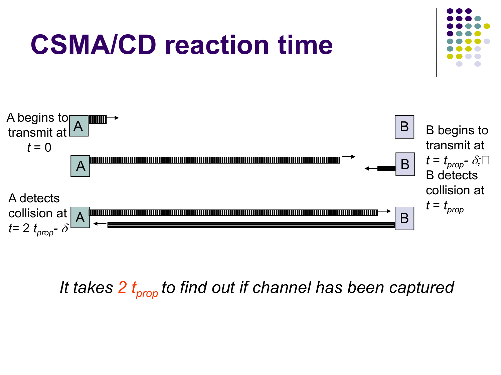

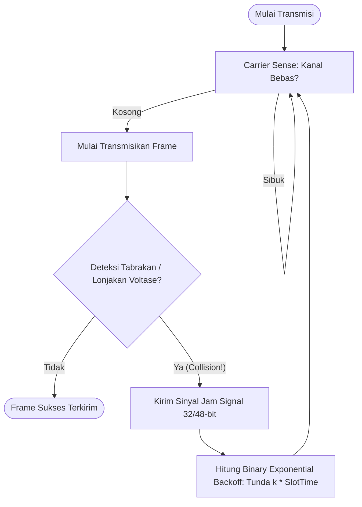

#### 1. Syarat Ukuran Frame Minimum Ethernet ($L_{\min}$)
Agar stasiun pengirim dapat mendeteksi tabrakan sebelum frame selesai seluruhnya dipompakan ke media kabel, durasi transmisi frame ($T_{\text{trans}}$) harus **minimal dua kali lipat waktu tunda rambat bolak-balik terpanjang (*Round-Trip Time / RTT*)**:
$$T_{\text{frame}} \ge 2 \times T_{\text{prop}}$$
$$\frac{L_{\min}}{R} \ge 2 \times \frac{d}{v} \implies L_{\min} \ge 2 \cdot T_{\text{prop}} \cdot R$$

> [!important] Asal-Usul Angka Keramat 64 Byte pada Standar Ethernet 10 Mbps
> Pada Ethernet 10 Mbps klasik dengan panjang kabel maksimum $2500\text{ meter}$ (termasuk 4 repeater), waktu tunda propagasi bolak-balik terburuk adalah:
> $$2 \times T_{\text{prop}} \approx 51.2 \ \mu\text{s}$$
> Maka ukuran frame minimum:
> $$L_{\min} = 10 \text{ Mbps} \times 51.2 \ \mu\text{s} = 512 \text{ bit} = \mathbf{64 \text{ byte}}$$
> Jika muatan data (*payload*) kurang dari 46 byte, lapisan MAC wajib menambahkan bit pengganjal (**Padding**) agar total frame mencapai 64 byte!

#### 2. Algoritma Binary Exponential Backoff
Ketika terjadi tabrakan berulang kali ke-$n$, stasiun menunda waktu acak sebesar $r \times \text{SlotTime}$ ($51.2 \ \mu\text{s}$), di mana nilai integer $r$ dipilih acak dari rentang:
$$0 \le r < 2^k \quad \text{dengan } k = \min(n, 10)$$
- Tabrakan ke-1 ($n=1$): $r \in \{0, 1\}$.
- Tabrakan ke-2 ($n=2$): $r \in \{0, 1, 2, 3\}$.
- Tabrakan ke-10 ($n=10$): $r \in \{0, 1, \dots, 1023\}$.
- Jika tabrakan mencapai 16 kali berturut-turut ($n = 16$), transmisi digagalkan (*abort*) dan sistem melaporkan error fatal ke lapisan atas.

---

### D. CSMA/CA (Collision Avoidance) & IEEE 802.11 WiFi

Pada media transmisi nirkabel, stasiun **tidak dapat mendeteksi tabrakan (*Collision Detection*)** karena daya sinyal pancar pemancar lokal ($+20\text{ dBm}$) ribuan kali lebih kuat daripada sinyal stasiun lain yang masuk (daya terima $-70\text{ dBm}$). Oleh karena itu, WiFi menggunakan **Collision Avoidance (CSMA/CA)**.

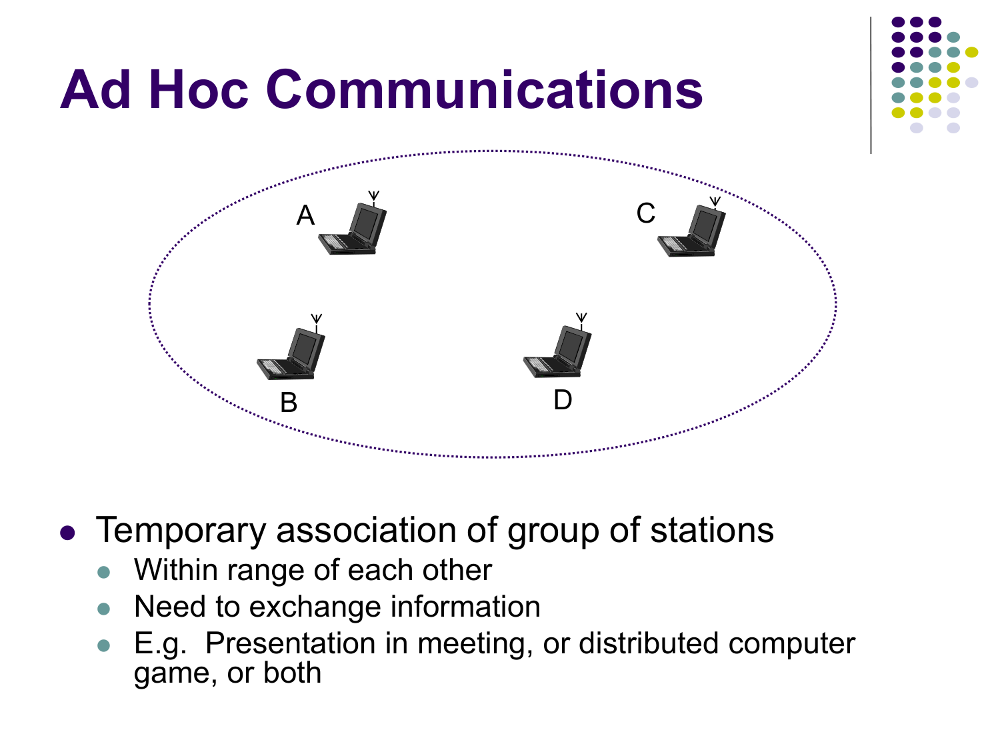

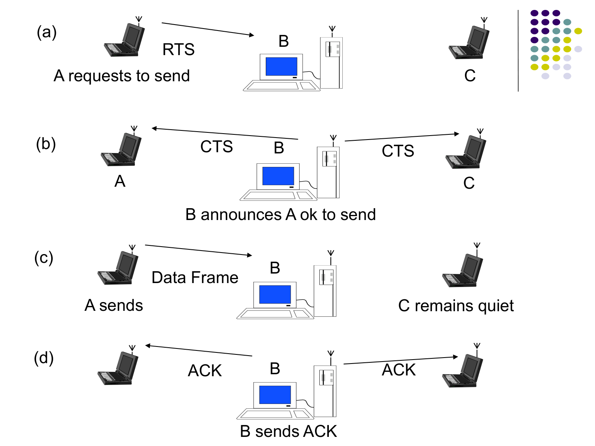

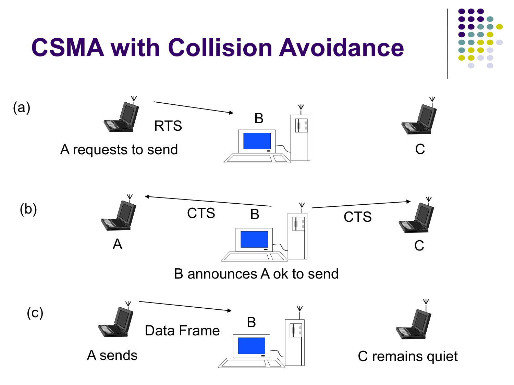

1. **Masalah Terminal Tersembunyi (*Hidden Terminal Problem*)**:
   Node A dan Node C keduanya berada dalam jangkauan Access Point B, tetapi Node A dan C saling terhalang dinding sehingga tidak dapat mendengar sinyal satu sama lain. Keduanya mengira saluran kosong dan mentransmisikan data bersamaan ke B $\to$ tabrakan hebat di Access Point B!
2. **Solusi Handshaking RTS/CTS**:
   - Node A mengirim frame kendali pendek **RTS (*Request to Send*)** ke AP.
   - AP membalas dengan siaran frame **CTS (*Clear to Send*)** yang didengar oleh seluruh stasiun di sekitarnya.
   - Node C yang mendengar CTS langsung menahan diri dari transmisi dan menyetel pewaktu **NAV (*Network Allocation Vector*)** virtual hingga transmisi Node A tuntas.
3. **Mekanisme Interframe Spaces (IFS)**:
   - **SIFS (*Short IFS*)**: Jeda waktu terpendek untuk pesan berprioritas tinggi (ACK, CTS).
   - **DIFS (*Distributed IFS*)**: Jeda waktu tunggu standar sebelum stasiun boleh bersaing memperebutkan saluran data.

---

## 4. Protokol Akses Terjadwal (Controlled Access): Token Ring & FDDI

Menghilangkan tabrakan sama sekali menggunakan mekanisme peredaran hak akses terpusat atau melingkar.

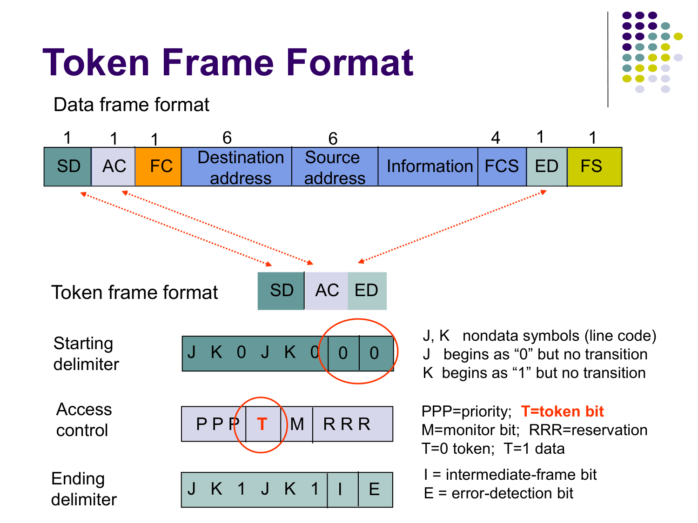

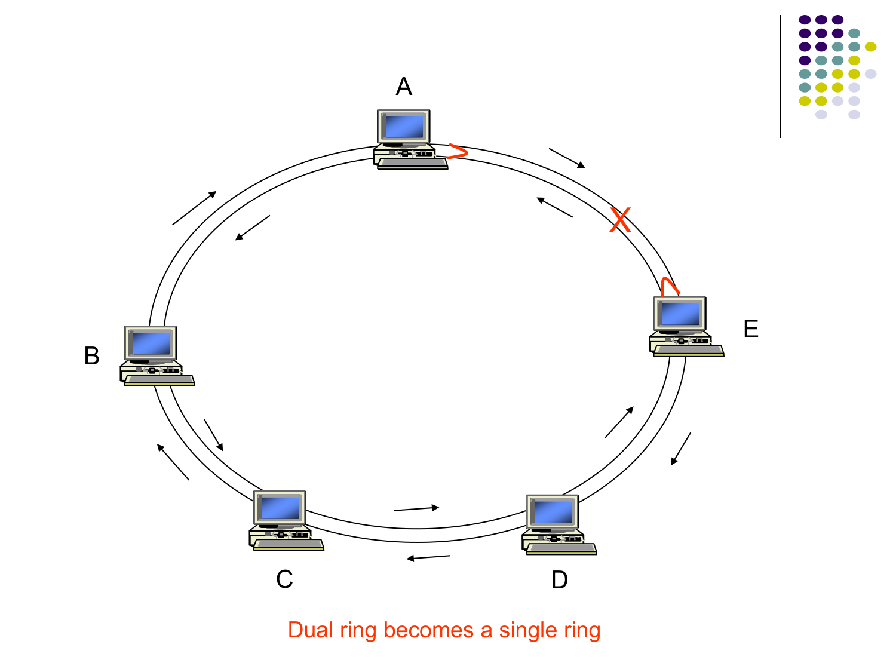

1. **Token Ring (IEEE 802.5)**:
   - Sebuah paket kecil khusus 3-byte (**Token**) diedarkan melingkar dari satu stasiun ke stasiun berikutnya dalam topologi cincin.
   - Stasiun yang ingin mengirim data harus menangkap token bebas tersebut, mengubah salah satu bit token menjadi frame data, menambahkan data pengguna, lalu meneruskannya ke stasiun tetangga.
   - Frame data mengitari cincin hingga dibaca oleh stasiun tujuan, lalu kembali ke stasiun pengirim awal yang bertugas membuang frame tersebut (*stripping*) dan melepaskan token baru ke jaringan.
2. **FDDI (*Fiber Distributed Data Interface*)**:
   - Standar LAN serat optik 100 Mbps berbasis **Dual Ring (Primary Ring dan Secondary Ring)**.
   - Memiliki kemampuan restorasi otomatis: jika kabel serat optik fisik terputus di satu titik, kedua cincin akan secara otomatis disambungkan (*wrap-around*) di kedua ujung stasiun yang rusak membentuk cincin tunggal tertutup yang utuh kembali.

---

## 5. Standar Ethernet (IEEE 802.3)

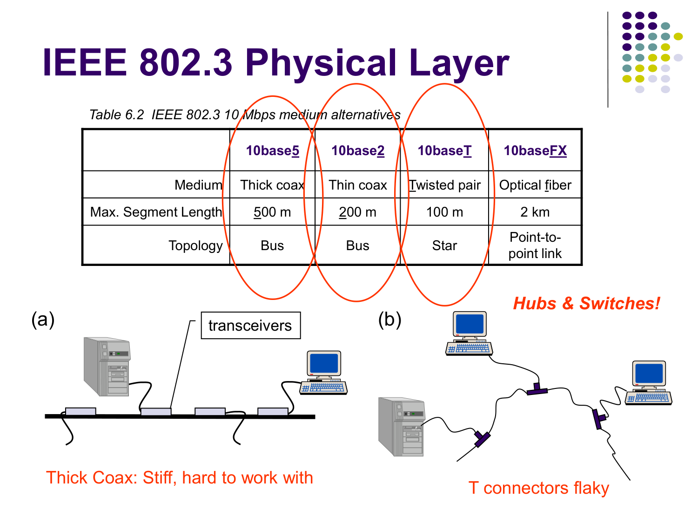

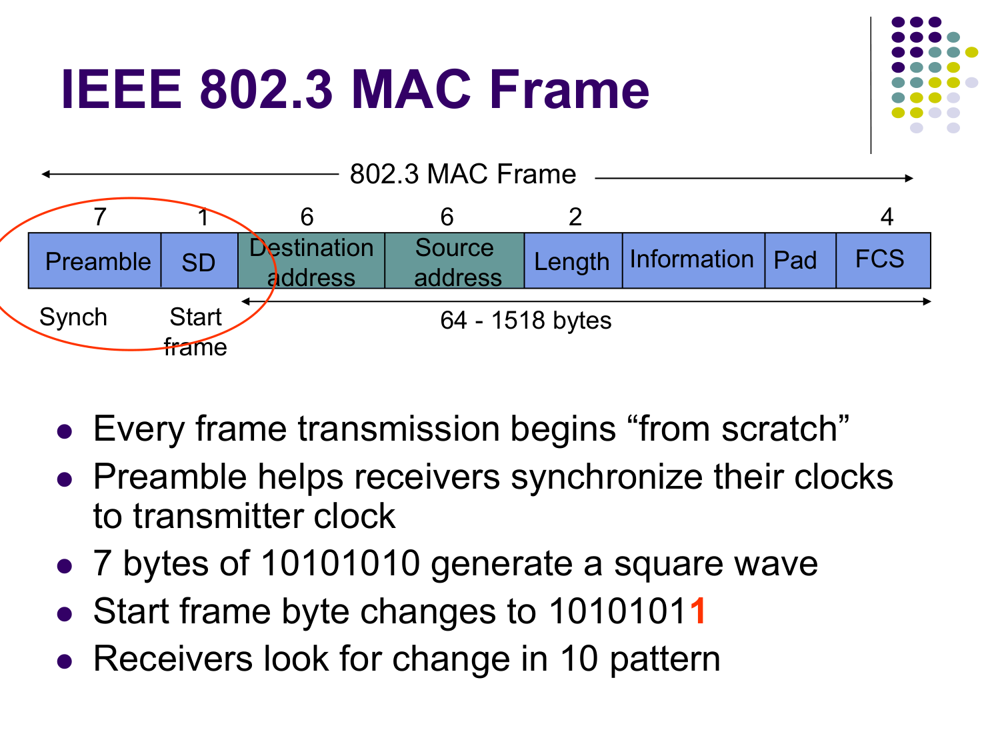

### Format Frame Standar Ethernet IEEE 802.3:

```text
+----------+-----+-----------+------------+----------+--------------+---------+
| Preamble | SFD | Dest MAC  | Source MAC | Len/Type | Data Payload | CRC FCS |
|  7 Byte  | 1 B |  6 Byte   |   6 Byte   |  2 Byte  | 46-1500 Byte | 4 Byte  |
+----------+-----+-----------+------------+----------+--------------+---------+
```

1. **Preamble (7 Byte)**: Pola bolak-balik `10101010` untuk sinkronisasi clock penerima.
2. **SFD (*Start Frame Delimiter* - 1 Byte)**: Pola `10101011` penanda awal frame data.
3. **Destination & Source MAC Address (masing-masing 6 Byte / 48 bit)**:
   - 24 bit pertama: **OUI (*Organizationally Unique Identifier*)** kode identitas pabrikan kartu jaringan terdaftar di IEEE.
   - 24 bit terakhir: Nomor seri kartu (*Device Identifier*).
   - Ditulis dalam notasi heksadesimal: `00:1A:2B:3C:4D:5E`.
4. **Length / Type (2 Byte)**:
   - Jika bernilai $\le 1500$ desimal: Menunjukkan panjang byte muatan (*IEEE 802.3 Length*).
   - Jika bernilai $\ge 1536$ (`0x0600`): Menunjukkan kode tipe protokol lapisan atas (*Ethernet II / DIX Type*, misal: `0x0800` untuk IPv4, `0x0806` untuk ARP).
5. **Data Payload (46 s/d 1500 Byte)**: Muatan paket IP dari Network Layer (MTU standar Internet = 1500 byte).
6. **FCS (*Frame Check Sequence* - 4 Byte)**: Nilai sisa pembagian polinomial CRC-32 untuk verifikasi integritas frame bebas kesalahan.

> [!important] Ukuran Frame Minimum dan Maksimum Ethernet
> - **Ukuran Minimum Frame**: $6 + 6 + 2 + 46 + 4 = \mathbf{64 \text{ Byte}}$ (tanpa menghitung preamble).
> - **Ukuran Maksimum Frame**: $6 + 6 + 2 + 1500 + 4 = \mathbf{1518 \text{ Byte}}$ (tanpa menghitung preamble).

---

## 6. Jembatan Jaringan (Bridges), Spanning Tree Protocol (STP), dan VLAN

Ketika jaringan LAN berkembang besar, segmentasi menjadi keharusan untuk memecah **Collision Domain** dan **Broadcast Domain**.

### A. Algoritma Pembelajaran Mandiri Jembatan (Self-Learning Transparent Bridge / Switch)

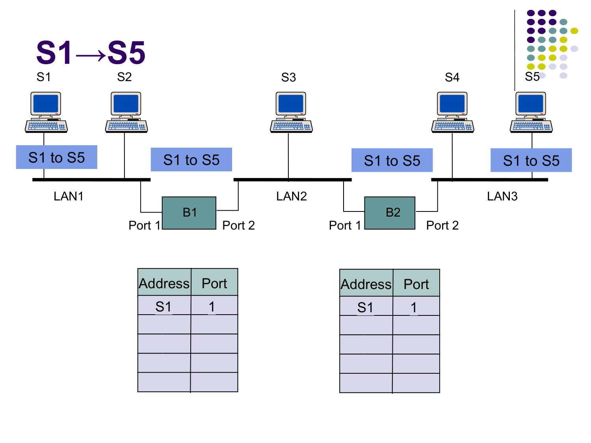

Switch bekerja pada Lapisan 2 (Data Link) dan membangun **Forwarding Table (MAC Address Table)** secara otomatis melalui teknik **Backward Learning**:
1. Setiap kali sebuah frame tiba di salah satu port switch, switch membaca **Source MAC Address** frame tersebut dan mencatat pasangan:
   $$\text{Tabel} \gets (\text{Source MAC Address}, \text{Nomor Port Kedatangan}, \text{Waktu})$$
2. Switch memeriksa **Destination MAC Address**:
   - Jika Destination MAC sudah terdaftar di tabel pada port yang berbeda: Switch langsung meneruskan frame **hanya ke port tujuan tersebut (*Forwarding / Filtering*)**.
   - Jika Destination MAC terdaftar di port yang sama dengan port kedatangan: Switch langsung membuang frame tersebut (*Drop / Filter*).
   - Jika Destination MAC belum dikenal atau berupa alamat broadcast (`FF:FF:FF:FF:FF:FF`): Switch meneruskan frame ke **seluruh port aktif lainnya kecuali port asal (*Flooding*)**.

---

### B. Spanning Tree Protocol (STP - IEEE 802.1D)
Untuk mencegah titik kegagalan tunggal (*SPOF*), administrator jaringan sering memasang kabel tautan redundan antar switch. Namun, tautan fisik yang melingkar (*loop*) akan memicu bencana **Badai Broadcast (*Broadcast Storm*)** dan instabilitas tabel MAC switch.

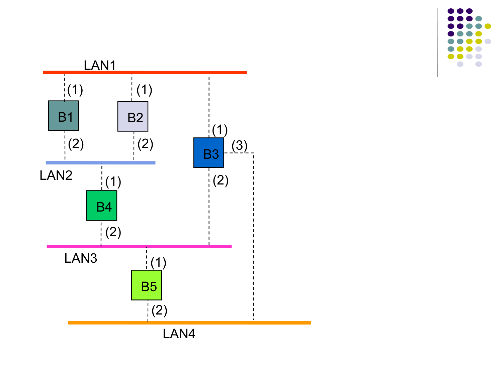

> [!important] Cara Kerja Algoritma Spanning Tree (Radia Perlman)
> STP secara dinamis menonaktifkan (*memblokir*) port-port tautan redundan sehingga topologi jaringan yang memiliki sirkuit melingkar diubah menjadi topologi pohon bebas loop (*Loop-Free Spanning Tree*):
> 1. **Pemilihan Root Bridge**: Switch dengan **Bridge ID (Prioritas + MAC Address)** terendah dinobatkan sebagai *Root Bridge*.
> 2. **Pemilihan Root Port (RP)**: Setiap switch non-root memilih satu port dengan biaya jalur akumulatif terendah (*Lowest Path Cost*) menuju Root Bridge.
> 3. **Pemilihan Designated Port (DP)**: Di setiap segmen tautan LAN bersama, satu port dipilih sebagai *Designated Port* untuk meneruskan paket.
> 4. **Blocking State**: Seluruh port lainnya disetel ke status **Blocking / Alternate**. Port ini tidak meneruskan data, tetapi siap aktif secara otomatis jika tautan utama putus (*failover*).

---

### C. Virtual LAN (VLAN - IEEE 802.1Q)

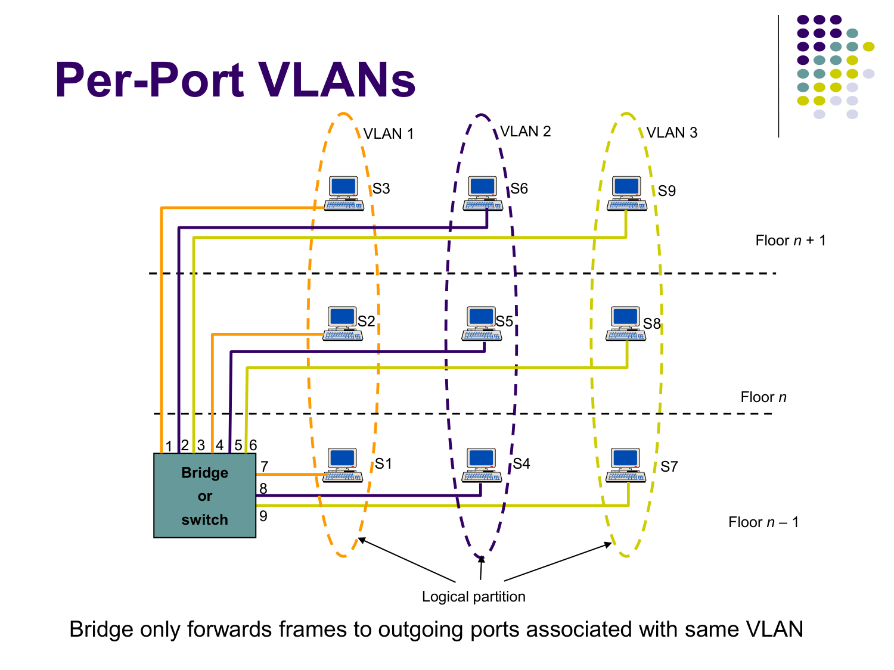

- **VLAN** membagi satu switch fisik tunggal menjadi beberapa domain siaran logis (*Broadcast Domains*) yang terisolasi secara aman.
- Komputer yang berada di VLAN berbeda (misal: VLAN Mahasiswa dan VLAN Dosen) tidak dapat saling berkomunikasi secara langsung pada Lapisan 2, meskipun dicolokkan ke switch fisik yang sama; komunikasi antar-VLAN wajib melewati Router / Layer 3 Switch (*Inter-VLAN Routing*).
- **Trunking (IEEE 802.1Q Tagging)**: Menghubungkan beberapa switch dengan menyisipkan **Tag VLAN 4-Byte** tambahan ke dalam header frame Ethernet, yang memuat **VLAN ID (12-bit)** yang mengidentifikasi kepemilikan subnet paket tersebut (mendukung hingga 4096 VLAN unik).
